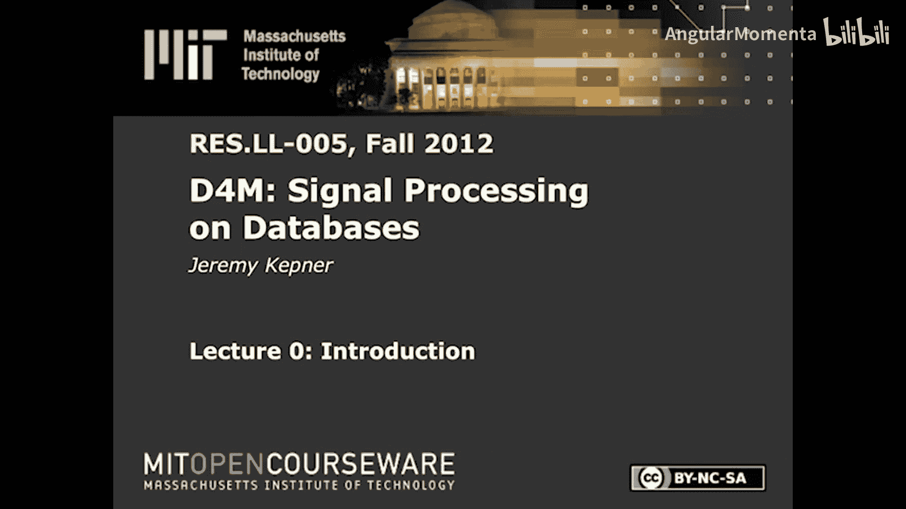
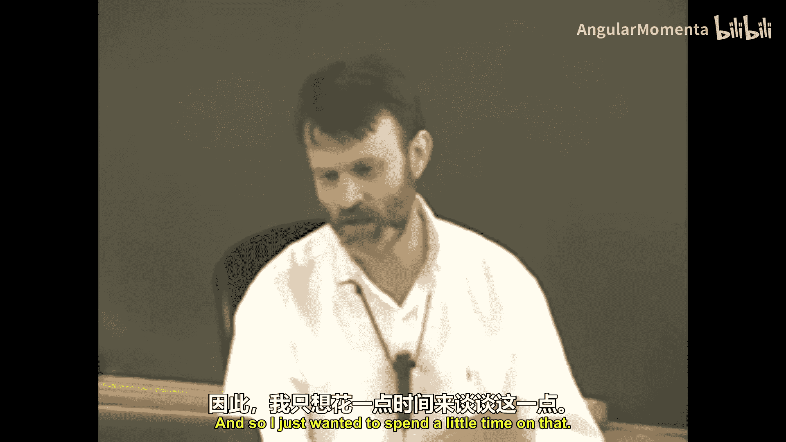
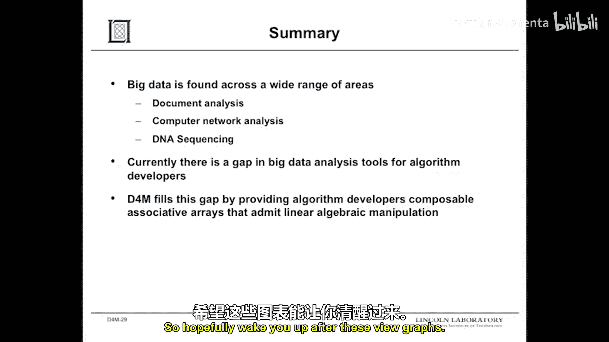

# 002：引言 🎓

在本节课中，我们将要学习一门名为“数据库信号处理”的课程。这门课程旨在将信号处理、检测理论和线性代数的数学工具，应用于处理由文本、字符串和关系构成的新型数据领域。我们将探索如何利用这些强大的数学框架来分析图数据、社交网络、网络流量等非传统数值数据。

---

以下内容在知识共享许可协议下提供。您的支持将帮助麻省理工开放课程持续提供高质量的免费教育资源。如需捐款或查看来自数百门麻省理工课程的其他材料，请访问 ocw.mit.edu。

欢迎各位。很高兴今天在这里见到大家，这是九讲课程的第一讲。这门课程名为“数据库信号处理”。今天对我来说是非常特殊的一天，因为这标志着我过去几十年、特别是近三四年深入研究的一项技术迈出了重要一步。我们希望这门课程所介绍的技术未来能被广泛使用。

这是一门关于全新技术的独特课程。因此，我要感谢你们成为这门课程的“首批体验者”。开设一门现有主题的新课程已属不易，而开设一门全新主题的课程则更具挑战。我们将尝试一些不同的方法，某些主题会从多个角度进行讲解，我们会观察哪些方式对你们最有效。

首先，我想谈谈课程标题，它有些与众不同。标题是“数据库信号处理”，这通常不是两个会联系在一起的短语。信号处理，众所周知，是我们在林肯实验室所做技术的核心之一。数学上，信号处理的核心是检测理论：如何在给定数据集中寻找目标，如何排除非目标并找到目标。而检测理论的数学核心是线性代数。这门技术正是为你们设计的，因为它假定你们具备线性代数基础，而这并非如想象中那么普遍。

第二个短语是“数据库”。我们想到数据库时，通常会想到网络搜索、文本等。这类数据与我们思考信号处理、检测理论和线性代数时想到的数学（如实数、矩阵）并不完全一致。我们在这里所做的，正是将这套数学工具与一个全新的数据分支（单词、字符串和关系）连接起来。这是本课程的核心创新点：我们将运用我们熟知的强大工具，尝试应用于这个对我们日益重要的新领域。这就是标题的由来。

---

有众多人士为这项工作做出了贡献。这张幻灯片列出了我能记起的人员名单，无疑我可能遗漏了某些重要人物，我为此表示歉意。但毫无疑问，这个团队的所有成员都对推动这项技术发展起到了重要作用。

---

以下是本讲的提纲，这也将是大多数课程的基本节奏：首先是通过PPT讲解介绍概念（抱歉，我们知道大家已经看了很多PPT），然后会进行演示，展示实际可用的代码（这些代码现在已可在你们的Lgrid账户中找到，部分代码甚至会成为作业的一部分）。因此，课程风格将是先讲解幻灯片，短暂休息后，再进行示例演示和讨论。

---

让我谈谈我们今天将要介绍的技术能够处理的一些数据类型。它使我们能够处理与关系相关的数据，特别是那些由图表示的关系。例如，车辆轨迹代表了位置之间的关系；社交网络代表了人与人之间的关系；网络领域则代表了计算机、网络服务器之间的通信关系。这些都是对我们非常重要的领域。

为了让大家了解我们为何关注此技术以及它能做什么，我将介绍一些我们使用该技术完成的、令人兴奋的实际案例。课程中也会有类似的示例，展示这项技术如何产生实际影响。我们首先要讨论的是在网络领域所做的一些工作。

---

这是一个数据集的示例，它是一个表示网络流量的图。这里可以看到源IP地址（可以想象为某个域内部的计算机）和目的IP地址（它们所访问的网络服务器）。图中绿色的点，在图论中有时被称为二分图，基本上是两组互相关联但组内无连接的顶点。图中这些淡蓝色的线就是实际的连接，显示了哪些计算机连接到哪些计算机。显然，网络流量数据量巨大，这张图显示了90分钟的数据。在这个特定案例中，数据集中实际上存在我们试图检测的恶意活动。

---

在处理此类数据集时，最大的挑战之一是数据表示。在数据库术语中，这有时被称为模式。如何表示数据通常是解决问题的关键。鉴于我们想使用图技术，我们发现数据几乎从不会以适合图的格式直接提供，因此我们必须经历许多步骤。使用这项技术时，它几乎总是从原始数据到数据分析再到查询的流水线中的一个环节。你们将希望为流水线的不同阶段使用不同的技术和工具。我们绝不试图暗示我们所讨论的技术是唯一的工具，它们只是重要的一环，但你们始终是在一个流水线的背景下工作。

这张图展示了我们通常在此类工作中利用的技术栈。我们的最终目标是进行图分析。本课程将重点讨论高级语言，它们能让你轻松地进行图分析，并桥接数据库本身和你所需的高性能计算。因此，不仅软件和数据有流水线，技术也有一个栈。解决此类问题时，通常从一个点开始，但在构建系统时，几乎总会涉及其他类型的技术。

以上只是一个快速概述和示例，我不期望大家完全理解。这个初步示例可能引发了更多疑问：到底如何实现？现在，我将稍微转变方向，真正谈谈这门课程的内容。我将从宏观角度谈谈这门课程。我一直认为，每门课程都应该告诉你，为什么它是你职业生涯中最重要的课程。当然，每门课你都能找到理由，但人们通常不会这么说。所以我要告诉你为什么这门课是最重要的。当然，每门课都是最重要的，但我要说说这门课的特殊之处。

退一步讲，我们都是麻省理工的一部分。麻省理工是地球上排名第一的理工科大学，这是任何合理衡量标准下的客观事实。麻省理工在过去60年取得了令人难以置信的成功，根本原因在于它认识到，做出发现的公式是理论与实验的结合。作为一个组织，我们实际上就是围绕这个公式组织的：理论部分由各院系负责，通常涉及数学；实验部分则是我们进行的研究，其核心是测量，也就是数据，通常以比特的形式存在。因此，实施麻省理工的这个公式，通常归结为在计算机中将软件和比特结合起来。这就是我们将这两个想法融合的地方，我认为这非常重要。

那么，我们用什么工具、什么机器来将它们结合起来呢？是计算机。如今，计算机比我们过去想象的要复杂得多。我们过去通常认为它们是冯·诺依曼机器，意味着有数据和操作（字节和软件），字节进入计算机的一部分，被操作，然后输出。这个模型在高层面上仍然成立，但我们现在处理的计算机要复杂得多。左边是一个标准的并行计算机，如今几乎每台计算机都类似这样：有处理器、内存、某种持久存储，以及连接它们的网络。这形成了一个非常复杂的内存层次结构，从顶部的寄存器开始，然后是缓存、本地内存、远程内存，最后是存储。这个层次结构有很多含义：带宽朝这个方向增加，延迟降低；可编程性通常增加（越近越无需担心）；数据容量则朝这个方向减少。所有现代计算机都是具有多级内存层次的冯·诺依曼架构。从根本上说，你必须知道，这种架构决定了你使用的算法。如果算法不能在这种架构上良好运行，你可能就不会实现它们。因此，必须非常清楚算法相对于此架构的适应性。

---

本课程的目标是教授能让你更快完成工作的技术。这是一张相当复杂的图，但它展示了：给定一个你想解决的问题，如果使用不同的技术来实现，这些技术的性能如何。在某种意义上，你可以将此视为解决问题所需编写的代码量，我们以实现C语言程序作为参考点。如果你使用汇编或Java MapReduce等，最终会编写更多代码；如果你使用C++、Java或Matlab等，编写的代码则更少。同时，这张图也显示了相对性能：在汇编等低级环境中，可以获得更高性能；在Matlab等高级环境中，性能则较低。这是一个相当普遍的权衡空间。我们在这里添加了并行编程模型（有多种类型：直接内存访问、消息传递、管理者-工作者或MapReduce风格等）。我们希望达到的目标是：付出更少努力，获得更高性能。因此，本课程将主要关注Matlab和我们称为D4M的技术。D4M是一种软件组合，能让你以相对较少的努力获得较好的性能。这就是本课程的全部内容：如果你处理这类问题，有合适的工具，使用合适的工具将花费更少时间。我们将尝试教授这些工具及其工作原理。

这里有一点“诱饵调包”的意味：课程名为“数据库信号处理”，但我们要到最后才真正讲到数据库。原因是，数据库只擅长解决一类问题，而且通常是在最后阶段才真正需要用到数据库。为了理解这一点，我们有多种不同的方式用算法解决问题：我们可以只使用单台计算机的内存；可以使用多台计算机的内存；可以使用磁盘或存储，甚至使用多个磁盘。随着我们朝这个方向推进，我们可以处理越来越多、越来越多的数据。但真正重要的是，回到之前那张图：当我处理这些数据时，所需的块大小是多少？如果我需要以非常小的块获取数据，那么将数据放在内存中显然是最有效的方式。同样，如果我们决定需要处理更多数据，可以转向并行程序以获得更多内存，或者使用文件中的数据。我们可以将数据写入文件，读入、处理再写出，这种模型非常有效。特别是如果我们以大数据块访问数据，这种模型效果很好。对于非常大的数据集，我们甚至可以并行写入文件来处理极大问题。最后，我们才会回到需要数据库的情况：当我们有大量数据，但只想访问其中一小部分时（例如查找某些内容），这时才真正需要数据库。除非数据只能通过数据库访问，否则你应遵循这条路径：从串行程序内存开始，可能转向使用文件的并行程序，数据库几乎是最后的手段，因为它增加了大量复杂性。虽然它能更快地查找内容，但如果你需要遍历数据的很大一部分，你会发现它实际上比使用文件要慢得多。我们将向你展示技术，遵循这条路径，希望到最后你会明白：是的，我知道在这些情况下会使用数据库，但我意识到我可以用其他技术完成大部分工作，而且效果很好。因此，你将学到我们所谓的“快速路径”。

如果你想达到一定的性能水平，但没有或只有很少相关培训，通常会走这条路：开始使用一项技术，程序会暂时变慢，你可能会在网上苦苦挣扎几天，最终回到起点，然后慢慢爬升到某个性能水平，这可能需要几周时间。我们一次又一次地观察到这种现象。通常，人们会在这里放弃，并说这项技术对他们无效。本课程的目的就是给你专家所掌握的技术。专家可以使用这项技术，知道如何正确使用，然后走上这条路径：在几小时内就能获得良好性能，如果他们真的想达到更高水平，可以再花几天时间。这就是我们的整体理念。

---

本课程将引入一些新概念，这些概念你可能在其他课程中未曾遇到过。我们将大量讨论图。标准的图论或计算机科学课程中讨论的图，通常侧重于无向、无权图。图是一组顶点和边。无向无权意味着所有边都是相同的，边要么存在要么不存在，类似于0或1，并且连接没有方向性。大多数图论课程都基于此。然而，在现实世界中，我从未遇到过这种图。事实上，另一个常见概念是Erdős–Rényi图（随机连接图），我在现实世界中也从未遇到过。因此，当我们现在拥有所有这些数据并将理论与数据对比时，我们发现现有理论有所欠缺，它并不是进入数据领域的良好基石。我们看到真实数据并非随机，通常遵循幂律分布（某些顶点非常受欢迎，而大多数顶点连接很少）。边通常是有向的（例如，我加你为好友与你加我为好友意义不同）。边本身通常有权重（可以是数值、单词等）。通常可以有多个边（例如，我可以发送多个好友请求）。可能最重要的是，边通常是“超边”，这个概念在图论中几乎从未涉及，但非常重要：一条边可以同时连接多个顶点。一个典型例子是发送给多个人的电子邮件。实际上，如今大多数电子邮件都有多个收件人。一封发送给全班所有人的电子邮件就是一条超边，它连接了我与所有收件人。这与我单独给每个人发送电子邮件（标准边）非常不同。因此，我们将超越图的标准定义，这将是本课程的难点。我们还将处理线性代数的更广泛定义。传统线性代数处理具有行索引和列索引的矩阵，其值为实数、整数或复数。但我们将处理字符串等，将线性代数应用于单词等领域。这将是不同的。实际上，这可能是我最喜欢的部分，尽管可能会让你们昏昏欲睡。我们还将扩展处理的定义。在这个领域，你会听到很多流行技术，比如Hadoop及其MapReduce并行编程范式。这是一项让初学者入门的好技术。但对于具备我们这种数学素养的人来说，我们可以使用更好的编程模型。如果你理解数学到我们这个程度，我们可以为你提供并行计算机的编程工具，这些工具比那些为不具备线性代数背景的人设计的技术更高效（编写更少代码，获得更好性能）。这将是本课程的基础。

---

让我继续介绍课程大纲。这基本上是九讲课程的安排。我们现在是引言部分，回顾课程和目标。下一讲将真正讨论“关联数组”这个概念，这是将所有内容整合在一起的核心技术。当我谈到将线性代数扩展到单词时，会使用一种称为模糊代数的数学概念，这涉及到称为群论的抽象代数概念。它并不像听起来那么可怕，实际上相当优雅，了解它很有好处。了解当我们使用关联数组技术时，我们已经思考了这些事物如何协同工作的数学原理，这很重要。当我们添加一个功能时，通常是因为它在数学上合理；当我们不添加时，通常是因为某些请求可能导致不良后果。然后，我们将进入课程的核心部分，展示如何分析非结构化数据。在分析非结构化数据时，我们会讨论幂律，并有一整讲关于幂律数据建模。我们还有一讲关于互相关。最后两讲将真正深入并行处理和数据库。最后两讲甚至不会完全是讲座，而主要是演示，因为我们将把许多内容整合在一起，并带你浏览代码示例。我们需要花些时间带你浏览，因为你会看到我们讨论的所有想法在这些代码示例中汇聚。软件中已有所有讲座材料（在你的Lgrid账户中），我认为有第0讲到第7讲（第7讲是第八讲），然后第9讲将主要是浏览示例。

---

我们坚信从线性代数角度看待图这一理念，甚至为此写了一本书。你们都已获赠这本书的副本。这本书阐述了如果你使用这些技术思考图所带来的理念和力量。我强烈鼓励你翻阅它，本课程的某些部分几乎直接取自这本书，但很多是补充材料。你会发现，本课程实际上是通往这些技术的桥梁：它让你能够从混乱的非结构化单词和其他类型的数据出发，然后将它们放入这种良好的线性代数格式，从而应用书中描述的技术。因此，这几乎是一座桥梁，我当然鼓励你阅读它，并随时向我提问。

---

现在，我将回到最初的网络示例，更详细地讲解，并可能强调一些我已经谈过的事情。这是一个非常标准的数据处理流水线：我们有原始数据（本例中是网络数据），这是一系列记录。我们需要将其转换为一组顶点和边，然后从中进行图分析和图算法。通常，你需要编写解析器，将数据从某种原始格式转换为处理链下一步的格式，然后将这些边列表转换为邻接矩阵，这是我们看待图的方式。关于邻接矩阵，让我回到这里。

对于不了解的人，这是一个图：一组顶点和边。这是该图的邻接矩阵。基本上，每一行是一个顶点，每一列是一个顶点。如果边存在，我们就在这里放一个点。图论与线性代数之间存在形式上的对偶性。图论的基本操作是广度优先搜索（BFS）：给定一个起始顶点，遍历其边到邻居。这里也有同样的操作：给定一个起始顶点向量，我们进行矩阵乘法来识别邻居。因此，在最根本的层面上，图论和线性代数是相连的，因为图论的基本操作是广度优先搜索，而线性代数的基本操作是向量-矩阵乘法。

---

我们希望形成这些邻接矩阵，以便利用这种联系。这里更详细地展示了我们将如何使用D4M技术来实现：我们有原始数据，将其转换为CSV文件（逗号分隔值文件，是电子表格和表格的默认格式，近年来变得非常流行）。然后，我们使用D4M技术读取这些CSV文件，将其插入分布式数据库。接着，我们可以查询该分布式数据库以获取关联数组。现在，从关联数组出发，我们拥有进行图算法的全部能力。因此，D4M真正帮助你在准备阶段（为进行图算法铺平道路）完成这些步骤。你甚至可以在完全不使用D4M的情况下进行图算法，只需在Matlab中使用常规线性代数操作即可。但D4M是连接器。事实上，我强烈建议人们只在D4M擅长的部分使用它，而在其他部分使用其他技术（如Matlab普通矩阵等）。这样你会获得更好的性能，对我来说也很好，因为如果你有问题，会去麻烦别人而不是我们，这对大家都有好处。

---

这是一个示例，展示了这看起来像什么。这是我们从数据中获取的代理日志，本质上是一个网络日志。我们首先要做的就是将其转换为CSV。基本上，每个条目获得一列，我们有一个实际条目的ID（本例中是源IP、服务器IP、时间戳），以及与之关联的实际文本行。这可以有很多列。如果你是标准的数据库人员（使用SQL，这是标准数据库语言），你可能会直接将这些数据制成具有这些列的表并插入。但我们发现，当你想快速查找数据，或者想以极高速度插入大量数据并仍能快速查找任何IP地址或时间戳时，挑战就出现了。SQL可能提供良好性能，但有些数据库和技术能提供更好的性能。这些数据库被称为三元组存储，因为它们将所有数据存储为三元组（行、列和关联值）。因此，我们做的是：获取我们的密集数据，并创建一个我们称之为“展开表”的结构。本质上，我们获取日志ID，附加列名及其值。我们称之为展开表。如果你像我一样是SQL老手，这种模式会立即让你感到不适甚至过敏，因为你创建了数量巨大的列。在SQL中，你可以动态创建列，但数据库保留在需要时重新复制和重新格式化整个表的权利。而三元组存储没有这个要求，它们只存储非零条目，因此无论你有多少列（十亿行、百亿列）都完全没问题。这是一个强大的特性。

但仅凭这个模式本身，对你绝对没有好处，你只是让事情变得更难了。因为大多数数据库系统（包括三元组存储）都有其取向：行取向或列取向。我们讨论的数据库几乎总是行取向的，这意味着它们可以在恒定时间内获取一行（给定行键），并快速返回给你。它们被设计为即使以每秒数百万条的速度插入数据，仍能在毫秒级查找内容，这是非常强大的技术。但到目前为止，我们只是让数据的输出格式变得奇怪，增加了难度。那么，回报在哪里呢？我们还存储了表的转置。对于熟悉稀疏线性代数的人来说，这是一个古老的技术：我们几乎总是存储矩阵A和它的转置A^T，因为某些操作在转置上更快，某些操作在原矩阵上更快。我们在这里做完全相同的事情。结合我们的展开模式，现在每个列都成了一行。通过一个简单的两表模式，我们索引了数据库中每个字符串。这并不是说你所有的数据库都只有两个表，但可能是三个或四个表，这相比标准数据库模式（可能有几十甚至上百个表）是巨大的简化。本质上，这是一个“一统天下”的模式：一个表及其配对表，你就索引了所有内容。代价是存储空间翻倍。但如果你问任何数据库人员：用存储空间翻倍的代价，换取对数据库中每个字符串的快速索引访问，他们百分之百会接受这个交易。这就是这项技术的威力：你可以引用巨大的数据集。随着我们深入学习关联数组，我们将反复回到这个模式，但这就是其背后的逻辑。到最后，你会明白我们这样做有充分的理由。

---

现在，我们已经将数据摄取到数据库中，可以进行查询了。如果我有一个表的绑定，D4M技术中一个很好的特性是：如果你使用一个表及其转置，我们会完全向你隐藏这一点。如果你向表中插入数据，它会自动插入转置；如果你按行查找，它会知道使用一个表；如果你按列查找，它会知道使用另一个表。这里我们进行了一个范围查询：给我这个时间范围内的所有数据（大约三小时窗口）。这是一个数据库查询，它返回一个关联数组的键。然后，我获取这些键对应的行（基本上我找到了特定时间戳内的每一行），现在我想获取整行数据，所以我将行键传回表中以获取实际数据。现在我得到了整行数据：服务器IP等完整列表。接下来，我要做一点代数运算：我想创建源IP和服务器IP的图。我通过这个相关性操作来实现，本质上是一个矩阵乘法。就这样，我从这个时间窗口的所有数据中构建了整个源IP-服务器IP图。这就是D4M的威力：它允许你对此类数据进行相关性分析，就像我们在线性代数中使用传统技术进行相关性分析一样。你可能会想：哇，这太有启发性了。在示例中，我们将深入探讨具体如何操作以及其工作原理，但这确实是人们使用D4M的目的：达到能够进行此类操作的阶段。检测理论的关键在于进行相关性分析。相关性让我们能够确定数据的背景和杂波，然后我们就可以运用我们熟知和喜爱的传统检测理论、信号处理技术等。这就是连接的具体体现。现在，我们有了一个关联数组或邻接矩阵，表示源IP及其服务器IP。我们实际上可以绘制它，这就是我们得到那张图的方式。如果我们获取这个图G的邻接矩阵，这就是它的样子，这就是我们构建它的方式，这是我们实际用来构建该图的代码。

---

继续前进，这张图展示了整个过程：我们有一整周的代理数据。这里显示了时间：大约花了两个小时进行数据摄取，大约三个小时进行这种处理。一亿条代理日志，445亿个三元组。这是大数据。这是真正的大数据。这是你可以做的事情，无论别人在做什么，你都应该能够使用这项技术在更大规模上完成。

---

这带我们来到本讲的结尾。总结一下：这类大数据存在于广泛的领域（如网络分析、DNA测序）。在人们传统上用来解决这类问题的工具与D4M这项技术之间存在差距。D4M填补了这个空白。

---

本节课中，我们一起学习了“数据库信号处理”课程的引言，了解了课程的目标、核心思想以及将要涵盖的技术概览。我们探讨了如何将线性代数和信号处理技术应用于图、文本和关系型数据，并初步了解了D4M技术在处理大规模、非结构化数据流水线中的桥梁作用。下一讲，我们将深入探讨“关联数组”这一核心概念。