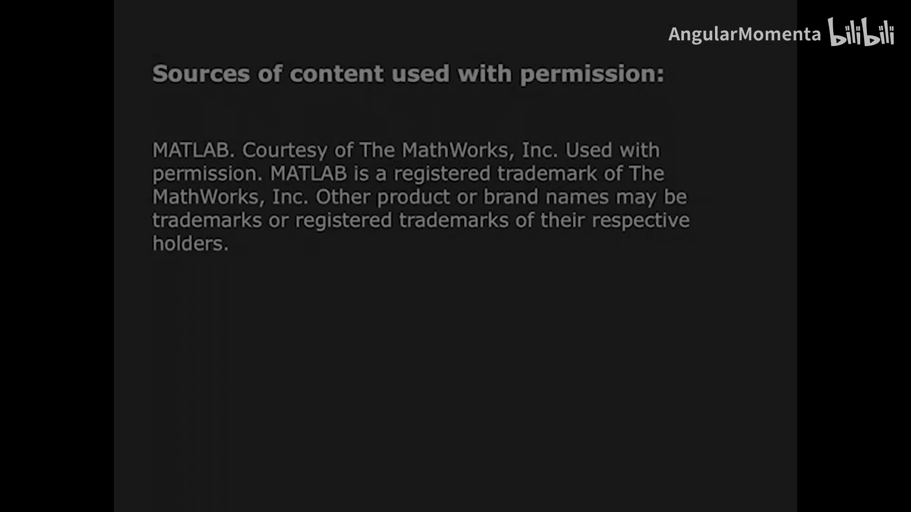

# 003：示例演示 🚀


在本节课中，我们将通过一系列示例，学习D4M（数据库、数据、数据挖掘）的基本概念和操作。我们将从设置环境开始，逐步介绍如何创建、查询和操作D4M的核心数据结构——关联数组。

## 概述

D4M的核心思想是将线性代数与字符串操作相结合，以便高效处理大规模数据。本节课将演示如何设置D4M环境，创建关联数组，进行数据查询，以及执行基本的数学运算。


---

## 1. 环境设置与验证

首先，我们需要确保D4M软件已正确安装并配置。所有软件和示例都位于您的Eleggrid账户的`toolsol`目录下。

在Matlab中，最简单的验证方法是输入`help D4M`。如果命令返回D4M所有函数的列表，说明路径设置正确。

以下是验证步骤的代码示例：
```matlab
help D4M
```

如果遇到任何问题，可以发送邮件至`gridhelp@Ldonmt.u`寻求帮助。

---

## 2. 创建关联数组

关联数组是D4M中的基本数据结构，它允许我们将行键、列键和字符串值关联起来。

在D4M中，字符串列表是一个字符行向量，其最后一个字符是分隔符。分隔符可以是逗号、分号、空格或换行符等。

以下是创建关联数组的步骤：

1.  **定义行键、列键和值**：使用字符行向量定义行键、列键和对应的值。
2.  **使用构造函数**：调用`Assoc`函数，传入行键、列键和值列表来创建关联数组。

以下是创建关联数组的代码示例：
```matlab
% 定义行键、列键和值（逗号为分隔符）
R = 'a,a,a,a,a,a,'; % 行键列表
C = 'A,A,A,A,A,A,'; % 列键列表
V = 'A-A,A-A,A-A,A-A,A-A,A-A,'; % 值列表

% 创建关联数组
A = Assoc(R, C, V);
```


创建后，可以使用`displayFull(A)`命令以表格形式查看关联数组的内容。

---

## 3. 查询关联数组

关联数组支持多种查询方式，这些查询语法与操作内存中的数组或数据库中的表基本一致。

以下是几种常见的查询操作：

*   **按行键和列键查询**：指定具体的行键和列键来获取数据。
*   **使用通配符查询**：使用通配符（如`*`）来匹配包含特定字符串的行或列。
*   **范围查询**：使用冒号（`:`）指定行或列的范围。
*   **按值查询**：根据值的字符串比较结果来筛选数据。

以下是查询操作的代码示例：
```matlab
% 获取行键为'a'和'b'的所有列
A('a,b', :);

% 获取所有包含'a'的行，以及第1到3列
A('*a*', 1:3);

% 获取所有值小于'B'的条目
A(Val < 'B');
```

需要注意的是，某些高级查询功能（如数值索引和值比较查询）可能并非在所有数据库后端都支持。

---

## 4. 对关联数组进行数学运算

关联数组不仅可以存储字符串，还可以转换为数值进行数学运算，这为数据分析提供了便利。

以下是进行数学运算的步骤：

1.  **转换为数值矩阵**：使用`double(logical(A))`或简写`dblLog(A)`将关联数组转换为0-1矩阵。
2.  **执行运算**：之后便可以像操作普通Matlab矩阵一样进行求和、转置、乘法等运算。

以下是数学运算的代码示例：
```matlab
% 将关联数组转换为数值矩阵
A_num = dblLog(A);

% 对行求和（压缩行维度）
row_sum = sum(A_num, 1);

% 对列求和（压缩列维度）
col_sum = sum(A_num, 2);

% 计算A的转置乘以A，得到共现矩阵（相关性矩阵）
corr_matrix = sqIn(A_num);
```

对于更复杂的、D4M未直接支持的运算，可以使用`adj(A)`提取内部的稀疏矩阵进行操作，完成后再用`putAdj`放回关联数组结构中。

---

## 5. 其他构造方法

除了标准的三列表构造法，关联数组还支持多种便捷的构造方式，以处理各种边界情况和快速创建特定结构。

以下是一些其他构造方法的示例：

*   **处理空输入**：如果输入为空，将返回一个空的关联数组。
*   **创建行/列向量**：通过将行键或列键指定为标量字符串，可以快速创建行向量或列向量。
*   **统一赋值**：可以为所有条目指定一个相同的数值或字符串值。

以下是其他构造方法的代码示例：
```matlab
% 快速创建行向量：所有条目属于同一行'r1'，不同列，不同数值
A_row = Assoc('r1,', 'c1,c2,c3,', [1 2 3]);

% 创建列向量：所有条目属于同一列'c1'，不同行，值统一为字符串'a'
A_col = Assoc('r1,r2,r3,', 'c1,', 'a');
```

---

## 总结

本节课我们一起学习了D4M的入门操作。我们首先完成了环境设置与验证，然后掌握了关联数组的创建方法，包括使用字符串列表定义数据。接着，我们探索了多种查询关联数组的技巧，例如按键查询、通配符匹配和范围查询。最后，我们学习了如何将关联数组转换为数值矩阵以进行数学运算，并了解了一些便捷的数组构造方法。




请将示例代码复制到您的本地目录进行练习，确保所有功能正常运行，为后续更深入的学习和实践做好准备。