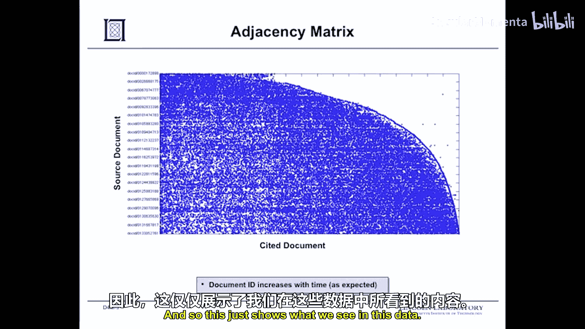
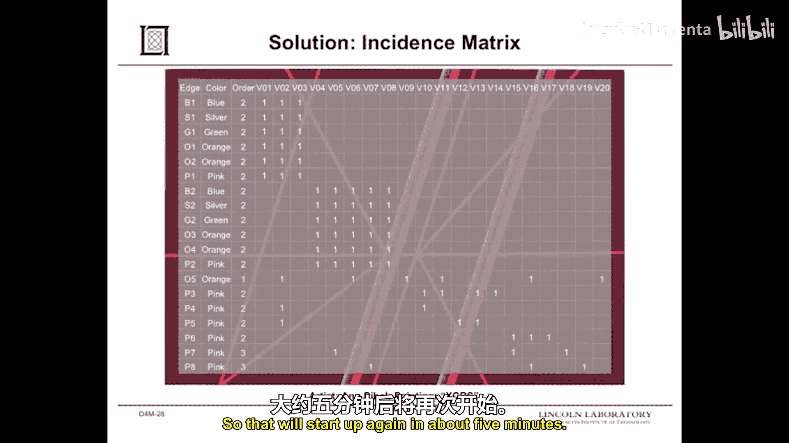

# 004：使用关联数组分析引文数据 📊


在本节课中，我们将学习如何利用D4M技术分析引文数据。我们将从原始数据出发，通过一系列步骤将其转换为便于分析的矩阵形式，并探讨如何从中提取有意义的关联信息。课程将涵盖数据处理流程、核心数据结构（关联数组与矩阵）以及从复杂数据中构建图的基本方法。

---

## 数据导入与模式设计 📥

上一节我们概述了课程目标，本节中我们来看看如何处理具体的引文数据。引文数据是学术分析中的常见例子，它结构相对清晰且易于获取。

原始数据通常以记录和列的表格形式（如SQL表）存在。我们采用一种称为“展开模式”的方法将其导入。在这种模式下，行键是原始记录，列键则由列标签和列值拼接而成。这样，每个唯一的字符串值都会拥有自己的列，从而形成一个大型稀疏结构。

将这种结构的转置也存入数据库后，我们就能以恒定时间快速查找任何字符串（如作者名、文档ID）。数据库中的值通常设为1，因为我们一般不会基于数值进行搜索（这需要遍历整个表，成本很高）。

对于数据集中较长的字段（如完整参考文献、标题、摘要），我们建议将其存储在单独的表中。这些“原始数据表”仅用于快速查阅完整内容，而不会干扰基于关键词的搜索索引。

为了支持文本分析（如关键词搜索），我们还会创建另一个表来索引标题和摘要中的所有单词及其N元语法（N-gram）。例如，单词“A”在标题中出现的位置信息会被记录。这样，我们既可以高效搜索，也可以在需要时重建原始文本。

以下是处理此类数据时常见的表结构：
*   **主表（展开模式）**：存储所有可用于搜索的字段及其关系，包含其转置以实现快速查找。
*   **原始数据表**：存储完整的、未经处理的文本字段（如摘要全文），仅用于展示。
*   **N元语法表**：存储文档中所有单词及其位置信息，用于高效的文本分析。

---

## 数据处理流程 ⚙️

将原始数据转化为可分析的数据库，需要经过一个多步骤的管道。D4M技术是这个管道中的关键一环，但并非全部。

对于一个约150GB的XML压缩数据文件，我们的处理流程如下：
1.  **接收与解压**：获取硬盘数据，解压缩XML文件（约1小时）。
2.  **解析为三元组**：使用C++等高性能语言编写解析器，将XML转换为（行键，列键，值）形式的三元组（约2小时）。对于大规模数据解析，低级语言如C/C++通常比Python或D4M本身更高效。
3.  **构建关联数组**：使用D4M将三元组读入，并在MATLAB中构建为“关联数组”数据结构（约1天）。关联数组是本节课的核心分析工具。
4.  **保存为文件**：在将数据插入数据库之前，先将关联数组保存到文件。这作为一个检查点，方便在需要重新插入数据时（例如数据库损坏）快速进行，避免了重复耗时的解析过程。
5.  **插入数据库**：将文件数据插入到我们设计好的三组数据库表中：主键表及其转置、N元语法表及其转置、原始文本表。在单个节点上，我们实现了每秒1万到10万条的插入速率。

值得注意的是，数据库擅长快速查询小部分数据，但遍历整个数据集的速度与插入速度相当。因此，如果需要对整个数据集进行分析，直接从文件系统读取保存的关联数组文件通常更快，也更容易实现并行处理。甚至对于需要反复查询同一部分数据（如3-4%的数据集）的任务，将其从数据库中查询出来并保存为文件进行后续分析，也是隔离数据库延迟、提升效率的好方法。

---

## 从关联数据到图分析 📈

我们存储数据的“展开模式”在数学上称为“关联矩阵”。在图论中，图通常可以用两种矩阵表示：邻接矩阵和关联矩阵。

*   **邻接矩阵**：行和列都代表顶点。如果两个顶点间有边，则对应矩阵元素有值。它非常适合表示简单有向图，但难以处理多边图或超边（连接多个顶点的边）。
*   **关联矩阵**：每一行代表一条边，每一列代表一个顶点。矩阵中的值表示这条边连接了哪些顶点。我们的引文数据包含丰富的连接关系（一篇文献连接着作者、机构、关键词等多个顶点），本质上是一种超边，因此更适合用关联矩阵无损地存储。

然而，我们通常的分析（如寻找合作作者）需要在顶点（如作者与作者）之间进行，这就需要从关联矩阵投影到邻接矩阵。这可以通过矩阵乘法实现。



给定关联矩阵 **E**，如果我们想分析作者之间的合作关系（即哪些作者共同出现在同一篇文献中），可以执行以下操作：
```matlab
% 假设 E 是完整的关联矩阵
E_author = E(startsWith('author::'), :); % 提取所有作者相关的行
A_coauthor = E_author' * E_author;       % 内积，得到作者-作者邻接矩阵
```
结果矩阵 **A_coauthor** 是一个对称方阵。对角线上的值表示某位作者出现的次数，非对角线上的值则表示两位作者共同出现的次数。这便构成了经典的“合著者关系图”。


同样，我们也可以分析文献之间的关联（例如，哪些文献共享相同的关键词），这通过外积形式的乘法实现：
```matlab
A_doc_shared_keyword = E_keyword * E_keyword'; % 外积，得到文档-文档邻接矩阵
```

这些“内平方”和“外平方”操作是进行分析的基础工具，它们将丰富的关联数据投影到更易处理的子空间上，尽管在此过程中会丢失一些原始信息（如具体的合作文献是哪一篇），但这是进行分析所必需的步骤。

---

## 超越传统图：处理复杂关系 🎨

传统的图论课程主要研究无向、无权重的简单图。然而，现实世界的数据关系要复杂得多。

考虑一幅由彩色线条构成的画作：
*   它包含**多种颜色的边**（信息维度）。
*   存在**多重边**（相同顶点间有多条边）。
*   包含**超边**（一条边连接多个顶点）。
*   线条的**绘制顺序**也可能包含信息。

如果使用传统简单图来表示，我们需要将超边分解为多条简单边，从而丢失了“这些边本属于同一整体”的信息。同时，边的颜色、顺序等信息也会被丢弃。

关联矩阵方法为解决此问题提供了方案。我们可以为每条边分配唯一的标签（如颜色、顺序ID），并在关联矩阵中记录每条边连接的所有顶点。这样，所有原始信息都得以保留。当需要进行特定分析时（例如，“只分析蓝色边构成的网络”），我们可以通过矩阵操作轻松地投影出相应的子图，而不会在数据存储阶段就丢失任何信息。

---

## 总结与核心要点 ✅

本节课我们一起学习了利用D4M技术分析引文数据的完整流程。

我们首先介绍了如何将原始的表格数据通过“展开模式”导入，并设计多张表来分别处理可搜索字段、原始文本和文本索引。接着，我们详细阐述了从原始XML文件到最终数据库的数据处理管道，强调了在适当环节使用文件缓存和选择合适工具（如C++用于解析）的重要性。

课程的核心是理解**关联数组**和两种矩阵表示法：**关联矩阵**（无损存储复杂关系）和**邻接矩阵**（用于实际分析）。我们通过矩阵乘法（如 **E' * E**）可以从关联矩阵投影出各种有意义的邻接矩阵（如合著者网络、文献相似度网络）。




最后，我们探讨了现实世界数据的复杂性，指出传统简单图表示的局限性，并展示了关联矩阵方法在保留多维度、多关系信息方面的强大能力。这种方法为我们处理和分析大规模、非结构化数据提供了坚实的数学和工程基础。