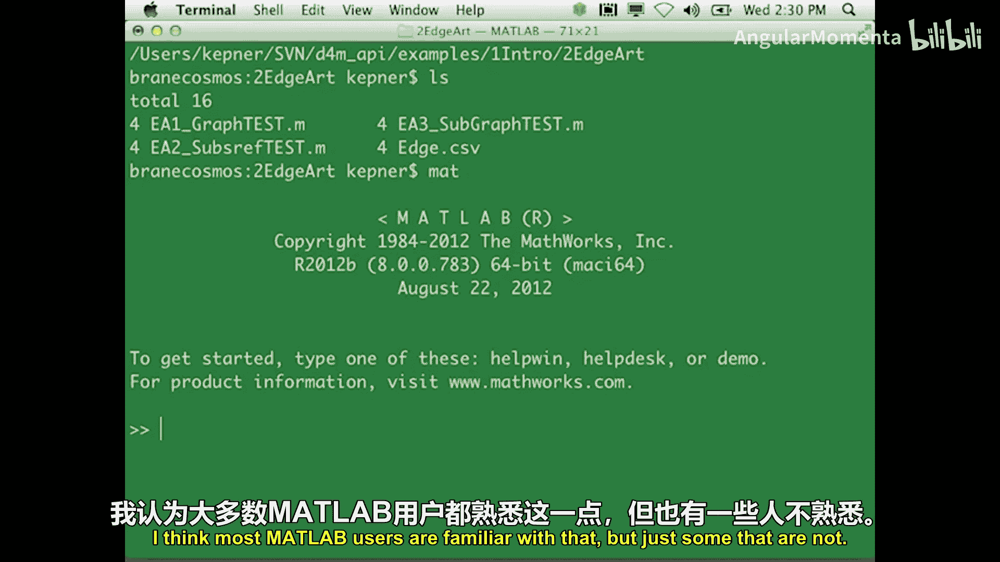

# 005：示例演示 🎨


在本节课中，我们将通过具体的代码示例，学习如何使用D4M（数据库、矩阵、数学）库进行图数据的处理和分析。我们将从一个艺术作品的关联数据入手，演示如何构建关联数组、计算邻接矩阵，并进行一些基本的图分析操作。

---

## 概述

我们将使用一个包含线条（边）和颜色（值）的艺术作品数据集。核心任务是：
1.  从CSV文件读取数据并构建关联数组（`Associative Array`）。
2.  从关联数据中提取顶点信息，构建关联矩阵。
3.  使用矩阵运算计算顶点邻接矩阵和边邻接矩阵。
4.  演示如何使用查询（如`startsWith`）和逻辑操作筛选数据。
5.  介绍一种特殊的矩阵乘法`catkeymul`，用于在关联操作中保留连接键信息。

---

## 读取数据与构建关联数组

首先，我们需要将数据加载到MATLAB环境中。我们使用`readCSV`函数来读取一个CSV格式的数据文件。这个文件包含了艺术作品中每条边（例如线条）与各个属性（如顶点、颜色、顺序）的关联关系。

```matlab
E = readCSV('art.csv');
```




执行上述代码后，变量`E`就成为了一个关联数组。我们可以使用`displayFull(E)`来查看它的完整结构。这个数组的行键（`row keys`）代表边（例如`E1`, `E2`），列键（`column keys`）代表属性（例如顶点`V1`, `V2`，颜色`color`，顺序`order`），而数组中的值则是对应的属性值（如颜色名称`green`，顺序数字`1`）。


关联数组的内部结构是经过字典序排序的，这保证了高效的数据检索和操作。

---

## 提取顶点并计算邻接矩阵

上一节我们介绍了如何构建完整的关联数组。本节中，我们来看看如何从中提取我们关心的部分——顶点数据，并进行图分析。

我们的目标是分析顶点之间的连接关系。因此，首先需要从完整的关联数组`E`中筛选出只包含顶点信息的子集。

以下是筛选顶点列并转换为数值矩阵的步骤：

```matlab
% 1. 筛选所有以‘V’开头的列（即所有顶点）
EV = E(:, startsWith('V,'));

% 2. 将逻辑值转换为双精度数值（有值处为1，无值处为0）
EV = double(logical(EV));
```

现在，`EV`是一个只包含0和1的矩阵，表示了每条边（行）包含了哪些顶点（列）。

接下来，我们可以利用这个顶点-边关联矩阵来计算顶点之间的邻接关系。两个顶点如果被同一条边连接，那么它们就是相邻的。这可以通过矩阵的“内积”运算来实现。

```matlab
% 计算顶点邻接矩阵：A = EV^T * EV
A_vertex = sqIn(EV);
displayFull(A_vertex);
```

运算结果`A_vertex`是一个对称矩阵。矩阵中`(i, j)`位置的值表示顶点`i`和顶点`j`共同出现在同一条边上的次数。值为0表示两个顶点没有直接连接。由于超边（一条边连接多个顶点）的存在，这个操作会在顶点之间形成“团”（`clique`）结构。

类似地，我们也可以计算边之间的邻接关系，即哪些边共享相同的顶点。

```matlab
% 计算边邻接矩阵：A_edge = EV * EV^T
A_edge = sqOut(EV);
displayFull(A_edge);
```

矩阵`A_edge`中`(i, j)`位置的值表示边`i`和边`j`共享的顶点数量。

---

## 数据查询与筛选操作


除了基本的矩阵运算，D4M还提供了灵活的数据查询功能。以下是两种常用的数据筛选方法。

第一种方法是基于值的精确匹配。例如，我们想找出所有颜色为“橙色”（`orange`）的边。


```matlab
% 找出颜色列的值等于‘orange’的所有行
E_orange_rows = Row(E(:, ‘color‘) == ‘orange‘);
% 用这些行索引回原始数组，得到所有橙色边的完整信息
E_orange = E(E_orange_rows, :);
displayFull(E_orange);
```

第二种方法是基于键（`key`）的模式匹配，使用`startsWith`函数。这通常比正则表达式更高效，尤其是在处理数据库绑定时。

```matlab
% 找出所有行键以‘O‘（橙色）或‘G‘（绿色）开头的边
E_og = E(startsWith(‘O,G‘, ‘,‘), :);
displayFull(E_og);
```

`startsWith`函数接受一个字符串列表，可以同时进行多个前缀查询，非常方便。

---

## 交叉关联与CatKeyMul操作

在实际分析中，我们经常需要比较两个不同集合的关联关系，这称为交叉关联（`cross-correlation`）。

假设我们有两个顶点-边矩阵，分别对应橙色边（`EV_orange`）和绿色边（`EV_green`）。我们想知道橙色边和绿色边通过顶点产生了怎样的关联。

```matlab
% 计算橙色边和绿色边的交叉关联（内积）
cross_inner = transpose(EV_orange) * EV_green;
% 计算交叉关联（外积）
cross_outer = EV_orange * transpose(EV_green);
```

内积`cross_inner`的结果可能为空，这表示没有顶点同时属于一个橙色边和一个绿色边。而外积`cross_outer`则显示了每对橙色边和绿色边共享的顶点数量。

然而，外积操作丢失了具体的顶点信息，我们只知道连接的数量，而不知道是哪些顶点起到了连接作用。为了解决这个问题，D4M引入了`CatKeyMul`（连接键乘法）操作。

`CatKeyMul`在矩阵乘法过程中，不是对数值进行累加，而是将匹配上的公共键（这里是顶点）连接成一个列表，并保存在结果矩阵的值中。

```matlab
% 使用CatKeyMul计算关联，并保留连接的顶点信息
correlation_with_keys = catkeymul(transpose(EV_orange), EV_green);
displayFull(correlation_with_keys);
```

结果不仅显示了哪些边是相连的，值字段还列出了连接它们的顶点列表。这是一个非常强大的功能，可以用于追溯数据关联的“谱系”。

**需要注意的是**：当对同一个矩阵使用`CatKeyMul`时，由于矩阵与自身相乘会产生密集的对角线（每条边与自身共享所有顶点），可能会生成极其冗长的列表，导致性能问题。因此，此操作更适用于两个不同集合的关联分析。

---

## 总结

本节课中我们一起学习了D4M库在图数据处理中的基本应用流程：
1.  **数据载入与表示**：使用`readCSV`和关联数组来灵活表示图数据。
2.  **图分析基础**：通过提取顶点-边矩阵（`EV`），并利用`sqIn`和`sqOut`计算顶点和边的邻接矩阵，从而分析图的连接结构。
3.  **灵活查询**：掌握了基于值（`==`）和基于键模式（`startsWith`）的数据筛选方法。
4.  **高级关联分析**：学习了交叉关联的概念，并认识了强大的`CatKeyMul`操作，它能在计算关联的同时保留具体的连接信息，为深入的数据溯源提供了工具。


通过本讲的示例，你应该已经具备了使用D4M处理简单图数据并进行分析的基础能力。建议你尝试完成课程作业：选择一幅图片，将其转化为线条图，标记顶点和边，构建关联矩阵，并计算其邻接矩阵，以加深理解。