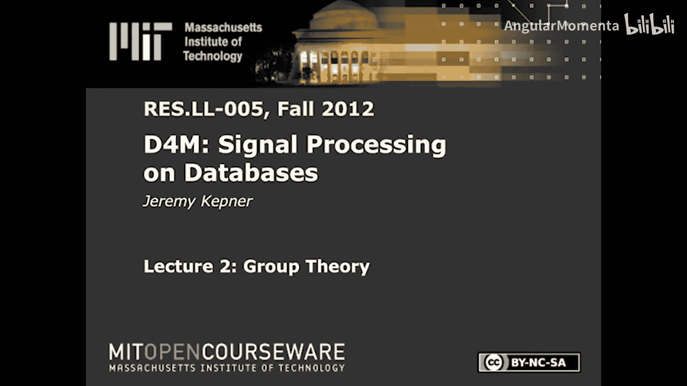
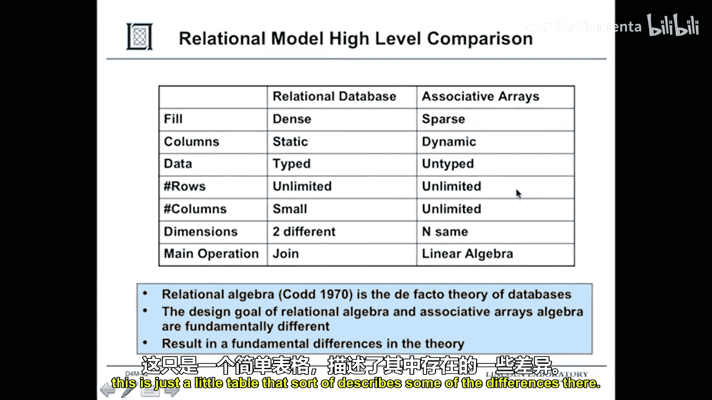

# 006：群论 📚

在本节课中，我们将深入探讨关联数组的数学基础，特别是其背后的群论概念。我们将了解关联数组如何为电子表格和大表提供形式化的数学结构，并探索其与线性代数和集合论的联系。

## 概述 📋

关联数组是一种强大的数据结构，它将键（通常是字符串）映射到值。这种结构自然地统一了四种思考数据的方式：关联数组、三元组数据库、图以及矩阵。本节课的目标是建立关联数组的正式数学基础，使我们能够将信号处理和线性代数中的成熟工具应用于数据库领域。

## 什么是电子表格与大表？ 📊

电子表格（如 Microsoft Excel）是地球上最常用的分析工具之一，每天有数亿人使用。大表则是指用于存储海量分析数据的大型三元组数据库，例如 Google 和 Amazon 所使用的系统。它们可以被视为巨大的电子表格，能够同时存储多样化的数据（字符串、日期、整数、实数等）。

然而，尽管这些结构被广泛使用，我们却缺乏一个正式的数学基础来描述它们。关联数组的概念恰好为此提供了一个优雅的数学结构。

## 关联数组的数学定义 🧮

关联数组可以被视为从一组键到值的**部分函数**。更正式地说，设 `S` 为一个无限、严格全序的集合（例如，按字典序排序的字符串集合，或实数集）。一个 `D` 维关联数组 `A` 是一个部分函数：

`A: K₁ × K₂ × ... × K_D → V`

其中 `K_i ⊆ S` 是键的集合，`V ⊆ S` 是值的集合。对于大多数应用，`D=2`，即行键和列键。关联数组只存储定义了值的键值对，其余部分视为“未定义”或“空”。

这与传统线性代数中的矩阵不同，矩阵的索引是整数，并且明确包含零值。在关联数组的实现中，零值通常被视为等同于“空”。

## 二元运算与碰撞函数 ⚙️

对两个关联数组进行二元运算（如加法、逻辑与）时，涉及两个关键函数：

1.  **键处理函数 (g)**：决定如何处理两个数组的键集。通常是取**并集 (∪)** 或**交集 (∩)**。例如，加法通常对应并集，而逻辑与通常对应交集。
2.  **值碰撞函数 (f)**：当两个数组在同一个键上都有定义（即发生“碰撞”）时，此函数决定如何合并两个值 `v1` 和 `v2`。

运算过程如下：
*   首先，根据函数 `g` 确定结果数组的键集（`K₃ = g(K₁, K₂)`）。
*   对于结果键集中的每个键：
    *   如果该键只在其中一个输入数组中有定义，则直接采用该值（若 `g` 是并集）或忽略（若 `g` 是交集）。
    *   如果该键在两个输入数组中都有定义（碰撞），则使用碰撞函数 `f` 计算新值：`v₃ = f(v₁, v₂)`。

这种设计保证了运算的**封闭性**：对关联数组的任何操作都返回另一个关联数组，这使得我们可以组合多个操作，形成易于理解和推理的运算链。

## 从群论到半环 🧬

上一节我们介绍了关联数组的基本运算，本节中我们来看看这些运算如何形成更高级的代数结构。通过为运算 `f` 和 `g` 选择特定的函数，我们可以让关联数组具备不同的代数性质。

我们首先关注那些构成**半群**的运算。半群要求运算满足**结合律**，即 `(a ∘ b) ∘ c = a ∘ (b ∘ c)`。在众多可能的碰撞函数中，有18种能形成结合运算。

进一步，如果运算还满足**交换律**（即 `a ∘ b = b ∘ a`），则构成**阿贝尔半群**（或称交换半群）。在这18种中，有14种满足交换律。

当我们为一对运算（一个充当“加法”，一个充当“乘法”）分配好角色，并且它们满足**分配律**时，就形成了一个**半环**。半环是环的推广，它不要求存在加法逆元（即没有“减法”）。在196对可能的运算组合中，有74对构成半环。

对于数据分析而言，半环尤为重要，因为许多图算法（如广度优先搜索）都可以归结为在半环上进行的矩阵乘法。常见的例子包括：
*   传统矩阵乘法：`(+, ×)` 半环。
*   最短路径算法：`(min, +)` 半环。
*   最大容量路径算法：`(max, min)` 半环。

## 向量空间与“域” 🚀

为了应用完整的线性代数工具，我们最终希望构建**向量空间**。传统的向量空间定义在“域”上（如实数域、复数域），域要求存在加法逆元。

然而，在关联数组的世界里，许多值（如字符串）没有自然的“负”概念。因此，我们转向一种称为 **“域”** 的结构——这是一种具备域的大部分性质（如分配律、存在零元和幺元），但**不要求加法逆元**的代数结构。

在满足条件的半环中，我们可以进一步定义标量乘法（将标量作用于关联数组的每一个值），从而构建出定义在“域”上的向量空间（或称“半向量空间”）。这使我们能够在关联数组上应用许多线性代数的概念，如子空间、张成空间等，尽管像线性无关性这类依赖于逆元的概念需要重新审视。

关联数组的一个巨大优势是**维度通用性**：任何两个关联数组都可以进行加法和乘法，无论它们的行键和列键是否匹配。系统会根据键处理函数自动处理维度对齐问题，这极大地简化了编程。

## 矩阵乘法的实现与应用 ✨

矩阵乘法是关联数组能力的“皇冠上的明珠”。有两种等价的视角：

1.  **内积形式**：计算输出矩阵的每个元素 `(i, j)` 时，取第一个矩阵的第 `i` 行与第二个矩阵的第 `j` 列进行内积。这是计算效率较高的实现方式。
2.  **外积形式**：将第一个矩阵的每一列视为一个列向量，第二个矩阵的每一行视为一个行向量，计算所有列向量与行向量的外积，然后将结果矩阵相加。这种形式在理论分析时更清晰，能确保运算始终保持在定义的代数结构内。

无论采用哪种视角，关联数组的矩阵乘法都天然支持维度通用性，并且运算结果自动封装为一个新的关联数组。

## 总结与展望 🎯

本节课我们一起学习了关联数组背后的群论基础。我们看到了如何通过定义键处理函数和值碰撞函数，为电子表格和大表这类通用数据结构建立一个丰富而严谨的数学框架。

这个框架的核心价值在于统一性：它将数据库查询（三元组）、图分析、线性代数（矩阵）和编程中的关联结构（哈希表）统一在同一个数学对象下。这使得我们能够将信号处理和线性代数中强大的数学工具直接应用于数据库和大数据分析领域，同时通过维度通用性等新特性，解决传统方法中棘手的对齐和维度匹配问题。

虽然仍有一些开放性问题（如广义逆、特征值），但关联数组代数已经为处理现代海量、异构数据提供了一个极其强大且优雅的数学基础。