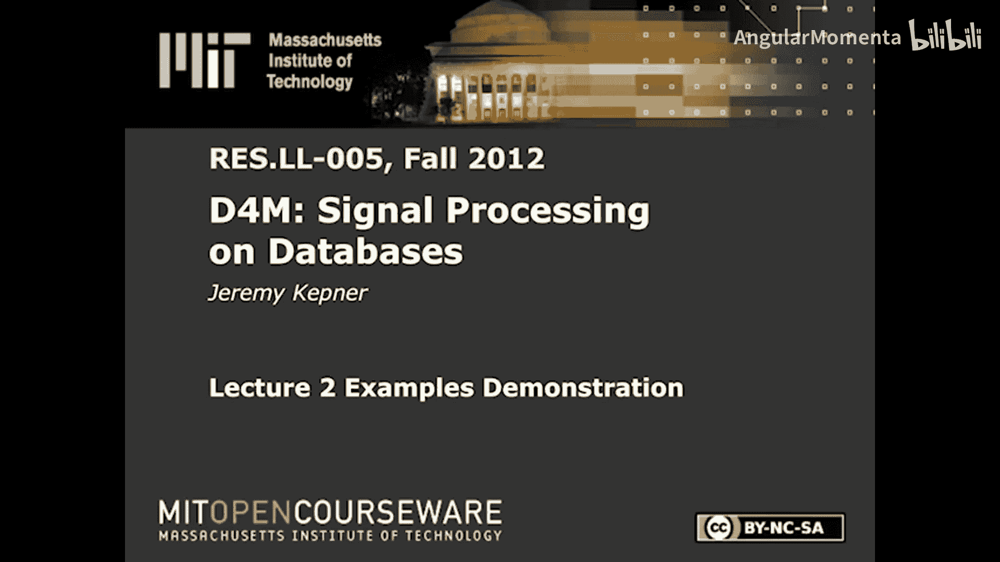
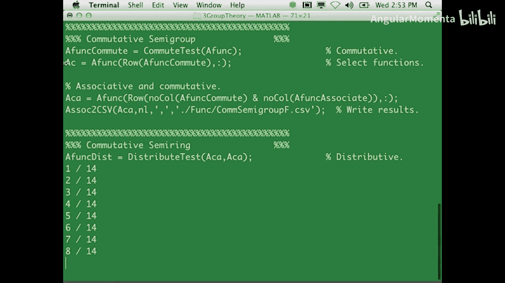
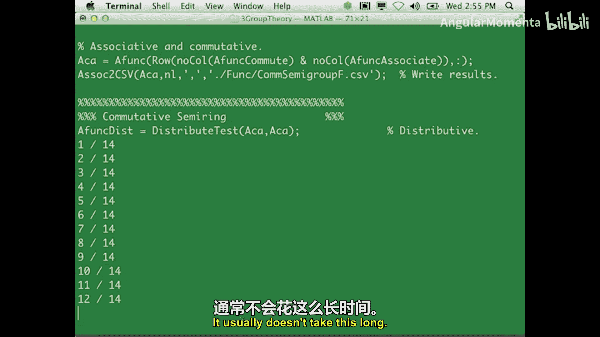
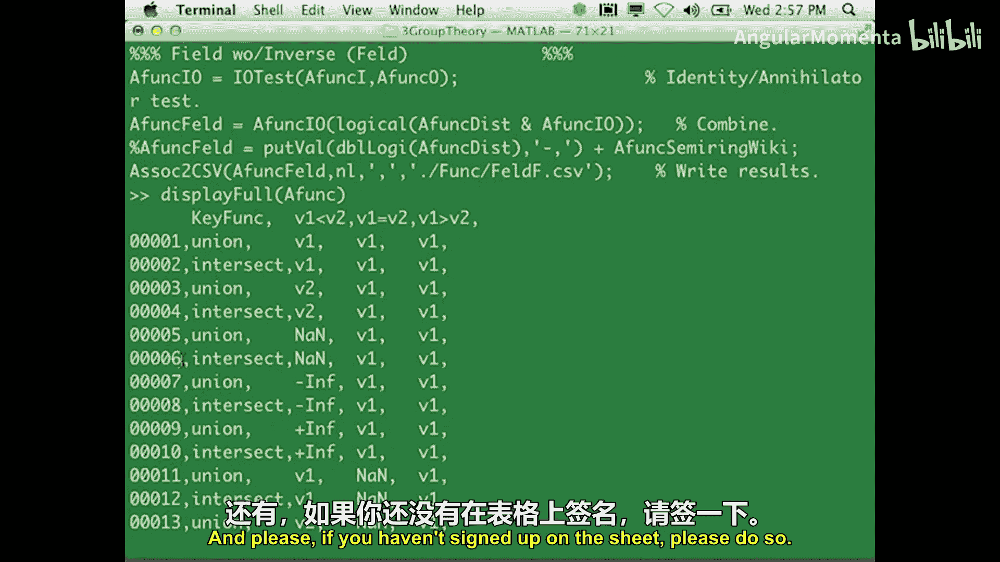

# 007：示例演示 🧪

在本节课中，我们将通过一个具体的示例演示，学习如何利用D4M（数据库与矩阵的数学）工具进行群论相关概念的探索性计算。我们将看到如何将抽象的函数定义和测试过程，通过类似电子表格的直观方式来实现。

---

上一节我们介绍了D4M的基本概念，本节中我们来看看一个名为“群论一”的具体示例。该示例演示了如何定义函数、组合它们，并进行简单的代数性质测试。

首先，我们启动示例程序。程序会读取一个CSV文件，该文件以类似电子表格的结构定义了不同的“关键函数”。

以下是该CSV文件包含的核心内容：
*   **集合操作**：定义了并集（`union`）和交集（`intersection`）操作。
*   **值比较条件**：定义了三种比较条件，即 `V1 < V2`、`V1 == V2` 和 `V1 > V2`。
*   **操作符结果**：定义了基于上述条件可能产生的不同操作结果。

这个CSV文件被作为关联数组读入。其强大之处在于，列名（如`V1 < V2`）本身可以是可执行的代码字符串。我们可以利用MATLAB的`eval`函数来执行这些列名，从而动态地生成或应用函数。这得益于D4M允许在集合中使用字符串的特性。

同样，MATLAB能够自动解析特殊值，如`NaN`（非数字）、`Inf`（无穷大）和`-Inf`（负无穷大）。在本示例中，`NaN`被用作一种具有“空值”或“失败状态”属性的特殊标识符，它在许多运算中能表现出符合预期的行为。

程序接着会进行一系列测试。需要说明的是，这些测试主要是快速的数值验证，而非严谨的形式化证明。例如，“半环测试”会花费一些时间运行，期间程序可能看起来没有响应，但这是在正常计算。

测试完成后，程序会输出结果。它会生成并展示所有可能的函数对组合。例如，通过代码可以自动生成200对不同的组合，并将结果写入一个新的CSV文件。这展示了D4M在自动化探索和生成数据方面的便捷性。

最后，我们读取并显示完整的函数组合结果。通过`display full(A_funk)`命令，可以看到所有值组合的完整表格。

本示例的核心目的，并非期望大家使用D4M进行深入的群论研究，而是为了展示当计算环境能够处理字符串等灵活数据类型时，解决问题的思路将大大拓宽。D4M使得以直观、灵活的方式组织和操作这类非传统数值数据变得非常简单。

---

本节课中我们一起学习了如何通过D4M工具进行一个探索性的群论示例演示。我们看到了如何用电子表格定义函数和条件，如何利用字符串列名实现动态代码执行，以及如何自动化地生成和测试函数组合。这体现了D4M在处理复杂、非结构化数据问题时的强大灵活性和便捷性。