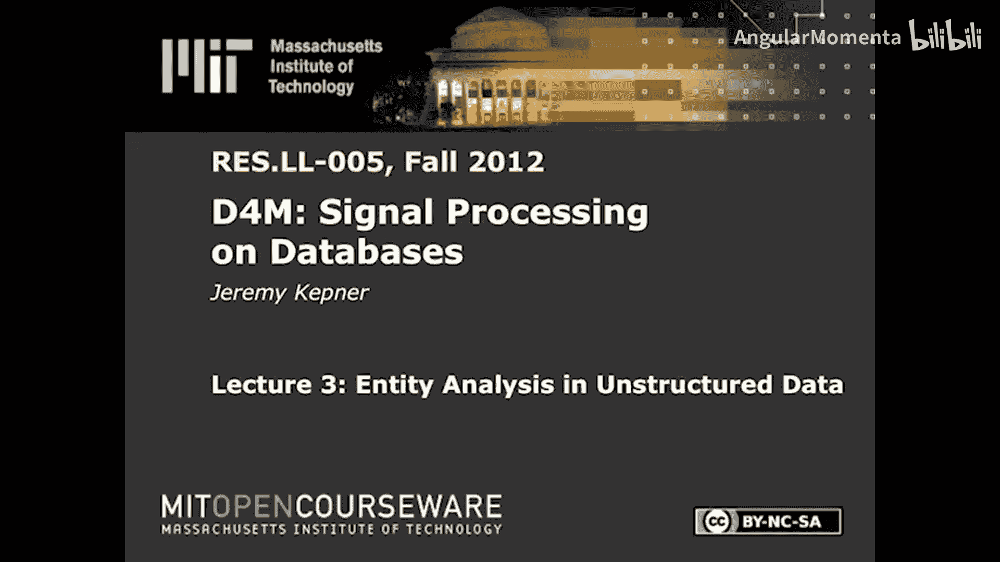
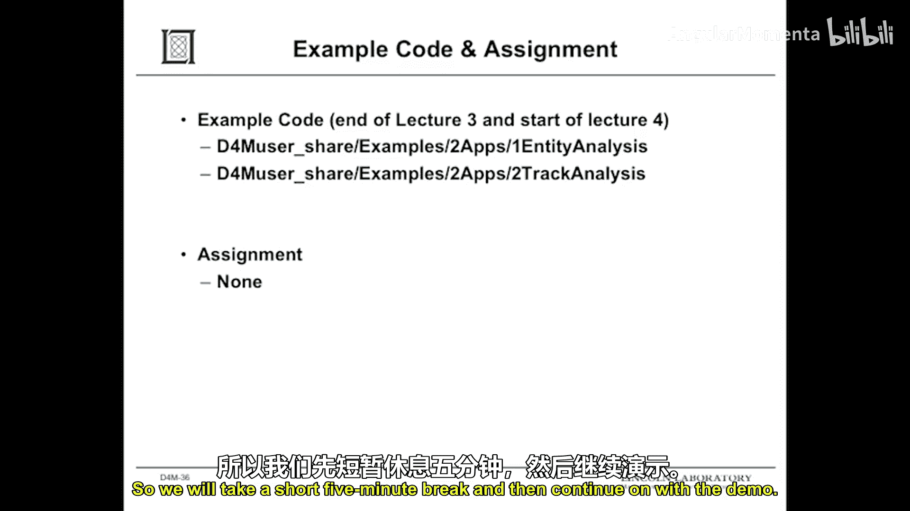
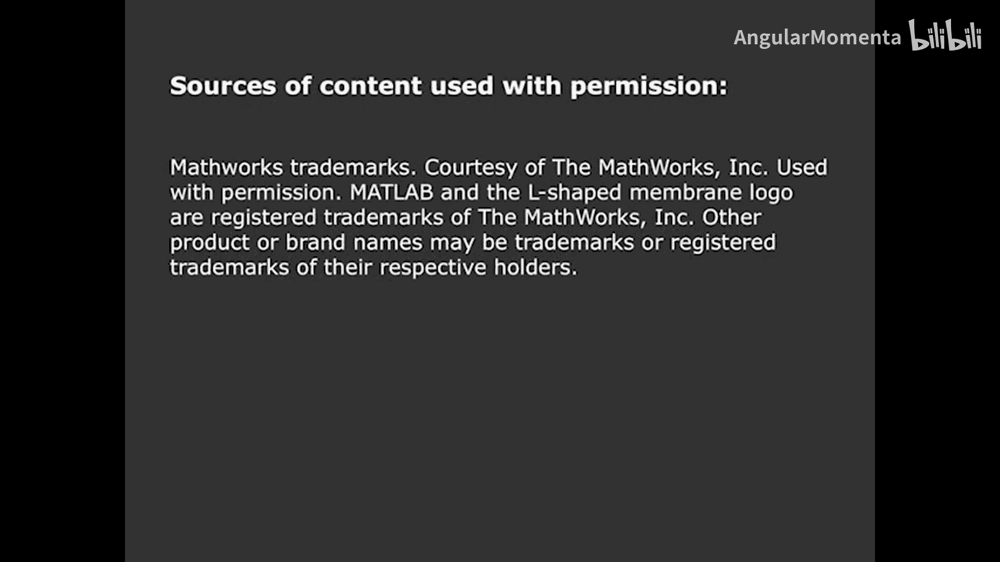

# 008：非结构化数据中的实体分析 📊

在本节课中，我们将要学习如何利用D4M技术对非结构化数据（如新闻文本）进行实体分析。我们将回顾Web技术的发展历程，理解D4M技术诞生的背景，并通过一个具体的案例——分析路透社新闻语料库中的实体关系——来演示其强大的分析能力。

## 课程概述与背景 🌐

上一节我们介绍了关联数组和线性代数的基础理论。本节中，我们来看看如何将这些理论应用于真实世界的数据分析。

以下内容采用知识共享许可协议提供。您的支持将帮助MIT OpenCourseWare继续免费提供高质量的教育资源。如需捐款或查看来自数百门MIT课程的其他材料，请访问 [ocw.mit.edu](http://ocw.mit.edu)。

我们现在开始上课。我知道今天实验室有很多活动，我非常高兴你们选择了来上这节课。对于那些提交了第一次作业的同学，我已经提供了反馈。我对完成作业的同学印象深刻，你们很好地把握了作业的精神。我知道刚布置的第二次作业是建立在第一次基础上的，对于那些没做第一次作业的同学可能会有些吃力。但我还是要祝贺那些挑战了第二次作业的同学，它确实需要相当多的思考。

我们将进入课程三个部分中的第二个阶段。前几讲我们做了很多动机阐述和理论介绍，现在我们将更多地接触那些你实际工作中可能会做的事情。我们正进入课程的下一个阶段。

这是第03讲。我们将使用一些真实数据作为例子进行讲解。

### 课程大纲

对于那些刚加入我们或通过网络观看并跳到此讲的同学，本课程名为“数据库信号处理”。这通常不放在一起的两个领域：信号处理（主要指检测理论及其线性代数基础）和数据库（主要指处理字符串、非结构化数据和图）。本课程讨论的D4M技术，正是将这两种视角融合在一起。

以下是大纲：我将简要介绍历史，谈谈Web如何演变成今天的样子，这很大程度上解释了为何我们发明了D4M技术。然后会谈谈D4M填补的具体空白，介绍一些相关成果。希望今天的演示能更深入，我们会花比上次更多的时间。

## Web的演变与D4M的诞生 💡

回顾Web的早期，即90年代初，硬件方面非常简单。都是Sun工作站，它们既是客户端也是服务器和数据库。当时的数据库主要是SQL数据库，Oracle刚刚起步，Sybase是当时的主导者。

这是一个早期现代网页的例子。我和朋友Don Bory为一家公司工作，我们有一个SQL数据库数据集，想把它发布出来。我们觉得当时的客户端工具很笨重。我的朋友Don下载了一个叫NCSA Mosaic的软件测试版，这是第一个浏览器。它改变了一切。在此之前，HTTP和HTML（1989年出现）并不被看好，另一个叫Gopher的技术更受欢迎。但Mosaic为HTTP创建了图形界面并支持图片，这改变了一切。我们当时用Perl语言连接Sybase数据库，通过Gopher服务器与Mosaic浏览器通信，生成HTML。我们当时的结论是：这个浏览器是个糟糕的GUI，HTTP是个糟糕的文件系统，Perl不适合分析，SQL也不适合数据进出。这太费劲了，不会流行起来。

然而，之后互联网经历了“寒武纪大爆发”。硬件方面，出现了大型数据中心、笔记本电脑、平板电脑等。浏览器技术也飞速发展。Mosaic的作者创立了Netscape，后来开源成为Mozilla和Firefox。微软收购了Spyglass公司的Mosaic代码，发展出Internet Explorer。Chrome则是完全重写的。SQL数据库方面，Oracle占主导，但也有MySQL等。服务器方面，Apache（源于Mosaic服务器）和Windows IIS是主流。连接它们的语言也大量涌现，如Java等。

重要的是要认识到，整个架构并非因为我们认为它们是最优工具而构建，它们只是当时可用的、能被重新用于这项工作的技术。因此，我们的结论必须修正：它确实流行起来了，因为分享信息的强烈愿望克服了高门槛。

如今情况已大不相同。我们不是第一个注意到原始架构存在缺陷的人。今天的Web看起来更像这样：我们仍有强大的客户端硬件；服务器和数据库已移至数据中心外的集装箱中；界面越来越像视频游戏（如iPad应用）；Google等公司认识到，如果只是呈现数据而非处理交易，SQL的许多功能可能并不需要，于是出现了更简单的、可扩展的“三元组存储”（Triple Stores），如Google Bigtable、Accumulo、Cassandra、HBase等。

但在中间层，我们很大程度上仍在使用相同的技术，即连接前后端的“胶水”层。我们的新结论是：查看大量数据仍然费劲，但视图很棒。中间层的问题，即这个“空白”，依然存在。D4M正是为了填补这个空白而设计的。

D4M（动态分布式数据维度数据模型）从底层设计，旨在处理存储在现代数据库中的三元组数据，并以更少的代码进行分析。它将三元组存储（可视为巨大的三元组稀疏矩阵）与我们在上一讲讨论的关联数组（Associative Array）数学概念连接起来。

## 技术生态与平台介绍 🖥️

我想谈谈我们带来这些技术的方式，介绍一下LLGrid以及我们在那里所做的工作，因为你们将使用LLGrid账户。

LLGrid是林肯实验室的核心超级计算机，我们在这里帮助满足您的所有计算需求。同样，如果您有项目并认为使用D4M有用，我们也可以提供帮助。LLGrid约有500名用户，超过2000个处理器。据我们所知，它是世界上唯一一个桌面交互式超级计算机，比任何其他超级计算机都更容易使用。

LLGrid的“面包和黄油”是我们的并行Matlab技术，今年将庆祝其10周年。它让人们能相对轻松地进行并行编程。D4M与此技术无缝交互，因此在本课程结束时，你们也将能用它进行并行数据库操作。我们使用“分布式阵列”并行编程模型，这被广泛认为是处理多维数组的最佳模型。MIT的每个人都熟悉矩阵思维，但这并非普遍技能。D4M使用矩阵视角看待数据，因此这两项技术结合得非常好。

在2012年，不谈“云”就不算完整的计算课程。我们将云简单分为两半：**效用云计算**（如Gmail、企业服务、日历、数据共享）和**数据密集型云计算**（基于Hadoop等技术）。后者是我们主要关注的。

从实施者的角度看，如果你拥有大量计算硬件，很可能在做四件事之一：传统超级计算（类似LLGrid所做的）、传统数据库管理系统（如信用卡交易）、企业计算（如今多在VMware上运行），或**大数据**（使用Java和MapReduce等）。这每一个都是数百亿美元的产业，硬件甚至芯片都出现了专业化。有时你的任务可以完全在一个领域内完成，有时则需要跨领域，这可能很有挑战性。

LLGrid使传统超级计算变得交互式、按需和弹性。在Hadoop社区，为了提供高效搜索，在Hadoop之上开发了许多数据库，HBase是一个，Accumulo是另一个（据我所知是性能最高的开源三元组存储）。我们创建了与这些数据库的绑定，即D4M技术。我们还有LLGrid MapReduce，这是Hadoop社区的核心编程模型，是一个非常简单的模型（每个程序在文件列表上独立运行）。对于使用Python或Java（而非Matlab）的用户，MapReduce是可用的。

我们的大愿景是结合**大计算**和**大数据**。随着我们处理新应用（文本、网络、生物等），新的API和分布式数据库类型正在影响一切。

### Hadoop简介

简单介绍一下Hadoop架构：你提交一个Hadoop MapReduce作业，它进入作业跟踪器，被分解为子任务，每个任务有自己的跟踪器，然后被发送到架构中的数据节点。名称节点负责跟踪实际名称。这是一个简单的Hadoop集群。

Hadoop的优势和劣势：它允许你在大量数据上分布式处理。**最佳用例**是：如果你有海量日志文件，并且你决定只对它们进行一次搜索（例如搜索一个字符串）。如果你决定进行不止一次搜索，那它就不总是最合适的。它基本上是为在大量文件上运行`grep`而设计的。整个数据库社区对此可能会感到不安，因为我们已经通过创建索引解决了快速搜索的问题，这也是人们发明HBase、Accumulo等数据库的原因。

Hadoop具有高度可扩展性，其设计能够容忍极不可靠的硬件，但这是有代价的——它依赖于大量复制（通常标准复制因子是3）。这对于高性能存储领域来说意味着成本是3倍。Hadoop的调度器还很不成熟，容易发生资源冲突，不是一个轻松的多用户环境。它根本上依赖于JVM存在于每个节点上，因为当你向每个节点发送程序时，该程序的解释器必须存在于每个节点上。默认情况下，Hadoop集群每个节点都有的语言只有Java。

LLGrid MapReduce架构大大简化了这一点。你调用`egan_mapreduce`，它启动一批映射器任务，在不同的输入文件上运行它们，完成后创建输出文件，然后如果你指定了，再运行一个归约程序来合并输出。基本模型就是：一个映射程序处理文件列表，每个生成一个输出；一个归约程序将它们全部合并。

这就是关于Hadoop的简要介绍。它非常简单和流行，预计将长期保持其流行度。对于地球上绝大多数人来说，这是他们能接触到的最易用的并行计算技术。

## D4M核心概念回顾与基础分析 📈

回到D4M，我之前提到过很多。D4M的核心概念是**多维关联数组**。D4M旨在让我们这些具有更多数学专业知识的人能够做比在Hadoop中更复杂的事情。它允许你同时以四种方式查看数据：可以将其视为二维矩阵，用字符串引用行和列，值也可以是字符串；它与三元组存储一一对应，因此可以轻松连接数据库；它看起来像矩阵，因此可以进行线性代数运算；利用邻接矩阵和图之间的对偶性，你也可以将数据视为图。

这是可组合的：几乎所有对关联数组执行的操作都会返回另一个关联数组。我们可以对它们进行加、减、与、或、乘等操作，可以非常轻松地进行复杂查询。这些操作既适用于关联数组，也适用于绑定的数据库表。

说到表，我已经谈过我们在这门课中一直使用的模式。如果你的标准数据看起来像这样（例如一个网络记录：源IP、域名、目的IP），我们通过将源与值连接来“展开”它，从而创建一个非常大的稀疏表，这自然会进入我们的三元组存储。当然，仅此本身并没有带来什么，因为大多数表要么是行存储要么是列存储。我们使用的数据库是行存储的，允许快速查找行键。然而，一旦我们展开了模式，如果我们同时存储其转置，我们现在就可以快速有效地索引这里的所有内容。对用户来说，就像我们用一种模式索引了数据库中的每个字符串，这是非常强大的一步。

## 实体分析实战演示 🎯

现在，我将展示一些我们做过的基本分析，并演示更多代码。

例如，这是我们的表。可以将其视为稀疏矩阵，这里有各种源IP。我只想对这些数据计算一些非常基本的统计量。需要说明的是，计算总和和平均值听起来可能不是非常复杂的统计，但它仍然异常强大。我们惊讶于它的价值，因为它通常能立即显示出你数据中的**坏数据**。对于许多客户来说，这通常是我们使用D4M提供的第一个增值：这是第一次有人从整体上查看他们的数据并能够做这类事情。通常我们做的第一件事就是：加载他们的数据，进行一些基本的求和，然后告诉他们：“你知道你有8%的数据在这个列中都有这个值吗？这绝对不可能是正确的。” 8%可能低到你不会在常规检查中遇到，但在最基本的直方图中就会凸显出来。这通常非常有价值，客户通常会去修复它。

因此，我鼓励你们在拿到数据后，首先进行基本统计，看看哪些地方正常，哪些地方有问题。

以下是基本实现。我们给它一组要查看的行（可以非常大）。我们有一个表绑定`T`。我们请求获取所有这些行，返回一个关联数组。由于表总是包含字符串并返回字符串值，我们首先需要将它们转换为逻辑值以便进行数学运算，然后再转换回双精度浮点数。

你可以传递正则表达式，也可以使用`startsWith`命令。假设我们只对源IP域名感兴趣。我们做的第一件事是查找热门列，只需输入`sum`即可。我们还想查找热门配对，计算协方差矩阵，或者平方后查找具有许多目的IP的域名。

在这个数据集中，最热门的是这些。你可以看到这些都是相当合理的内容，比如“patriots”（新英格兰爱国者队球迷很多）、“ads”、“staples”等。这立刻向你展示了数据情况。

这是数据的协方差矩阵。如你所见，它是对称的，显然有对角线，并且具有二分图结构（没有目的IP到目的IP的链接，只有源IP到目的域名等）。协方差矩阵通常非常有帮助，因为它第一次向你展示了数据的完整互连结构。你可以快速识别密集行、密集列、块、组，以及那些因为太密集或太稀疏而可能不感兴趣的块。这是一个非常基础的调查工具。

这里要提一下我们另一个小组的同事开发的“结构化知识空间”（Structured Knowledge Space, SKS）。SKS是一个非常强大的分析数据集。它有点像Google搜索的联想功能，但更深层。SKS维护一个文档集合的数据库，当你输入“阿富汗”时，它会去统计这些文档中不同类型实体的出现次数，然后显示可能的下一个关键词选择，这是基于数据本身，而非缓存的查询。这是一个相当复杂的分析。

D4M走在正确轨道上的一个重大胜利是：这个功能原本用Java和SQL实现了数百或数千行代码，而我们将展示如何用一行代码实现它。

### SKS算法示例

让我们回顾一下那个算法。假设我的数据看起来像这样：有一批文档，一批实体，以及实体出现在文档中的关系。我的关联数组将字符串映射到行，我的两个“面”（facet）只是这里的两个列名。我选择面Y1和Y2。基本操作是：获取Y1和Y2。我使用这里的竖线符号表示去掉面名，以便对它们进行“与”操作。这得到了所有同时包含“UN”和“Carl”的文档。然后，我可以通过矩阵乘法计算计数：将它们“与”起来，转置，然后进行矩阵乘法。就这样完成了。

## 演示：路透社语料库实体分析 📰

现在我将进入演示环节。我会先进行设置，然后我们短暂休息一下，再开始演示。演示将真正展示如何在真实数据上使用D4M。

我们将要处理的数据是**路透社语料库**（Reuters Corpus）。这是2000年发布的一个语料库，旨在促进该领域的研究。我们非常感谢路透社这样做。他们将数据交给了NIST（美国国家标准与技术研究院），由NIST管理这个数据集。这是一组90年代中后期的路透社新闻报道，总计约80万篇。我们实际使用的并非原始路透社数据，而是通过各种解析器运行后提取出的实体（人物、地点、组织）。因此，这是数据的一个非常简洁的摘要，是一个衍生品。

数据符合幂律分布。如果我们查看每个实体出现的文档数，会发现某些人物、地点和组织出现在许多文档中，而大多数只出现在少数文档中。查看每个文档包含的实体数也会看到同样的现象。本质上，你可以将此视为计算这个二分图的入度和出度，它具有我们期望在数据中看到的经典幂律形状。

我们将在演示中完成这个分析。

### 总结与预告

回顾一下，Web的演变催生了一类新技术。我们看到Web正朝着游戏化界面、三元组存储数据库和D4M这类分析技术发展。这是一项非常新的技术。

顺便说明，本周没有作业。对于那些还在做上次作业的同学，可以放松一下了。

示例代码在示例目录中，我们现在已经进入到第二个子文件夹 `apps/entity_analysis`。鼓励大家运行这些示例，我们稍后就会开始做。现在我们将休息五分钟，然后继续演示。

---

本节课中我们一起学习了Web技术栈的演变、D4M技术出现的背景及其核心价值。我们回顾了关联数组在数据分析中的基础应用，并预览了如何利用D4M对路透社新闻语料库进行实体关系分析。在接下来的演示中，我们将亲眼见证如何用简洁的代码实现强大的分析功能。