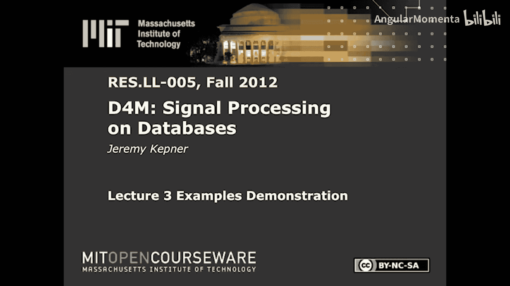
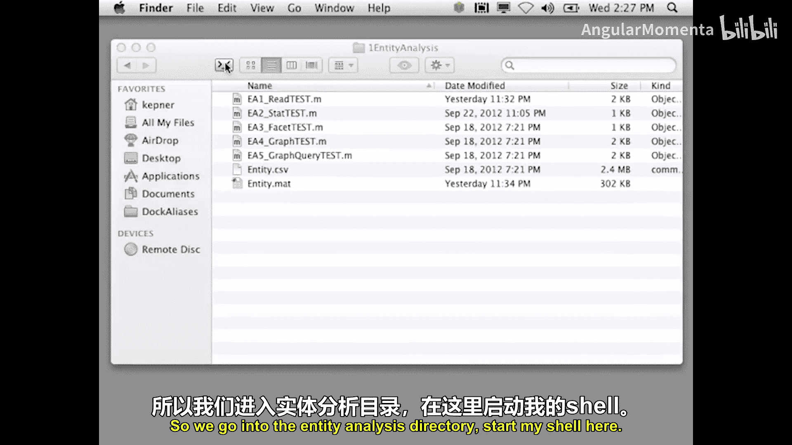
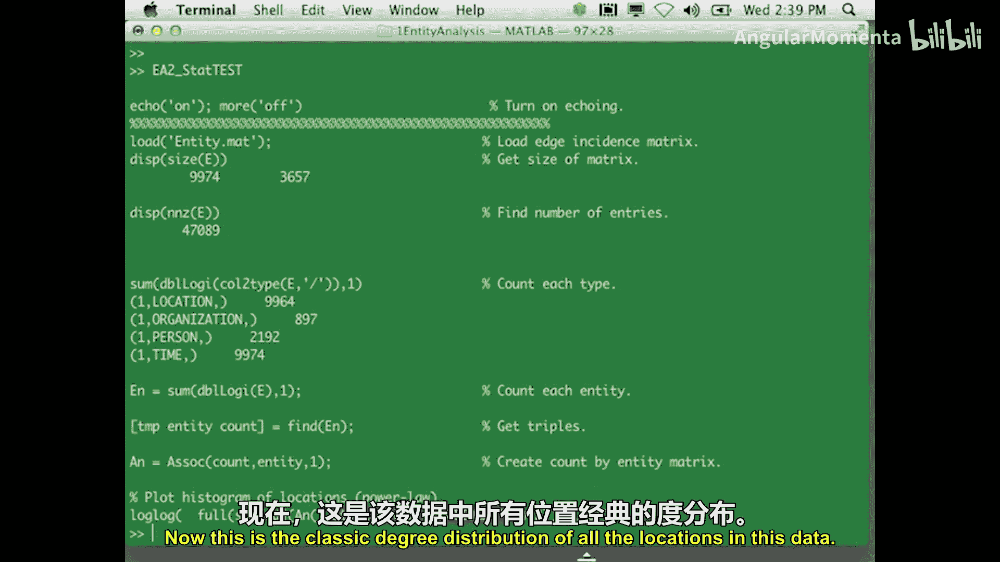
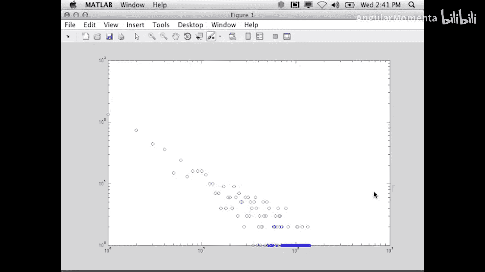
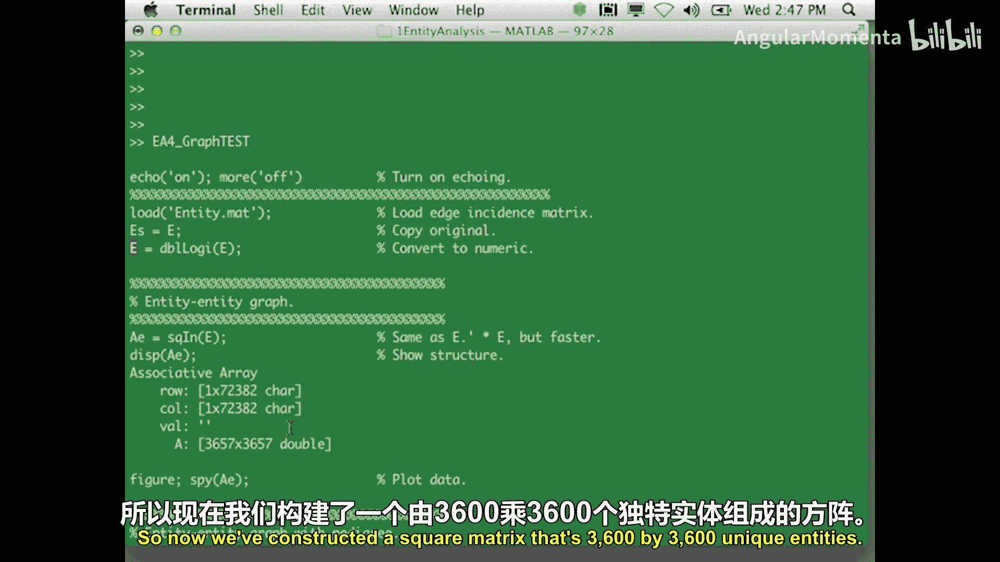
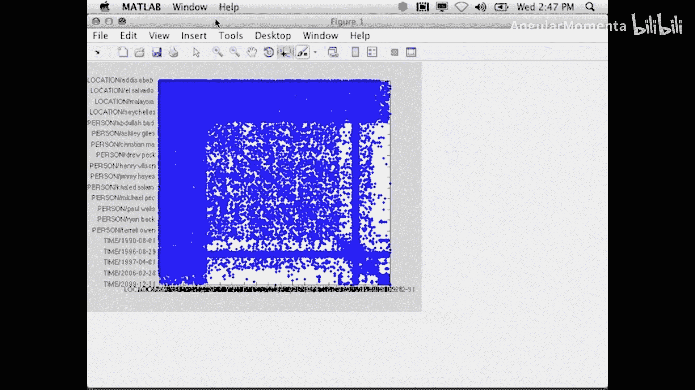
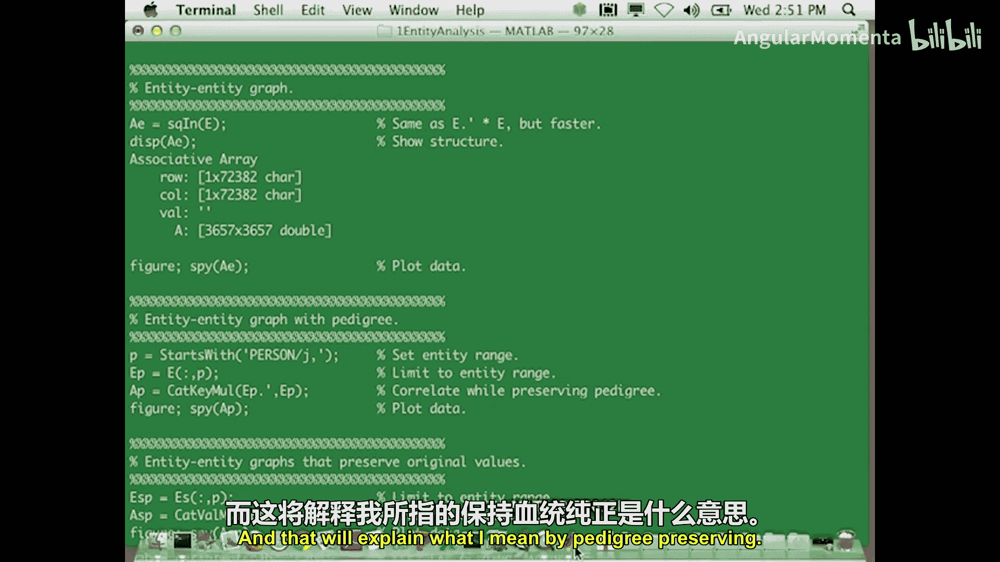
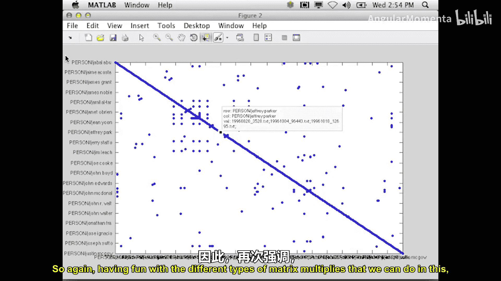
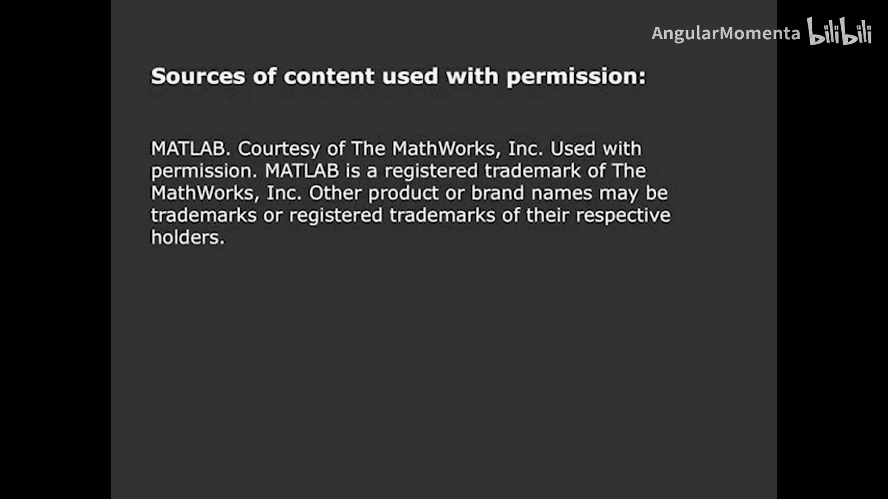

# 009：示例演示 🧪






在本节课中，我们将通过一个具体的示例演示，学习如何使用D4M（数据库、数据、数据挖掘）工具包对从路透社文档中提取的实体数据进行分析。我们将涵盖数据读取、格式转换、基本统计、相关性分析以及图结构探索等核心操作。

***

## 数据读取与格式转换


上一节我们介绍了D4M的基本概念，本节中我们来看看如何将原始数据读入并转换为适合分析的关联数组格式。

首先，我们有一个包含约2.4MB数据的CSV文件。该文件包含了从路透社文档中提取的实体信息，每一行代表一个实体在一个文档中出现的位置。

```matlab
% 读取CSV文件数据到关联数组
E = Assoc('','','');
E = readCSV('entity_data.csv');
```

读取后，数据以“边列表”的形式存储在关联数组 `E` 中。其行键是自动生成的索引，列包括文档名、实体名、位置和实体类型。为了进行后续分析，我们需要将其转换为“展开模式”，即以文档为行、以“类型:实体”组合为列的矩阵。

以下是转换步骤：

1.  获取构成关联数组的三元组（行、列、值）。
2.  将实体类型和实体名称字符串拼接，形成新的列键。
3.  用文档作为行键，新的“类型:实体”作为列键，位置作为值，构建新的关联数组。

```matlab
% 获取三元组
[docStr, entityStr, posStr] = find(E);
% 拼接类型和实体，形成新的列键
colStr = CatStr(entityTypeStr, ':', entityStr);
% 构建展开模式的关联数组
A = Assoc(docStr, colStr, posStr);
```


转换完成后，我们可以保存这个二进制文件以便快速后续加载。这个新矩阵 `A` 的行是文档，列是唯一的“类型:实体”对，值表示该实体在文档中出现的位置。

***

## 基本统计与直方图

在将数据成功转换为展开模式后，我们可以开始计算一些基本的统计数据，以了解数据的整体分布情况。

首先，我们查看数据的基本维度：文档数量、唯一实体数量以及非零条目总数。



```matlab
% 显示关联数组的尺寸（行数 x 列数）
size(A)
% 计算非零条目的数量
nnz(A)
```

接着，我们可能想知道数据集中每种类型的实体（如地点、人物、组织）各有多少。这需要先将展开的列键拆分开，然后进行统计。

以下是计算实体类型分布的步骤：



1.  使用 `Col2Type` 类函数将拼接的列键拆分开。
2.  将关联数组转换为仅包含1的二进制形式（使用 `double(logical(A))`）。
3.  沿行方向求和，得到每个实体出现的总文档数。
4.  进一步处理，得到每个实体的出现频次。

```matlab
% 拆分列键，获取实体类型和名称
[typeList, entityList] = Col2Type(colStr);
% 转换为二进制并沿行求和，得到每个实体的文档频次
entityCount = sum(double(logical(A)), 1);
% 获取实体及其频次的三元组
[~, entity, count] = find(entityCount);
```

最后，我们可以针对特定类型的实体（例如所有“地点”）绘制其出现频次的分布直方图。这通常呈现出典型的“幂律分布”，即少数实体出现非常频繁，而大多数实体只出现几次。

```matlab
% 选取所有‘地点’实体
locationEntities = entityStartsWith(entity, 'LOCATION:');
locationCounts = count(locationEntities);
% 绘制对数-对数坐标下的直方图
loglog(sort(full(locationCounts), 'descend'));
xlabel('Rank'); ylabel('Frequency');
title('Location Entity Degree Distribution (Power Law)');
```

这种分布分析是信号处理中的基础，有助于我们理解数据特性，并为后续的过滤（如去除高频和低频噪声）提供依据。

***

## 相关性分析：Facet查询

掌握了数据的基本分布后，我们可以探索实体之间的关联。一种强大的方法是进行“Facet”查询，即分析当某些实体共同出现时，其他实体出现的模式。

例如，我们想找出所有同时包含“纽约”（地点）和“张德培”（人物）的文档，并查看这些文档中还有哪些其他实体频繁出现。





其核心操作是矩阵乘法，公式为：
**`相关性向量 = (A(:, 实体1) + A(:, 实体2))’ * A`**

```matlab
% 选取‘纽约’和‘张德培’对应的列向量
nyCol = A(:, ‘LOCATION:New York’);
mcCol = A(:, ‘PERSON:Michael Chang’);
% 合并两个查询（确保列名一致后相加）
combinedQuery = noCol(nyCol) + noCol(mcCol);
% 转置为行向量，并与原矩阵相乘，得到其他实体的共现频次
facetVector = combinedQuery’ * A;
```

这样得到的 `facetVector` 是一个行向量，其中的值表示其他实体在与“纽约”和“张德培”共同出现的文档中出现的次数。为了识别出有意义的关联（而不仅仅是普遍常见的实体），我们需要对结果进行归一化，即用每个实体的共现次数除以它在整个数据集中的总出现次数。

```matlab
% 计算每个实体在整个数据集中的总出现次数
entityTotal = sum(A, 1);
% 归一化Facet结果
normalizedFacet = facetVector ./ entityTotal;
```

归一化后，值接近1的实体（如“弗吉尼亚·韦德”）表示它们几乎只在与查询实体相关的文档中出现，暗示着更强的特定关联；而值很小的实体（如“美国”）虽然也出现在这些文档中，但它们在许多其他文档中也出现，因此关联性较弱。



***

## 图构建与分析

之前的分析聚焦于实体与文档的关系。现在，我们通过矩阵运算将数据投影到实体-实体或文档-文档的关系空间，从而构建图并进行探索。

首先，我们计算实体-实体关联矩阵（也称为共现矩阵）。这通过将文档-实体矩阵与其转置相乘来实现：
**`实体关联矩阵 G_entity = A’ * A`**

```matlab
% 计算实体-实体关联矩阵（使用平方函数优化自相关）
G_entity = sqIn(A);
% 可视化该稀疏矩阵的结构
spy(G_entity);
```

生成的 `G_entity` 是一个对称方阵，其行和列都是实体。矩阵中的非零值表示两个实体共同出现在至少一个文档中。通过可视化，我们可以清晰看到数据中的区块结构，例如地点-地点、人物-人物、时间-时间之间的密集连接块。



除了简单的共现计数，有时我们还需要知道是哪些文档连接了两个实体。这时需要使用“谱系保留”矩阵乘法，它在结果中保留被消去的维度（即文档）的标识符作为值。

```matlab
% 使用谱系保留乘法，结果值是被共享的文档ID
G_entity_pedigree = A’ * A; % 使用重载的特殊乘法语义
% 例如，查询‘Jennifer Hurley’和‘James Harvey’的连接
connectionDoc = G_entity_pedigree(‘PERSON:Jennifer Hurley’, ‘PERSON:James Harvey’);
```

类似地，我们可以构建文档-文档关联矩阵，以发现内容相似的文档：
**`文档关联矩阵 G_doc = A * A’`**

```matlab
% 计算文档-文档关联矩阵
G_doc = sqOut(A);
spy(G_doc);
```

这个矩阵揭示了哪些文档共享大量相同的实体。通过对角线操作（移除文档与自身的关联），并对关联强度进行归一化（考虑文档自身的大小），我们可以进行更复杂的多面体查询和社区发现。例如，找出与“纽约”强相关且出现超过一定次数的人物，然后进一步分析这些人物的关系网络（邻域和三角关系）。

```matlab
% 1. 移除关联矩阵的对角线（自连接）
D = diag(diag(G_entity));
G_entity_no_self = G_entity - D;
% 2. 归一化关联强度（Jaccard相似度的一种形式）
entityDegrees = diag(G_entity); % 每个实体的度
normMatrix = 1 ./ max(entityDegrees’, entityDegrees); % 示例归一化
G_norm = G_entity_no_self .* normMatrix;
% 3. 执行复杂查询：找出与“纽约”共现超过4次且归一化强度>0.3的人物
target = ‘LOCATION:New York’;
[relatedEntities, strength] = find(G_norm(target, :) > 4 & G_norm(target, :) > 0.3);
% 4. 分析其中一个关键人物（如‘John Kennedy’）的邻域网络
neighborhood = G_norm(‘PERSON:John Kennedy’, :);
% 找出该邻域中的三角关系（即与John Kennedy相连的实体之间也相互连接）
triangles = neighborhood’ * neighborhood;
```


***




本节课中我们一起学习了如何利用D4M工具包对实体数据进行端到端的分析。我们从读取原始CSV数据开始，将其转换为强大的关联数组格式。随后，我们计算了基本的统计信息和分布直方图，以理解数据特征。接着，我们深入探讨了Facet查询，用于分析实体间的条件相关性。最后，我们通过矩阵乘法构建了实体和文档的关系图，并演示了如何进行图上的查询、归一化和社区结构探索。这些技术为在大型数据库上进行高效的信号处理和数据挖掘奠定了坚实的基础。