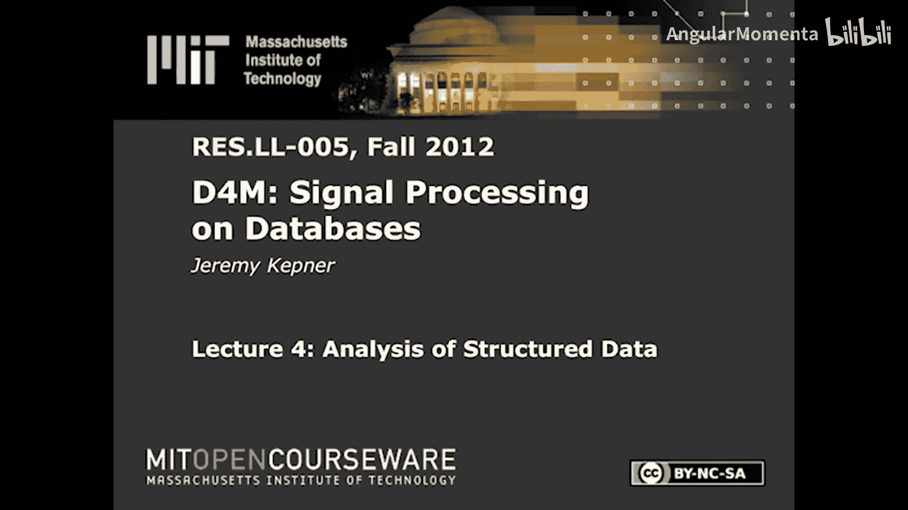
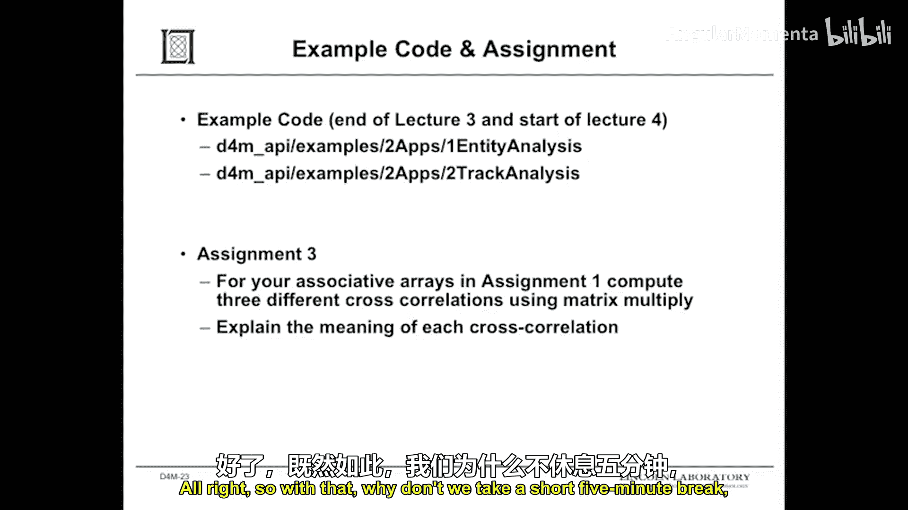

# 010：结构化数据分析 📊



在本节课中，我们将学习如何对数据库中的结构化数据进行更复杂的分析。我们将超越简单的查询和基本关联，探索一些更高级的分析技术，并了解D4M技术在处理这些复杂任务时的优势。

---

## 数据模式与并行化考量

上一节我们介绍了D4M的基本概念，本节中我们来看看处理数据时的一个关键设计模式。

我们使用一种称为“展开转置对”的模式将数据读入三元组存储（如Acumulo）。这种模式允许我们动态添加任意数量的列，而无需额外开销。具体做法是将原始表的列名和值拼接在一起，形成新的列。

**公式**：`新列键 = 列名 + 分隔符 + 值`

然而，在设计行键时，我们需要考虑并行化问题。如果行键是基于时间的小端序（例如递增的时间戳），在并行数据库系统中，所有新数据可能会持续写入同一个处理器节点，造成热点瓶颈。

**解决方案**：将行键设计为大端序的时间格式，或者使用哈希取模等策略进行分发。同时，建议将实际的时间值存储在一个名为“time”的列中，以便直接查询。

---

## 基础统计分析 📈

在开始复杂分析前，获取数据的基本统计信息至关重要。这有助于快速发现数据质量问题。

以下是获取基础统计信息的关键步骤：

1.  **查询数据**：获取指定行键范围内的所有数据。
2.  **转换为数值**：使用 `double(logical(...))` 函数将字符串值转换为数值1，便于数学运算。
3.  **计算列计数**：对行维度进行求和，得到每类列的出现次数。
4.  **计算协方差**：通过 `A’ * A` 或 `sqIn` 计算列与列之间的协方差。
5.  **恢复原始模式**：使用 `CatVal` 函数将“展开”的列键拆分开，恢复成“列-值”对的密集格式。

这些操作在D4M中通常只需一行代码即可完成，能快速揭示数据中的异常模式，例如某些列从不共现或出现频率异常。

---

## 构建数据图与图遍历 🕸️

接下来，我们探讨如何在数据中构建和遍历图结构。

目标是：给定一组起始列，找出通过特定类型的列与它们相连的所有其他列，同时排除一些已知的“干扰”列。

**算法核心步骤**：
1.  根据起始列 `C0`，找到包含这些列的所有行。
2.  从这些行中，仅筛选出我们关心的列类型 `Ct`。
3.  从结果中减去我们想要排除的干扰列 `Cclutter`。

**代码示例**：
```matlab
% 步骤1 & 2: 找到包含C0的行，并筛选出Ct类型的列
A = T(C0, :); % 查询包含C0的所有行
rows = Row(A); % 提取行键
A = T(rows, :); % 用行键获取完整行数据
A = double(logical(A)); % 转换为数值
A = A(:, Ct); % 筛选特定列类型

% 步骤3: 排除干扰列
C1 = Col(A - A(:, Cclutter)); % 获取最终的列集合C1
```

**图遍历的局限性**：需要注意的是，数据的自然拓扑结构可能限制遍历。例如，在环状图中，从某个节点出发的单向遍历可能无法到达所有其他节点。设计分析时必须考虑边的方向性。

---

## 空间范围查询 🌍

许多数据集包含空间坐标信息。我们将学习如何高效地查询落在特定地理多边形内的数据。

基本思路是：
1.  查询一个初始的行范围。
2.  从中提取出存储坐标的列（如 `x`, `y`）。
3.  将坐标值从字符串转换为数值。
4.  使用MATLAB的 `inpolygon` 函数判断哪些坐标点位于给定的多边形内。
5.  返回落在多边形内的所有数据列。

为了提高大规模空间查询的效率，可以使用 **莫顿编码** 技术。它将二维坐标的字符串交错排列，形成一维的Z序曲线编码，从而可以将二维范围查询转换为高效的一维前缀查询，之后再进行精确的坐标过滤。

---

## 高级关联分析：类型对查找 🔗

现在，我们进行更复杂的“二阶”分析，例如查找同时包含两种特定类型数据的行。

目标是：找出所有恰好包含一个 `类型1` 值和一个 `类型2` 值的行。

**实现步骤**：
1.  查询数据并转换为数值矩阵。
2.  分别对 `类型1` 和 `类型2` 的列进行行求和。
3.  找到行和等于1的 `类型1` 行。
4.  在这些行中，进一步找到行和等于2的行（这意味着该行恰好包含一个 `类型1` 和一个 `类型2`）。
5.  提取出这些行中的 `类型1` 和 `类型2` 的具体值，构建它们之间的关联关系。

D4M的一个便利特性是，查询函数可以通过输出参数的数量来返回不同形式的结果。指定三个输出参数（行、列、值）可以直接获得三元组列表，这在处理大型数据或只关心部分信息时更高效。

---

## 列对集合与语义扩展

我们还可以分析列对之间的集合关系。例如，给定两组列 `C1` 和 `C2`，找出所有同时出现在同一行中的 `(C1_i, C2_j)` 对。

这可以通过字符串拼接函数 `CatStr` 来实现，它将两个字符串数组合并，用分隔符连接，从而创建出代表配对的唯一新键。

此外，基于已有的配对关系，可以进行语义扩展推理。例如：
*   **反向对**：如果存在 `(列1, 列3)`，可能意味着也存在 `(列3, 列1)`。
*   **衍生对**：如果存在 `(列1, 值A)`，可能意味着也应该存在 `(列2, 值A)`。

这些模式在构建知识图谱或完善数据关系时非常有用。

---

## 总结

本节课中我们一起学习了多种针对结构化数据的分析技术：

1.  **基础统计**：快速获取数据概览，发现质量问题。
2.  **图遍历**：在数据中构建和探索关系网络，并注意方向性限制。
3.  **空间查询**：利用坐标数据进行地理范围筛选，了解莫顿编码优化。
4.  **高级关联**：通过矩阵运算和集合操作，查找复杂的类型共现关系。
5.  **关系扩展**：基于现有数据对，进行逻辑推理和语义扩展。



通过“展开转置对”模式，我们可以将许多复杂的图分析和关联分析，转化为一系列高效的行列查询和矩阵乘法。随着熟练度的提升，你会发现D4M能够以简洁的代码，优雅地解决大量复杂的数据分析问题。