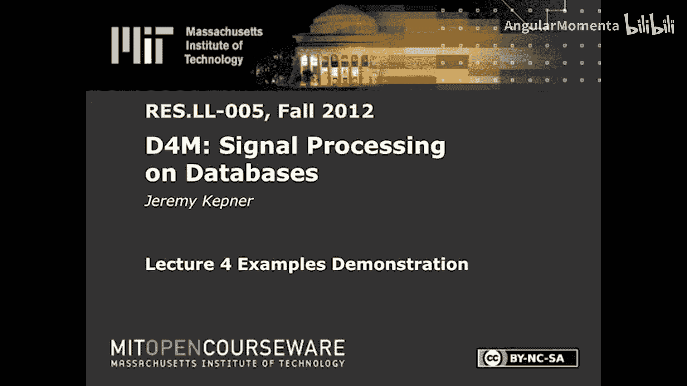
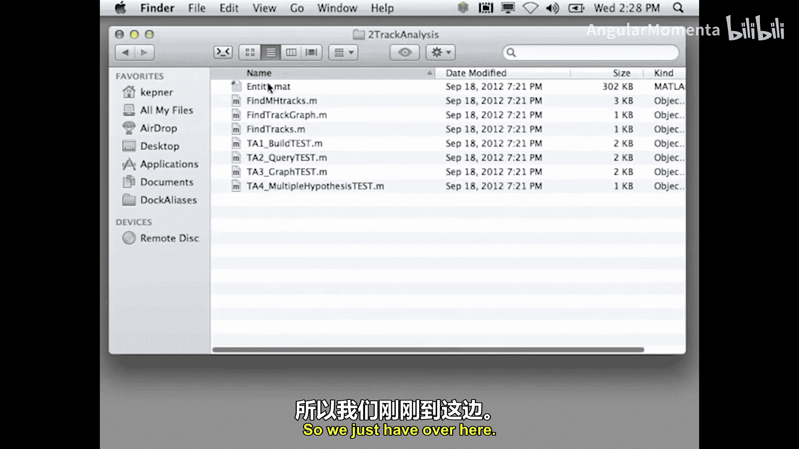
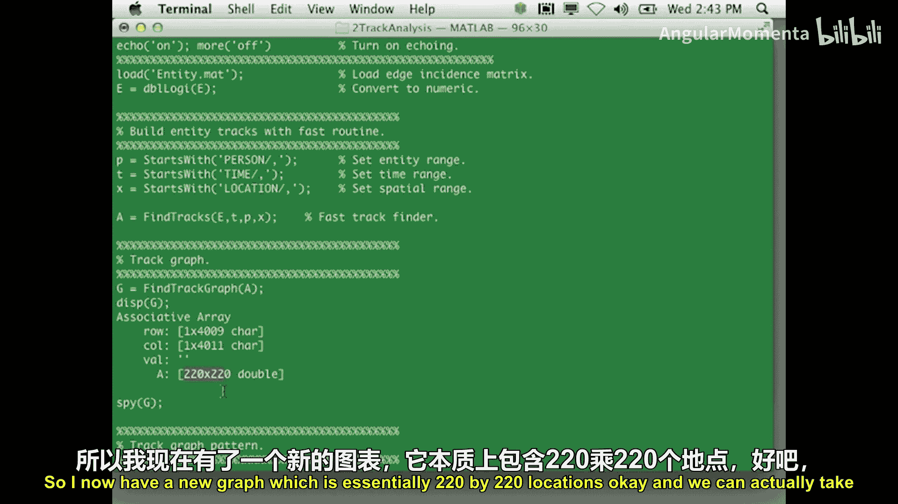
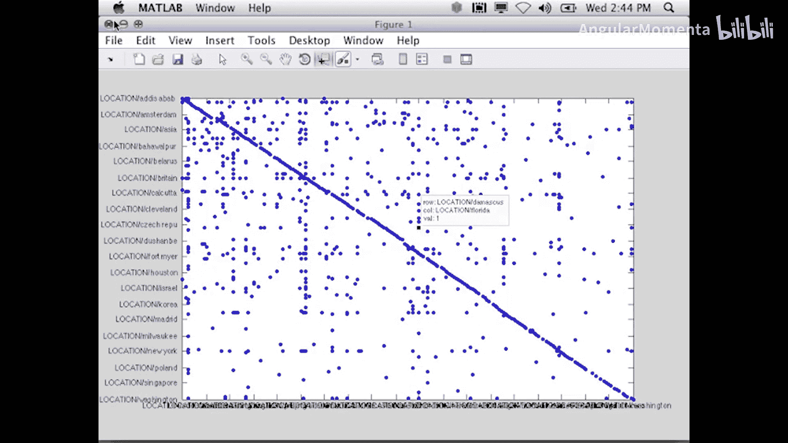
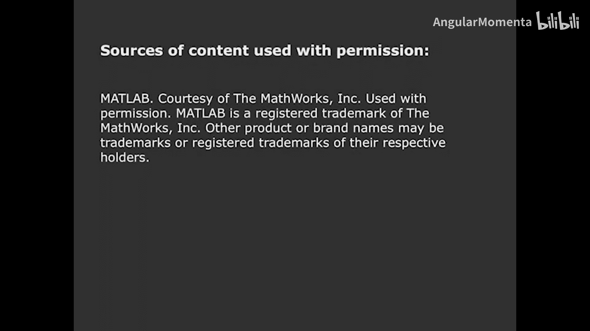

# 011：示例演示 🧭



在本节课中，我们将通过一系列具体的代码示例，学习如何使用D4M（数据库、数据、数据挖掘）工具包对路透社数据集进行高级分析。我们将重点学习如何构建和查询“轨迹”，并探索更复杂的分析模式。



---

## 数据概览与准备

首先，我们加载并查看数据集。这个数据集包含了近10000个文档和3600个实体（如地点、人物、组织、时间）。

```matlab
load entity.mat; % 加载名为 E 的关联数组
spy(E'); % 可视化数据矩阵的稀疏结构
```

通过可视化，我们可以看到数据中不同实体类别的分布。例如，地点“United States”和“New York”出现频率很高，组织“International Red Cross”也很突出。

我们可以使用 `startsWith` 等查询语法快速筛选数据。例如，查找所有以“person/”开头的列（即所有人物实体）：

```matlab
personRows = startsWith(E, 'person/');
```

---

## 构建简单轨迹

上一节我们介绍了数据分析的基本概念，本节中我们来看看如何从文档中提取“轨迹”。一个轨迹可以定义为在同一文档中同时出现的人物、时间和地点。

以下是构建轨迹的关键步骤：

1.  **定义轨迹元素**：我们指定人物、时间和地点作为轨迹的三个要素。
    ```matlab
    obj = startsWith(E, 'person/');
    tim = startsWith(E, 'time/');
    loc = startsWith(E, 'location/');
    ```

2.  **筛选有效文档**：只保留同时包含人物、时间和地点的文档行。
    ```matlab
    % 计算每行是否同时包含三类实体
    hasAll = sum(obj,2) & sum(tim,2) & sum(loc,2);
    E_reduced = E(hasAll, :);
    ```

3.  **创建边列表**：将文档、时间、地点信息转换为边列表格式。
    ```matlab
    % 提取文档-时间边和文档-地点边
    [~,~,ET] = find(E_reduced(:, tim));
    [~,~,ES] = find(E_reduced(:, loc));
    ```

4.  **通过矩阵乘法构建轨迹**：这是核心步骤，通过关联数组的矩阵乘法，高效地关联起人物、时间和地点。
    ```matlab
    % 构建“时间轨迹”：人物 -> 时间 -> 地点
    Ttrack = (obj' * tim) * loc';
    % 构建“空间轨迹”：人物 -> 地点 -> 时间
    Strack = (obj' * loc) * tim';
    ```

生成的 `Ttrack` 矩阵中，行是人，列是时间，值是与该人、该时间相关的地点集合。`Strack` 矩阵则展示了人物与地点的关联及其对应的时间。通过点击矩阵中的单元格，可以查看具体的关联详情。

---

## 轨迹查询与分析

构建轨迹后，我们可以进行各种查询。以下是几种常见的查询操作：

*   **查询特定人物的轨迹**：
    ```matlab
    personTrack = Ttrack('person/Michael Chang', :);
    ```

*   **在特定时间和地点窗口内查询轨迹**：
    ```matlab
    % 查找在1996年11月期间出现在澳大利亚的轨迹
    timeRange = startsWith(tim, 'time/199611');
    locationFilter = (loc == 'location/Australia');
    windowedTracks = Ttrack(:, timeRange) & Strack(:, locationFilter);
    ```

*   **比较不同人物的轨迹重合度**：
    ```matlab
    p1 = Ttrack('person/Michael Chang', :);
    p2 = Ttrack('person/Javier Sanchez', :);
    % 检查是否有共同的时间或地点
    overlap = p1 & p2;
    ```

---

## 构建轨迹图



我们可以将轨迹进一步抽象为图结构。例如，将一个轨迹序列（地点A -> 地点B -> 地点C）转换为地点之间的转移图。



以下是构建轨迹图的基本思路：

1.  对每个轨迹，提取其按时间排序的地点序列。
2.  将序列中相邻的地点对（如“地点A -> 地点B”）作为图中的一条边。
3.  统计所有轨迹中，相同地点对出现的次数作为边的权重。

```matlab
% 这是一个简化的逻辑示意
for each track
    locations = get_locations_in_time_order(track);
    for i = 1:length(locations)-1
        graph(locations(i), locations(i+1)) += 1;
    end
end
```

生成的地点-地点图（例如220x220的矩阵）可以揭示数据中隐藏的移动模式或关联模式。例如，我们可能发现从“Belgium”到“Albania”或从“Australia”到“Colombia”的频繁转移。

---

## 高级分析示例：多假设跟踪

对于更复杂的场景，如一个文档中提及一个人物和多个地点、时间，简单的轨迹模型可能不够。我们可以进行“多假设跟踪”分析。

此分析会列出特定人物（如“Michael Chang”）在所有文档中出现的所有可能的地点-时间对，形成一个可能轨迹的集合。此外，它还可以记录实体在文档文本中的字符距离等信息，为后续基于上下文的精确筛选提供依据。

```matlab
% 分析 Michael Chang 的所有可能关联
hypotheses = findMultipleHypothesisTracks(E, 'person/Michael Chang');
```
该函数会返回一个结构，包含人物每次出现时，文档中所有邻近的时间和地点，以及它们之间的字符偏移量，从而帮助判断哪个地点-时间对最可能是真实所指。

---

## 总结

本节课中我们一起学习了如何利用D4M对实体数据进行复杂的轨迹分析。我们从加载和探索数据开始，逐步实现了：
1.  **基础轨迹构建**：通过矩阵乘法关联人物、时间、地点。
2.  **灵活轨迹查询**：支持按人物、时间范围、地点进行筛选和对比。
3.  **轨迹图生成**：将序列数据转换为地点转移图，发现宏观模式。
4.  **高级分析模式**：如多假设跟踪，处理数据中的歧义以探索更精确的关联。




这些示例展示了D4M在探索性数据分析方面的强大能力，它允许研究者快速迭代和发现新的分析模式，然后将成熟的方法部署到生产系统中。