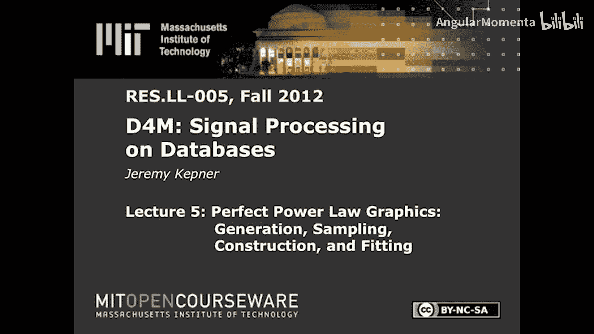
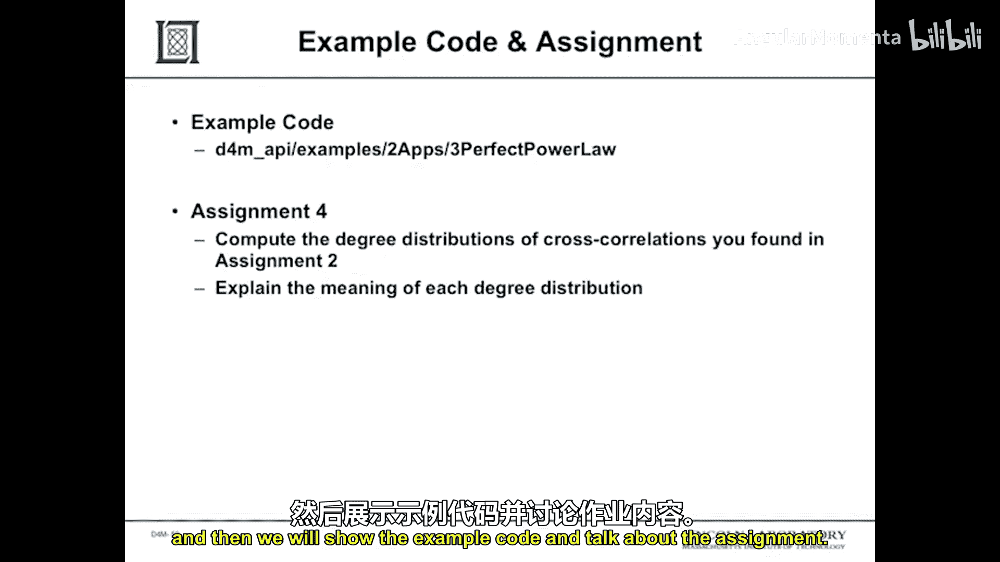
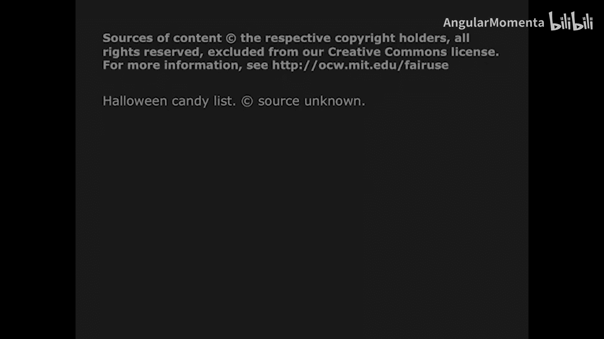

# 012：完美幂律图——生成、采样、构建与拟合 📊



在本节课中，我们将学习如何为图数据构建一个背景模型，特别是基于“完美幂律”的模型。我们将探讨如何生成、采样、拟合这种幂律分布，并利用它来检测数据中的异常模式。这对于理解社交网络、通信网络等由人工过程产生的数据至关重要。

## 概述

传统的信号处理依赖于高斯噪声作为背景模型。然而，许多现代数据集（如社交网络图）呈现出幂律分布，而非高斯分布。因此，我们需要为这些数据开发新的背景模型。本节课将介绍一种构建“完美幂律”图的线性模型方法，并研究采样、数据清理等操作对观测分布的影响，最终将其应用于实际数据（如路透社新闻数据集）的分析。

## 构建完美幂律图

上一节我们概述了背景模型的重要性。本节中，我们来看看如何具体构建一个完美的幂律分布图。

我们将图表示为一个随机矩阵 **A**。该矩阵有 `N_out` 个行顶点和 `N_in` 个列顶点，矩阵中的非零值代表边，所有值的总和 **M** 代表边的总数。一个“完美幂律”要求顶点的出度分布和入度分布都遵循幂律，即度数 **d** 与拥有该度数的顶点数 **N(d)** 满足关系：**N(d) ∝ d^{-α}**，其中 **α** 是幂律指数。

我们可以用以下简单的MATLAB函数来生成这样的度分布：

```matlab
function [d, N_d] = perfect_power_law(alpha, d_max, N_d)
    % 生成完美幂律度分布
    % alpha: 幂律指数
    % d_max: 最大度数
    % N_d: 控制分布中“段”的数量
    ...
end
```

该函数会生成一个度分布，其在对数坐标下呈直线。它巧妙地处理了从“整数区间”（每个整数度数一个桶）到“对数区间”的过渡，这与真实数据中观察到的现象一致。此外，我们可以用“简易斜率估计法”来估算 **α**，即直接用最大度数点 **d_max** 和度数为1的点进行拟合：**α = log(N(1)/N(d_max)) / log(d_max)**。

生成了度分布后，我们需要将其分配给具体的边。以下代码可以将度分布实例化为一个具体的边列表：

```matlab
edges = assign_edges_from_degree_distribution(d, N_d);
```

将顶点连接成边的方式有很多种（例如，全自环、随机连接），这对应着不同的二阶统计特性。通常，我们模拟随机标记顶点并随机配对的情况，这更接近真实世界的数据。

## 模型参数与拟合

我们构建模型的三个参数是：幂律指数 **α**、最大度数 **d_max** 和粗略代表区间数量的 **N_d**。然而，在实际分析中，我们更常从数据中获取顶点数 **N** 和边数 **M**。

给定 **α**，我们可以反推出能构成幂律的 **N** 和 **M** 的允许范围。并非所有的 **(N, M)** 组合都能产生幂律，它们通常落在一个带状区域内，其边顶点比常在10左右，这与许多实际数据集的经验值相符。通过数值方法，我们可以根据给定的 **α** 和 **M** 来拟合出最佳的 **d_max** 和 **N_d**。

以下是应用此模型的一个实例（以万圣节糖果分布为例）：
*   边数（糖果总数） **M = 77**
*   顶点数（糖果种类） **N = 19**
*   边顶点比 **M/N ≈ 4**
*   最大度数（某种糖果的数量） **d_max = 15**
*   简易斜率估计 **α ≈ 1.7**

通过模型拟合，我们得到了参数，并可以用模型定义的区间对原始数据进行重分桶。重分桶后的数据点能更清晰地揭示其背后的幂律趋势。

## 采样与数据清理的影响

拥有了生成完美幂律模型的能力后，我们现在可以研究常见的操作——如采样和数据清理——会如何影响我们观测到的分布。

在传统图论中，我们常将数据简化为无向、无权、无自环的图，以便应用现有理论。但当我们对一个完美幂律图施加这些“清理”操作时（例如，`A = triu(A + A') > 0`），其度分布会发生显著扭曲，可能产生弯曲或扇状尾部（我们称之为“女巫的扫帚”分布）。这种非线性失真可能被误认为是数据本身的特性。

然而，即使数据被清理后看起来不像幂律，我们仍可以通过模型拟合和重分桶来恢复其潜在的幂律结构。反之，有些操作（如计算关联矩阵 `A * A'`）可能产生一个看起来像幂律的分布，但经过重分桶分析后，可能会发现其存在“女巫的鼻子”状的隆起。这表明，线性幂律模型仍然是一个良好的一阶近似，而隆起部分可以作为二阶修正来研究。

另一个重要现象是“致密化”，即随着时间推移，图的边顶点比会增加。这不仅是潜在物理过程的产物，也直接源于采样方式：
*   **随机采样边**：随着采样比例增加，累积样本的边顶点比会持续上升（致密化），因为是在向固定数量的顶点中添加边。
*   **线性采样（整行或整列）**：每个样本本身就能保持与整体相似的密度，因此累积样本的密度保持恒定。

幂律指数 **α** 的估计也受采样影响。随机采样初始会高估 **α**，而线性采样则会低估，但随着数据量增加，两者都会收敛到真实值。

## 子采样与联合分布分析

对于大规模数据集，我们通常需要通过子采样来高效估计背景模型。我们可以分析从完美幂律中采样子集时，度分布的变化，并推导出相应的校正公式。

此外，我们可以通过顶点的度来标记它们，进而研究联合分布，即查看从度为 **d_out** 的顶点到度为 **d_in** 的顶点的边数分布。对于完美幂律，这个联合分布在用模型定义的区间重分桶后，应该呈现相对均匀的分布。

通过计算观测值与模型期望值的比值 **观测值 / 期望值**，我们可以识别异常模式。原始数据由于泊松采样噪声（在小计数区域波动大），比值图可能很杂乱。但经过重分桶后，大部分数据会集中在1附近，使得真正的异常值（显著大于或小于1）更容易被识别。我们可以据此定位最典型、最过剩和最不足的连接模式。

## 应用于路透社数据集

现在，我们将上述理论应用于真实的路透社新闻数据集。该数据集包含文档与实体（如地点、组织、人物、时间）之间的关联。

以下是针对不同实体类型的分析结果：
*   **地点与组织**：其度分布在重分桶后大致符合幂律，但仍存在一些弯曲，暗示数据中可能存在真实的结构性特征。
*   **人物**：其度分布在原始数据中呈现“弯曲扫帚”状，但经过模型拟合和重分桶后，显示出非常漂亮的幂律分布，表明人物关联性具有很强的幂律特性。
*   **时间**：重分桶后显示出明显的尖峰，这与数据中特定时间戳（如新闻发布时间）的集中出现有关，验证了重分桶对于揭示真实特征的有效性。

我们也分析了实体间的共现（关联）关系。例如，人物-人物关联的原始图看起来像幂律，但重分桶后揭示了数据中真实存在的相关性隆起。

在采样分析中，按文档（行）采样表现为线性采样特性，而按实体（列）采样则更接近随机采样特性，其致密化和幂律指数收敛行为都与完美幂律模型的预测一致。

最后，通过计算联合分布的观测值与期望值之比，我们可以系统地找出最具代表性的文档、最异常的连接等，为数据摘要和异常检测提供有力工具。

## 总结





本节课中，我们一起学习了为图数据构建基于“完美幂律”的背景模型。我们掌握了生成完美幂律图的方法，并深入探讨了采样、数据清理等操作如何非线性地扭曲观测分布。通过模型拟合和重分桶技术，我们可以从扭曲的数据中恢复潜在的幂律结构，或验证其是否存在高阶特征。我们将这套方法应用于路透社数据集，展示了如何利用背景模型来量化数据、识别异常，并理解不同实体类型的统计特性差异。这为在图数据上应用经典的检测理论奠定了坚实的基础。