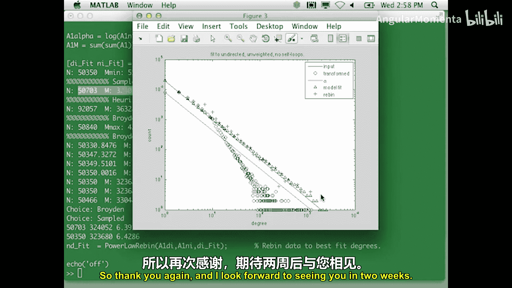

# 013：示例演示 🎬

在本节课中，我们将通过一系列MATLAB代码示例，学习如何生成、操作和分析符合幂律分布的图数据。我们将看到如何创建完美的幂律图，如何通过不同的排列方式改变其视觉表现，以及如何处理和校正采样数据。

---

## 生成完美幂律图

首先，我们学习如何根据给定的参数生成一个完美的幂律分布图。核心参数包括指数 `alpha`、最大度数 `Dmax` 和分箱数量 `ND`。

以下是生成和绘制初始幂律分布的步骤：

1.  **设置参数并生成分布**：我们设定 `alpha = 1.3`，`Dmax = 1000`，`ND ≈ 30`。使用 `power_law_distribution` 函数根据这些参数创建度数分布。
2.  **绘制分布图**：生成的完美幂律分布如图1所示。
3.  **计算图的基本属性**：通过求和计算总顶点数 `N` 和总边数 `M`。在本例中，得到 `N = 18,187`，`M = 84,000`，边顶点比约为 `4.6`。
4.  **生成边列表**：使用 `edges_from_distribution` 函数，根据度数分布生成一组符合该分布的顶点和边。

上一节我们介绍了如何生成一个基础的幂律图，本节中我们来看看如何通过不同的排列方式，改变这个图的邻接矩阵视觉表现，而不改变其度数分布。

## 探索不同的排列方式

通过随机排列边和顶点标签，我们可以创建视觉上不同但度数分布完全相同的图。以下是四种排列组合：

*   **不进行任何排列**：直接使用生成器输出的顶点和边。生成的邻接矩阵（图2）显示为完全的自环，这虽然无趣，但严格符合幂律分布。
*   **仅排列边**：随机打乱边的连接关系，但不改变顶点标签的顺序。生成的邻接矩阵（图3）看起来随机，但高度数顶点仍集中在矩阵的左上角（因为生成器默认按度数降序输出顶点）。
*   **仅排列顶点标签**：随机打乱顶点标签，但不改变边的连接。生成的邻接矩阵（图4）看起来稀疏且随机，因为每个顶点的边集被整体移动了位置。
*   **同时排列边和顶点标签**：这是创建随机外观图的典型方法。生成的邻接矩阵（图5）中，高度数顶点对应的行和列会显得格外密集，这是幂律图的标志性特征。

通过邻接矩阵可视化是分析大型图的有效方法，它能让我们在单个视图中观察数万条边，而传统的节点-连接线图在此尺度下会变得难以辨认。

接下来，我们将学习如何对生成的图数据进行常见的清理和转换操作。

## 数据清理与转换

在实际分析中，我们经常需要对图数据进行标准化处理。以下操作展示了不同处理方式对数据的影响：

*   **转换为无权图**：将多重边合并为单边。这会丢失连接强度的信息，例如在社交网络中，将频繁联系和单次联系等同看待。
*   **转换为无向图**：忽略边的方向。这也会丢失信息，例如在引用网络中，A频繁引用B与B频繁引用A的意义不同。
*   **消除自环**：移除顶点连接自身的边。在本例中，自环很少，因此此操作对数据扭曲很小。
*   **计算上三角关联矩阵**：通过邻接矩阵与其转置相乘得到，可以揭示其他结构。

这些转换都会以不同方式扭曲原始的理想幂律分布，图6至图9展示了这些扭曲效果。

在分析真实数据时，我们常常无法获得全量数据，而只能进行采样。下面我们看看采样对幂律分布估计的影响。

## 采样与校正

我们创建一个更大的完美幂律图（`N=50,000`，`M=329,000`），然后随机抽取 `1/40` 的顶点作为样本。

*   **朴素采样估计的问题**：如果简单地用样本度数乘以采样率（40倍）来估计总体度数，对于高度数顶点估计效果很好，但对于低度数（稀有）顶点，会严重高估其出现概率（图10与图11对比）。这印证了幂律世界中“长尾”效应：有大量稀有事件，其中一些注定会发生。
*   **改进的校正方法**：我们提供了 `compute_degree_correction` 和 `apply_degree_correction` 函数。该方法基于中位数（50分位数）进行校正，而不是简单的平均值。校正后（图12），对低度数顶点的估计变得更加合理，从而在高频和低频部分都能得到更好的总体估计。

最后，我们将学习如何对实际处理过的图数据进行幂律拟合，以恢复其原始分布参数。

## 幂律分布拟合

本部分演示如何对一个已经过转换（无向、无权、无自环）的图数据进行幂律拟合，试图恢复其原始参数。

1.  **准备数据**：使用之前的参数创建完美幂律图，然后对其进行无向、无权、消除自环的标准处理。
2.  **计算经验分布**：计算处理后图的度数分布。
3.  **估算“简易斜率”**：通过计算度数为1的顶点数与最大度数顶点数之比，快速估算alpha值（`poor man‘s alpha`）。在本例中，该估计值与真实值非常接近。
4.  **进行幂律拟合**：使用 `power_law_fit` 函数进行拟合。该函数结合了三种优化技术来应对拟合问题的复杂性：
    *   **采样搜索**：在参数空间中随机采样。
    *   **启发式搜索**：一种模拟退火类搜索。
    *   **邦加莱搜索**：一种改进的牛顿法非线性优化。
    函数会评估这些方法的结果，并选择最佳拟合参数（本例中选择了采样搜索的结果）。
5.  **评估拟合效果**：图13展示了拟合过程在 `N`（顶点数）与 `M`（边数）参数空间中的搜索路径。图14则对比了原始模型、转换后的数据、拟合出的新模型以及将数据重映射到模型分箱后的结果。可以看到，即使数据经过转换，拟合过程也能很好地恢复原始的幂律分布形态。

---

本节课中我们一起学习了从生成、可视化、转换到分析和拟合幂律图数据的完整流程。我们看到了如何通过邻接矩阵有效观察大图，理解了常见数据清理操作带来的影响，掌握了处理采样偏差的校正方法，并最终实现了对幂律分布参数的稳健拟合。这些工具和方法为分析真实世界中的复杂网络数据奠定了基础。