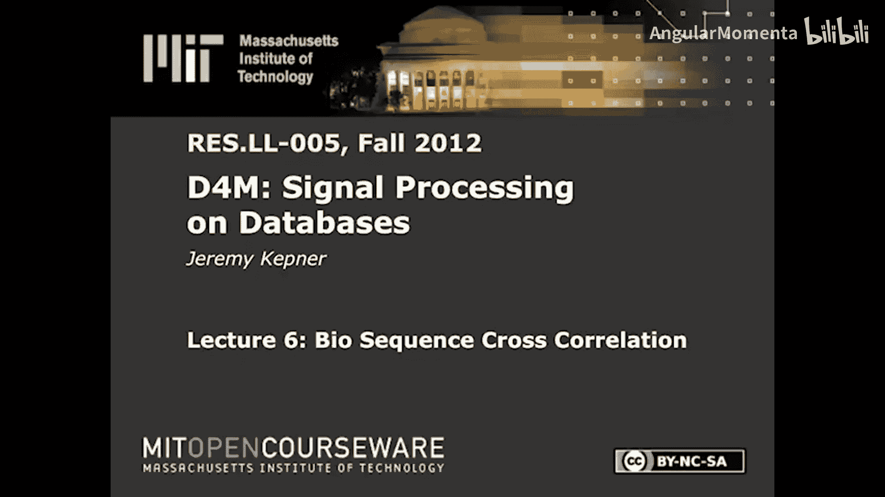
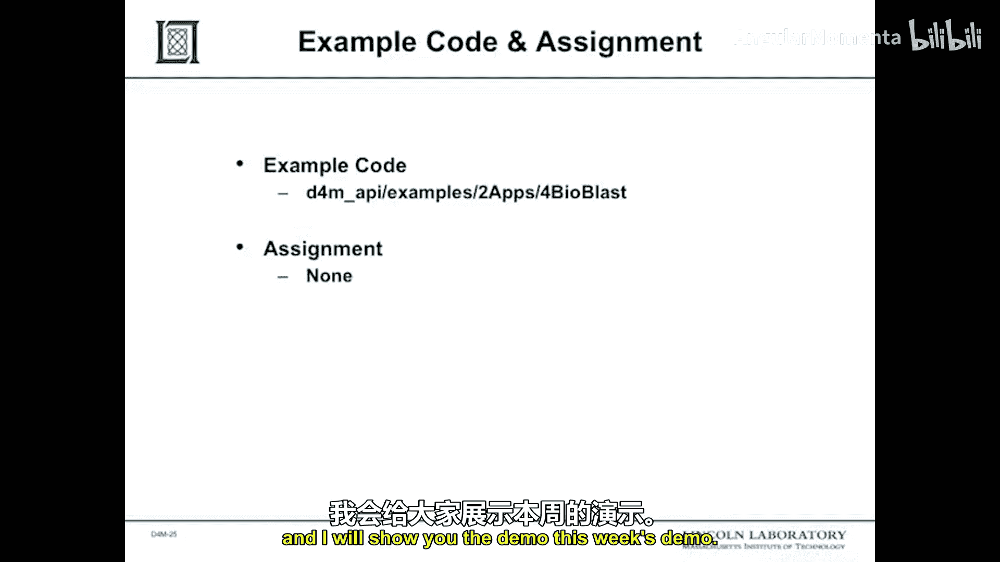

# 014： 生物序列互相关 🧬



在本节课中，我们将学习如何利用D4M技术和关联数组的数学原理，高效地进行生物基因序列的匹配与分析。我们将从一个具体的应用案例——快速识别病原体DNA序列——入手，了解整个数据处理流程，并展示如何通过结合数据库技术实现性能的显著提升。

## 概述：基因序列分析的挑战与机遇

随着DNA测序成本的急剧下降，获取基因数据变得前所未有的容易。一台桌面测序仪每天可产生数百GB的数据。这为医疗诊断、疫情追踪等领域带来了巨大机遇，但同时也对数据处理速度提出了严峻挑战。例如，在2011年德国大肠杆菌疫情中，快速、准确地识别病原体序列对于控制疫情和减少经济损失至关重要。传统的序列比对方法计算量大、耗时长，因此我们需要更高效的算法。

## 核心算法：基于关联数组的序列匹配

上一节我们提到了海量基因数据带来的挑战，本节中我们来看看如何使用D4M的核心数学工具——关联数组——来简化并加速序列匹配。

基因序列由A、T、C、G四种碱基（称为“基对”）组成。标准的匹配算法是将长序列切割成更短的片段（例如10个碱基的片段，称为“10-mer”），然后比较这些片段。

**算法步骤如下：**

1.  **构建参考序列矩阵**：将已知的参考数据库中的每条序列（ID）作为行，将该序列中出现的所有唯一10-mer作为列，形成一个稀疏关联数组 `A1`。
    *   `A1(序列ID, 10-mer) = 1` （表示该序列包含此10-mer）

2.  **构建待测序列矩阵**：对待测的未知样本序列进行同样操作，得到矩阵 `A2`。

3.  **计算互相关（匹配度）**：通过矩阵乘法计算两个集合的匹配程度。
    *   `匹配结果 = A1’ * A2`
    *   结果矩阵中的每个元素 `(i, j)` 的值，代表参考序列 `i` 与未知序列 `j` 所共有的10-mer数量。数值越高，表明两条序列越相似。

这个算法将复杂的生物序列比对问题，转化为了简洁的线性代数运算。

## 性能优化：利用统计特性减少计算量

直接进行全量序列比对计算量巨大。我们可以利用数据本身的统计特性来大幅优化。

在将参考数据存入数据库（如Accumulo）时，我们可以利用其“累加器”功能，自动统计每个10-mer在所有序列中出现的总次数，即它的“度”。分析发现，10-mer的度分布遵循一个长尾分布：少数10-mer出现在绝大多数序列中（常见片段），而大多数10-mer只出现在少量序列中。

**核心洞察**：常见片段（度很高的10-mer）就像常见词汇“的”、“是”，对于区分不同文档（序列）作用很小，反而是噪声。真正的匹配信息隐藏在那些不常见的片段中。

因此，我们可以设置一个阈值，**只选择那些度低于特定值的10-mer进行比对**。例如，仅使用度最低的0.5%的10-mer，就能过滤掉99.5%的数据量。

**实验结果证明**：
*   **检测率**：使用0.5%的数据，几乎能检测出所有的强匹配序列。
*   **误报率**：在降采样后的数据中，如果匹配数超过10，则几乎100%是真实匹配。
这种基于统计的降采样方法，在保证精度的同时，极大地提升了比对速度。

## 深入分析：追溯匹配的具体证据

有时我们不仅想知道匹配的数量，还想知道具体是哪些片段匹配了。这就需要“追溯谱系”的关联。

D4M提供了一种特殊的矩阵乘法（如 `catKeyMul`），它可以在计算结果中保留匹配的键（即具体的10-mer），而不仅仅是计数。

**代码示例**：
```matlab
% 执行保留具体匹配片段的矩阵乘法
detailed_matches = catKeyMul(A1', A2);
% 筛选出匹配数大于6的结果
strong_detailed_matches = detailed_matches(detailed_matches.val > 6, :);
```
结果将显示：序列ID `i` 与序列ID `j` 匹配，并且列出它们共同拥有的具体10-mer列表。这允许研究人员进一步分析匹配片段的连续性和生物学意义。

## 系统集成：从数据到应用的完整流程

一个完整的应用系统不仅仅是算法。本节我们来看看如何将D4M分析与数据库等技术集成到一个可用的数据处理管道中。

**典型数据处理管道如下：**

1.  **原始数据**：接收FASTA格式的原始基因序列文件。
2.  **数据解析**：将序列解析成“三元组”格式（行键：序列ID，列键：10-mer，值：位置）。
3.  **并行入库与本地缓存**：
    *   使用并行程序将三元组高速插入Accumulo数据库。为了获得最佳插入性能，需要注意数据的“分片”策略，将数据均匀分布到不同的数据库节点上。
    *   同时，将数据也转换为关联数组并保存为MAT文件。数据库擅长随机查询，而本地文件格式更适合对整个数据集进行全扫描或复杂分析，也便于并行计算。
4.  **分析计算**：从数据库查询参考数据，从本地文件加载样本数据，执行高效的降采样互相关计算。
5.  **结果展示**：可以通过Web界面等方式，为用户提供交互式分析结果。

这种架构分离了算法开发（在MATLAB/D4M环境中快速原型化）和系统部署（可能用Java等语言重写核心模块），兼顾了开发效率和运行效率。

## 成果总结

通过结合D4M的关联数组数学和Accumulo数据库的高性能特性，我们在基因序列分析上取得了显著成果：
*   **开发效率**：用约150行D4M代码实现了核心比对功能，而传统工具（如BLAST）有近百万行代码。
*   **运行效率**：相比传统方法，实现了**100倍的速度提升**，能够在几小时内处理数十亿的序列数据。




本节课中我们一起学习了如何将抽象的关联数组运算应用于具体的生物信息学问题，构建了一个从高效算法到完整系统管道的解决方案。这种方法不仅适用于基因序列分析，同样可应用于文档比对、网络分析等任何需要快速进行集合匹配和关联发现的领域。