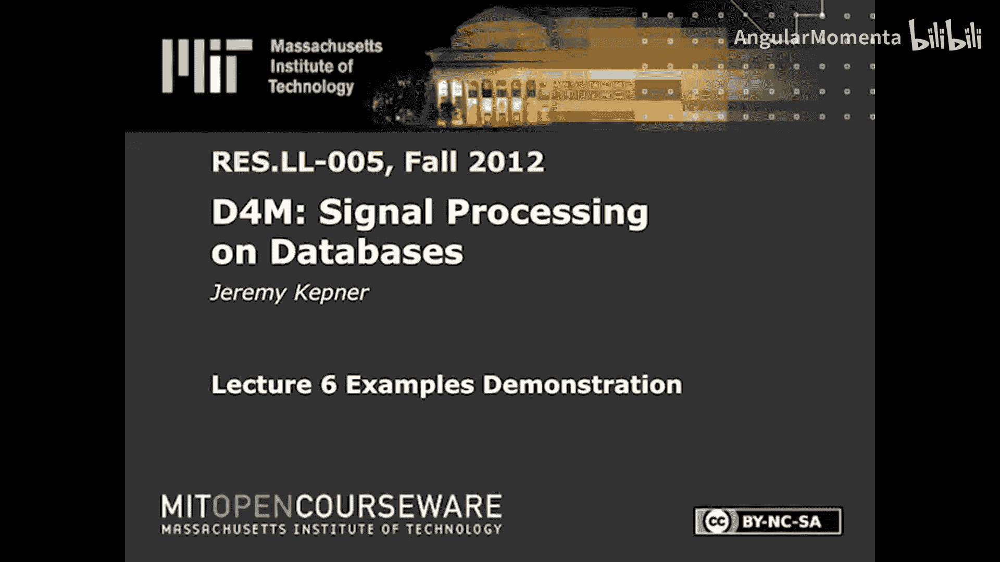
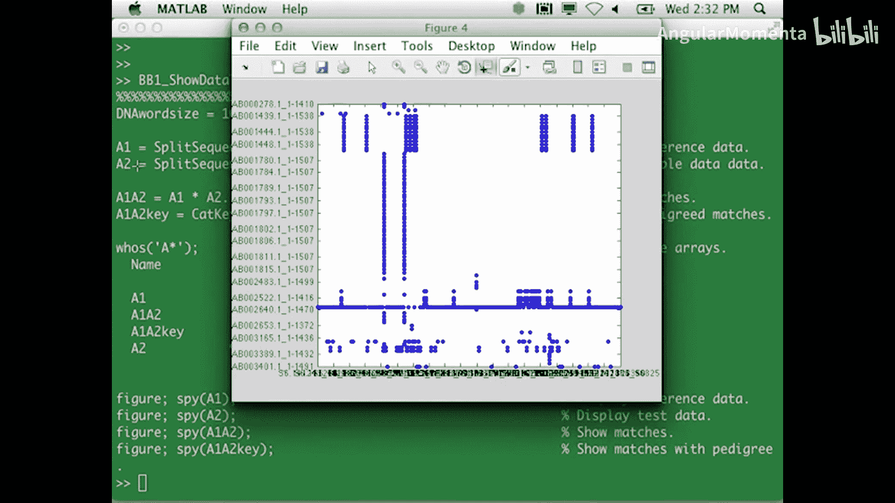
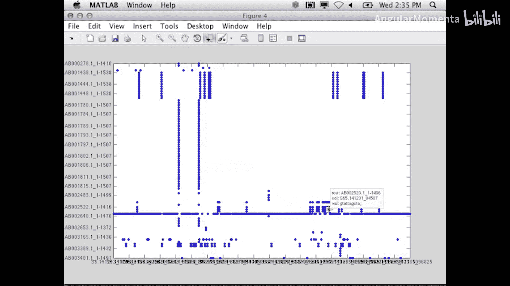
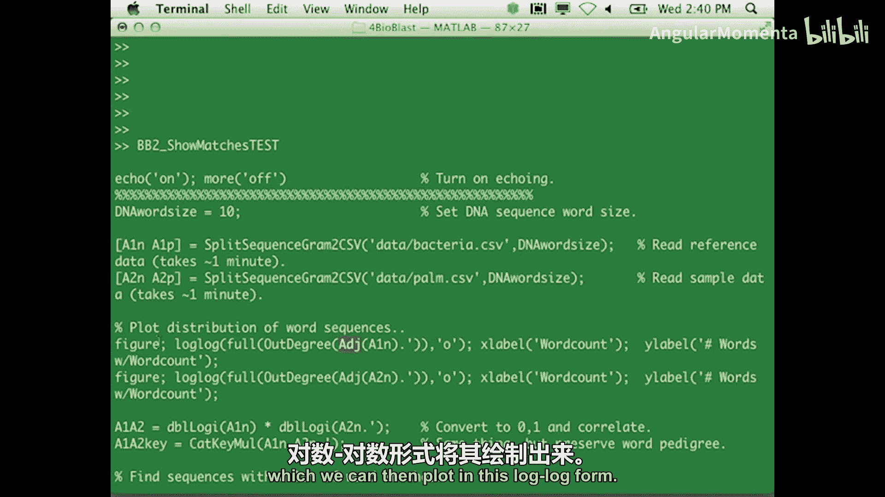
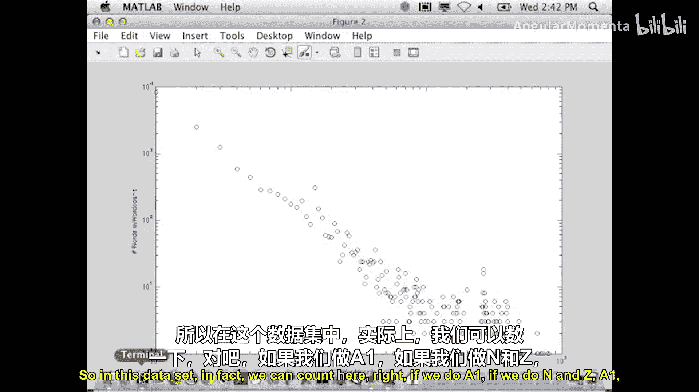
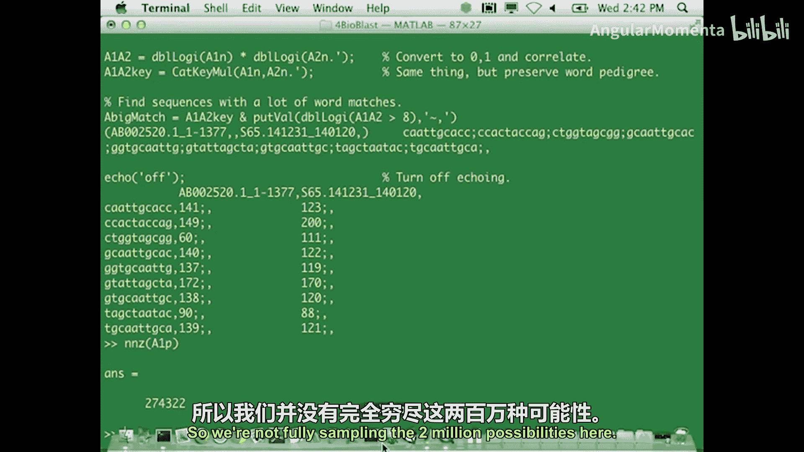
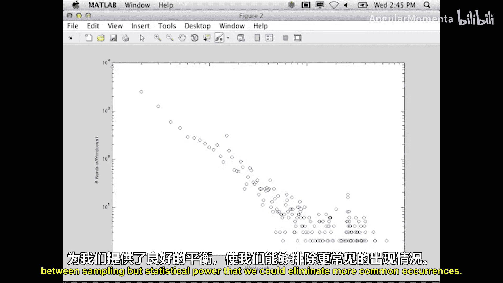
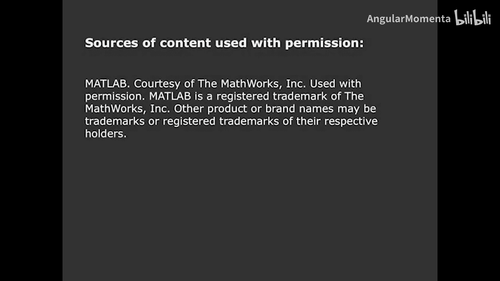

# 015：示例演示 🧬



在本节课中，我们将通过两个具体的示例，演示如何利用D4M（数据库、矩阵、数学）框架对生物信息学中的DNA序列数据进行关联数组操作和交叉相关分析。我们将学习如何从原始数据构建关联数组，进行矩阵乘法以发现序列间的匹配，并利用谱系追踪功能深入分析匹配细节。

---

## 概述与数据介绍

上一节我们介绍了关联数组和矩阵乘法的核心概念。本节中，我们来看看如何将这些理论应用于实际的DNA序列数据分析。




我们将使用两个数据集：
1.  一个已知的参考细菌数据集。
2.  一个从人手表面采集的DNA序列样本（开源数据）。

我们的目标是分析样本数据中的序列与参考数据集之间的匹配情况。以下是两个数据集的直观展示，可以看到序列长度差异很大。


---


## 示例一：基础匹配分析

首先，我们运行第一个示例程序 `B1`。该程序的核心是读取数据并构建关联数组。


### 构建关联数组

我们设定**k-mer**（即连续碱基片段）的长度为10，也就是分析10-mer。程序会读取CSV格式的FASTA文件，并根据指定的k-mer长度创建关联数组。


*   **行**： 代表一个DNA序列（Sequence ID）。
*   **列**： 代表一个唯一的10-mer。
*   **值**： 表示该10-mer在该序列中是否出现（通常为1）。



我们分别为参考数据集（A1）和样本数据集（A2）构建了关联数组。

```matlab
% 伪代码示意：构建关联数组
A1 = Assoc([], [], [], seqIDs1, kmers1);
A2 = Assoc([], [], [], seqIDs2, kmers2);
```

### 执行矩阵乘法

接下来，我们通过矩阵乘法计算两个数据集之间的交叉相关（匹配）情况。

*   **标准矩阵乘法 (`A1 * A2.‘`)**： 结果矩阵 `A1A2` 中的每个元素值，表示对应的参考序列和样本序列所共享的唯一10-mer的数量。
*   **谱系矩阵乘法 (`catKeyAll(A1, A2.‘)`)**： 结果 `A1A2key` 不仅包含数量，还通过值（value）记录了具体是哪些10-mer促成了这次匹配。

```matlab
% 计算匹配
A1A2 = A1 * A2.‘;          % 标准乘法，得到匹配计数
A1A2key = catKeyAll(A1, A2.‘); % 谱系乘法，得到匹配详情
```

运算结果显示：
*   A1（参考集）有198条序列，包含801个唯一10-mer。
*   A2（样本集）有999条序列，包含2365个唯一10-mer。
*   矩阵乘法后，198条参考序列中的85条，与999条样本序列中的415条，至少有一个共同的10-mer。

### 结果可视化与分析


我们可以通过可视化工具查看这些矩阵。

1.  **查看A1（参考数据集）**： 矩阵非常稀疏。放大后可以看到，某些10-mer（列）出现在很多序列中，形成垂直的“亮线”；某些序列（行）包含很多10-mer，形成水平的“亮线”。



2.  **查看A2（样本数据集）**： 结构类似，但模式略有不同，可能存在更多密集的区块。

3.  **查看交叉相关矩阵 (`A1A2`)**： 该图显示了匹配计数。由于大部分匹配只是偶然共享一个10-mer，所以图中绝大多数点的值都是1。

4.  **查看谱系结果 (`A1A2key`)**： 这是最关键的一步。图中每个点代表一个具体的匹配关系。例如，一个点表示“参考序列ID-X”与“样本序列ID-Y”在“10-mer-Z”上匹配。点击该点，程序可以打印出完整的10-mer字符串，方便我们进一步核查。

通过这个简单的例子，我们演示了从数据到关联数组，再到发现并可视化序列间基本关联的全过程。





---

## 示例二：进阶分析与统计

在第一个示例中，关联数组的值仅是0或1（表示出现与否）。现在，我们进行更深入的分析，记录每个10-mer在序列中出现的具体位置和次数。

### 构建包含位置信息的关联数组

我们再次读取数据，但这次生成两个关联数组：
*   `A1c`: 存储每个10-mer在每条序列中出现的**次数**（计数）。
*   `A1p`: 存储每个10-mer在序列中出现的**位置列表**。

这为后续分析（如判断匹配是否是连续区域）提供了可能。虽然构建这样的数组更耗时，但信息量更大。



### 分析度分布

在深入匹配细节前，先了解数据的整体统计特性总是有益的。我们计算并绘制两个数据集的“出度”分布（即每条序列包含的唯一10-mer数量）。

以下是具体方法：
1.  使用 `adj` 函数从关联数组 `A1c` 中提取其内部的稀疏矩阵。
2.  使用 `outdegree` 函数对行（序列）进行求和，得到每条序列的10-mer数量。
3.  在双对数坐标轴上绘制频率分布图。

```matlab
% 计算并绘制出度分布
M1 = adj(A1c); % 获取内部稀疏矩阵
d1 = outdegree(M1); % 计算行和（出度）
loglog(sort(full(d1), ‘descend‘)); % 绘制双对数图
```


**结果分析**：两个数据集的分布都近似遵循**幂律分布**（长尾分布），即大多数序列只包含少量独特10-mer，少数序列包含大量独特10-mer。这与许多真实世界网络数据特征相似。

**一个深入思考**：为何之前某些数据显示类似高斯（钟形）分布？这可能与采样充分性有关。10-mer的总可能组合约有4^10 ≈ 100万种。当前数据集仅包含约27万个条目，未充分采样整个空间，故呈幂律分布。当一个数据集足够大（如5亿条目），能更充分地采样整个可能空间时，分布可能更接近对数正态分布（钟形）。这只是一个假设，说明了数据规模对统计特征的影响。

### 执行有阈值的匹配分析

现在，我们进行类似于示例一的交叉相关分析，但目标更明确：找到那些共享**多个**独特10-mer的序列对，这比偶然匹配更有意义。

步骤如下：
1.  **二值化**： 将存储计数的 `A1c` 和 `A2c` 通过 `double logical` 函数转换回0/1矩阵（`A1b， A2b`），因为我们只关心是否出现，不关心出现次数。
    ```matlab
    A1b = double(logical(A1c));
    A2b = double(logical(A2c));
    ```
2.  **计算匹配**： 计算 `A1b` 和 `A2b` 的交叉相关。
    ```matlab
    Corr = A1b * A2b.‘;
    ```
3.  **设定阈值并提取**： 我们只关注匹配数大于8的序列对。这里使用了一个巧妙的技巧：
    ```matlab
    HighMatch = (Corr > 8); % 提取匹配数>8的子数组
    HighMatch = floor(HighMatch); % 将所有值设为1
    HighMatch = putVal(HighMatch, ‘~‘); % 将所有值赋为字符串‘~‘
    ```
    **技巧解释**： 我们将`HighMatch`的值设为`‘~‘`，然后与谱系矩阵`catKeyAll(A1b， A2b.‘)`进行“与”操作。D4M默认的字符串碰撞函数是`min`（取字典序最小值）。`‘~‘`的ASCII码很大，而谱系信息字符串通常以字母开头（ASCII码较小）。因此，`min(‘~‘， ‘具体谱系‘)`的结果永远是谱系字符串本身。这样我们就巧妙地利用碰撞函数规则，从谱系矩阵中“筛选”出了我们感兴趣的高匹配对的具体匹配信息。
4.  **查看结果**： 最终，我们可以得到类似这样的信息：参考序列`ID_REF`与样本序列`ID_SAMP`匹配了至少8个不同的10-mer，并列出这些10-mer的具体列表。进一步，我们可以根据`A1p`和`A2p`中的位置信息，检查这些匹配的10-mer在原始序列中是否是连续区域，从而判断是否可能来自同源DNA片段。

---

## 总结与课程预告

本节课中，我们一起学习了两个完整的D4M应用示例：
1.  **基础匹配**： 从FASTA数据构建关联数组，利用矩阵乘法快速发现序列间的共享k-mer，并通过可视化工具探索结果。
2.  **进阶分析**： 在关联数组中存储更丰富的信息（计数、位置），通过度分布了解数据整体特征，并利用阈值筛选和谱系追踪功能，深入挖掘具有显著意义的序列匹配对。

通过这些操作，我们展示了D4M如何将数据库查询（通过关联数组）转化为线性代数运算，从而高效处理大规模、稀疏的生物信息学数据。

**下节课预告**：接下来的课程将是整个系列中最关键的一讲。大家将有机会在Lincoln实验室的网格计算账户上，亲自运行这些示例程序，操作真实的测试数据库。这对于理解和掌握D4M技术至关重要，也帮助我们共同测试和完善D4M工具。期待大家的参与！

谢谢。


