# 016：演示7 🚀


在本节课中，我们将通过一系列实际演示，学习如何使用D4M与Accumulo数据库进行交互。我们将从生成测试数据开始，逐步进行数据插入、查询、迭代器使用以及更复杂的连接操作，最后还会展示如何处理更大规模的数据集和真实的Twitter数据。通过这些步骤，你将掌握利用D4M进行高效数据库操作的核心技能。

***

## 概述

本节课是课程系列的倒数第二讲。之前的所有内容都在为实际使用数据库打下基础。今天我们将不依赖幻灯片，而是通过实际操作演示与现有技术栈的交互。所有演示内容都是你可以实际使用的。我们将从使用已设置的Accumulo数据库开始。

你可以通过访问网页 `dbstatus.lincoln.mit.edu` 来查看你有权访问的数据库列表。登录后，你会看到为课程设置的五个独立的Accumulo数据库实例。

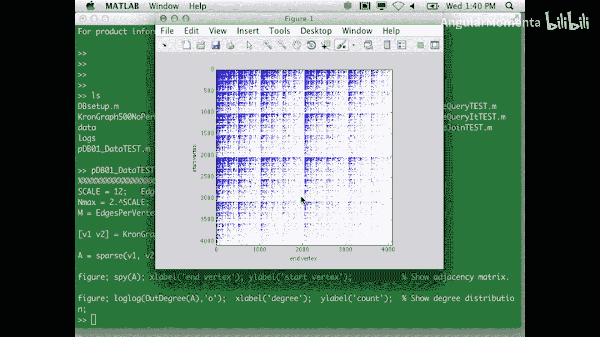

一个正在运行的Accumulo实例的管理页面会显示磁盘使用情况、表数量、历史摄入速率和扫描速率等信息。这些信息对于监控数据库性能非常有用。


今天的演示代码位于 `examples/scaling/two_parallel_database` 目录中。我们将涵盖大量内容，展示如何利用D4M和Accumulo协同工作。

***


## 第一步：生成测试数据 📊

为了进行数据库工作和测试，我们首先需要生成一些数据。我们将使用一个内置的数据生成器，称为Kronecker图生成器。它源自Graph 500基准测试，可以生成具有幂律分布的大规模图。

以下是生成数据的关键参数和步骤：
*   **scale参数**：决定顶点数量，顶点数大约为 `2^scale`。
*   **边数**：每个顶点的平均边数乘以最大顶点数 `nmax`。
*   **生成结果**：返回两个向量，分别代表起始顶点和结束顶点的列表。


我们首先生成一个较小的图来观察其结构。


```matlab
scale = 12;
edgeFactor = 16;
nmax = 2^scale;
m = edgeFactor * nmax;
[src, dst] = KronGraph500NoPerm(scale, edgeFactor);
A = sparse(src, dst, 1, nmax, nmax);
spy(A);
title('Kronecker Graph Adjacency Matrix');
```

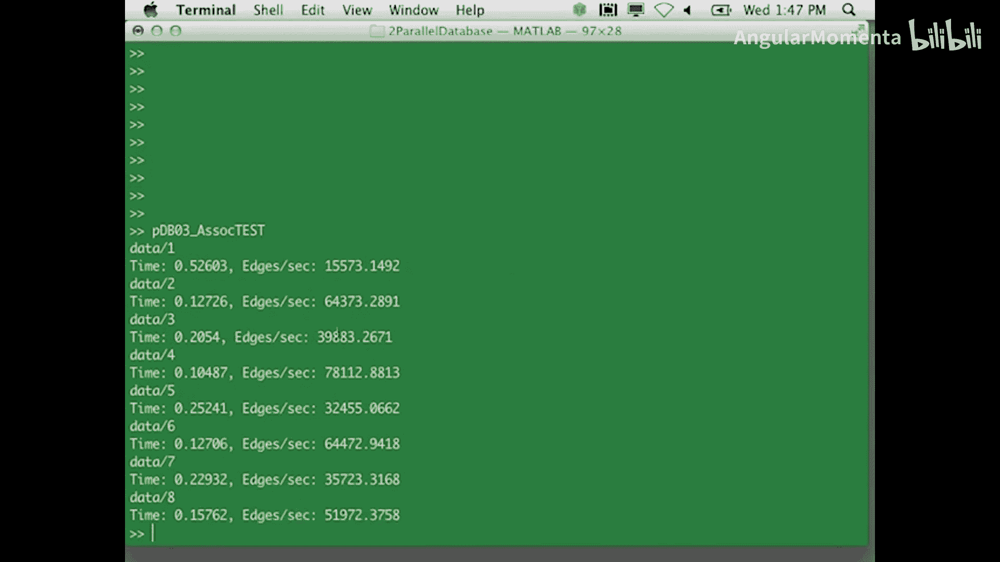

生成的邻接矩阵具有递归的分形结构。我们还可以绘制其度分布图，它呈现出典型的幂律特征，即少数顶点（超级节点）拥有大量连接，而大多数顶点连接数很少。

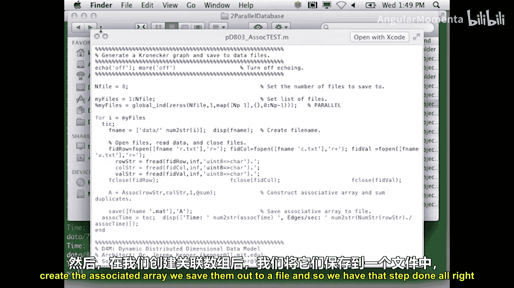

***

## 第二步：创建更大的数据集并保存到文件 💾


接下来，我们将创建一个更大的数据集。通过多次调用生成器，我们可以获得同一图分布的多个独立样本，从而创建一个边数更多的图。


我们将生成8组数据，并将每组数据的（行、列、值）三元组分别保存到三个独立的文本文件中（`*_row.txt`, `*_col.txt`, `*_val.txt`）。在生成过程中，我们会记录每秒生成的边数，这是评估数据处理流水线性能的重要指标。


```matlab
numFiles = 8;
for i = 1:numFiles
    fileName = sprintf('data/test_%02d', i);
    rng(i); % 设置随机种子以保证可重复性
    [src, dst] = KronGraph500NoPerm(scale, edgeFactor);
    % 将顶点索引转换为字符串并写入文件
    dlmwrite([fileName '_row.txt'], num2str(src), '');
    dlmwrite([fileName '_col.txt'], num2str(dst), '');
    dlmwrite([fileName '_val.txt'], ones(size(src)), ''); % 值全部设为1
end
```

生成的文件包含由逗号分隔的字符串序列。现在，我们有了8组数据文件。


***


## 第三步：将文件数据读入并构建关联数组 🔄

直接处理文本文件效率较低。因此，我们将这些三元组读入，构建成D4M的关联数组（Associative Array），然后保存为MATLAB的二进制 `.mat` 文件。这样，后续操作会快得多。

在构建关联数组时，如果遇到相同的行和列键（即碰撞），我们可以指定处理方式。默认是取最小值，但我们也可以指定为求和操作 `@sum`，这样同一个单元格的值就会累加起来。


```matlab
for i = 1:numFiles
    fileName = sprintf('data/test_%02d', i);
    % 读取三元组文件
    rowStr = dlmread([fileName '_row.txt'], ',');
    colStr = dlmread([fileName '_col.txt'], ',');
    val = dlmread([fileName '_val.txt'], ',');
    % 构建关联数组，碰撞时值相加
    A = Assoc(rowStr, colStr, val, @sum);
    save([fileName '.mat'], 'A');
end
```

保存后的 `.mat` 文件通常比原始的三个文本文件更小，因为关联数组内部对行键和列键进行了压缩存储。

***

## 第四步：在文件上进行计算（入度/出度分布）📈

现在，我们可以直接基于 `.mat` 文件进行计算，而无需数据库。例如，我们可以读取所有文件，累加计算整个图的入度分布和出度分布。

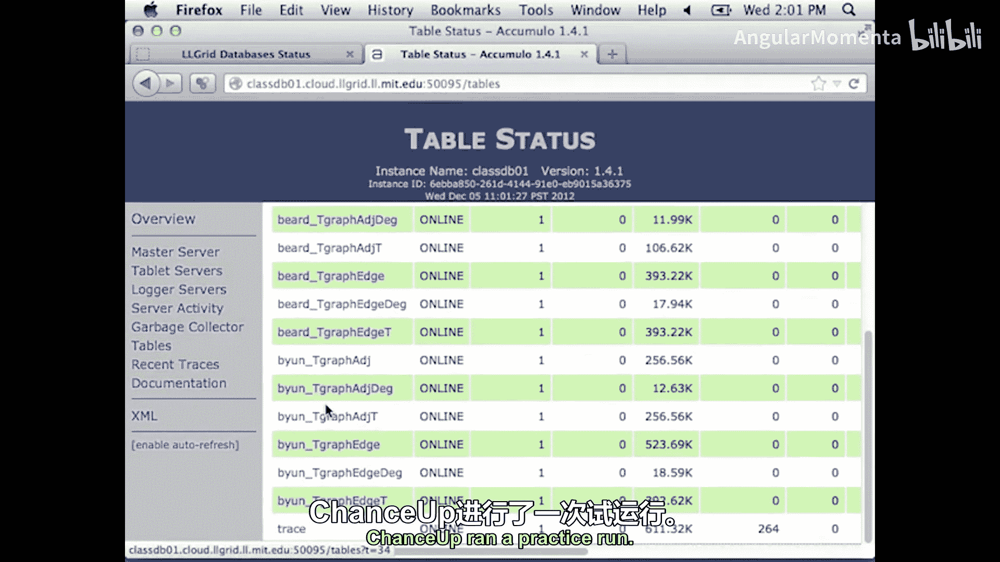

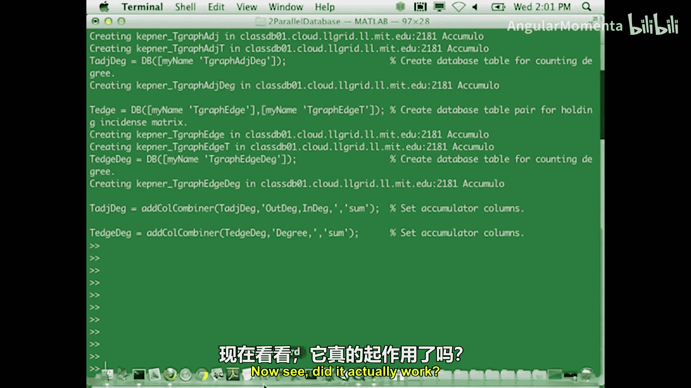

一种简单的方法是循环读取每个文件，并将关联数组直接相加。然而，对于大规模数据，这种方法可能导致性能随着循环次数增加而下降，因为每次相加都涉及重建操作。

更高效的方法是先分别对每个文件计算行和或列和，将结果保存到列表或预分配的缓冲区中，最后再进行一次性的总和计算。

```matlab
inDegreeTally = [];
outDegreeTally = [];
for i = 1:numFiles
    fileName = sprintf('data/test_%02d.mat', i);
    load(fileName, 'A');
    % 计算并累加行和（出度）与列和（入度）
    outDegreeTally = [outDegreeTally; sum(A,2)]; % 追加到列表
    inDegreeTally = [inDegreeTally; sum(A,1)']; % 追加到列表
end
% 最后进行总和计算（更高效的方式是使用预分配缓冲区）
totalOutDegree = sum(outDegreeTally);
totalInDegree = sum(inDegreeTally);
% 绘制度分布图
figure;
loglog(full(totalOutDegree), full(totalInDegree), '.');
```

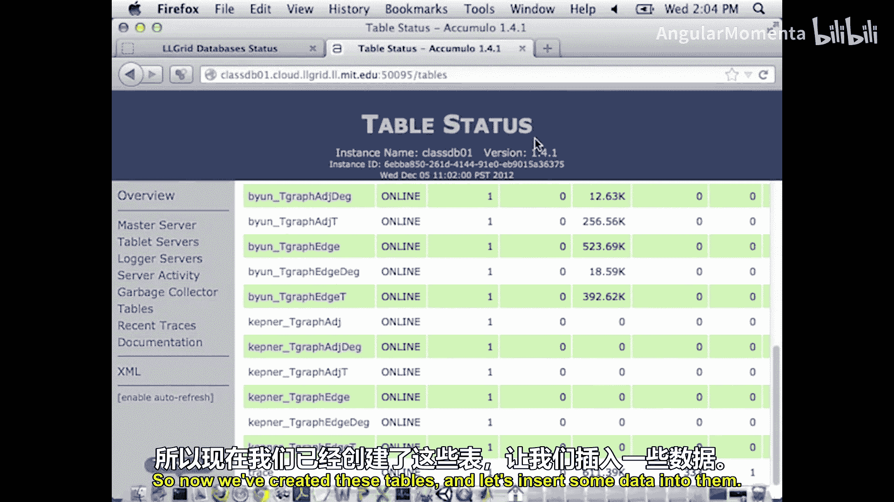


这种基于文件的计算方式非常适合需要遍历全部数据的分析任务。如果后续需要反复使用某次查询的结果，将其保存到文件中是更佳选择。

***

## 第五步：设置数据库与创建表 🗃️


现在，我们开始真正的数据库操作。首先，需要在Accumulo中设置并创建表。

我们使用 `DBsetup` 命令来连接数据库。在林肯实验室网格（LLGrid）系统上，有一个便捷函数 `DBsetupLLGrid`，它利用挂载的文件系统来获取认证密钥，简化了连接过程。

我们将创建以下几组表：
1.  **邻接矩阵表对**：一个表存储 `(行, 列)`，其转置表存储 `(列, 行)`，以实现快速的行查找和列查找。
2.  **度统计表**：利用Accumulo的聚合器（Combiner）功能，在插入时实时计算并存储每个顶点的入度和出度。这对于快速了解数据规模非常有用。
3.  **边表（关联矩阵）**：以边为行、顶点为列，保留每条边的原始信息，支持超边（连接多个顶点的边）。


在创建表时，我们可以为特定列（如 `'out_degree,'` 和 `'in_degree,'`）启用 `SUM` 聚合器，这样在插入碰撞时值会自动相加。

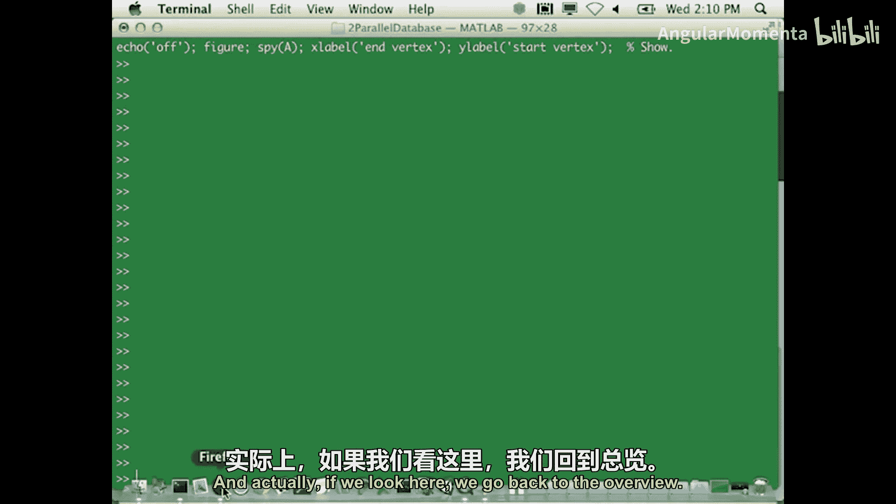

```matlab
% 连接数据库（LLGrid特定方式）
db = DBsetupLLGrid('classdb01');
% 创建邻接矩阵表对
Tadj = DB([myName 'Tadj'], [myName 'TadjT']);
% 创建度统计表，并为度数列启用SUM聚合器
TadjDeg = DB([myName 'TadjDeg']);
TadjDeg = addColCombiner(TadjDeg, 'out_degree,', 'sum');
TadjDeg = addColCombiner(TadjDeg, 'in_degree,', 'sum');
% 创建边表及度统计表
Tedge = DB([myName 'Tedge'], [myName 'TedgeT']);
TedgeDeg = DB([myName 'TedgeDeg']);
TedgeDeg = addColCombiner(TedgeDeg, 'degree,', 'sum');
```

创建成功后，可以在Accumulo的Web管理界面中看到新创建的空表。请注意，在生产环境中，需要合理设置表的读写权限。

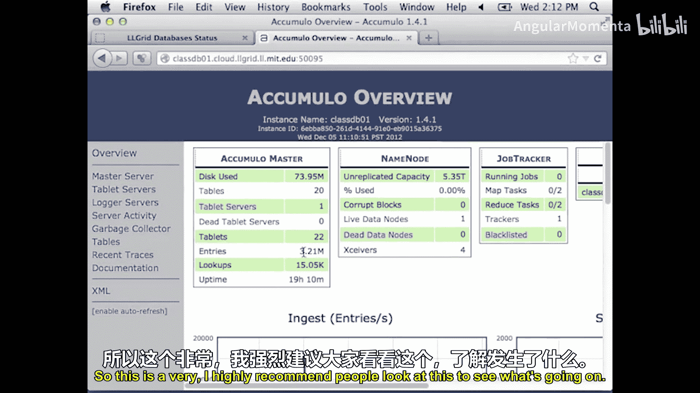

***

## 第六步：向数据库插入数据 ⬆️

表创建好后，我们就可以向其中插入数据了。首先插入邻接矩阵数据。

我们从 `.mat` 文件中读取关联数组，但需要注意，Accumulo只能存储字符串。因此，我们需要使用 `Num2Str` 函数将关联数组中的数值转换为字符串。

插入操作非常简单，只需使用 `put` 方法即可。对于表对 `Tadj`，D4M会自动处理正向和转置的插入。对于度统计表 `TadjDeg`，我们先在D4M中计算好每个顶点的行和（出度）与列和（入度），然后再插入。这种“先聚合，后插入”的方式可以显著减少数据库的插入操作次数，提升性能。

```matlab
for i = 1:numFiles
    fileName = sprintf('data/test_%02d.mat', i);
    load(fileName, 'A');
    % 将数值转换为字符串以便数据库存储
    Astr = Num2Str(A);
    % 插入邻接矩阵
    put(Tadj, Astr);
    % 计算并插入出度
    outDeg = sum(A, 2);
    put(TadjDeg, Assoc(row(outDeg), 'out_degree,', Num2Str(outDeg)));
    % 计算并插入入度
    inDeg = sum(A, 1)';
    put(TadjDeg, Assoc(row(inDeg), 'in_degree,', Num2Str(inDeg)));
end
```


即使是插入15万条记录，Accumulo也能在瞬间完成，这展示了其强大的插入性能。我们可以通过管理界面监控实时的插入速率。

***


## 第七步：执行数据库查询 🔍

数据插入后，我们就可以执行查询了。一个常见的场景是：随机选择一些顶点，先查看它们的度（数量），然后根据度的范围（例如，过滤掉超级节点和噪声节点）筛选出感兴趣的顶点，最后获取这些顶点的完整邻接行信息。

这类似于信号处理中的“滤除杂波（clutter）”和“抑制噪声（noise）”步骤，在图分析中非常实用。


```matlab
% 随机选择100个顶点
numVertices = 100;
randomVertices = randi([1, 1000], numVertices, 1);
vertexStr = Num2Str(randomVertices);
% 查询这些顶点的出度
degreeInfo = TadjDeg(vertexStr, 'out_degree,');
% 设置度的阈值，筛选出“信号”顶点
degMin = 5;
degMax = 10;
selectedVertices = degreeInfo(:, 'out_degree,') > degMin & degreeInfo(:, 'out_degree,') < degMax;
% 获取筛选后顶点的完整邻接行
resultRows = Tadj(row(selectedVertices), :);
% 可视化结果
spy(resultRows);
```

通过这种查询，我们可以快速聚焦于图中具有特定连接模式的顶点。

***

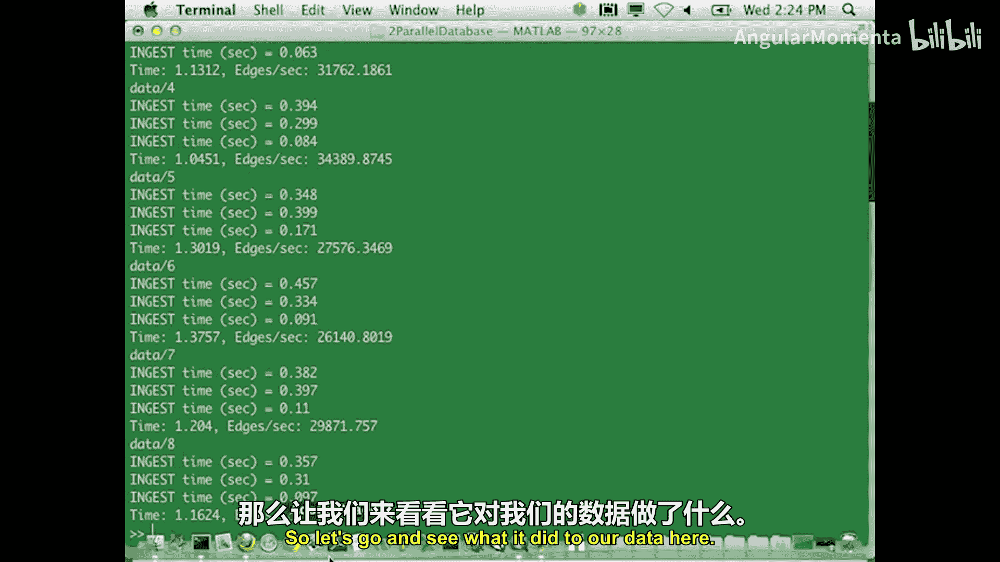

## 第八步：使用迭代器处理大量结果 🔄

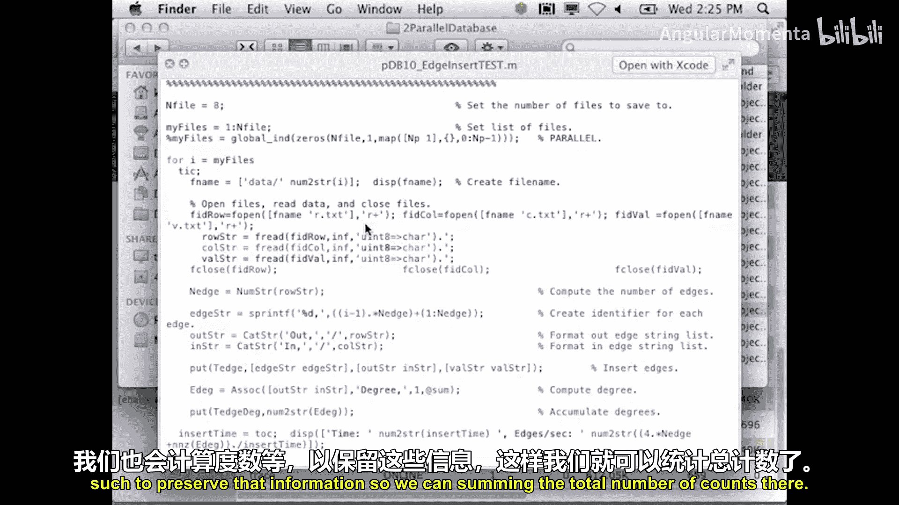

当查询可能返回大量数据（超过内存容量）时，我们需要使用迭代器（Iterator）。迭代器允许我们以可控的块大小（chunk size）逐步获取查询结果。


在MATLAB中，我们通过创建迭代器对象来实现。尽管MATLAB本质上是无状态的，但D4M通过底层Java代码实现了有状态的迭代器，语法上依然保持MATLAB风格。


```matlab
% 创建迭代器，设置每次返回最多1000条条目
maxElements = 1000;
iterator = Tadj.iterator('element', maxElements);
% 初始化查询，获取随机顶点的数据
queryVertices = Num2Str(randi([1, 1000], 100, 1));
A1 = iterator(queryVertices);
% 循环处理结果块
inDegreeTally = [];
while nnz(A1) > 0
    inDegreeTally = [inDegreeTally; sum(A1, 1)'];
    A1 = iterator(); % 继续获取下一块结果
end
% 计算最大入度
maxInDegree = max(full(inDegreeTally));
```


迭代器使得处理海量结果成为可能，并且可以在获取一定数量后暂停，等待用户确认，防止意外的大查询拖垮系统。

***

## 第九步：在数据库上执行连接操作 ⛓️


连接（Join）是数据库的核心操作之一。例如，我们想找出同时包含特定两个顶点的所有记录。


一种方法是先分别获取包含顶点A和顶点B的所有记录列，在内存中进行逻辑“与”操作，找出同时包含两者的行，然后再根据这些行键去获取完整的记录。

```matlab
col1 = '1,';
col2 = '100,';
% 获取包含col1或col2的所有列
cols = Tadj(:, {col1, col2});
% 将值转换为逻辑值并求和，和为2的行即同时包含两者
jointRows = sum(logical(cols), 2) == 2;
% 获取这些行的完整信息
result = Tadj(row(jointRows), :);
```

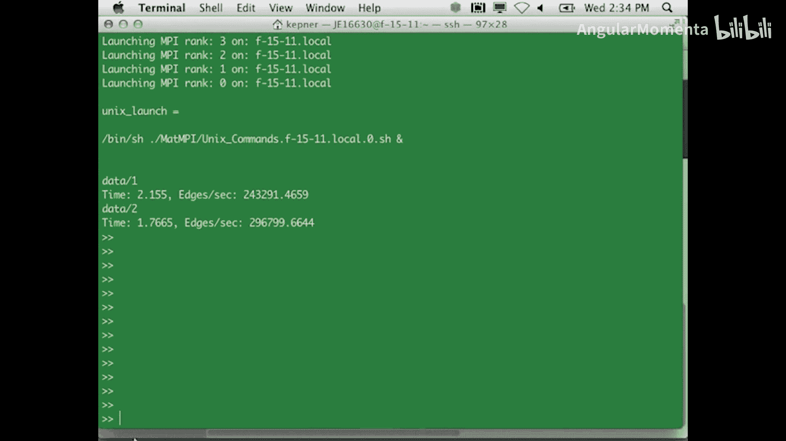

如果单个列的结果太大无法装入内存，可以使用两个迭代器分别遍历，并在遍历过程中逐步完成连接操作。这模拟了传统SQL查询规划器在后台的工作方式。


***

## 第十步：插入并查询边数据（关联矩阵） 📝


之前我们存储的是邻接矩阵，它合并了重复边。有时我们需要保留每条边的原始信息，这时就需要使用关联矩阵（Incidence Matrix），其中每行代表一条边，每列代表一个顶点。

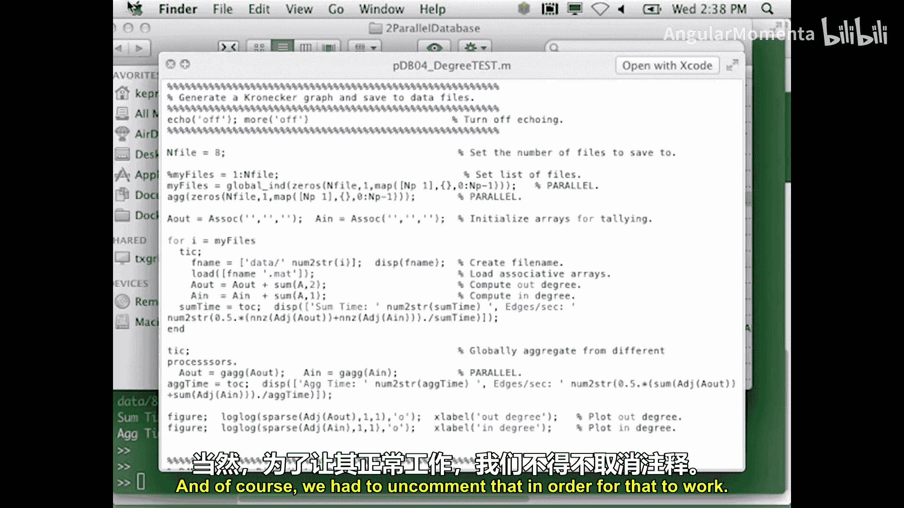

插入边数据的过程与之前类似，但需要为每条边生成唯一的行键，并在列键中体现方向（如 `'out/‘` 和 `’in/'`）。

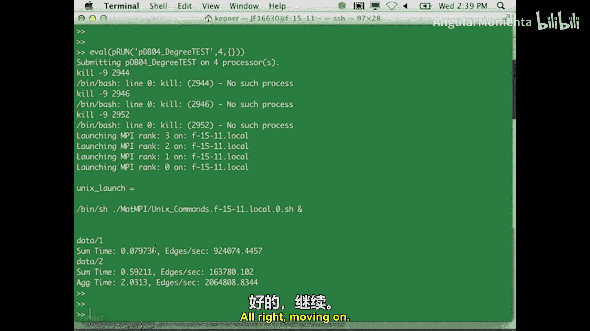

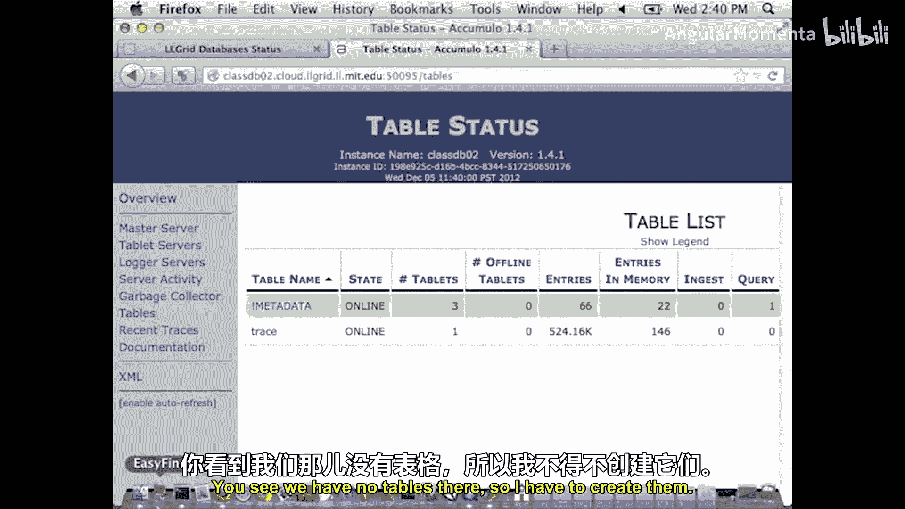

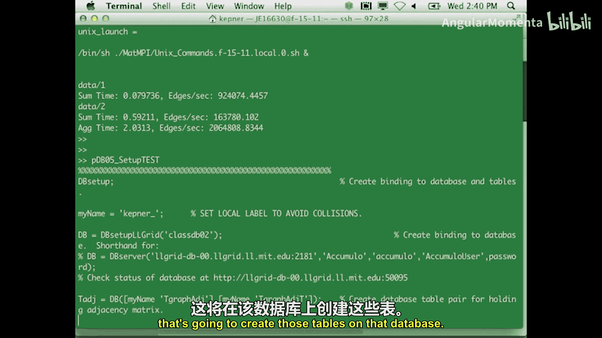

```matlab
for i = 1:numFiles
    % 读取原始的三元组文件
    src = dlmread(sprintf('data/test_%02d_row.txt', i), ',');
    dst = dlmread(sprintf('data/test_%02d_col.txt', i), ',');
    numEdges = length(src);
    for e = 1:numEdges
        % 为每条边创建唯一ID
        edgeId = sprintf('edge%06d_%02d', e, i);
        % 插入出边和入边信息
        put(Tedge, Assoc(edgeId, ['out/' num2str(src(e))], '1'));
        put(Tedge, Assoc(edgeId, ['in/' num2str(dst(e))], '1'));
    end
end
```

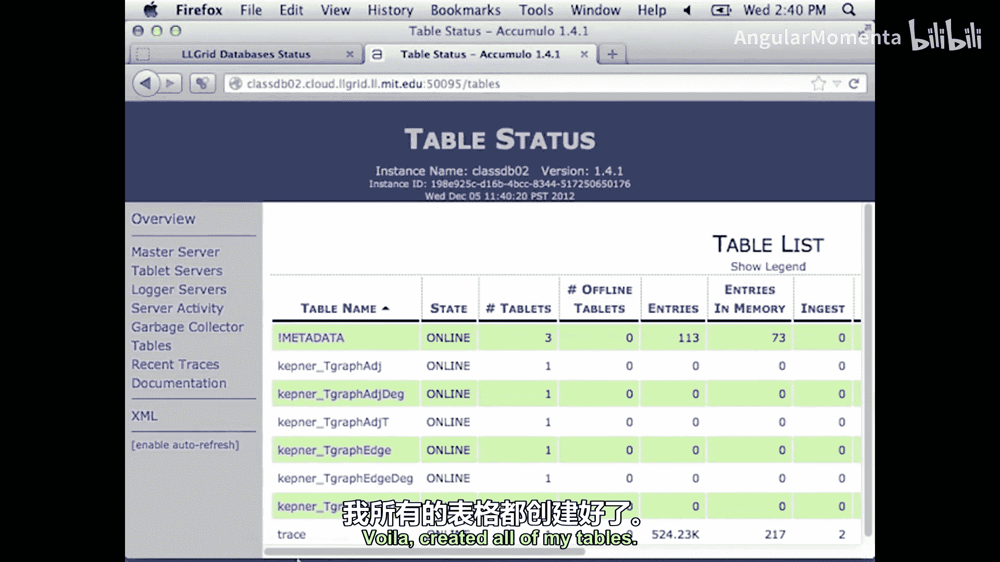

对边表的查询同样可以利用度统计表进行预筛选，避免触及连接数过多的顶点，从而执行复杂的图分析查询。


***

## 第十一步：处理更大规模的数据与并行计算 ⚡

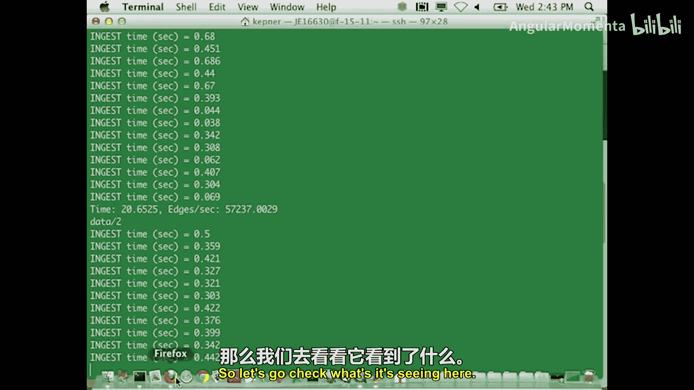

为了展示D4M和Accumulo处理更大数据量的能力，我们可以在更强大的服务器节点上运行上述步骤。通过增加生成图的规模（例如 `scale=18`），我们可以创建包含数百万条边的数据集。

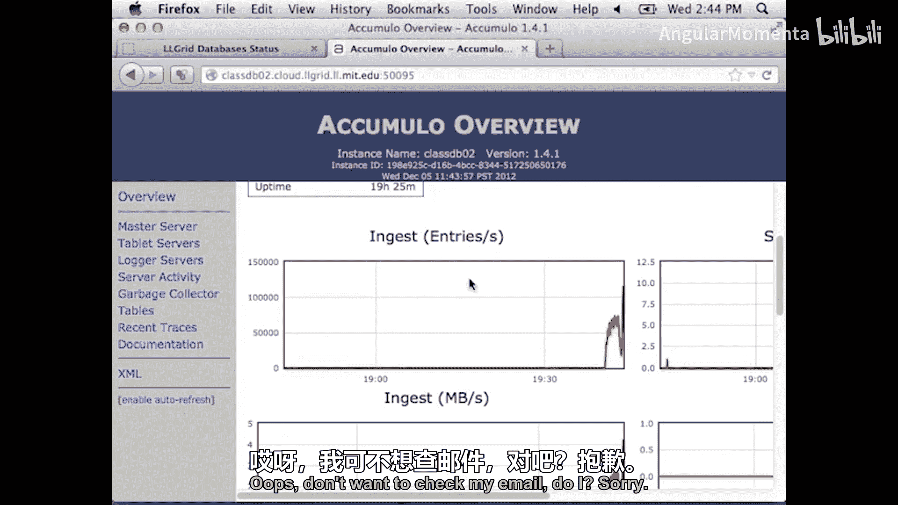


在这些多核服务器上，我们可以轻松地将文件读取、关联数组构建等计算任务并行化。D4M与MATLAB并行计算工具箱集成良好，通常只需取消注释代码中的 `parfor` 循环或使用 `pRUN` 命令即可。

```matlab
% 示例：并行读取文件并构建关联数组
if exist('parpool','file') && isempty(gcp('nocreate'))
    parpool; % 启动并行池
end
parfor i = 1:numFiles
    % 每个工作进程处理不同的文件
    fileName = sprintf('data/big_test_%02d', i);
    % ... 读取和构建关联数组的代码 ...
    save([fileName '.mat'], 'A');
end
```


在并行插入数据库时，多个进程同时写入可能会使单个数据库实例的插入速率达到每秒数十万甚至更高，充分体现了Accumulo的高吞吐量能力。

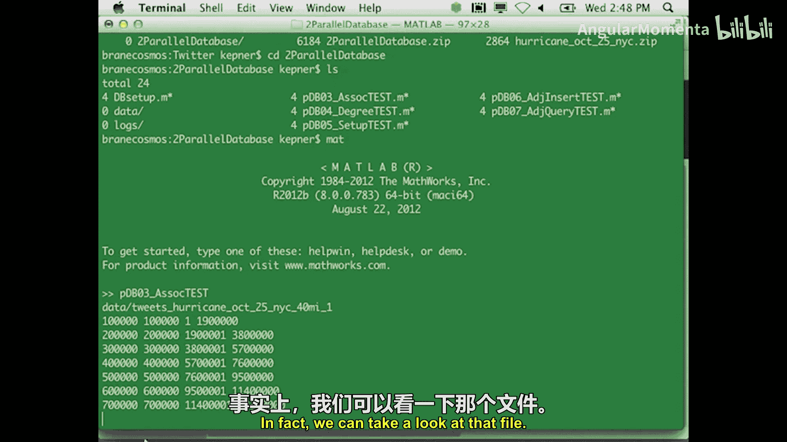

***


## 第十二步：分析真实数据——Twitter示例 🐦


最后，我们使用一个真实的Twitter数据集进行演示。该数据集包含了大量推文，经过解析后转换成了（实体，类型，值）形式的三元组。

我们首先将数据读入并构建关联数组，计算各类实体（如单词、@提及、#标签、地理位置）的出现频率（度分布）。这个过程能迅速揭示数据中的问题，例如：“New York City”和“New York City ”（多一个空格）会被视为两个不同的键。这种数据清洗工作正是D4M的用武之地。

```matlab
% 加载Twitter关联数组
load('twitter_data.mat', 'A');
% 计算列和（每个实体的出现频率）
degreeDist = sum(A,1);
% 找出高频实体
highFreqLocations = degreeDist(:, 'location,') > 100;
highFreqMentions = degreeDist(:, 'mention,') > 100;
highFreqHashtags = degreeDist(:, 'hashtag,') > 50;
% 显示结果
disp('高频地点：'); disp(row(highFreqLocations));
disp('高频@提及：'); disp(row(highFreqMentions));
disp('高频#标签：'); disp(row(highFreqHashtags));
```

通过这种分析，我们可以快速理解数据集的概况，发现数据质量问题，并聚焦于重要的信号。对于真正海量的数据，则可以将其入库，利用数据库的计数和迭代器功能进行更深入、更高效的查询。

***

## 总结 🎯


本节课中，我们一起学习了D4M与Accumulo数据库协同工作的完整流程：

1.  **生成与处理测试数据**：使用Kronecker图生成器创建具有幂律特征的图数据，并保存为文件和关联数组。
2.  **文件级计算**：直接在MATLAB文件中进行高效的度分布等分析，适用于全数据遍历场景。
3.  **数据库设置与连接**：配置Accumulo数据库，创建用于邻接矩阵、度统计和边存储的表对。
4.  **数据插入**：将关联数组数据高效插入数据库，利用聚合器在插入时进行统计。
5.  **基本与高级查询**：执行基于键的查询，利用度信息进行过滤，实现类似信号处理的“杂波滤除”。
6.  **迭代器使用**：通过迭代器分块处理可能返回大量结果的查询，避免内存溢出。
7.  **连接操作**：在数据库上实现类似SQL的连接查询，包括内存连接和迭代器连接两种策略。
8.  **边数据管理**：使用关联矩阵存储原始边信息，支持更丰富的图分析。
9.  **并行与大规模处理**：在强大硬件上并行执行数据生成、处理和插入，展示系统的高扩展性。
10. **真实数据分析**：将所学应用于Twitter数据集，演示了快速的数据概览、质量检查和洞察发现。


核心在于理解：D4M提供了线性代数和关联数组的抽象，使得数据库操作变得直观；而Accumulo则提供了海量数据的高性能存储与检索能力。两者结合，为大规模图数据和社会网络分析提供了强大的工具链。记住，对于需要全扫描的分析，优先使用文件；对于需要随机访问、复杂过滤和迭代查询的任务，则使用数据库。