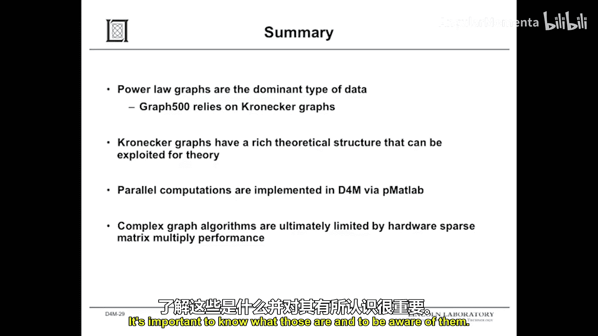

# 017：克罗内克图、数据生成与性能 🚀

在本节课中，我们将要学习如何生成用于大规模图计算基准测试的数据，特别是克罗内克图。我们还将探讨影响数据库和D4M性能的关键因素，并理解在不同场景下选择合适计算工具的策略。

## 克罗内克图与Graph 500基准测试

上一节我们介绍了人工生成数据集的重要性。本节中，我们来看看一个用于生成大规模图数据的强大工具：克罗内克图。

Graph 500基准测试旨在为世界上最强大的计算机提供一个衡量其在图类型操作上性能的机制。该基准测试生成数据，构建成图，然后执行其他操作。我们发现它作为一个高性能数据生成器非常有用，尤其适合测试对幂律数据的插入性能。

该基准测试生成的数据被称为克罗内克图。其基本思想是取一个小的种子矩阵 **G**，然后通过多次克罗内克积运算来创建一个巨大的邻接矩阵，从而生成图结构。这种方法能自然地产生类似幂律的度分布图。

克罗内克积的一个强大优势在于，它无需实际构建庞大的邻接矩阵就能生成图的边。只要多个进程设置不同的随机数种子，它们就能并行地生成一个更大图中完全一致的边，这使得生成超大规模图成为可能。

然而，克罗内克图生成的数据会带有一些人工结构（如图中的“凸起”），这是其人工特征。因此，如果目标是模拟真实图，我们开发的“完美幂律”方法可能是更好的选择。

## 克罗内克积详解

为了更好地理解克罗内克图，让我们回顾一下克罗内克积的定义。

如果有一个矩阵 **B**（大小为 Nb x Nb）和另一个矩阵 **C**（大小为 Nc x Nc），它们的克罗内克积 **B ⊗ C** 是通过将 **C** 乘以 **B** 中的每个元素，并将结果按块排列而形成的一个更大矩阵。这是一种在两个维度上扩展矩阵的方法。

克罗内克图主要有三种类型：
*   **显式图**：将克罗内克图的系数设置为0和1。这样得到的结构非常清晰，便于进行理论分析。
*   **随机图**：矩阵中的元素是0到1之间的概率值，表示顶点间存在边的概率。通过多次克罗内克积得到一个巨大的概率矩阵。
*   **实例图**：从上述概率矩阵中随机采样，生成图的具体实例。在进行模拟时，通常得到的是这种类型的图。

## 克罗内克图的理论分析

克罗内克图为图论分析提供了强大的理论框架。一个很好的分析对象是二分图。

二分图包含两组顶点，每组内部的顶点互不连接，但都与另一组的所有顶点相连。其邻接矩阵具有特定的块结构。

如果我们对两个二分图进行克罗内克积，结果（在某种置换下）等于另外两个二分图的并集。这个结果最早由Weisel教授在1962年证明。通过不断对二分图进行克罗内克积，可以自然地构建出幂律图结构：生成超级节点、低度数组件和单例顶点。

我们可以解析地计算克罗内克积二分图的度分布。例如，对一个 (5,1) 二分图进行10次克罗内克积，得到的度分布在双对数坐标下会呈现斜率为-1的直线段，这体现了其内在的幂律特性。

纯二分图没有组内连接。为了在社区之间创建连接，我们需要在对角线上添加单位矩阵 **I**。这样，图 **B + I** 的克罗内克积就能生成既包含密集社区（来自 **B**），又包含社区间连接（来自 **I**）的图。通过解析计算和适当的置换，我们可以清晰地看到图中的核心二分图块以及它们之间的互联结构。

我们甚至可以计算这种图的度分布、直径、特征值、等周率等指标。这为了解幂律图的子结构及其相互作用提供了深刻见解。

## 数据库性能考量

现在，让我们从理论转向实践，探讨一些性能基准测试。

在并行计算中，通常关注一个参数：同时运行的并行进程数。然而，当涉及并行数据库时，需要考虑更多参数。

以下是影响并行数据库插入性能的关键参数：
*   **并行进程数**：同时向数据库插入数据的工作进程数量。
*   **Tablet服务器数**：在 Accumulo 等数据库中，数据被分片存储在多个 Tablet 服务器上。服务器数量会影响整体吞吐量。
*   **表的分片（Splits）**：表在数据库中被分割成多个区域，分布在不同服务器上。分片的数量和数据分布的均衡性对性能有巨大影响。分片过少或数据倾斜都会限制性能。

另一个重要因素是**数据块大小**，即每次提交给数据库的数据量。通常存在一个最优块大小，能使插入性能达到峰值。这是因为合适大小的数据块可以更好地利用CPU缓存。

对于查询性能，需要记住 Accumulo 是一个基于行的存储系统。按行键查询可以近乎恒定时间内返回结果。然而，如果按列查询且没有使用特殊的“转置”模式，则需要对整个表进行扫描，性能会随着数据量增长而线性下降。这正是D4M采用特殊模式来同时支持高效行、列查询的主要原因。

## D4M 与硬件性能极限

最后，我们来谈谈 D4M 本身的性能。

如果以最优方式编写 D4M 程序（通常是将复杂分析转化为一系列稀疏矩阵乘法），就能最大限度地利用底层高度优化的数学库（如稀疏BLAS）。D4M 关联数组的运算性能非常接近原生 MATLAB 稀疏矩阵运算。

然而，必须认识到稀疏矩阵乘法存在根本性的硬件限制。现代CPU的缓存和向量化单元是为密集矩阵乘法设计的，因此密集运算能达到接近95%的硬件峰值效率。相比之下，稀疏矩阵乘法的效率可能只有0.1%左右，这是因为其内存访问模式不规则，无法有效利用缓存。

此外，D4M中那些需要拼接字符串键的特殊乘法操作（例如在生物信息学例子中保留DNA序列信息），还会引入额外的性能开销，主要受限于字符串排序的速度。

因此，在优化程序时，了解这些理论性能极限至关重要。它帮助我们判断优化空间：如果当前性能距离理论极限有1000倍差距，通常很容易通过 profiling 找到问题并大幅改进；但如果已经接近极限（例如10%），那么进一步优化的收益可能就非常有限了。

## 总结：选择正确的工具

本节课中我们一起学习了克罗内克图的生成与理论，以及数据库和D4M的性能特性。现在，我们可以更好地理解解决数据库信号处理问题的“轻松路径”：

根据数据量和访问粒度来选择工具：
*   **数据量小，访问粒度小**：直接在单机内存中处理（使用D4M关联数组）。
*   **数据请求量大，但可放入内存**：单机内存处理仍然是最佳选择。
*   **数据量大，请求粒度大（如全表扫描）**：使用文件系统，分批读入内存处理。或者使用并行计算和并行文件系统。
*   **数据量大，且需要随机访问小部分数据**：这是数据库的典型应用场景。

如今，许多被认为是“大数据”的数据集（如数百万甚至数亿条目），实际上可以轻松放入单机内存中处理。真正的数据库用武之地通常在需要随机访问超大规模数据（如数十亿条目）时。当然，如果数据已经存在于某个数据库中，并且是唯一的数据源，那么集成需求可能会凌驾于纯性能考量之上。

关键在于为工作选择正确的工具，并根据需要灵活组合它们，这是高效完成工作而不至于陷入困境的捷径。