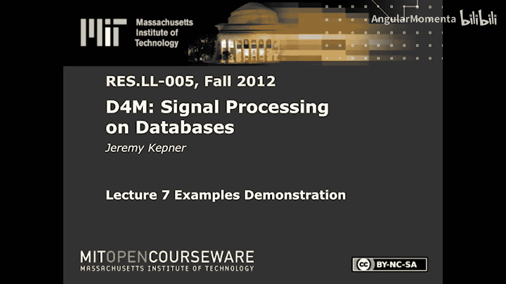
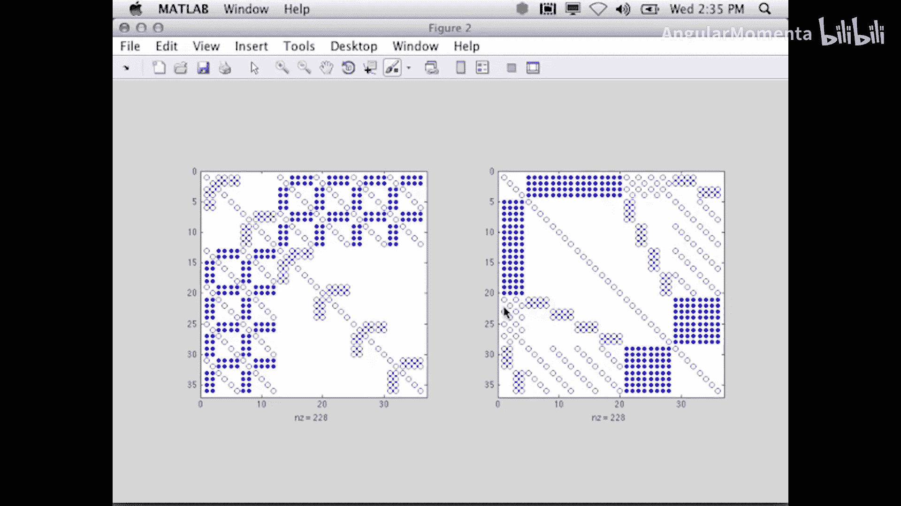
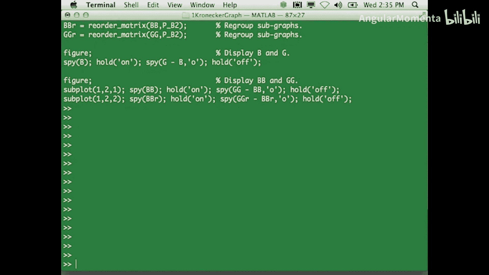
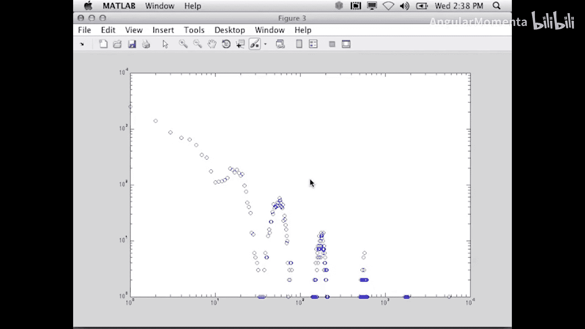
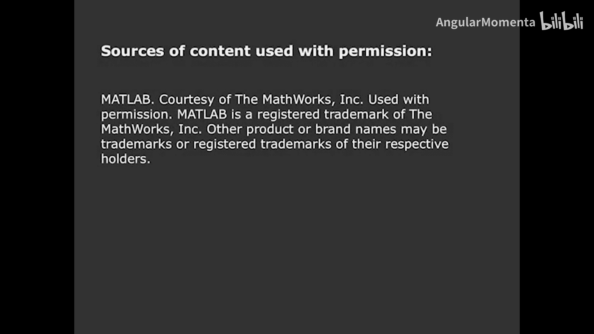

# 018：示例演示 🎬

在本节课中，我们将通过一个具体的示例演示，来学习如何将信号处理的概念应用于数据库操作。我们将看到如何利用矩阵运算来处理和分析存储在数据库中的关联数据。

---

上一节我们介绍了数据库与线性代数结合的基本概念。本节中，我们来看看一个具体的应用实例。

以下是一个简单的关联数据示例，它描述了人物（行）与地点（列）之间的访问关系。矩阵中的“1”表示某人访问过某地。

```
       地点A  地点B  地点C
人物X    1      0      1
人物Y    0      1      1
人物Z    1      1      0
```

这个矩阵可以表示为 **A**。我们可以通过矩阵乘法来挖掘数据中的关系。例如，计算 **A^T * A** 可以得到地点之间的关联矩阵，揭示哪些地点常被相同的人访问。

计算过程如下：
**关联矩阵 = A^T * A**

这个运算的结果是一个对称矩阵，其对角线元素表示访问每个地点的总人数，非对角线元素表示同时访问两个地点的人数。

---

为了更清晰地展示，以下是计算步骤的分解：

1.  **转置矩阵 A**：将行（人物）和列（地点）互换。
2.  **执行矩阵乘法**：将转置后的矩阵与原始矩阵 **A** 相乘。

通过这个简单的操作，我们就能从原始的“人物-地点”数据中，提炼出“地点-地点”的共现模式。这正是信号处理中相关分析思想在数据库查询中的体现。



---

本节课中我们一起学习了如何将一个代表关联数据的矩阵，通过**矩阵转置**和**矩阵乘法**运算，转换为一个揭示元素间共同出现关系的关联矩阵。这个演示清晰地展示了将数据库操作转化为线性代数运算的核心思路，为处理大规模图数据提供了高效的计算基础。



***

**版权声明：** 本课程内容采用知识共享许可协议提供。您的支持将帮助MIT开放课程持续免费提供高质量教育资源。如需捐款或查看来自数百门MIT课程的其他材料，请访问 MIT OpenCourseWare 网站 ocw.mit.edu。










