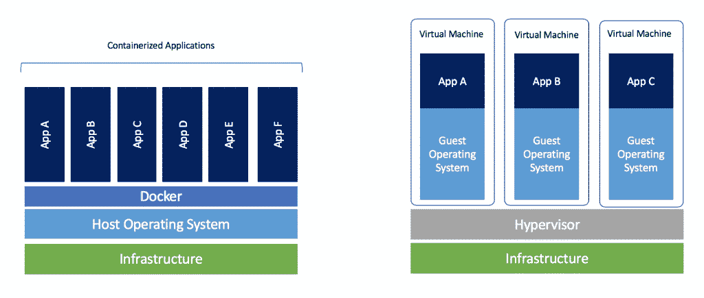

# 虚拟机和容器

> 原文：[`missing.csail.mit.edu/2019/virtual-machines/`](https://missing.csail.mit.edu/2019/virtual-machines/)

# 虚拟机

虚拟机是模拟计算机。你可以配置一个带有某些操作系统和配置的客户机虚拟机，并使用它而不会影响你的主机环境。

对于这门课程，你可以使用虚拟机来实验操作系统、软件和配置，而无需承担风险：你不会影响你的主要开发环境。

通常情况下，虚拟机有很多用途。它们通常用于运行仅在特定操作系统上运行的软件（例如，在 Linux 上使用 Windows 虚拟机来运行 Windows 特定的软件）。它们经常用于尝试可能有害的软件。

## 有用的功能

+   **隔离**：虚拟机管理程序在隔离客户机与主机方面做得相当不错，因此你可以使用虚拟机以相对安全的方式运行有缺陷或不可信的软件。

+   **快照**：你可以对你的虚拟机进行“快照”，捕获整个机器状态（磁盘、内存等），对你的机器进行更改，然后恢复到早期状态。这对于测试可能具有破坏性的操作等非常有用。

## 缺点

虚拟机通常比在裸机上运行要慢，因此它们可能不适合某些应用程序。

## 设置

+   **资源**：与主机机器共享；在分配物理资源时要留意这一点。

+   **网络**：有很多选项，默认 NAT 应该适用于大多数用例。

+   **客户机插件**：许多虚拟机管理程序可以在客户机中安装软件，以实现与主机系统的更好集成。如果可能的话，你应该使用这个功能。

## 资源

+   虚拟机管理程序

    +   [VirtualBox](https://www.virtualbox.org/)（开源）

    +   [Virt-manager](https://virt-manager.org/)（开源，管理 KVM 虚拟机和 LXC 容器）

    +   [VMWare](https://www.vmware.com/)（商业，IS&T [为 MIT 学生提供](https://ist.mit.edu/vmware-fusion)）

如果你已经熟悉流行的虚拟机管理程序/虚拟机，你可能想了解如何从命令行友好的方式来做这件事。一个选项是[libvirt](https://wiki.libvirt.org/page/UbuntuKVMWalkthrough)工具包，它允许你管理多个不同的虚拟化提供商/虚拟机管理程序。

## 练习

1.  下载并安装虚拟机管理程序。

1.  创建一个新的虚拟机并安装一个 Linux 发行版（例如，[Debian](https://www.debian.org/)）。

1.  尝试使用快照进行实验。尝试你一直想尝试的事情，比如运行`sudo rm -rf --no-preserve-root /`，看看你是否能轻松恢复。

1.  了解什么是[fork-bomb](https://en.wikipedia.org/wiki/Fork_bomb) (`:(){ :|:& };:`)，并在虚拟机上运行它，以查看资源隔离（CPU、内存等）是否工作。

1.  安装客户机插件并尝试不同的窗口模式、文件共享和其他功能。

# 容器

虚拟机相对较重；如果您想以自动化的方式启动机器，该怎么办？容器就出现了！

+   Amazon Firecracker

+   Docker

+   rkt

+   lxc

容器主要只是各种 Linux 安全特性的组合，如虚拟文件系统、虚拟网络接口、chroots、虚拟内存技巧等，这些特性共同呈现出虚拟化的外观。

容器的安全性或隔离性不如虚拟机，但非常接近，并且正在变得更好。通常性能更高，启动速度更快，但并非总是如此。

性能提升的原因是，与运行整个操作系统副本的虚拟机不同，容器与主机共享 Linux 内核。然而请注意，如果您在 Windows/macOS 上运行 Linux 容器，则需要一个 Linux 虚拟机作为中间层来激活。

 *Docker 容器和虚拟机的对比。来源：blog.docker.com*

当您想在标准化的设置中运行自动化任务时，容器很方便：

+   构建系统

+   开发环境

+   预包装服务器

+   运行不受信任的程序

    +   评分学生提交

    +   （一些）云计算

+   持续集成

    +   Travis CI

    +   GitHub Actions

此外，像 Docker 这样的容器软件也被广泛用作解决 [依赖地狱](https://en.wikipedia.org/wiki/Dependency_hell) 的解决方案。如果一个机器需要运行许多具有冲突依赖的服务，它们可以使用容器进行隔离。

通常，您会编写一个文件来定义如何构建您的容器。您从一个最小的 *基础镜像*（如 Alpine Linux）开始，然后运行一系列命令来设置您想要的 环境（安装软件包、复制文件、构建内容、编写配置文件等）。通常，还可以指定任何应可用的外部端口，以及一个 *入口点*，它指定容器启动时应运行的命令（如评分脚本）。

类似于代码仓库网站（如 [GitHub](https://github.com/)），还有一些容器仓库网站（如 [DockerHub](https://hub.docker.com/)），在这些网站上，许多软件服务都有预先构建的镜像，可以轻松部署。

## 练习

1.  选择一种容器软件（Docker、LXC 等）并安装一个简单的 Linux 镜像。尝试通过 SSH 连接到它。

1.  搜索并下载一个流行的 Web 服务器（nginx、apache 等）的预构建容器镜像。

* * *

[编辑此页面](https://github.com/missing-semester/missing-semester/blob/master/_2019/virtual-machines.md)。

根据 [CC BY-NC-SA](https://creativecommons.org/licenses/by-nc-sa/4.0) 许可。
