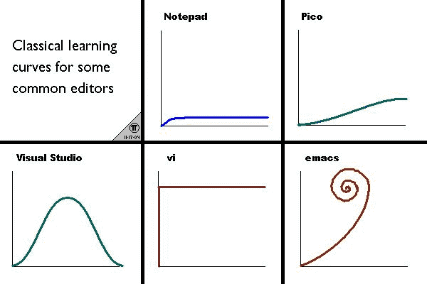

# 编辑器

> 原文：[`missing.csail.mit.edu/2019/editors/`](https://missing.csail.mit.edu/2019/editors/)

# 编辑器的重要性

作为程序员，我们大部分时间都在编辑纯文本文件。花时间学习一个适合你需求的编辑器是值得的。

你如何学习一个新的编辑器？你强迫自己使用那个编辑器一段时间，即使它暂时会阻碍你的生产力。很快就会得到回报（两周足够学习基础知识）。

我们将教你使用 Vim，但我们鼓励你尝试其他编辑器。这是一个非常个人化的选择，人们对此有[强烈的意见](https://en.wikipedia.org/wiki/Editor_war)。

我们不能在 50 分钟内教你如何使用一个强大的编辑器，所以我们将专注于教你基础知识，展示一些更高级的功能，并为你提供掌握工具的资源。我们将以 Vim 的上下文来教授课程，但大多数想法将适用于你使用的任何其他强大编辑器（如果它们不适用，那么你可能不应该使用那个编辑器！）。



编辑器学习曲线图是一个神话。学习一个强大编辑器的基础知识相当容易（尽管可能需要数年才能精通）。

今天哪些编辑器受欢迎？参见这个 [Stack Overflow 调查](https://insights.stackoverflow.com/survey/2018/#development-environments-and-tools)（可能存在一些偏见，因为 Stack Overflow 用户可能不能代表所有程序员）。

## 命令行编辑器

即使你最终决定使用图形用户界面编辑器，学习一个命令行编辑器对于轻松编辑远程机器上的文件也是值得的。

# Nano

Nano 是一个简单的命令行编辑器。

+   使用箭头键移动

+   所有其他快捷键（保存、退出）显示在底部

# Vim

Vi/Vim 是一个强大的文本编辑器。它是一个通常安装在所有地方的命令行程序，这使得在远程机器上编辑文件变得方便。

Vim 还有一些图形版本，如 GVim 和 [MacVim](https://macvim-dev.github.io/macvim/)。这些提供了额外的功能，如 24 位颜色、菜单和弹出窗口。

## Vim 的哲学

+   当编程时，你大部分时间都在阅读/编辑，而不是编写

    +   Vim 是一个**模式**编辑器：插入文本和操作文本有不同的模式

+   Vim 是可编程的（使用 Vimscript 以及其他语言如 Python）

+   Vim 的界面本身就像是一种编程语言

    +   按键（带有助记名）是命令

    +   命令是可组合的

+   不要使用鼠标：太慢了

+   编辑器应该以你认为的速度工作

## 初识 Vim

### 模式

Vim 在左下角显示当前模式。

+   正常模式：用于在文件中移动和进行编辑

    +   在这里花大部分的时间

+   插入模式：用于插入文本

+   视觉（视觉、行或块）模式：用于选择文本块

你通过按`<ESC>`从任何模式切换回普通模式来更改模式。从普通模式，使用`i`进入插入模式，使用`v`进入视觉模式，使用`V`进入视觉行模式，使用`<C-v>`进入视觉块模式。

使用 Vim 时，你会经常使用`<ESC>`键：考虑将 Caps Lock 映射到 Escape。

### 基础

Vim ex 命令通过普通模式下的`:{命令}`发出。

+   `:q` 退出（关闭窗口）

+   `:w` 保存

+   `:wq` 保存并退出

+   `:e {文件名}` 打开文件进行编辑

+   `:ls` 显示打开的缓冲区

+   `:help {topic}` 打开帮助

    +   `:help :w` 打开`:w`命令的帮助

    +   `:help w` 打开`w`移动的帮助

### 移动

Vim 关于高效移动。在普通模式下导航文件。

+   禁用箭头键以避免养成坏习惯

    ```py
    nnoremap <Left> :echoe "Use h"<CR>
    nnoremap <Right> :echoe "Use l"<CR>
    nnoremap <Up> :echoe "Use k"<CR>
    nnoremap <Down> :echoe "Use j"<CR> 
    ```

+   基本移动：`hjkl`（左，下，上，右）

+   单词：`w`（下一个单词），`b`（单词开头），`e`（单词结尾）

+   行：`0`（行首），`^`（第一个非空白字符），`$`（行尾）

+   屏幕：`H`（屏幕顶部），`M`（屏幕中间），`L`（屏幕底部）

+   文件：`gg`（文件开头），`G`（文件结尾）

+   行号：`:{数字}<CR>`或`{数字}G`（第{数字}行）

+   其他：`%`（对应项）

+   查找：`f{字符}`，`t{字符}`，`F{字符}`，`T{字符}`

    +   在当前行上向前/向后查找{字符}

+   重复 N 次：`{number}{movement}`，例如`10j`向下移动 10 行

+   搜索：`/{正则表达式}`，`n` / `N` 用于导航匹配项

### 选择

视觉模式：

+   视觉

+   视觉行

+   视觉块

可以使用移动键来选择。

### 操作文本

你现在用键盘（和强大的可组合命令）来做你以前用鼠标做的所有事情。

+   `i`进入插入模式

    +   但对于操纵/删除文本，想要使用比退格键更强大的工具

+   `o` / `O` 在下方/上方插入行

+   `d{移动}` 删除{移动}

    +   例如`dw`是删除单词，`d$`是删除到行尾，`d0`是删除到行首

+   `c{移动}` 改变{移动}

    +   例如`cw`是更改单词

    +   例如`d{移动}`后跟`i`

+   `x` 删除字符（等同于`dl`）

+   `s` 替换字符（等同于`xi`）

+   视觉模式 + 操作

    +   选择文本，`d`删除它或`c`更改它

+   `u` 撤销，`<C-r>` 重做

+   还有更多要学习：例如`~`可以翻转字符的大小写

### 资源

+   `vimtutor`命令行程序，教你使用 vim

+   [Vim 冒险游戏](https://vim-adventures.com/)，学习 Vim

## 自定义 Vim

Vim 通过`~/.vimrc`中的纯文本配置文件（包含 Vimscript 命令）进行自定义。可能有很多基本设置你想打开。

查看 GitHub 上的人的 dotfiles 以获取灵感，但尽量不要复制粘贴人们的完整配置。阅读它，理解它，并取你需要的。

一些可以考虑的定制化：

+   语法高亮：`syntax on`

+   主题

+   行号：`set nu` / `set rnu`

+   通过所有内容退格：`set backspace=indent,eol,start`

## 高级 Vim

这里有一些示例来展示编辑器的强大功能。我们无法教你所有这些类型的东西，但你在使用过程中会学到它们。一个好的启发式方法：每当你使用你的编辑器并认为“一定有更好的方法来做这件事”，通常确实有：在网上查找。

### 搜索和替换

`:s` (替换) 命令 ([文档](https://vim.fandom.com/wiki/Search_and_replace)).

+   `%s/foo/bar/g`

    +   在文件中全局替换 foo 为 bar

+   `%s/\.*\)/\1/g`

    +   将命名的 Markdown 链接替换为纯 URL

### 多窗口

+   使用 `sp` / `vsp` 来分割窗口

+   可以有多个相同缓冲区的视图。

### 鼠标支持

+   `set mouse+=a`

    +   可以点击，滚动选择

### 宏

+   使用 `q{字符}` 开始在 `{字符}` 寄存器中记录宏

+   使用 `q` 停止记录

+   使用 `@{字符}` 重放宏

+   宏执行在错误时停止

+   `{数字}@{字符}` 执行宏 {数字} 次

+   宏可以是递归的

    +   首先使用 `q{字符}q` 清除宏

    +   记录宏，使用 `@{字符}` 递归调用宏（在记录完成前将不会执行任何操作）

+   示例：将 xml 转换为 json (文件)

    +   包含键 "name" / "email" 的对象数组

    +   使用 Python 程序？

    +   使用 sed / 正则表达式

        +   `g/people/d`

        +   `%s/<person>/{/g`

        +   `%s/<name>\(.*\)<\/name>/"name": "\1",/g`

        +   …

    +   Vim 命令 / 宏

        +   `Gdd`，`ggdd` 删除第一行和最后一行

        +   格式化单个元素（寄存器 `e`）的宏

            +   使用 `<name>` 跳转到行

            +   `qe^r"f>s": "<ESC>f<C"<ESC>q`

        +   格式化人员的宏

            +   使用 `<person>` 跳转到行

            +   `qpS{<ESC>j@eA,<ESC>j@ejS},<ESC>q`

        +   格式化人员并跳转到下一个人

            +   使用 `<person>` 跳转到行

            +   `qq@pjq`

        +   执行宏直到文件末尾

            +   `999@q`

        +   手动删除最后一个 `,` 并添加 `[` 和 `]` 分隔符

## 扩展 Vim

有许多插件可以扩展 vim。

首先，使用插件管理器如 [vim-plug](https://github.com/junegunn/vim-plug)，[Vundle](https://github.com/VundleVim/Vundle.vim)，或 [pathogen.vim](https://github.com/tpope/vim-pathogen) 进行设置。

一些可以考虑的插件：

+   [ctrlp.vim](https://github.com/kien/ctrlp.vim): 模糊文件查找器

+   [vim-fugitive](https://github.com/tpope/vim-fugitive): git 集成

+   [vim-surround](https://github.com/tpope/vim-surround): 操作 "surroundings”

+   [gundo.vim](https://github.com/sjl/gundo.vim): 导航撤销树

+   [nerdtree](https://github.com/scrooloose/nerdtree): 文件浏览器

+   [syntastic](https://github.com/vim-syntastic/syntastic): 语法检查

+   [vim-easymotion](https://github.com/easymotion/vim-easymotion): 魔法移动

+   [vim-over](https://github.com/osyo-manga/vim-over): 替换预览

插件列表：

+   [Vim Awesome](https://vimawesome.com/)

## Vim-mode 在其他程序中

对于许多流行的编辑器（例如 vim 和 emacs），许多其他工具支持编辑器模拟。

+   Shell

    +   bash: `set -o vi`

    +   zsh: `bindkey -v`

    +   `export EDITOR=vim` (由 `git` 等程序使用的环境变量)

+   `~/.inputrc`

    +   `set editing-mode vi`

甚至有适用于网页浏览器的 vim 键绑定扩展 [browsers](https://vim.fandom.com/wiki/Vim_key_bindings_for_web_browsers)，一些流行的有 [Vimium](https://chrome.google.com/webstore/detail/vimium/dbepggeogbaibhgnhhndojpepiihcmeb?hl=en) 用于 Google Chrome 和 [Tridactyl](https://github.com/tridactyl/tridactyl) 用于 Firefox。

## 资源

+   [Vim Tips Wiki](https://vim.fandom.com/wiki/Vim_Tips_Wiki)

+   [Vim Advent Calendar](https://vimways.org/2018/)：各种 Vim 技巧

+   [Neovim](https://neovim.io/) 是一个现代的 vim 重实现，拥有更活跃的开发。

+   [Vim Golf](https://www.vimgolf.com/)：各种 Vim 挑战

# 练习

1.  尝试一些编辑器。至少尝试一个命令行编辑器（例如 Vim）和至少一个图形用户界面编辑器（例如 Atom）。通过像 `vimtutor`（或其他编辑器的等效教程）这样的教程来学习。为了真正感受一个新的编辑器，承诺在几天内只使用它来完成你的工作。

1.  个性化你的编辑器。在网上查找技巧和窍门，并查看其他人的配置（通常，它们都有很好的文档）。

1.  尝试为你的编辑器添加插件。

1.  至少连续几周坚持使用一个强大的编辑器：那时你应该开始看到它的好处。在某个时候，你应该能够让你的编辑器工作得和你思考一样快。

1.  安装一个代码检查器（例如 python 的 pyflakes），将其链接到你的编辑器，并测试它是否工作。

* * *

[编辑此页面](https://github.com/missing-semester/missing-semester/blob/master/_2019/editors.md)。

根据[CC BY-NC-SA](https://creativecommons.org/licenses/by-nc-sa/4.0)许可。
