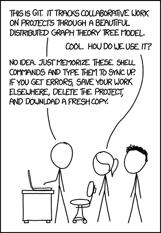

# 版本控制

> [原文链接](https://missing.csail.mit.edu/2019/version-control/)

无论你正在处理的是随时间变化的东西，能够跟踪这些变化都是有用的。这可能出于许多原因：它为你记录了发生了什么变化，如何撤销它，谁进行了更改，甚至可能还有为什么。版本控制系统（VCS）提供了这种能力。它们允许你将更改提交到一组文件中，包括描述更改的消息，以及查看和撤销你过去所做的更改。

大多数 VCS 支持在多个用户之间共享提交历史。这允许方便的协作：你可以看到我所作的更改，我也可以看到你所作的更改。由于 VCS 跟踪更改，它通常（尽管不总是）能够找出如何结合我们的更改，只要它们相对不重叠。

有很多 VCS，它们在支持的内容、功能和交互方式上差异很大。[这里](https://en.wikipedia.org/wiki/Comparison_of_version-control_software)有很多，我们将重点介绍 [git](https://git-scm.com/)，这是更常用的一种，但我建议你也要看看 [Mercurial](https://www.mercurial-scm.org/)。

说了这么多——直接进入要点！

## Git 是黑暗魔法吗？

还不完全是这样……你需要理解数据模型。我们将跳过一些细节，但大致来说，git 的 *核心* “东西”是一个提交。

+   每个提交都有一个唯一的名称，“修订哈希”一个像 `998622294a6c520db718867354bf98348ae3c7e2` 这样长的哈希值，通常缩短为一个短（独特）的前缀：`9986222`

+   提交包含作者 + 提交信息

+   还包含任何 *祖先提交* 的哈希值，通常是上一个提交的哈希值

+   提交也代表了一个 diff，即从提交的祖先到提交的表示（例如，删除此文件中的这一行，添加此文件中的这些行，重命名该文件等）。

    +   事实上，Git 存储了完整的前后状态

    +   可能不想存储经常更改的大文件！

初始时，*仓库*（大致上：git 管理的文件夹）没有内容，也没有提交。让我们设置一下：

```py
$  git init hackers
$  cd hackers
$  git status 
```

这里的输出实际上为我们提供了一个很好的起点。让我们深入挖掘，确保我们完全理解它。

首先，“位于分支 master”。

+   不想总是使用哈希值。

+   分支是指向哈希值的名称。

+   master 是传统上指代“最新”提交的名称。每次创建新的提交时，master 名称都会指向新的提交哈希。

+   特殊名称 `HEAD` 指的是“当前”名称

+   你也可以使用 `git branch`（或 `git tag`）创建自己的名称，我们稍后会回到这一点

让我们跳过“还没有提交”，因为这没什么可说的。

然后，“没有提交内容”。

+   每个提交都包含一个包含所有你所作更改的 diff。但这个 diff 是如何最初构建的呢？

+   *可以*总是提交自上次提交以来所做的所有更改

    +   有时你只想提交其中的一些（例如，不包括 `TODO`s）

    +   有时你希望将一个更改拆分成多个提交，为每个提交提供单独的提交信息

+   git 允许你*暂存*更改以构建一个提交

    +   使用 `git add` 将文件或文件的更改添加到暂存更改中

        +   使用 `git add -p` 仅添加文件中的某些更改

        +   没有参数时，`git add` 对“所有已知文件”操作

    +   使用 `git rm` 删除文件并将其删除暂存

    +   使用 `git reset` 清空暂存更改集

        +   注意，这*不会*更改任何文件！它*只*意味着不会有更改被包含在提交中

        +   要移除仅一些暂存更改：`git reset FILE` 或 `git reset -p`

    +   使用 `git diff --staged` 检查暂存更改

    +   使用 `git diff` 查看剩余的更改

    +   当你对暂存满意时，使用 `git commit` 创建提交

        +   如果你只想提交*所有*更改：`git commit -a`

        +   `git help add` 有更多有用的信息

当你在玩弄上述内容时，尝试运行 `git status` 来查看 git 认为你正在做什么——这出奇地有帮助！

## 你说的一个提交...

好的，我们有一个提交，现在怎么办？

+   我们可以查看最近的变化：`git log`（或 `git log --oneline`）

+   我们可以使用 `git log -p` 查看完整更改

+   我们可以使用 `git show master` 显示特定的提交

    +   或者使用 `-p` 进行完整的 diff/patch

+   我们可以使用 `git checkout NAME` 回到提交的状态

    +   如果 `NAME` 是一个提交哈希，git 会说我们处于“分离”状态。这仅仅意味着没有 `NAME` 指向这个提交，所以如果我们进行提交，没有人会知道。

+   我们可以用 `git revert NAME` 撤销一个更改

    +   反向应用 `NAME` 提交中的更改

+   我们可以使用 `git diff NAME..` 将较旧版本与此版本进行比较

    +   `a..b` 是一个提交范围。如果任一为空，则表示 `HEAD`。

+   我们可以使用 `git log NAME..` 显示使用之间的所有提交

    +   `-p` 在这里也适用

+   我们可以用 `git reset NAME` 将 `master` 指向特定的提交（实际上是从那时起撤销所有更改）：

    +   哎，为什么？`reset` 不是用来更改暂存更改的吗？`reset` 有一个“第二种”形式（见 `git help reset`），它将 `HEAD` 设置为给定名称指向的提交。

    +   注意，这并没有改变任何文件——`git diff` 现在实际上显示 `git diff NAME..`。

## 名称的意义是什么？

很明显，在 git 中名称很重要。它们是理解 git 中发生的大部分事情的关键。到目前为止，我们已经讨论了提交哈希、master 和 `HEAD`。但还有更多！

+   你可以用 `git branch b` 创建自己的分支（如 master）

    +   创建一个新的名称，`b`，它指向 `HEAD` 处的提交

    +   尽管如此，你仍然“在”master 上，所以如果你创建一个新的提交，master 将指向那个新提交，`b` 不会。

    +   使用 `git checkout b` 切换到分支

        +   你现在所做的任何提交都将更新 `b` 名称

        +   使用 `git checkout master` 切换回 master

            +   `b` 中的所有更改都被隐藏起来

        +   这是一个非常方便的方法，可以轻松测试更改

+   标签是永远不会改变的另一个名称，并且有自己的信息。常用于标记发布和变更日志。

+   `NAME^` 表示“`NAME`之前的提交”

    +   可以递归应用：`NAME^^^`

    +   当你使用`~`时，你很可能是指`~`

        +   `~`是“时间性的”，而`^`通过祖先

        +   `~~`与`^^`相同

        +   使用`~`你还可以写`X~3`表示“比`X`早 3 个提交”

        +   你不想要`³`

    +   `git diff HEAD^`

+   `-`表示“前一个名称”

+   除非你给出另一个参数，否则大多数命令都操作于`HEAD`。

## 清理你的混乱

你的提交历史通常会变成：

+   `add feature x` – 可能甚至有一个关于`x`的提交信息！

+   `忘记添加文件`

+   `fix bug`

+   `typo`

+   `typo2`

+   `实际上修复`

+   `实际上实际上修复`

+   `tests pass`

+   `fix example code`

+   `typo`

+   `x`

+   `x`

+   `x`

+   `x`

对于 git 来说，这是*可以接受的*，但对未来的你或其他好奇变化内容的人并不太有帮助。git 允许你清理这些事情：

+   `git commit --amend`: 将暂存更改合并到上一个提交

    +   注意，这*会改变*之前的提交，给它一个新的哈希值！

+   `git rebase -i HEAD~13`是*神奇的*。对于过去 13 次提交中的每一次，选择要执行的操作：

    +   默认是`pick`；不执行任何操作

    +   `r`: 修改提交信息

    +   `e`: 更改提交（添加或删除文件）

    +   `s`: 将提交与上一个提交合并并编辑提交信息

    +   `f`: “修复” – 将提交与上一个提交合并；丢弃提交信息

    +   最后，`HEAD`被设置为指向现在的最后一个提交

    +   通常被称为*压缩*提交

    +   它真正做的事情：将`HEAD`回滚到变基的起点，然后按照指示的顺序重新应用提交。

+   `git reset --hard NAME`: 将所有文件的状态重置为`NAME`（如果没有给出名称，则为`HEAD`）。这对于撤销更改很有用。

## 与他人一起玩耍

版本控制的一个常见用例是允许多个人对一组文件进行更改，而不会相互干扰。或者更确切地说，确保*如果*他们相互干扰，他们不会默默地覆盖彼此的更改。

git 是一个*分布式*版本控制系统：每个人都有一个整个仓库的本地副本（好吧，是其他人选择发布的所有内容）。一些 VCS 是*集中式*的（例如，subversion）：服务器拥有所有提交，客户端只有他们“检出”的文件。基本上，他们只有*当前*的文件，并且需要向服务器请求其他内容。

每个 git 仓库的副本都可以列为“远程”。你可以使用`git clone ADDRESS`（而不是`git init`）复制现有的 git 仓库。这创建了一个名为*origin*的远程，它指向`ADDRESS`。你可以使用`git fetch REMOTE`从远程获取名称和它们指向的提交。远程的所有名称都对你可用，作为`REMOTE/NAME`，你可以像使用本地名称一样使用它们。

如果你具有对远程仓库的写权限，你可以通过使用 `git push` 来更改远程仓库中的名称，使其指向你已提交的提交。例如，让我们将远程仓库 `origin` 中的 `master` 名称（分支）指向当前 `master` 分支指向的提交：

+   `git push origin master:master`

+   为了方便起见，你可以将 `origin/master` 设置为当你从当前分支使用 `-u` 推送时的默认目标

+   考虑：这会做什么？`git push origin master:HEAD^`

通常，你会使用 GitHub、GitLab、BitBucket 或其他类似的服务作为你的远程仓库。就 git 而言，这并没有什么“特殊”之处。它只是名称和提交。如果有人更改了 `master` 分支并更新 `github/master` 以指向他们的提交（我们稍后会回到这一点），那么当你执行 `git fetch github` 时，你将能够使用 `git log github/master` 看到他们的更改。

## 与他人协作

到目前为止，分支似乎没什么用：你可以创建它们，在上面做工作，但然后呢？最终，你还是会将 `master` 指向它们，对吧？

+   如果你在开发一个大型功能时需要修复某些问题怎么办？

+   如果在此期间有人对 `master` 分支进行了更改怎么办？

不可避免地，你将不得不将一个分支的更改与另一个分支的更改合并，无论这些更改是由你还是其他人做出的。git 允许你使用 `git merge NAME` 来做这件事，不出所料。`merge` 将：

+   寻找 `HEAD` 和 `NAME` 共享的提交祖先的最新点（即它们分叉的地方）

+   （尝试）将所有这些更改应用到当前的 `HEAD`

+   生成一个包含所有这些更改的提交，并将 `HEAD` 和 `NAME` 列为其祖先

+   将 `HEAD` 设置为该提交的哈希值

一旦你的大型功能完成，你可以将其分支合并到 `master` 中，git 将确保你不会丢失任何分支上的更改！

如果你以前使用过 git，你可能通过不同的名称认识 `merge`：`pull`。当你执行 `git pull REMOTE BRANCH` 时，这意味着：

+   `git fetch REMOTE`

+   `git merge REMOTE/BRANCH`

+   其中，就像 `push` 一样，`REMOTE` 和 `BRANCH` 通常省略并使用“跟踪”远程分支（记得 `-u` 吗？）

这通常工作得非常好。只要合并的分支之间的更改是互斥的。如果不是，你就会遇到一个 *合并冲突*。听起来很可怕...

+   合并冲突只是 git 告诉你它不知道最终的差异应该是什么样子

+   git 暂停并要求你完成“合并提交”的暂存

+   在你的编辑器中打开冲突的文件，并寻找许多角度符号 (`<<<<<<<`)。`=======` 之上的内容是自共享祖先提交以来在 `HEAD` 中所做的更改。以下是自共享提交以来在 `NAME` 中所做的更改。

+   `git mergetool` 非常方便——打开一个差异编辑器

+   一旦你通过确定文件现在应该是什么样子来 *解决* 冲突，使用 `git add` 将这些更改暂存。

+   当所有冲突都解决后，使用 `git commit` 完成

    +   你可以使用 `git merge --abort` 放弃合并

你刚刚解决了你的第一个 git 合并冲突！\o/ 现在你可以使用 `git push` 发布你的最终更改

## 当世界相撞时

当你 `push` 时，git 会检查如果你更新了你要推送的远程名称，是否没有人丢失了工作。它是通过检查远程名称的当前提交是否是你推送的提交的祖先来做到这一点的。如果是，git 可以安全地只更新名称；这被称为 *快速前进*。如果不是，git 将拒绝更新远程名称，并告诉你有更改。

如果你的推送被拒绝，你会怎么做？

+   使用 `git pull` 合并远程更改（即，`fetch` + `merge`）

+   使用 `--force` 强制推送：这将丢失其他人的更改！

    +   还有 `--force-with-lease`，这只有在远程名称自上次从该远程获取以来没有更改时才会强制更改。更安全！

    +   如果你已经将之前推送的本地提交进行了变基（“历史重写”；可能不要这样做），你将不得不强制推送。想想为什么！

+   尝试将你的更改“叠加”在远程更改之上

    +   这是一个 `rebase`！

        +   回滚自共享祖先以来的所有本地提交

        +   将 `HEAD` 快速前进到远程名称的提交

        +   按顺序应用本地提交

            +   可能会有你必须手动解决的冲突

            +   `git rebase --continue` 或 `--abort`

        +   更多内容[这里](https://git-scm.com/book/en/v2/Git-Branching-Rebasing)

    +   `git pull --rebase` 会为你启动这个过程

    +   你是否应该合并还是变基是一个热门话题！一些好的阅读材料：

        +   [this](https://www.atlassian.com/git/tutorials/merging-vs-rebasing)

        +   [this](https://web.archive.org/web/20210106220723/https://derekgourlay.com/blog/git-when-to-merge-vs-when-to-rebase/)

        +   [this](https://stackoverflow.com/questions/804115/when-do-you-use-git-rebase-instead-of-git-merge)

# 进一步阅读

(https://xkcd.com/1597/)

+   [Learn git branching](https://learngitbranching.js.org/)

+   [How to explain git in simple words](https://smusamashah.github.io/blog/2017/10/14/explain-git-in-simple-words)

+   [Git from the bottom up](https://jwiegley.github.io/git-from-the-bottom-up/)

+   [Git for computer scientists](https://eagain.net/articles/git-for-computer-scientists/)

+   [Oh shit, git!](https://ohshitgit.com/)

+   [The Pro Git book](https://git-scm.com/book/en/v2)

# 练习

1.  在一个仓库中尝试修改一个现有文件。当你执行 `git stash` 时会发生什么？运行 `git log --all --oneline` 你会看到什么？通过运行 `git stash pop` 来撤销你用 `git stash` 做的操作。在什么情况下这可能会很有用？

1.  学习 Git 时常见的错误之一是提交不应由 Git 管理的大文件或添加敏感信息。尝试将文件添加到仓库中，进行一些提交，然后从历史记录中删除该文件（你可能需要查看 [这个](https://help.github.com/articles/removing-sensitive-data-from-a-repository/)）。另外，如果你希望 Git 为你管理大文件，查看 [Git-LFS](https://git-lfs.github.com/)

1.  Git 对于撤销更改非常方便，但一个人甚至需要熟悉最不可能发生的变化。

    1.  如果某个提交中不小心修改了文件，可以使用 `git revert` 来撤销更改。然而，如果提交涉及多个更改，`revert` 可能不是最佳选择。我们如何使用 `git checkout` 从特定提交中恢复文件版本？

    1.  创建一个分支，在该分支中提交并删除它。你还能恢复该提交吗？尝试查看 `git reflog`。（注意：快速恢复悬空对象，Git 会定期自动清理没有任何引用指向的提交。）

    1.  如果一个人过于冲动地使用 `git reset --hard` 而不是 `git reset`，那么更改可能会轻易丢失。然而，由于更改已经被暂存，我们可以恢复它们。（查看 `git fsck --lost-found` 和 `.git/lost-found`）

1.  在任何 Git 仓库中，查看 `.git/hooks` 文件夹，你会找到一些以 `.sample` 结尾的脚本。如果你将它们重命名并去掉 `.sample`，它们将根据其名称运行。例如，`pre-commit` 将在提交之前执行。尝试使用它们进行实验。

1.  与许多命令行工具一样，`git` 提供了一个名为 `~/.gitconfig` 的配置文件（或点文件）。使用 `~/.gitconfig` 创建一个别名，这样当你运行 `git graph` 时，你会得到 `git log --oneline --decorate --all --graph` 的输出（这是一个快速可视化提交图的不错命令）。

1.  Git 还允许你在 `~/.gitignore_global` 下定义全局忽略模式，这有助于防止常见的错误，例如添加 RSA 密钥。创建一个 `~/.gitignore_global` 文件，并添加模式 `*rsa`，然后测试它在仓库中是否有效。

1.  一旦你开始更熟悉 `git`，你会发现自己在遇到常见任务，例如编辑你的 `.gitignore`。[git extras](https://github.com/tj/git-extras/blob/master/Commands.md) 提供了一些小工具，它们可以与 `git` 集成。例如，`git ignore PATTERN` 将将指定的模式添加到你的仓库中的 `.gitignore` 文件，而 `git ignore-io LANGUAGE` 将从 [gitignore.io](https://www.gitignore.io) 获取该语言的常见忽略模式。安装 `git extras` 并尝试使用一些工具，如 `git alias` 或 `git ignore`。

1.  Git 图形界面程序有时可以是一个很好的资源。尝试在一个 Git 仓库中运行 [gitk](https://git-scm.com/docs/gitk)，并探索界面的不同部分。然后运行 `gitk --all`，看看有什么不同？

1.  一旦你习惯了命令行应用程序，GUI 工具可能会感觉笨重/臃肿。两者之间一个不错的折衷方案是基于 ncurses 的工具，这些工具可以从命令行导航，同时仍然提供交互式界面。Git 有 [tig](https://github.com/jonas/tig)，尝试安装它并在一个仓库中运行它。你可以在[这里](https://www.atlassian.com/blog/git/git-tig)找到一些使用示例。

* * *

[编辑此页面](https://github.com/missing-semester/missing-semester/blob/master/_2019/version-control.md).

本作品受 [CC BY-NC-SA](https://creativecommons.org/licenses/by-nc-sa/4.0) 许可。
