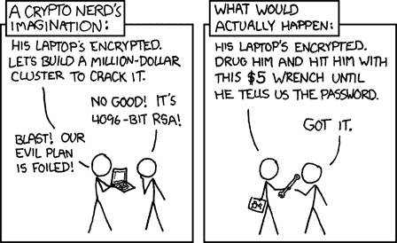

# 安全和隐私

> 原文：[`missing.csail.mit.edu/2019/security/`](https://missing.csail.mit.edu/2019/security/)

世界是一个可怕的地方，每个人都想抓住你。

好吧，可能不是，但这并不意味着你想炫耀所有的秘密。安全和隐私通常都是关于提高攻击者的门槛。找出你的威胁模型，然后围绕那个模型设计你的安全机制！如果威胁模型是国家安全局或摩萨德，你可能会遇到麻烦。

有*很多*种方法可以使你的技术形象更加安全。我们在这里会涉及很多高级话题，但这是一个过程，自我教育是你能做的最好的事情之一。所以：

## 跟随正确的人

提高你的安全知识的最好方法之一是跟随那些在安全方面有声音的人。以下是一些建议：

+   [@TroyHunt](https://twitter.com/TroyHunt)

+   [@SwiftOnSecurity](https://twitter.com/SwiftOnSecurity)

+   [@taviso](https://twitter.com/taviso)

+   [@thegrugq](https://twitter.com/thegrugq)

+   [@tqbf](https://twitter.com/tqbf)

+   [@mattblaze](https://twitter.com/mattblaze)

+   [@moxie](https://twitter.com/moxie)

参考以下列表获取更多建议：[这个列表](https://heimdalsecurity.com/blog/best-twitter-cybersec-accounts/)

## 一般安全建议

Tech Solidarity 有一个相当不错的关于记者的[应该做和不应该做的事情列表](https://web.archive.org/web/20221123204419/https://techsolidarity.org/resources/basic_security.htm)，其中包含很多合理的建议，并且相当更新。[@thegrugq](https://medium.com/@thegrugq) 还有一篇关于[旅行安全建议](https://medium.com/@thegrugq/stop-fabricating-travel-security-advice-35259bf0e869)的好博客文章，值得一读。我们将在这里重复很多来自这些来源的建议，以及一些额外的建议。此外，购买一个[USB 数据阻断器](https://www.amazon.com/dp/B00QRRZ2QM/)，因为[USB 很可怕](https://www.bleepingcomputer.com/news/security/heres-a-list-of-29-different-types-of-usb-attacks/)。

## 认证

如果你还没有做的话，第一件事应该是下载一个密码管理器。一些不错的选择有：

+   [1password](https://1password.com/)

+   [KeePass](https://keepass.info/)

+   [BitWarden](https://bitwarden.com/)

+   [`pass`](https://git.zx2c4.com/password-store/about/)

如果你特别偏执，请使用一种在本地计算机上加密密码的方法，而不是在服务器上以纯文本形式存储。用它为所有你关心的网站生成密码。然后，开启双因素认证，理想情况下使用 [FIDO/U2F](https://fidoalliance.org/) 撬棍（例如 [YubiKey](https://www.yubico.com/quiz/)，它为学生提供 [20% 的折扣](https://www.yubico.com/why-yubico/for-education/))。在紧急情况下，TOTP（如 Google Authenticator 或 Duo）也可以使用，但它[不能防止钓鱼](https://twitter.com/taviso/status/1082015009348104192)。除非你的威胁模型只包括随机陌生人捡起你传输中的密码，否则短信几乎毫无用处。

此外，关于纸质密钥的注意事项。通常，服务会提供一个“备份密钥”，你可以在丢失真正的第二因素时作为备用因素使用（顺便说一句，始终要在一个安全的地方保留备份）。虽然你可以将这些密钥存放在密码管理器中，但这意味着如果有人获取了你的密码管理器，你将完全处于不利地位（但也许你对此模型可以接受）。如果你真的非常偏执，请打印出这些纸质密钥，永远不要以数字形式存储，并将它们放在现实世界中的保险箱中。

## 私人通信

使用 [Signal](https://www.signal.org/) ([设置说明](https://medium.com/@mshelton/signal-for-beginners-c6b44f76a1f0). [Wire](https://wire.com/en/) 同样不错([`www.securemessagingapps.com/`](https://www.securemessagingapps.com/)); WhatsApp 可以接受；[不要使用 Telegram](https://twitter.com/bascule/status/897187286554628096)). 桌面即时通讯工具相当不完善（部分原因是通常依赖于 Electron，这是一个庞大的信任堆栈）。

电子邮件尤其有问题，即使经过 PGP 签名。它通常不是前向安全的，密钥分发问题相当严重。[keybase.io](https://keybase.io/) 有所帮助，并且出于许多其他原因也很有用。此外，PGP 密钥通常在桌面计算机上处理，这是最不安全的计算环境之一。相关地，考虑购买 Chromebook，或者只需在带键盘的平板电脑上工作。

## 文件安全

文件安全是一项艰巨的任务，它涉及多个层面。你试图防范的是什么？

(https://xkcd.com/538/)

+   离线攻击（有人在你关闭笔记本电脑时偷走它）：启用全磁盘加密。([Linux 上的 cryptsetup + LUKS](https://wiki.archlinux.org/index.php/Dm-crypt/Encrypting_a_non-root_file_system)，[Windows 上的 BitLocker](https://fossbytes.com/enable-full-disk-encryption-windows-10/)，[macOS 上的 FileVault](https://support.apple.com/en-us/HT204837)。请注意，如果攻击者也拥有你并且真的想要你的秘密，这不会有所帮助）。

+   在线攻击（有人拥有你的笔记本电脑并且它处于开启状态）：使用文件加密。为此，有两种主要的机制

    +   加密文件系统：堆叠文件系统加密软件对文件进行单独加密，而不是对加密块设备进行加密。你可以通过提供解密密钥来“挂载”这些文件系统，然后自由浏览其中的文件。当你卸载它时，那些文件就都不可用了。现代解决方案包括[gocryptfs](https://github.com/rfjakob/gocryptfs)和[eCryptFS](https://www.ecryptfs.org/)。更详细的比较可以在[这里](https://nuetzlich.net/gocryptfs/comparison/)和[这里](https://wiki.archlinux.org/index.php/disk_encryption#Comparison_table)找到。

    +   加密文件：使用对称加密（见`gpg -c`）和密钥对单个文件进行加密。或者，像`pass`一样，也可以使用你的公钥来加密密钥，这样只有你才能用私钥在以后读取它。确切的加密设置非常重要！

+   [合理否认](https://en.wikipedia.org/wiki/Plausible_deniability)（看起来有什么问题官员？）：通常性能较低，更容易丢失数据。实际上很难证明它提供了[可否认加密](https://en.wikipedia.org/wiki/Deniable_encryption)！请参阅[这里的讨论](https://security.stackexchange.com/questions/135846/is-plausible-deniability-actually-feasible-for-encrypted-volumes-disks)，然后考虑你是否可能想要尝试[VeraCrypt](https://www.veracrypt.fr/en/Home.html)（老牌 TrueCrypt 的维护分支）。

+   加密备份：使用[Tarsnap](https://www.tarsnap.com/)或[Borgbase](https://www.borgbase.com/)

    +   考虑一下，如果攻击者获得了你的笔记本电脑，他们是否可以删除你的备份！

## 互联网安全与隐私

互联网是一个非常可怕的地方。开放的 WiFi 网络[很可怕](https://www.troyhunt.com/the-beginners-guide-to-breaking-website/)。[是](https://www.troyhunt.com/talking-with-scott-hanselman-on/)。确保你之后删除它们，否则你的手机会高兴地宣布并重新连接到具有相同名称的东西！

如果你曾经连接到一个你不信任的网络，VPN 可能是有价值的，但请记住，你是在很大程度上信任 VPN 提供商。你真的比你的 ISP 更信任他们吗？如果你真的想要 VPN，请使用你确信可以信任的提供商，并且你可能需要为此付费。或者为自己设置[WireGuard](https://www.wireguard.com/) – 它是[出色的](https://web.archive.org/web/20210526211307/https://latacora.micro.blog/there-will-be/)！

在[cipherlist.eu](https://cipherlist.eu/)上也有许多互联网应用程序的安全配置设置。如果你特别注重隐私，[privacytools.io](https://privacytools.io)也是一个很好的资源。

一些朋友可能会对 [Tor](https://www.torproject.org/) 感到好奇。请记住，Tor 并非特别抵抗强大的全球攻击者，且在流量分析攻击中较为脆弱。它可能在小型范围内隐藏流量有用，但在隐私方面并不会给你带来太多好处。你最好一开始就使用更安全的服务（Signal、TLS + 证书固定等）。

## 网络安全

那么，你也想上网吗？哎呀，你真的在冒险了。

安装 [HTTPS Everywhere](https://www.eff.org/https-everywhere)。SSL/TLS 是 [至关重要的](https://www.troyhunt.com/ssl-is-not-about-encryption/)，它不仅仅是关于加密，还在于能够验证你最初是在与正确的服务进行交流！如果你运行自己的网站服务器，[对其进行测试](https://www.ssllabs.com/ssltest/index.html)。TLS 配置 [可能会变得复杂](https://wiki.mozilla.org/Security/Server_Side_TLS)。HTTPS Everywhere 将竭尽全力，在存在替代方案时，永远不会导航你到 HTTP 网站。这并不能完全保护你，但确实有所帮助。如果你真的非常谨慎，可以黑名单任何你绝对不需要的 SSL/TLS CA。

安装 [uBlock Origin](https://github.com/gorhill/uBlock)。它是一个 [广谱拦截器](https://github.com/gorhill/uBlock/wiki/Blocking-mode)，不仅阻止广告，还能阻止页面可能尝试的所有第三方通信。以及内联脚本等。如果你愿意花时间进行配置以使一切工作，请访问 [中等模式](https://github.com/gorhill/uBlock/wiki/Blocking-mode:-medium-mode) 或甚至 [困难模式](https://github.com/gorhill/uBlock/wiki/Blocking-mode:-hard-mode)。这些模式确实会使一些网站在调整设置之前无法工作，但也会显著提高你的在线安全性。

如果你使用 Firefox，请启用 [多账户容器](https://support.mozilla.org/en-US/kb/containers)。为社交网络、银行、购物等创建单独的容器。Firefox 将为每个容器保留完全独立的 cookie 和其他状态，因此在一个容器中访问的网站无法窥探其他容器的敏感数据。在 Google Chrome 中，你可以使用 [Chrome 配置文件](https://support.google.com/chrome/answer/2364824)来实现类似的效果。

## 练习

1.  使用 PGP 加密文件

1.  使用 veracrypt 创建一个简单的加密卷

1.  为您最敏感数据的账户启用双因素认证，例如 GMail、Dropbox、Github 等。

* * *

[编辑此页面](https://github.com/missing-semester/missing-semester/blob/master/_2019/security.md)。

本文档遵循 [CC BY-NC-SA](https://creativecommons.org/licenses/by-nc-sa/4.0) 许可协议。
