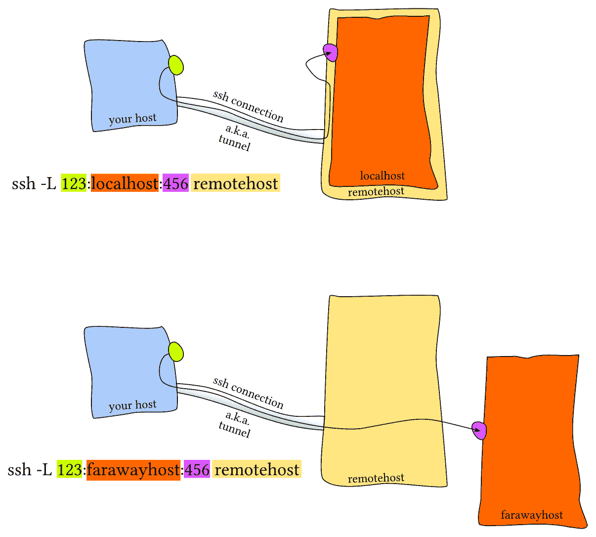
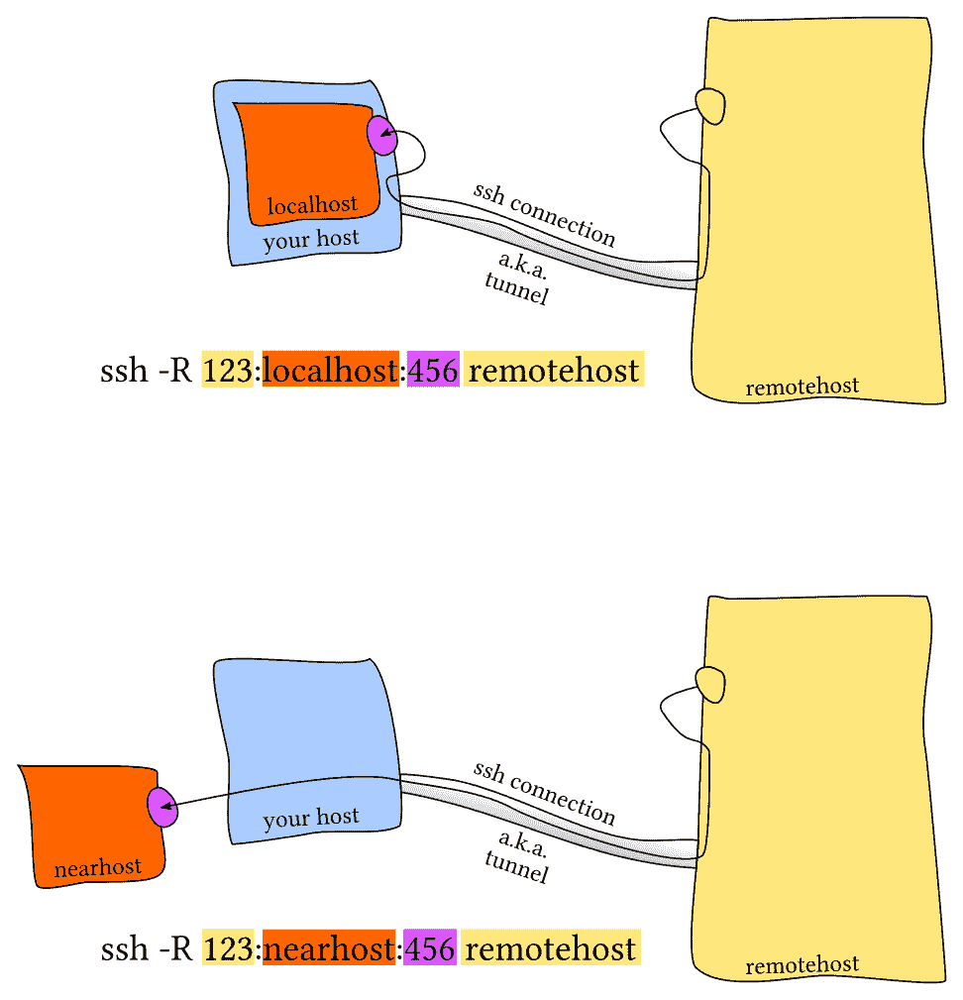

# 命令行环境

> [`missing.csail.mit.edu/2020/command-line/`](https://missing.csail.mit.edu/2020/command-line/)

在这次讲座中，我们将探讨几种方法，这些方法可以帮助你在使用 shell 时提高工作效率。我们已经使用 shell 有一段时间了，但我们主要关注执行不同的命令。现在我们将看到如何同时运行多个进程并跟踪它们，如何停止或暂停特定进程，以及如何使进程在后台运行。

我们还将了解不同的方法来改进你的 shell 和其他工具，通过定义别名和使用 dotfiles 进行配置。这两者都可以帮助你节省时间，例如，在所有机器上使用相同的配置，而无需输入长命令。我们将探讨如何使用 SSH 与远程机器协同工作。

# 作业控制

在某些情况下，你可能需要在进程执行过程中中断它，例如，如果某个命令完成时间过长（例如，搜索非常大的目录结构的`find`命令）。大多数时候，你可以按`Ctrl-C`，命令就会停止。但这是如何实际工作的，为什么有时它无法停止进程？

## 终止一个进程

你的 shell 正在使用一种称为*信号*的 UNIX 通信机制来向进程传递信息。当进程收到信号时，它会停止执行，处理信号，并根据信号传递的信息可能改变执行流程。因此，信号是*软件中断*。

在我们的情况下，当按`Ctrl-C`时，这会提示 shell 向进程发送`SIGINT`信号。

这是一个捕获`SIGINT`并忽略它的 Python 程序的简单示例，不再停止。现在我们可以使用`SIGQUIT`信号来终止这个程序，通过按`Ctrl-\`。

```py
#!/usr/bin/env python import signal, time

def handler(signum, time):
    print("\nI got a SIGINT, but I am not stopping")

signal.signal(signal.SIGINT, handler)
i = 0
while True:
    time.sleep(.1)
    print("\r{}".format(i), end="")
    i += 1 
```

如果我们向这个程序发送两次`SIGINT`信号，然后是`SIGQUIT`信号，会发生什么情况。请注意，`^`是当在终端中输入时显示`Ctrl`的方式。

```py
$ python sigint.py
24^C
I got a SIGINT, but I am not stopping
26^C
I got a SIGINT, but I am not stopping
30^\[1]    39913 quit       python sigint.py 
```

虽然`SIGINT`和`SIGQUIT`通常都与终端相关请求相关联，但一个更通用的信号，用于请求进程优雅地退出，是`SIGTERM`信号。要发送此信号，我们可以使用`kill`命令，语法为`kill -TERM <PID>`。

## 暂停和后台处理进程

信号可以执行除终止进程之外的其他操作。例如，`SIGSTOP`会暂停一个进程。在终端中，按`Ctrl-Z`会提示 shell 发送一个`SIGTSTP`信号，即终端版本的`SIGSTOP`。

然后，我们可以使用`fg`或`bg`命令分别在前台或后台继续暂停的作业。

`jobs`（[jobs](https://www.man7.org/linux/man-pages/man1/jobs.1p.html)）命令列出了与当前终端会话关联的未完成作业。你可以通过它们的 pid（你可以使用`pgrep`（[pgrep](https://www.man7.org/linux/man-pages/man1/pgrep.1.html)）来找出）来引用这些作业。更直观的是，你也可以使用百分号后跟其作业号（由`jobs`显示）来引用一个进程。要引用最后一个后台作业，你可以使用特殊参数`$!`。

还有一件事需要知道的是，命令中的`&`后缀将在后台运行命令，这样你就可以获得提示符，尽管它仍然会使用 shell 的 STDOUT，这可能会很烦人（在这种情况下使用 shell 重定向）。

要将正在运行的程序放入后台，你可以按`Ctrl-Z`然后按`bg`。请注意，后台进程仍然是你的终端的子进程，如果你关闭终端，它们将会死亡（这将发送另一个信号，`SIGHUP`）。为了避免这种情况发生，你可以使用`nohup`（[nohup](https://www.man7.org/linux/man-pages/man1/nohup.1.html)）运行程序（这是一个忽略`SIGHUP`的包装器），或者如果进程已经启动，可以使用`disown`。或者，你可以使用我们在下一节中将要看到的终端复用器。

下面是一个示例会话，以展示一些这些概念。

```py
$ sleep 1000
^Z
[1]  + 18653 suspended  sleep 1000

$ nohup sleep 2000 &
[2] 18745
appending output to nohup.out

$ jobs
[1]  + suspended  sleep 1000
[2]  - running    nohup sleep 2000

$ bg %1
[1]  - 18653 continued  sleep 1000

$ jobs
[1]  - running    sleep 1000
[2]  + running    nohup sleep 2000

$ kill -STOP %1
[1]  + 18653 suspended (signal)  sleep 1000

$ jobs
[1]  + suspended (signal)  sleep 1000
[2]  - running    nohup sleep 2000

$ kill -SIGHUP %1
[1]  + 18653 hangup     sleep 1000

$ jobs
[2]  + running    nohup sleep 2000

$ kill -SIGHUP %2

$ jobs
[2]  + running    nohup sleep 2000

$ kill %2
[2]  + 18745 terminated  nohup sleep 2000

$ jobs 
```

一个特殊的信号是`SIGKILL`，因为它不能被进程捕获，并且它将立即终止它。然而，它可能会有不良的副作用，例如留下孤儿子进程。

你可以在[这里](https://en.wikipedia.org/wiki/Signal_(IPC))了解更多关于这些和其他信号的信息，或者输入`man signal`或`kill -l`。

# 终端复用器

当使用命令行界面时，你通常会想要同时运行多个任务。例如，你可能想要同时运行你的编辑器和你的程序。虽然这可以通过打开新的终端窗口来实现，但使用终端复用器是一个更灵活的解决方案。

类似于`tmux`（[tmux](https://www.man7.org/linux/man-pages/man1/tmux.1.html)）的终端复用器允许你使用面板和标签来复用终端窗口，这样你可以与多个 shell 会话进行交互。此外，终端复用器还允许你在某个时间点之后断开当前终端会话并重新连接。当与远程机器一起工作时，这可以使你的工作流程变得更好，因为它避免了使用`nohup`和类似技巧的需求。

目前最受欢迎的终端复用器是`tmux`（[tmux](https://www.man7.org/linux/man-pages/man1/tmux.1.html)）。`tmux`高度可配置，通过使用相关的快捷键，你可以创建多个标签和面板，并快速在其中导航。

`tmux`期望你知道它的快捷键，它们的形式都是`<C-b> x`，这意味着（1）按`Ctrl+b`，（2）释放`Ctrl+b`，然后（3）按`x`。`tmux`有以下对象层次结构：

+   **会话** - 会话是一个包含一个或多个窗口的独立工作空间

    +   `tmux` 启动一个新会话。

    +   `tmux new -s NAME` 以该名称启动它。

    +   `tmux ls` 列出当前会话

    +   在 `tmux` 中，输入 `<C-b> d` 可以断开当前会话

    +   `tmux a` 连接到最后一个会话。您可以使用 `-t` 标志来指定

+   **窗口** - 与编辑器或浏览器中的标签页相当，它们是同一会话的视觉上分离的部分

    +   `<C-b> c` 创建一个新窗口。要关闭它，你可以简单地终止 shell，执行 `<C-d>`

    +   `<C-b> N` 跳转到第 *N* 个窗口。注意它们是编号的

    +   `<C-b> p` 跳转到上一个窗口

    +   `<C-b> n` 跳转到下一个窗口

    +   `<C-b> ,` 重命名当前窗口

    +   `<C-b> w` 列出当前窗口

+   **面板** - 与 vim 的分割类似，面板允许您在同一视觉显示中拥有多个 shell。

    +   `<C-b> "` 水平分割当前面板

    +   `<C-b> %` 垂直分割当前面板

    +   `<C-b> <direction>` 移动到指定 *方向* 的面板。方向在这里意味着箭头键。

    +   `<C-b> z` 切换当前面板的缩放

    +   `<C-b> [` 开始滚动。然后您可以按 `<space>` 开始选择，按 `<enter>` 复制该选择。

    +   `<C-b> <space>` 在面板布局之间循环。

对于进一步阅读，[这里](https://www.hamvocke.com/blog/a-quick-and-easy-guide-to-tmux/) 是关于 `tmux` 的快速教程，[这个](https://linuxcommand.org/lc3_adv_termmux.php) 有更详细的解释，涵盖了原始的 `screen` 命令。您可能还想熟悉一下 `[screen](https://www.man7.org/linux/man-pages/man1/screen.1.html)`，因为它安装在大多数 UNIX 系统中。

# 别名

输入涉及许多标志或详细选项的长命令可能会变得令人厌烦。因此，大多数 shell 都支持 *别名* 功能。shell 别名是另一个命令的简写形式，shell 会自动为您替换。例如，bash 中的别名具有以下结构：

```py
alias alias_name="command_to_alias arg1 arg2" 
```

注意，等号 `=` 周围没有空格，因为 `[alias](https://www.man7.org/linux/man-pages/man1/alias.1p.html)` 是一个接受单个参数的 shell 命令。

别名具有许多方便的功能：

```py
# Make shorthands for common flags
alias ll="ls -lh"

# Save a lot of typing for common commands
alias gs="git status"
alias gc="git commit"
alias v="vim"

# Save you from mistyping
alias sl=ls

# Overwrite existing commands for better defaults
alias mv="mv -i"           # -i prompts before overwrite
alias mkdir="mkdir -p"     # -p make parent dirs as needed
alias df="df -h"           # -h prints human readable format

# Alias can be composed
alias la="ls -A"
alias lla="la -l"

# To ignore an alias run it prepended with \
\ls
# Or disable an alias altogether with unalias
unalias la

# To get an alias definition just call it with alias
alias ll
# Will print ll='ls -lh' 
```

注意，别名默认不会持久化 shell 会话。要使别名持久化，您需要将其包含在 shell 启动文件中，如 `.bashrc` 或 `.zshrc`，我们将在下一节介绍。

# 配置文件

Many programs are configured using plain-text files known as *dotfiles* (because the file names begin with a `.`, e.g. `~/.vimrc`, so that they are hidden in the directory listing `ls` by default).

Shells are one example of programs configured with such files. On startup, your shell will read many files to load its configuration. Depending on the shell, whether you are starting a login and/or interactive the entire process can be quite complex. [Here](https://blog.flowblok.id.au/2013-02/shell-startup-scripts.html) is an excellent resource on the topic.

对于 `bash`，编辑您的 `.bashrc` 或 `.bash_profile` 在大多数系统中都会起作用。在这里，您可以包括在启动时想要运行的命令，比如我们刚才描述的别名或对您的 `PATH` 环境变量的修改。实际上，许多程序会要求您在 shell 配置文件中包含一行类似 `export PATH="$PATH:/path/to/program/bin"` 的内容，以便它们的二进制文件可以被找到。

一些可以通过 dotfiles 配置的工具的其他示例包括：

+   `bash` - `~/.bashrc`，`~/.bash_profile`

+   `git` - `~/.gitconfig`

+   `vim` - `~/.vimrc` 和 `~/.vim` 文件夹

+   `ssh` - `~/.ssh/config`

+   `tmux` - `~/.tmux.conf`

您应该如何组织您的 dotfiles？它们应该放在自己的文件夹中，置于版本控制之下，并使用脚本**链接**到适当的位置。这样做有以下好处：

+   **易于安装**：如果您登录到一台新机器，应用您的自定义设置只需一分钟。

+   **便携性**：您的工具将在任何地方以相同的方式工作。

+   **同步**：您可以在任何地方更新您的 dotfiles 并保持它们同步。

+   **变更跟踪**：您可能在整个编程生涯中维护您的 dotfiles，对于长期项目来说，版本历史记录是非常有用的。

您应该在 dotfiles 中放置什么内容？您可以通过阅读在线文档或 [man 页面](https://en.wikipedia.org/wiki/Man_page) 了解您的工具设置。另一种很好的方法是搜索有关特定程序的博客文章，作者会告诉您他们偏好的自定义设置。还有另一种了解自定义设置的方法是查看其他人的 dotfiles：您可以在 GitHub 上找到大量的 [dotfiles 存储库](https://github.com/search?o=desc&q=dotfiles&s=stars&type=Repositories) — 请参阅最受欢迎的一个 [这里](https://github.com/mathiasbynens/dotfiles)（我们建议您不要盲目复制配置）。[这里](https://dotfiles.github.io/) 是关于此主题的另一个很好的资源。

所有课程讲师的 dotfiles 都可以在 GitHub 上公开访问：[Anish](https://github.com/anishathalye/dotfiles)，[Jon](https://github.com/jonhoo/configs)，[Jose](https://github.com/jjgo/dotfiles)。

## **便携性**

使用 dotfiles 的一种常见问题是，当与多台机器一起工作时，配置可能无法正常工作，例如，如果它们有不同的操作系统或 shell。有时您也只想在特定机器上应用某些配置。

有一些技巧可以使这更容易。如果配置文件支持，请使用类似 if 语句的等效功能来应用特定于机器的自定义设置。例如，您的 shell 可以有如下内容：

```py
if [[ "$(uname)" == "Linux" ]]; then {do_something}; fi

# Check before using shell-specific features
if [[ "$SHELL" == "zsh" ]]; then {do_something}; fi

# You can also make it machine-specific
if [[ "$(hostname)" == "myServer" ]]; then {do_something}; fi 
```

如果配置文件支持，请使用包含功能。例如，一个 `~/.gitconfig` 可以有一个设置：

```py
[include]
    path = ~/.gitconfig_local 
```

然后在每台机器上，`~/.gitconfig_local` 可以包含特定于机器的设置。您甚至可以将这些设置跟踪在单独的存储库中。 

如果你想让不同的程序共享一些配置，这个想法也很有用。例如，如果你想让 `bash` 和 `zsh` 共享同一组别名，你可以在 `.aliases` 下写入它们，并在两个中都有以下块：

```py
# Test if ~/.aliases exists and source it
if [ -f ~/.aliases ]; then source ~/.aliases
fi 
```

# 远程机器

对于程序员来说，在日常工作中使用远程服务器变得越来越普遍。如果你需要使用远程服务器来部署后端软件或者你需要一个具有更高计算能力的服务器，你最终会使用安全外壳（SSH）。与大多数工具一样，SSH 具有高度的可配置性，因此了解它是有价值的。

要通过 `ssh` 连接到服务器，你执行以下命令

```py
ssh foo@bar.mit.edu 
```

在这里，我们尝试以用户 `foo` 的身份在服务器 `bar.mit.edu` 上进行 ssh 连接。服务器可以通过 URL（如 `bar.mit.edu`）或 IP 地址（例如 `foobar@192.168.1.42`）指定。稍后我们将看到，如果我们修改 ssh 配置文件，你可以仅使用类似 `ssh bar` 的方式访问。

## 执行命令

`ssh` 的一个常被忽视的功能是能够直接运行命令。`ssh foobar@server ls` 将在 foobar 的家目录中执行 `ls` 命令。它与管道一起工作，所以 `ssh foobar@server ls | grep PATTERN` 将在本地 grep `ls` 的远程输出，而 `ls | ssh foobar@server grep PATTERN` 将在远程 grep `ls` 的本地输出。

## SSH 密钥

基于密钥的认证利用公钥加密技术向服务器证明客户端拥有秘密私钥，而不泄露密钥。这样你就不需要每次都重新输入密码。然而，私钥（通常是 `~/.ssh/id_rsa`，最近更多是 `~/.ssh/id_ed25519`）实际上就是你的密码，所以要像对待密码一样对待它。

### 密钥生成

要生成一对密钥，你可以运行 `ssh-keygen`。

```py
ssh-keygen -a 100 -t ed25519 -f ~/.ssh/id_ed25519 
```

你应该选择一个密码短语，以防止有人获取你的私钥来访问授权服务器。使用 `ssh-agent` 或 `gpg-agent`，这样你就不必每次都输入密码短语。

如果你曾经使用 SSH 密钥配置 GitHub 推送，那么你可能已经完成了[这里](https://help.github.com/articles/connecting-to-github-with-ssh/)概述的步骤，并且已经有一个有效的密钥对。要检查你是否有一个密码短语并验证它，你可以运行 `ssh-keygen -y -f /path/to/key`。

### 基于密钥的认证

`ssh` 会查看 `.ssh/authorized_keys` 以确定它应该允许哪些客户端进入。要复制一个公钥，你可以使用：

```py
cat .ssh/id_ed25519.pub | ssh foobar@remote 'cat >> ~/.ssh/authorized_keys' 
```

如果可用，可以使用 `ssh-copy-id` 实现一个更简单的解决方案：

```py
ssh-copy-id -i .ssh/id_ed25519 foobar@remote 
```

## 通过 SSH 复制文件

有许多方法可以通过 ssh 复制文件：

+   `ssh+tee`，最简单的方法是使用 `ssh` 命令执行和 STDIN 输入，执行 `cat localfile | ssh remote_server tee serverfile`。回想一下，`tee` 将 STDIN 的输出写入文件。

+   [`scp`](https://www.man7.org/linux/man-pages/man1/scp.1.html) 在复制大量文件/目录时，由于它可以轻松地对路径进行递归，所以安全的复制 `scp` 命令更方便。语法是 `scp 本地路径/本地文件 远程主机:远程路径/远程文件`

+   [`rsync`](https://www.man7.org/linux/man-pages/man1/rsync.1.html) 通过检测本地和远程的相同文件，并防止再次复制它们来改进 `scp`。它还提供了对符号链接、权限的更精细控制，并具有像 `--partial` 标志这样的额外功能，可以从之前中断的复制中恢复。`rsync` 的语法与 `scp` 类似。

## 端口转发

在许多场景中，你可能会遇到在机器上监听特定端口的软件。当这种情况发生在你的本地机器上时，你可以输入 `localhost:PORT` 或 `127.0.0.1:PORT`，但对于没有通过网络/互联网直接提供端口的远程服务器，你该怎么办呢？

这被称为 *端口转发*，它有两种形式：本地端口转发和远程端口转发（见图片以获取更多详细信息，图片来自 [这篇 StackOverflow 帖子](https://unix.stackexchange.com/questions/115897/whats-ssh-port-forwarding-and-whats-the-difference-between-ssh-local-and-remot)）。

**本地端口转发** 

**远程端口转发** 

最常见的场景是本地端口转发，其中远程机器上的服务在一个端口上监听，你想要将你的本地机器上的一个端口链接到远程端口。例如，如果我们在一个监听端口 `8888` 的远程服务器上执行 `jupyter notebook`。因此，要将它转发到本地端口 `9999`，我们会这样做 `ssh -L 9999:localhost:8888 foobar@remote_server`，然后在我们的本地机器上导航到 `localhost:9999`。

## SSH 配置

我们已经介绍了许多我们可以传递的参数。一个诱人的替代方案是创建看起来像

```py
alias my_server="ssh -i ~/.id_ed25519 --port 2222 -L 9999:localhost:8888 foobar@remote_server" 
```

然而，有一个更好的替代方案使用 `~/.ssh/config`。

```py
Host vm
    User foobar
    HostName 172.16.174.141
    Port 2222
    IdentityFile ~/.ssh/id_ed25519
    LocalForward 9999 localhost:8888

# Configs can also take wildcards
Host *.mit.edu
    User foobaz 
```

使用 `~/.ssh/config` 文件而不是别名的另一个优点是，其他程序如 `scp`、`rsync`、`mosh` 等也能够读取它并将设置转换为相应的标志。

注意，`~/.ssh/config` 文件可以被视为点文件，通常情况下将其包含在其他点文件中是没问题的。然而，如果你将其公开，要考虑你可能会提供给互联网上陌生人的信息：你的服务器、用户、开放端口等。这可能会方便某些类型的攻击，因此在分享你的 SSH 配置时要三思。

服务器端配置通常在`/etc/ssh/sshd_config`中指定。在这里，你可以进行更改，如禁用密码认证、更改 ssh 端口、启用 X11 转发等。你可以根据每个用户指定配置设置。

## 杂项

连接到远程服务器时常见的痛苦是因你的电脑关闭、进入睡眠状态或更改网络而断开连接。此外，如果有一个有显著延迟的连接，使用 ssh 可能会变得相当令人沮丧。[Mosh](https://mosh.org/)，移动壳，在 ssh 的基础上进行了改进，允许漫游连接、间歇性连接并提供智能本地回显。

有时挂载远程文件夹很方便。[sshfs](https://github.com/libfuse/sshfs)可以在本地挂载远程服务器上的文件夹，然后你可以使用本地编辑器。

# Shell 与框架

在介绍 shell 工具和脚本时，我们介绍了`bash` shell，因为它是最普遍的 shell，大多数系统都将其作为默认选项。然而，它并不是唯一的选择。

例如，`zsh` shell 是`bash`的超集，并提供了许多开箱即用的便利功能，例如：

+   智能通配符，`**`

+   内联通配符/通配符展开

+   拼写纠正

+   更好的标签完成/选择

+   路径展开（`cd /u/lo/b`将展开为`/usr/local/bin`）

**框架**也可以改善你的 shell。一些流行的通用框架包括[prezto](https://github.com/sorin-ionescu/prezto)或[oh-my-zsh](https://ohmyz.sh/)，以及专注于特定功能的较小框架，如[zsh-syntax-highlighting](https://github.com/zsh-users/zsh-syntax-highlighting)或[zsh-history-substring-search](https://github.com/zsh-users/zsh-history-substring-search)。像[fish](https://fishshell.com/)这样的 shell 默认包含了许多用户友好的功能。其中一些功能包括：

+   右侧提示符

+   命令语法高亮

+   历史子串搜索

+   基于手册页的标志完成

+   智能自动完成

+   提示主题

使用这些框架时要注意的一点是，它们可能会减慢你的 shell 速度，特别是如果它们运行的代码没有正确优化，或者代码量过多。你总是可以对其进行性能分析，并禁用不常用或不如速度重要的功能。

# 终端模拟器

除了自定义你的 shell，花些时间了解你的**终端模拟器**及其设置也是值得的。市面上有各种各样的终端模拟器（这里有一个[比较](https://anarc.at/blog/2018-04-12-terminal-emulators-1/)）。

由于你可能会在终端上花费数百到数千小时，因此查看其设置是值得的。你可能想在终端中修改的一些方面包括：

+   字体选择

+   颜色方案

+   键盘快捷键

+   标签/面板支持

+   滚动配置

+   性能（一些较新的终端，如[Alacritty](https://github.com/jwilm/alacritty)或[kitty](https://sw.kovidgoyal.net/kitty/)，提供 GPU 加速）。

# 练习

## 任务控制

1.  从我们所看到的，我们可以使用一些`ps aux | grep`命令来获取我们的作业的进程 ID，然后杀死它们，但还有更好的方法。在终端中启动一个`sleep 10000`作业，使用`Ctrl-Z`将其置于后台，然后继续执行。现在使用[`pgrep`](https://www.man7.org/linux/man-pages/man1/pgrep.1.html)来找到它的 pid，使用[`pkill`](https://man7.org/linux/man-pages/man1/pgrep.1.html)来杀死它，而无需输入 pid 本身。（提示：使用`-af`标志）。

1.  假设你不想在另一个进程完成之前启动一个进程。你将如何操作？在这个练习中，我们的限制进程始终是`sleep 60 &`。实现这一目标的一种方法是用`[`wait](https://www.man7.org/linux/man-pages/man1/wait.1p.html)`命令。尝试启动 sleep 命令，并让`ls`等待后台进程完成。

    然而，如果我们从一个不同的 bash 会话开始，这个策略就会失败，因为`wait`命令只对子进程有效。笔记中没有讨论的一个特性是，`kill`命令的退出状态在成功时为零，否则为非零。`kill -0`不会发送信号，但如果进程不存在，将给出非零的退出状态。编写一个名为`pidwait`的 bash 函数，它接受一个进程 ID（pid）并等待直到指定的进程完成。你应该使用`sleep`来避免不必要的 CPU 浪费。

## Terminal multiplexer

1.  遵循这个`tmux`[教程](https://www.hamvocke.com/blog/a-quick-and-easy-guide-to-tmux/)，然后学习如何按照[这些步骤](https://www.hamvocke.com/blog/a-guide-to-customizing-your-tmux-conf/)进行一些基本的自定义设置。

## Aliases

1.  创建一个别名`dc`，当输入错误时解析为`cd`。

1.  运行`history | awk '{$1="";print substr($0,2)}' | sort | uniq -c | sort -n | tail -n 10`来获取你使用最多的前 10 个命令，并考虑为它们编写更短的别名。注意：这适用于 Bash；如果你使用 ZSH，请使用`history 1`而不是仅仅`history`。

## Dotfiles

让我们让你熟悉一下 dotfiles。

1.  为你的 dotfiles 创建一个文件夹并设置版本控制。

1.  至少为其中一个程序添加配置，例如你的 shell，并做一些定制（为了开始，这可以是通过设置`$PS1`来自定义你的 shell 提示符这样简单的事情）。

1.  设置一种方法，以便快速（且无需手动操作）在新机器上安装你的 dotfiles。这可以是一个简单的 shell 脚本，它为每个文件调用`ln -s`，或者你可以使用一个[专用工具](https://dotfiles.github.io/utilities/)。

1.  在一个全新的虚拟机上测试你的安装脚本。

1.  将你当前的所有工具配置迁移到你的 dotfiles 仓库中。

1.  在 GitHub 上发布你的 dotfiles。

## Remote Machines

安装一个 Linux 虚拟机（或使用已经存在的虚拟机）进行这个练习。如果你不熟悉虚拟机，请查看[这个](https://hibbard.eu/install-ubuntu-virtual-box/)教程来安装一个。

1.  前往 `~/.ssh/` 并检查你是否在那里有一对 SSH 密钥。如果没有，使用 `ssh-keygen -a 100 -t ed25519` 生成它们。建议你使用密码，并使用 `ssh-agent`，更多信息[这里](https://www.ssh.com/ssh/agent)。

1.  编辑 `.ssh/config` 以添加以下条目

    ```py
     Host vm
         User username_goes_here
         HostName ip_goes_here
         IdentityFile ~/.ssh/id_ed25519
         LocalForward 9999 localhost:8888 
    ```

1.  使用 `ssh-copy-id vm` 将你的 SSH 密钥复制到服务器。

1.  在你的虚拟机中通过执行 `python -m http.server 8888` 启动一个 web 服务器。通过在你的机器上导航到 `http://localhost:9999` 来访问虚拟机 web 服务器。

1.  通过执行 `sudo vim /etc/ssh/sshd_config` 编辑你的 SSH 服务器配置，并通过编辑 `PasswordAuthentication` 的值来禁用密码认证。通过编辑 `PermitRootLogin` 的值来禁用 root 登录。使用 `sudo service sshd restart` 重启 `ssh` 服务。再次尝试 SSH 登录。

1.  (挑战) 在虚拟机中安装 [mosh](https://mosh.org/) 并建立连接。然后断开服务器/虚拟机的网络适配器。mosh 是否能正确恢复？

1.  (挑战) 查看在 `ssh` 中 `-N` 和 `-f` 标志的作用，并找出一个命令来实现后台端口转发。

* * *

[编辑此页面](https://github.com/missing-semester/missing-semester/blob/master/_2020/command-line.md)。

本内容受 [CC BY-NC-SA](https://creativecommons.org/licenses/by-nc-sa/4.0) 许可。
