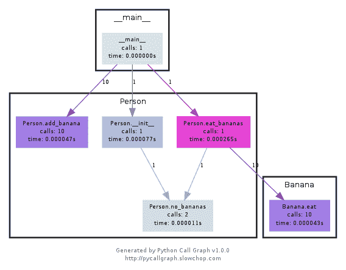

# 调试和性能分析

> 原文：[`missing.csail.mit.edu/2020/debugging-profiling/`](https://missing.csail.mit.edu/2020/debugging-profiling/)

编程中的一个黄金法则是代码不会做你期望它做的事情，而是做你告诉它做的事情。弥合这个差距有时可能是一项相当困难的任务。在本讲座中，我们将介绍处理有缺陷和资源密集型代码的有用技术：调试和性能分析。

# 调试

## Printf 调试和日志记录

“最有效的调试工具仍然是仔细思考，辅以恰当地放置的打印语句”—— 布莱恩·柯林汉，《Unix 初学者指南》。

调试程序的第一种方法是添加打印语句在你检测到问题的周围，并持续迭代，直到你提取出足够的信息来理解导致问题的原因。

第二种方法是使用程序中的日志记录，而不是临时的打印语句。日志记录比常规的打印语句有以下几个优点：

+   你可以将日志记录到文件、套接字甚至远程服务器，而不是标准输出。

+   日志支持严重级别（如 INFO、DEBUG、WARN、ERROR 等），这允许你相应地过滤输出。

+   对于新问题，你的日志很可能包含足够的信息来检测出问题所在。

这里是一个记录消息的示例代码：

```py
$ python logger.py
# Raw output as with just prints
$ python logger.py log
# Log formatted output
$ python logger.py log ERROR
# Print only ERROR levels and above
$ python logger.py color
# Color formatted output 
```

我最喜欢的使日志更易读的小技巧之一是给它们上色。到现在你可能已经意识到你的终端使用颜色来使内容更易读。但是它是如何做到的呢？像`ls`或`grep`这样的程序正在使用[ANSI 转义码](https://en.wikipedia.org/wiki/ANSI_escape_code)，这是一系列特殊的字符序列，用来指示你的 shell 改变输出的颜色。例如，执行`echo -e "\e[38;2;255;0;0mThis is red\e[0m"`会在你的终端上以红色打印消息`This is red`，只要它支持[真彩色](https://github.com/termstandard/colors#truecolor-support-in-output-devices)。如果你的终端不支持这个（例如 macOS 的 Terminal.app），你可以使用更广泛支持的 16 种颜色的转义码，例如 `echo -e "\e[31;1mThis is red\e[0m"`。

以下脚本展示了如何将多种 RGB 颜色打印到你的终端（再次强调，只要它支持真彩色）。

```py
#!/usr/bin/env bash
for R in $(seq 0 20 255); do
    for G in $(seq 0 20 255); do
        for B in $(seq 0 20 255); do printf "\e[38;2;${R};${G};${B}m█\e[0m";
        done
    done
done 
```

## 第三方日志

当你开始构建更大的软件系统时，你很可能会遇到作为独立程序运行的依赖项。Web 服务器、数据库或消息代理是这类依赖项的常见例子。与这些系统交互时，通常需要读取它们的日志，因为客户端的错误消息可能不足以说明问题。

幸运的是，大多数程序会在你的系统中某个地方记录自己的日志。在 UNIX 系统中，程序在`/var/log`下记录日志是很常见的。例如，[NGINX](https://www.nginx.com/) 网络服务器将其日志放在`/var/log/nginx`下。最近，系统开始使用**系统日志**，这越来越成为所有日志消息的存放地。大多数（但不是所有）Linux 系统使用`systemd`，这是一个系统守护进程，它控制着你的系统中的许多事情，比如哪些服务被启用和运行。`systemd`将日志放在`/var/log/journal`下，并采用专门的格式，你可以使用`[`journalctl](https://www.man7.org/linux/man-pages/man1/journalctl.1.html)`命令来显示消息。同样，在 macOS 上，仍然有`/var/log/system.log`，但越来越多的工具使用系统日志，可以使用`[`log show](https://www.manpagez.com/man/1/log/)`来显示。在大多数 UNIX 系统中，你也可以使用`[`dmesg](https://www.man7.org/linux/man-pages/man1/dmesg.1.html)`命令来访问内核日志。

对于在系统日志下进行日志记录，你可以使用`[`logger](https://www.man7.org/linux/man-pages/man1/logger.1.html)` shell 程序。以下是一个使用`logger`的示例以及如何检查条目是否已进入系统日志。此外，大多数编程语言都有绑定到系统日志的日志记录功能。

```py
logger "Hello Logs"
# On macOS
log show --last 1m | grep Hello
# On Linux
journalctl --since "1m ago" | grep Hello 
```

正如我们在数据处理讲座中看到的，日志可能非常冗长，它们需要一定程度的处理和过滤才能获取你想要的信息。如果你发现自己正在大量过滤`journalctl`和`log show`，你可以考虑使用它们的标志，这些标志可以对它们的输出进行初步的过滤。还有一些工具，如`[`lnav](https://lnav.org/)`，提供了对日志文件改进的展示和导航。

## 调试器

当 printf 调试不足以满足需求时，你应该使用调试器。调试器是允许你与程序执行交互的程序，它允许以下操作：

+   当程序到达某一特定行时停止执行。

+   逐条指令地执行程序。

+   在程序崩溃后检查变量的值。

+   当满足给定条件时，有条件地停止执行。

+   许多更多高级功能

许多编程语言都附带某种形式的调试器。在 Python 中，这是 Python 调试器`[`pdb](https://docs.python.org/3/library/pdb.html)`。

下面是`pdb`支持的命令的简要描述：

+   **l**(ist) - 显示当前行周围的 11 行或继续之前的列表。

+   **s**(tep) - 执行当前行，并在第一个可能的情况下停止。

+   **n**(ext) - 继续执行，直到当前函数中的下一行或它返回。

+   **b**(reak) - 设置断点（取决于提供的参数）。

+   **p**(rint) - 在当前上下文中评估表达式并打印其值。还有一个 **pp**，用于使用 `[`pprint`](https://docs.python.org/3/library/pprint.html)` 显示。

+   **r**(eturn) - 继续执行直到当前函数返回。

+   **q**(uit) - 退出调试器。

让我们通过一个使用 `pdb` 修复以下有问题的 Python 代码的示例。 (参见讲座视频)。

```py
def bubble_sort(arr):
    n = len(arr)
    for i in range(n):
        for j in range(n):
            if arr[j] > arr[j+1]:
                arr[j] = arr[j+1]
                arr[j+1] = arr[j]
    return arr

print(bubble_sort([4, 2, 1, 8, 7, 6])) 
```

注意，由于 Python 是一种解释型语言，我们可以使用 `pdb` 命令行来执行命令和指令。`[`ipdb`](https://pypi.org/project/ipdb/) 是一个改进的 `pdb`，它使用 `[`IPython`](https://ipython.org) REPL，支持自动完成、语法高亮、更好的跟踪和更好的内省，同时保留了与 `pdb` 模块相同的接口。

对于更底层的编程，你可能需要考虑 `[`gdb`](https://www.gnu.org/software/gdb/)（及其生活质量改进版 `[`pwndbg`](https://github.com/pwndbg/pwndbg)）和 `[`lldb`](https://lldb.llvm.org/)。它们针对 C 类语言调试进行了优化，但几乎可以让你探测任何进程并获取其当前机器状态：寄存器、堆栈、程序计数器等。

## 专用工具

即使你试图调试的是一个黑盒二进制文件，也有工具可以帮助你。当程序需要执行只有内核才能执行的操作时，它们会使用 [系统调用](https://en.wikipedia.org/wiki/System_call)。有一些命令可以跟踪程序执行的系统调用。在 Linux 中有 `[`strace`](https://www.man7.org/linux/man-pages/man1/strace.1.html)`，而在 macOS 和 BSD 中有 `[`dtrace`](https://dtrace.org/about/)。`dtrace` 使用其自己的 `D` 语言，可能难以使用，但有一个名为 `[`dtruss`](https://www.manpagez.com/man/1/dtruss/) 的包装器，它提供了一个与 `strace` 更相似的接口（更多详情[这里](https://8thlight.com/blog/colin-jones/2015/11/06/dtrace-even-better-than-strace-for-osx.html)）。

下面是一些使用 `strace` 或 `dtruss` 来显示 `ls` 执行的 `stat` 系统调用跟踪的示例。对于更深入的了解 `strace`，可以阅读[这篇文章](https://blogs.oracle.com/linux/strace-the-sysadmins-microscope-v2)和[这本杂志](https://jvns.ca/strace-zine-unfolded.pdf)。

```py
# On Linux
sudo strace -e lstat ls -l > /dev/null
# On macOS
sudo dtruss -t lstat64_extended ls -l > /dev/null 
```

在某些情况下，你可能需要查看网络数据包以确定程序中的问题。像 `[`tcpdump`](https://www.man7.org/linux/man-pages/man1/tcpdump.1.html)` 和 [Wireshark](https://www.wireshark.org/) 这样的工具是网络数据包分析器，允许你读取网络数据包并根据不同的标准进行过滤。

对于 Web 开发，Chrome/Firefox 开发者工具非常方便。它们提供大量工具，包括：

+   源代码 - 检查任何网站的 HTML/CSS/JS 源代码。

+   实时 HTML、CSS、JS 修改 - 修改网站内容、样式和行为以进行测试（你可以亲自看到网站截图不是有效的证据）。

+   JavaScript 壳 - 在 JS REPL 中执行命令。

+   网络 - 分析请求时间线。

+   存储 - 查看 Cookies 和本地应用程序存储。

## 静态分析

对于某些问题，你不需要运行任何代码。例如，只需仔细查看一段代码，你可能会意识到你的循环变量正在遮蔽一个已经存在的变量或函数名；或者程序在定义变量之前就读取了它。这就是静态分析工具发挥作用的地方。静态分析程序将源代码作为输入，并使用编码规则进行分析，以推理其正确性。

在下面的 Python 代码片段中存在几个错误。首先，我们的循环变量`foo`遮蔽了函数`foo`的先前定义。我们还把最后一行中的`baz`写成了`bar`，所以程序在完成`sleep`调用（将花费一分钟）后将会崩溃。

```py
import time

def foo():
    return 42

for foo in range(5):
    print(foo)
bar = 1
bar *= 0.2
time.sleep(60)
print(baz) 
```

静态分析工具可以识别这类问题。当我们对代码运行`pyflakes`时，我们会得到与这两个错误相关的错误。`mypy`是另一个可以检测类型检查问题的工具。在这里，`mypy`会警告我们`bar`最初是一个`int`，然后被转换为`float`。再次注意，所有这些问题都是在无需运行代码的情况下被检测到的。

```py
$ pyflakes foobar.py
foobar.py:6: redefinition of unused 'foo' from line 3
foobar.py:11: undefined name 'baz'

$ mypy foobar.py
foobar.py:6: error: Incompatible types in assignment (expression has type "int", variable has type "Callable[[], Any]")
foobar.py:9: error: Incompatible types in assignment (expression has type "float", variable has type "int")
foobar.py:11: error: Name 'baz' is not defined
Found 3 errors in 1 file (checked 1 source file) 
```

在壳工具讲座中，我们介绍了`shellcheck`，这是一个类似用于 shell 脚本的工具。

大多数编辑器和 IDE 都支持在编辑器本身中显示这些工具的输出，突出显示警告和错误的位置。这通常被称为**代码检查**，它也可以用来显示其他类型的错误，如风格违规或不安全的结构。

在 vim 中，插件`ale`或`syntastic`将允许你这样做。对于 Python，`pylint`和`pep8`是风格检查器的示例，而`bandit`是一个旨在发现常见安全问题的工具。对于其他语言，人们已经编制了综合的静态分析工具列表，例如[Awesome Static Analysis](https://github.com/mre/awesome-static-analysis)（你可能想看看*写作*部分），而对于检查器，有[Awesome Linters](https://github.com/caramelomartins/awesome-linters)。

风格化 linting 的补充工具是代码格式化工具，例如 Python 的`black`（[black](https://github.com/psf/black)），Go 的`gofmt`，Rust 的`rustfmt`，以及 JavaScript、HTML 和 CSS 的`prettier`（[prettier](https://prettier.io/)）。这些工具会自动格式化你的代码，使其与给定编程语言的常见风格模式保持一致。尽管你可能不愿意将代码风格控制权交给他人，但标准化代码格式将有助于其他人阅读你的代码，并使你更好地阅读其他人的（风格标准化的）代码。

# 分析

即使你的代码功能上表现如你所预期，但如果它占用了所有的 CPU 或内存，那可能还不够好。算法课程通常教授大*O*表示法，但并不教授如何找到程序中的热点。由于[过早优化是万恶之源](https://wiki.c2.com/?PrematureOptimization)，你应该了解分析器和监控工具。它们将帮助你理解程序中哪些部分花费了最多时间和/或资源，这样你就可以专注于优化这些部分。

## 时间测量

类似于调试的情况，在许多场景中，只需打印代码在两个点之间花费的时间就足够了。以下是一个使用 Python 的`time`模块的示例。

```py
import time, random
n = random.randint(1, 10) * 100

# Get current time start = time.time()

# Do some work print("Sleeping for {} ms".format(n))
time.sleep(n/1000)

# Compute time between start and now print(time.time() - start)

# Output
# Sleeping for 500 ms
# 0.5713930130004883 
```

然而，墙钟时间可能会误导，因为你的电脑可能同时运行其他进程或等待事件发生。工具通常会在*实际*、*用户*和*系统*时间之间做出区分。一般来说，*用户* + *系统*时间告诉你进程实际在 CPU 上花费了多少时间（更详细的解释[这里](https://stackoverflow.com/questions/556405/what-do-real-user-and-sys-mean-in-the-output-of-time1)）。

+   *实际* - 程序从开始到结束的墙钟时间，包括其他进程占用的时间和阻塞时的时间（例如，等待 I/O 或网络）。

+   *用户* - 在 CPU 上运行用户代码所花费的时间

+   *系统* - 在 CPU 上运行内核代码所花费的时间

例如，尝试运行一个执行 HTTP 请求的命令，并在其前加上`time`（[time](https://www.man7.org/linux/man-pages/man1/time.1.html)）。在慢速连接下，你可能会得到如下所示的输出。这里请求完成用了超过 2 秒钟，但进程只消耗了 15 毫秒的用户 CPU 时间和 12 毫秒的内核 CPU 时间。

```py
$ time curl https://missing.csail.mit.edu &> /dev/null
real    0m2.561s
user    0m0.015s
sys     0m0.012s 
```

## 分析器

### CPU

大多数时候，当人们提到 *profilers* 时，他们实际上是指 *CPU 分析器*，这是最常见的。主要有两种类型的 CPU 分析器：*跟踪* 和 *采样* 分析器。跟踪分析器会记录程序执行的每个函数调用，而采样分析器会定期（通常每毫秒）探测程序，并记录程序的堆栈。他们使用这些记录来展示程序花费最多时间做什么的汇总统计。如果你想要更多关于这个主题的细节，[这里](https://jvns.ca/blog/2017/12/17/how-do-ruby---python-profilers-work-) 是一篇很好的介绍文章。

大多数编程语言都有一些命令行分析器，你可以用来分析你的代码。它们通常与完整的集成开发环境（IDE）集成，但在这个讲座中，我们将专注于命令行工具本身。

在 Python 中，我们可以使用 `cProfile` 模块来分析函数调用的耗时。以下是一个简单的示例，它实现了 Python 中的基本 grep 功能：

```py
#!/usr/bin/env python 
import sys, re

def grep(pattern, file):
    with open(file, 'r') as f:
        print(file)
        for i, line in enumerate(f.readlines()):
            pattern = re.compile(pattern)
            match = pattern.search(line)
            if match is not None:
                print("{}: {}".format(i, line), end="")

if __name__ == '__main__':
    times = int(sys.argv[1])
    pattern = sys.argv[2]
    for i in range(times):
        for file in sys.argv[3:]:
            grep(pattern, file) 
```

我们可以使用以下命令来分析此代码。分析输出我们可以看到，I/O 占用了大部分时间，同时编译正则表达式也花费了相当多的时间。由于正则表达式只需要编译一次，我们可以将其从循环中提取出来。

```py
$ python -m cProfile -s tottime grep.py 1000 '^(import|\s*def)[^,]*$' *.py

[omitted program output]

 ncalls  tottime  percall  cumtime  percall filename:lineno(function)
     8000    0.266    0.000    0.292    0.000 {built-in method io.open}
     8000    0.153    0.000    0.894    0.000 grep.py:5(grep)
    17000    0.101    0.000    0.101    0.000 {built-in method builtins.print}
     8000    0.100    0.000    0.129    0.000 {method 'readlines' of '_io._IOBase' objects}
    93000    0.097    0.000    0.111    0.000 re.py:286(_compile)
    93000    0.069    0.000    0.069    0.000 {method 'search' of '_sre.SRE_Pattern' objects}
    93000    0.030    0.000    0.141    0.000 re.py:231(compile)
    17000    0.019    0.000    0.029    0.000 codecs.py:318(decode)
        1    0.017    0.017    0.911    0.911 grep.py:3(<module>)

[omitted lines] 
```

Python 的 `cProfile` 分析器（以及许多分析器）的一个缺点是它们显示的是每次函数调用的耗时。这可能会很快变得不直观，尤其是如果你在代码中使用第三方库，因为内部函数调用也会被计算在内。显示分析信息的一个更直观的方法是包括每行代码所花费的时间，这正是 *line profilers* 所做的。

例如，以下 Python 代码执行了对班级网站的请求，并解析响应以获取页面中的所有 URL：

```py
#!/usr/bin/env python import requests
from bs4 import BeautifulSoup

# This is a decorator that tells line_profiler
# that we want to analyze this function @profile
def get_urls():
    response = requests.get('https://missing.csail.mit.edu')
    s = BeautifulSoup(response.content, 'lxml')
    urls = []
    for url in s.find_all('a'):
        urls.append(url['href'])

if __name__ == '__main__':
    get_urls() 
```

如果我们使用 Python 的 `cProfile` 分析器，我们会得到超过 2500 行的输出，即使排序后也难以理解时间都花在了哪里。使用 `line_profiler`（[line_profiler](https://github.com/pyutils/line_profiler)）快速运行一下，可以看到每行代码所花费的时间：

```py
$ kernprof -l -v a.py
Wrote profile results to urls.py.lprof
Timer unit: 1e-06 s

Total time: 0.636188 s
File: a.py
Function: get_urls at line 5

Line #  Hits         Time  Per Hit   % Time  Line Contents
==============================================================
 5                                           @profile
 6                                           def get_urls():
 7         1     613909.0 613909.0     96.5      response = requests.get('https://missing.csail.mit.edu')
 8         1      21559.0  21559.0      3.4      s = BeautifulSoup(response.content, 'lxml')
 9         1          2.0      2.0      0.0      urls = []
10        25        685.0     27.4      0.1      for url in s.find_all('a'):
11        24         33.0      1.4      0.0          urls.append(url['href']) 
```

### 内存

在像 C 或 C++ 这样的语言中，内存泄漏可能导致你的程序无法释放不再需要的内存。为了帮助内存调试过程，你可以使用像 [Valgrind](https://valgrind.org/) 这样的工具，它可以帮助你识别内存泄漏。

在像 Python 这样的垃圾回收语言中，使用内存分析器仍然很有用，因为只要你在内存中有对象的指针，它们就不会被垃圾回收。以下是一个示例程序及其使用 [memory-profiler](https://pypi.org/project/memory-profiler/) 运行时的相关输出（注意与 `line-profiler` 中的装饰器类似）。

```py
@profile
def my_func():
    a = [1] * (10 ** 6)
    b = [2] * (2 * 10 ** 7)
    del b
    return a

if __name__ == '__main__':
    my_func() 
```

```py
$ python -m memory_profiler example.py
Line #    Mem usage  Increment   Line Contents
==============================================
     3                           @profile
     4      5.97 MB    0.00 MB   def my_func():
     5     13.61 MB    7.64 MB       a = [1] * (10 ** 6)
     6    166.20 MB  152.59 MB       b = [2] * (2 * 10 ** 7)
     7     13.61 MB -152.59 MB       del b
     8     13.61 MB    0.00 MB       return a 
```

### 事件分析

就像 `strace` 用于调试一样，你可能想要忽略你正在运行的代码的细节，并在剖析时将其视为黑盒。`[`perf`](https://www.man7.org/linux/man-pages/man1/perf.1.html) 命令抽象掉了 CPU 差异，并且不报告时间或内存，而是报告与你的程序相关的系统事件。例如，`perf` 可以轻松报告较差的缓存局部性、大量的页面错误或活锁。以下是该命令的概述：

+   `perf list` - 列出可以用 perf 跟踪的事件

+   `perf stat COMMAND ARG1 ARG2` - 获取与进程或命令相关的不同事件的计数

+   `perf record COMMAND ARG1 ARG2` - 记录命令的运行并将统计数据保存到名为 `perf.data` 的文件中

+   `perf report` - 格式化和打印在 `perf.data` 中收集的数据

### 可视化

由于软件项目的固有复杂性，真实世界程序的剖析输出将包含大量信息。人类是视觉生物，在阅读大量数字并理解它们方面相当糟糕。因此，有许多工具可以以更易于解析的方式显示剖析器的输出。

显示采样剖析器的 CPU 剖析信息的一种常见方式是使用 [火焰图](https://www.brendangregg.com/flamegraphs.html)，它将在 Y 轴上显示函数调用的层次结构，X 轴上的时间与函数调用成比例。它们也是交互式的，允许你放大程序的具体部分并获取它们的堆栈跟踪（尝试点击下面的图像）。


调用图或控制流图通过将函数作为节点和函数调用作为有向边包含在内，显示程序内子程序之间的关系。当与调用次数和时间等信息结合时，调用图对于解释程序流程非常有用。在 Python 中，你可以使用 `pycallgraph` 库来生成它们。



## 资源监控

有时，分析程序性能的第一步是了解其实际资源消耗。当程序资源受限时，例如没有足够的内存或在慢速网络连接上运行时，它们通常会运行得较慢。有大量的命令行工具用于探测和显示不同的系统资源，如 CPU 使用率、内存使用率、网络、磁盘使用率等等。

+   **通用监控** - 最受欢迎的可能就是 `htop` (`https://htop.dev/`)，它是 `top` (`https://www.man7.org/linux/man-pages/man1/top.1.html`) 的改进版。`htop` 显示系统上当前运行进程的各种统计信息。`htop` 有许多选项和快捷键，其中一些有用的包括：`<F6>` 用于排序进程，`t` 用于显示树形层次结构，`h` 用于切换线程。还可以参考 `glances` (`https://nicolargo.github.io/glances/`)，它具有类似实现和出色的用户界面。对于获取所有进程的聚合度量，`dool` (`https://github.com/scottchiefbaker/dool`) 是另一个巧妙的工具，它计算许多不同子系统（如 I/O、网络、CPU 利用率、上下文切换等）的实时资源指标。

+   **I/O 操作** - [`iotop`](https://www.man7.org/linux/man-pages/man8/iotop.8.html) 显示实时 I/O 使用信息，便于检查进程是否正在进行大量的 I/O 磁盘操作

+   **磁盘使用** - `df` (`https://www.man7.org/linux/man-pages/man1/df.1.html`) 显示每个分区的指标，而 `du` (`https://man7.org/linux/man-pages/man1/du.1.html`) 显示当前目录中每个文件的磁盘使用情况。在这些工具中，`-h` 标志告诉程序以可读的格式打印。`du` 的一个更交互式的版本是 `ncdu` (`https://dev.yorhel.nl/ncdu`)，它允许你在导航文件夹的同时删除文件和文件夹。

+   **内存使用** - [`free`](https://www.man7.org/linux/man-pages/man1/free.1.html) 显示系统中的总空闲和已用内存。内存也在 `htop` 等工具中显示。

+   **打开的文件** - [`lsof`](https://www.man7.org/linux/man-pages/man8/lsof.8.html) 列出进程打开的文件信息。这对于检查哪个进程打开了特定文件非常有用。

+   **网络连接和配置** - [`ss`](https://www.man7.org/linux/man-pages/man8/ss.8.html) 允许你监控进出网络数据包的统计信息以及接口统计信息。`ss` 的一个常见用途是确定机器上使用特定端口的进程。对于显示路由、网络设备和接口，你可以使用 `ip` (`https://man7.org/linux/man-pages/man8/ip.8.html`)。请注意，`netstat` 和 `ifconfig` 已经被弃用，分别被上述工具取代。

+   **网络使用** - `nethogs` (`https://github.com/raboof/nethogs`) 和 `iftop` (`https://pdw.ex-parrot.com/iftop/") 是用于监控网络使用的良好交互式 CLI 工具。

如果你想测试这些工具，也可以使用 `stress` 命令在机器上人为地施加负载。

### **专用工具**

有时候，黑盒基准测试就足以确定要使用哪种软件。像[`hyperfine`](https://github.com/sharkdp/hyperfine)这样的工具让你可以快速基准测试命令行程序。例如，在 shell 工具和脚本讲座中，我们推荐使用`fd`而不是`find`。我们可以使用`hyperfine`来比较我们经常运行的任务。例如，在下面的例子中，`fd`在我的机器上比`find`快 20 倍。

```py
$ hyperfine --warmup 3 'fd -e jpg' 'find . -iname "*.jpg"'
Benchmark #1: fd -e jpg
  Time (mean ± σ):      51.4 ms ±   2.9 ms    [User: 121.0 ms, System: 160.5 ms]
  Range (min … max):    44.2 ms …  60.1 ms    56 runs

Benchmark #2: find . -iname "*.jpg"
  Time (mean ± σ):      1.126 s ±  0.101 s    [User: 141.1 ms, System: 956.1 ms]
  Range (min … max):    0.975 s …  1.287 s    10 runs

Summary
  'fd -e jpg' ran
   21.89 ± 2.33 times faster than 'find . -iname "*.jpg"' 
```

就像调试一样，浏览器也提供了一套出色的工具来分析网页加载，让你可以找出时间都花在了哪里（加载、渲染、脚本等）。有关[Firefox](https://profiler.firefox.com/docs/)和[Chrome](https://developers.google.com/web/tools/chrome-devtools/rendering-tools)的更多信息。

# 练习

## 调试

1.  在 Linux 上使用`journalctl`或在 macOS 上使用`log show`来获取过去一天的超级用户访问和命令。如果没有，你可以执行一些无害的命令，如`sudo ls`，然后再次检查。

1.  进行[这个](https://github.com/spiside/pdb-tutorial)的`pdb`教程，熟悉这些命令。要深入了解，请阅读[这篇](https://realpython.com/python-debugging-pdb)教程。

1.  安装[`shellcheck`](https://www.shellcheck.net/)并尝试检查以下脚本。代码有什么问题？修复它。在你的编辑器中安装一个代码检查插件，这样你就可以自动获得警告。

    ```py
    #!/bin/sh
    ## Example: a typical script with several problems
    for f in $(ls *.m3u)
    do grep -qi hq.*mp3 $f \
        && echo -e 'Playlist $f contains a HQ file in mp3 format'
    done 
    ```

1.  （高级）阅读有关[可逆调试](https://undo.io/resources/reverse-debugging-whitepaper/)的内容，并使用[`rr`](https://rr-project.org/)或[`RevPDB`](https://morepypy.blogspot.com/2016/07/reverse-debugging-for-python.html)来获取一个简单的示例。

    ## 性能分析

1.  这里有一些排序算法的实现。使用[`cProfile`](https://docs.python.org/3/library/profile.html)和[`line_profiler`](https://github.com/pyutils/line_profiler)来比较插入排序和快速排序的运行时间。每个算法的瓶颈在哪里？然后使用`memory_profiler`来检查内存消耗，为什么插入排序更好？现在检查快速排序的原地版本。挑战：使用`perf`查看每个算法的循环计数和缓存命中与缺失。

1.  这里有一些（可能有些复杂）的 Python 代码，用于使用每个数字的函数来计算斐波那契数。

    ```py
    #!/usr/bin/env python def fib0(): return 0

    def fib1(): return 1

    s = """def fib{}(): return fib{}() + fib{}()"""

    if __name__ == '__main__':

        for n in range(2, 10):
            exec(s.format(n, n-1, n-2))
        # from functools import lru_cache
        # for n in range(10):
        #     exec("fib{} = lru_cache(1)(fib{})".format(n, n))
        print(eval("fib9()")) 
    ```

    将代码放入文件并使其可执行。安装先决条件：[`pycallgraph`](https://lewiscowles1986.github.io/py-call-graph/)和[`graphviz`](https://graphviz.org/)。（如果你可以运行`dot`，那么你已经有 GraphViz 了。）使用`pycallgraph graphviz -- ./fib.py`运行代码，并检查`pycallgraph.png`文件。`fib0`被调用了多少次？我们可以通过缓存函数做得更好。取消注释注释的行并重新生成图像。现在我们调用每个`fibN`函数的次数是多少？

1.  一个常见的问题是，你想要监听的端口已经被另一个进程占用。让我们学习如何发现该进程的进程 ID。首先执行 `python -m http.server 4444` 以启动一个监听在端口 `4444` 上的最小化 Web 服务器。在另一个终端运行 `lsof | grep LISTEN` 以打印所有监听进程和端口。找到该进程的进程 ID，并通过运行 `kill <PID>` 来终止它。

1.  限制进程的资源可以是你的工具箱中的另一个实用工具。尝试运行 `stress -c 3` 并使用 `htop` 可视化 CPU 消耗。现在，执行 `taskset --cpu-list 0,2 stress -c 3` 并可视化它。`stress` 是否正在占用三个 CPU？为什么不是？阅读 [`man taskset`](https://www.man7.org/linux/man-pages/man1/taskset.1.html)。挑战：使用 [`cgroups`](https://www.man7.org/linux/man-pages/man7/cgroups.7.html) 实现相同的效果。尝试限制 `stress -m` 的内存消耗。

1.  (高级) 命令 `curl ipinfo.io` 执行一个 HTTP 请求并获取关于你的公共 IP 的信息。打开 [Wireshark](https://www.wireshark.org/) 并尝试嗅探 `curl` 发送和接收的请求和回复数据包。（提示：使用 `http` 过滤器仅观察 HTTP 数据包）。

* * *

[编辑此页面](https://github.com/missing-semester/missing-semester/blob/master/_2020/debugging-profiling.md)。

本文档遵循 [CC BY-NC-SA](https://creativecommons.org/licenses/by-nc-sa/4.0) 许可协议。
