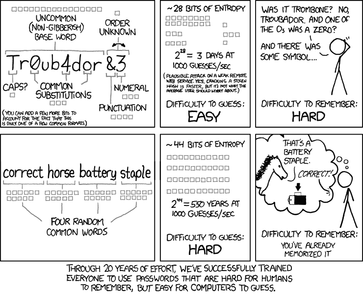

# 安全和密码学

> 原文：[`missing.csail.mit.edu/2020/security/`](https://missing.csail.mit.edu/2020/security/)

去年的安全和隐私讲座重点介绍了你作为计算机*用户*如何变得更安全。今年，我们将关注与理解本课程早期介绍的工具相关的安全和密码学概念，例如 Git 中哈希函数的使用或 SSH 中的密钥派生函数和对称/非对称加密系统。

这场讲座不能替代更严格和完整的计算机系统安全([6.858](https://css.csail.mit.edu/6.858/))或密码学([6.857](https://courses.csail.mit.edu/6.857/)和 6.875)课程。在没有正式安全培训的情况下不要进行安全工作。除非你是专家，否则不要[自己实现密码学](https://www.schneier.com/blog/archives/2015/05/amateurs_produc.html)。同样的原则也适用于系统安全。

这场讲座对基本密码学概念进行了非常非正式（但我们认为实用）的处理。这场讲座不足以教你如何*设计*安全系统或密码协议，但我们希望它足以让你对已经使用的程序和协议有一个一般性的理解。

# 熵

[熵](https://en.wikipedia.org/wiki/Entropy_(information_theory))是随机性的度量。这在确定密码强度时很有用。



如上[XKCD 漫画](https://xkcd.com/936/)所示，像“correcthorsebatterystaple”这样的密码比像“Tr0ub4dor&3”这样的密码更安全。但如何量化这种东西呢？

熵以*比特*为单位进行测量，当从一组可能的结果中均匀随机选择时，熵等于`log_2(可能性数量)`。公平的硬币抛掷给出 1 比特的熵。掷骰子（六面骰子）大约有 2.58 比特的熵。

你应该考虑攻击者知道密码的*模型*，但不知道用于选择特定密码的随机性（例如来自[dice rolls](https://en.wikipedia.org/wiki/Diceware)）。

需要多少比特的熵才足够？这取决于你的威胁模型。正如 XKCD 漫画所指出的，大约 40 比特的熵相当不错。为了抵抗离线猜测，需要更强的密码（例如 80 比特，或更多）。

# 哈希函数

一种[加密哈希函数](https://en.wikipedia.org/wiki/Cryptographic_hash_function)将任意大小的数据映射到固定大小，并具有一些特殊属性。一个哈希函数的大致规范如下：

```py
hash(value: array<byte>) -> vector<byte, N>  (for some fixed N) 
```

一个哈希函数的例子是[SHA1](https://en.wikipedia.org/wiki/SHA-1)，它在 Git 中使用。它将任意大小的输入映射到 160 位的输出（可以表示为 40 个十六进制字符）。我们可以使用`sha1sum`命令尝试对输入进行 SHA1 哈希：

```py
$  printf 'hello' | sha1sum
aaf4c61ddcc5e8a2dabede0f3b482cd9aea9434d $  printf 'hello' | sha1sum
aaf4c61ddcc5e8a2dabede0f3b482cd9aea9434d $  printf 'Hello' | sha1sum
f7ff9e8b7bb2e09b70935a5d785e0cc5d9d0abf0 
```

在高层次上，哈希函数可以被视为一个难以逆推的看似随机的（但确定性的）函数（这就是哈希函数的[理想模型](https://en.wikipedia.org/wiki/Random_oracle)）。哈希函数具有以下特性：

+   确定性：相同的输入总是生成相同的输出。

+   不可逆：很难找到一个输入`m`，使得对于某个期望的输出`h`，有`hash(m) = h`。

+   目标碰撞抵抗：给定一个输入`m_1`，很难找到一个不同的输入`m_2`，使得`hash(m_1) = hash(m_2)`。

+   抗碰撞：很难找到两个输入`m_1`和`m_2`，使得`hash(m_1) = hash(m_2)`（注意，这比目标碰撞抵抗是一个更强的特性）。

注意：虽然它可能适用于某些目的，但 SHA-1 已不再被认为是强大的加密哈希函数。[不再使用](https://web.archive.org/web/20260207211148/https://shattered.io/)。你可能对[加密哈希函数的寿命表](https://valerieaurora.org/hash.html)感兴趣。然而，请注意，推荐特定的哈希函数超出了本次讲座的范围。如果你在进行与此相关的工作，你需要接受安全/密码学的正规培训。

## 应用

+   Git，用于内容地址存储。哈希函数的概念是一个更通用的概念（存在非加密哈希函数）。为什么 Git 使用加密哈希函数？

+   文件内容的简要总结。软件通常可以从（可能不太可靠的）镜像站点下载，例如 Linux ISO，而且最好不需要信任它们。官方站点通常会在下载链接（指向第三方镜像）旁边发布哈希值，以便在下载文件后可以检查哈希值。

+   [承诺方案](https://en.wikipedia.org/wiki/Commitment_scheme)。假设你想对某个特定值进行承诺，但稍后才会揭示该值。例如，我想在“我脑海中”进行公平的硬币投掷，而不需要一个双方都能看到的可信共享硬币。我可以选择一个值`r = random()`，然后分享`h = sha256(r)`。然后，你可以叫正面或反面（我们将同意`r`为偶数表示正面，奇数表示反面）。在你叫出之后，我可以揭示我的值`r`，你可以通过检查`sha256(r)`是否与之前分享的哈希值匹配来确认我没有作弊。

# 密钥派生函数

与加密哈希相关的一个概念是[密钥派生函数](https://en.wikipedia.org/wiki/Key_derivation_function)（KDFs），它们用于许多应用，包括为其他加密算法生成固定长度的输出作为密钥。通常，KDFs 会故意设计得较慢，以减缓离线暴力攻击。

## 应用

+   从密码短语生成密钥，用于其他加密算法（例如，对称加密，见下文）。

+   存储登录凭证。存储明文密码是错误的；正确的方法是为每个用户生成和存储一个随机的 [盐](https://en.wikipedia.org/wiki/Salt_(cryptography)) `salt = random()`，存储 `KDF(password + salt)`，并通过重新计算 KDF 来验证登录尝试，给定输入的密码和存储的盐。

# 对称密码学

在考虑密码学时，隐藏消息内容可能是您首先想到的概念。对称密码学通过以下功能集实现这一点：

```py
keygen() -> key  (this function is randomized)

encrypt(plaintext: array<byte>, key) -> array<byte>  (the ciphertext)
decrypt(ciphertext: array<byte>, key) -> array<byte>  (the plaintext) 
```

加密函数具有以下属性：给定输出（密文），如果没有密钥，很难确定输入（明文）。解密函数具有明显的正确性属性，即 `decrypt(encrypt(m, k), k) = m`。

目前广泛使用的对称密码系统的一个例子是 [AES](https://en.wikipedia.org/wiki/Advanced_Encryption_Standard)。

## 应用

+   将文件加密以存储在不信任的云服务中。这可以与 KDFs 结合使用，因此您可以使用密码加密文件。生成 `key = KDF(passphrase)`，然后存储 `encrypt(file, key)`。

# 非对称密码学

“非对称”一词指的是存在两个密钥，它们具有不同的角色。私钥，正如其名称所暗示的，意味着应该保持私密，而公钥可以公开共享，这不会影响安全性（与对称密码系统中的密钥共享不同）。非对称密码系统提供以下功能集，用于加密/解密和签名/验证：

```py
keygen() -> (public key, private key)  (this function is randomized)

encrypt(plaintext: array<byte>, public key) -> array<byte>  (the ciphertext)
decrypt(ciphertext: array<byte>, private key) -> array<byte>  (the plaintext)

sign(message: array<byte>, private key) -> array<byte>  (the signature)
verify(message: array<byte>, signature: array<byte>, public key) -> bool  (whether or not the signature is valid) 
```

加密/解密函数具有与对称密码系统中的类似属性。可以使用 *公钥* 加密一条消息。给定输出（密文），如果没有 *私钥*，很难确定输入（明文）。解密函数具有明显的正确性属性，即 `decrypt(encrypt(m, public key), private key) = m`。

对称加密和非对称加密可以与物理锁进行比较。对称密码系统就像一个门锁：任何拥有密钥的人都可以锁定和解锁它。非对称加密就像一个带钥匙的挂锁。您可以给某人一把未锁的锁（公钥），他们可以将信息放入一个盒子中，然后锁上，之后，只有您才能打开锁，因为您保留了钥匙（私钥）。

签名/验证函数具有您希望物理签名具有的相同属性，即很难伪造签名。无论消息如何，如果没有 *私钥*，很难生成一个签名，使得 `verify(message, signature, public key)` 返回 true。当然，验证函数具有明显的正确性属性，即 `verify(message, sign(message, private key), public key) = true`。

## 应用

+   [PGP 电子邮件加密](https://en.wikipedia.org/wiki/Pretty_Good_Privacy)。人们可以将他们的公钥发布在网上（例如，在 PGP 密钥服务器上或在[Keybase](https://keybase.io/）上）。任何人都可以发送加密电子邮件。

+   私人消息。像 [Signal](https://signal.org/) 和 [Keybase](https://keybase.io/) 这样的应用程序使用非对称密钥来建立私人通信通道。

+   签名软件。Git 可以有 GPG 签名的提交和标签。通过发布的公钥，任何人都可以验证下载的软件的真实性。

## 密钥分发

非对称密钥加密非常出色，但它面临着将公钥/将公钥映射到现实世界身份的大挑战。针对这个问题有许多解决方案。Signal 提供了一个简单的解决方案：首次使用时信任，并支持带外公钥交换（你亲自验证你朋友的“安全号码”）。PGP 有一个不同的解决方案，即[信任网](https://en.wikipedia.org/wiki/Web_of_trust)。Keybase 还有一个不同的解决方案，即[社会证明](https://keybase.io/blog/chat-apps-softer-than-tofu)（以及其他一些巧妙的想法）。每种模型都有其优点；我们（讲师）喜欢 Keybase 的模型。

# 案例研究

## 密码管理器

这是一个每个人都应该尝试使用的必备工具（例如 [KeePassXC](https://keepassxc.org/)，[pass](https://git.zx2c4.com/password-store/about/)，和 [1Password](https://1password.com)）。密码管理器使得使用唯一、随机生成的高熵密码来管理所有登录变得方便，并且它们将所有密码保存在一个地方，使用从口令生成密钥的对称加密算法加密。

使用密码管理器让你避免密码重复使用（因此当网站被入侵时影响较小），使用高熵密码（因此你被入侵的可能性较小），并且只需要记住一个高熵密码。

## 双因素认证

[双因素认证](https://en.wikipedia.org/wiki/Multi-factor_authentication)（2FA）要求你使用一个口令（“你知道的某物”）以及一个 2FA 认证器（例如 [YubiKey](https://www.yubico.com/)，“你拥有的某物”），以防止被盗密码和[钓鱼攻击](https://en.wikipedia.org/wiki/Phishing)。

## 全盘加密

保持笔记本电脑整个磁盘加密是保护数据的一种简单方法，以防你的笔记本电脑被盗。你可以在 Linux 上使用 [cryptsetup + LUKS](https://wiki.archlinux.org/index.php/Dm-crypt/Encrypting_a_non-root_file_system)，在 Windows 上使用 [BitLocker](https://fossbytes.com/enable-full-disk-encryption-windows-10/)，或在 macOS 上使用 [FileVault](https://support.apple.com/en-us/HT204837)。这将使用对称加密算法加密整个磁盘，密钥由口令保护。

## 私人消息

使用 [Signal](https://signal.org/) 或 [Keybase](https://keybase.io/)。端到端安全是从非对称密钥加密开始的。获取你联系人的公钥是这里的关键步骤。如果你想获得良好的安全性，你需要通过带外方式（使用 Signal 或 Keybase）验证公钥，或者信任社会证明（使用 Keybase）。

## SSH

我们在之前的讲座中介绍了 SSH 和 SSH 密钥的使用。让我们看看这个的密码学方面。

当你运行 `ssh-keygen` 时，它会生成一个非对称密钥对，`public_key, private_key`。这是随机生成的，使用操作系统提供的熵（从硬件事件等收集）。公钥以原样存储（它是公开的，所以保密并不重要），但在静止状态下，私钥应该在磁盘上加密。`ssh-keygen` 程序提示用户输入一个口令短语，然后通过密钥派生函数生成一个密钥，该密钥随后用于使用对称加密算法加密私钥。

在使用中，一旦服务器知道客户端的公钥（存储在`.ssh/authorized_keys`文件中），连接的客户端可以使用非对称签名来证明其身份。这是通过[挑战-响应](https://en.wikipedia.org/wiki/Challenge%E2%80%93response_authentication)来完成的。在高层上，服务器选择一个随机数并发送给客户端。客户端然后对这条消息进行签名并发送签名回服务器，服务器将签名与记录中的公钥进行比对。这实际上证明了客户端拥有与服务器`.ssh/authorized_keys`文件中的公钥相对应的私钥，因此服务器可以允许客户端登录。

# 资源

+   去年的笔记：从这次讲座更侧重于作为计算机用户的安全和隐私的角度

+   [密码学正确答案](https://latacora.micro.blog/2018/04/03/cryptographic-right-answers.html)：为许多常见的 X 提供“我应该为 X 使用什么密码学？”的答案。

# 练习

1.  **熵。**

    1.  假设密码是一个由四个小写词典单词组成的连接，其中每个单词是从大小为 100,000 的词典中随机选择的。这样一个密码的例子是 `correcthorsebatterystaple`。这个密码有多少位的熵？

    1.  考虑一个替代方案，其中密码被选为一个由 8 个随机字母数字字符组成的序列（包括大小写字母）。一个例子是 `rg8Ql34g`。这个密码有多少位的熵？

    1.  哪个密码更强大？

    1.  假设攻击者每秒可以尝试猜测 10,000 个密码。平均来说，破解每个密码需要多长时间？

1.  **密码学哈希函数。** 从一个[镜像](https://www.debian.org/CD/http-ftp/)（例如[这个阿根廷镜像](http://debian.xfree.com.ar/debian-cd/current/amd64/iso-cd/iso-cd/))下载 Debian 镜像。使用`sha256sum`命令等交叉检查哈希值，与从官方 Debian 网站（例如[这个文件](https://cdimage.debian.org/debian-cd/current/amd64/iso-cd/SHA256SUMS)）检索的哈希值进行比对，如果已从阿根廷镜像下载了链接的文件。

1.  **对称加密。**使用 AES 加密对文件进行加密，使用[OpenSSL](https://www.openssl.org/)：`openssl aes-256-cbc -salt -in {输入文件名} -out {输出文件名}`。使用`cat`或`hexdump`查看内容。使用`openssl aes-256-cbc -d -in {输入文件名} -out {输出文件名}`进行解密，并使用`cmp`确认内容与原始文件匹配。

1.  **非对称加密。**

    1.  在你可以访问的计算机上设置[SSH 密钥](https://www.digitalocean.com/community/tutorials/how-to-set-up-ssh-keys--2)（不是 Athena，因为 Kerberos 与 SSH 密钥交互异常）。确保你的私钥使用密码加密，以便在静止状态下得到保护。

    1.  [设置 GPG](https://www.digitalocean.com/community/tutorials/how-to-use-gpg-to-encrypt-and-sign-messages)

    1.  向 Anish 发送加密邮件（[公钥](https://keybase.io/anish)）。

    1.  使用`git commit -S`签署 Git 提交或使用`git tag -s`创建签署的 Git 标签。使用`git show --show-signature`在提交上或使用`git tag -v`在标签上验证签名。

* * *

[编辑此页面](https://github.com/missing-semester/missing-semester/blob/master/_2020/security.md).

本文档遵循[CC BY-NC-SA](https://creativecommons.org/licenses/by-nc-sa/4.0)许可协议。
