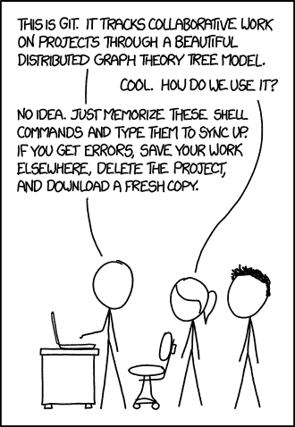

# 版本控制和 Git

> [`missing.csail.mit.edu/2026/version-control/`](https://missing.csail.mit.edu/2026/version-control/)

版本控制系统（VCSs）是用于跟踪源代码（或其他文件和文件夹集合）更改的工具。正如其名称所暗示的，这些工具有助于维护更改的历史；此外，它们还促进了协作。从逻辑上讲，VCSs 通过一系列*快照*跟踪文件夹及其内容的更改，其中每个快照封装了顶级目录内文件/文件夹的整个状态。VCSs 还维护诸如谁创建了每个快照、与每个快照相关的消息等元数据。

版本控制有什么用？即使你一个人工作，它也能让你查看项目的旧快照，记录为什么做出某些更改，并行开发分支，等等。当与他人合作时，它是一个无价之宝，可以查看其他人所做的更改，以及在并发开发中解决冲突。

现代的版本控制系统（VCSs）也让你能够轻松（并且经常自动地）回答如下问题：

+   谁编写了这个模块？

+   这个特定文件的特定行是什么时候被编辑的？由谁编辑的？为什么编辑？

+   在过去 1000 次修订中，何时/为什么某个特定的单元测试停止工作？

尽管存在其他 VCSs，但**Git**是版本控制的既定标准。这个[XKCD 漫画](https://xkcd.com/1597/)捕捉了 Git 的声誉：



因为 Git 的界面是一个有缺陷的抽象，所以从上到下学习 Git（从其界面/命令行界面开始）可能会导致很多困惑。人们可以记住一些命令，并将它们视为魔法咒语，并在任何问题出现时遵循上面漫画中的方法。

虽然 Git 的界面确实很丑陋，但其底层设计和理念是美丽的。丑陋的界面需要*记忆*，而美丽的设计则可以*理解*。因此，我们从 Git 的数据模型开始，自下而上地解释 Git，然后涵盖命令行界面。一旦理解了数据模型，就可以更好地理解命令，了解它们是如何操作底层数据模型的。

# Git 的数据模型

Git 的独创性在于其精心设计的数据库模型，它使得版本控制的所有良好功能成为可能，如维护历史、支持分支和促进协作。

## 快照

Git 将顶级目录内的一组文件和文件夹的历史视为一系列快照。在 Git 术语中，文件被称为“blob”，它只是一堆字节。目录被称为“tree”，它将名称映射到 blob 或 tree（因此目录可以包含其他目录）。快照是正在跟踪的顶级树。例如，我们可能有一个如下所示的树：

```py
<root> (tree)
|
+- foo (tree)
|  |
|  + bar.txt (blob, contents = "hello world")
|
+- baz.txt (blob, contents = "git is wonderful") 
```

顶层树包含两个元素，一个树“foo”（它本身包含一个元素，一个 blob“bar.txt”），和一个 blob“baz.txt”。

## 历史建模：关联快照

版本控制系统应该如何关联快照？一个简单的模型可能是有一个线性历史。历史将是一系列按时间顺序排列的快照。由于许多原因，Git 不使用这种简单的模型。

在 Git 中，历史是一个快照的有向无环图（DAG）。这可能听起来像是一个复杂的数学术语，但不要感到害怕。这仅仅意味着 Git 中的每个快照都引用了一组“父快照”，即在其之前出现的快照。它是一组父快照而不是单个父快照（如线性历史中那样），因为一个快照可能来自多个父快照，例如，由于合并（合并）两个平行的开发分支。

Git 将这些快照称为“提交”。可视化提交历史可能看起来像这样：

```py
o <-- o <-- o <-- o
            ^
             \
              --- o <-- o 
```

在上面的 ASCII 艺术中，`o`对应于单个提交（快照）。箭头指向每个提交的父提交（这是一个“先于”关系，而不是“后于”关系）。在第三个提交之后，历史分支成两个独立的分支。这可能对应于，例如，两个独立的功能并行开发。在未来，这些分支可能会合并以创建一个新的快照，该快照包含这两个功能，产生一个新的历史，如下所示，新创建的合并提交以粗体显示：

```py
 o <-- o <-- o <-- o <---- **o**
            ^            /
             \          v
              --- o <-- o 

```

Git 中的提交是不可变的。这并不意味着错误不能被纠正；只是“编辑”提交历史实际上是在创建全新的提交，并且引用（见下文）被更新以指向新的提交。

## 数据模型，伪代码

看到 Git 的数据模型以伪代码的形式写下来可能会有所帮助：

```py
// a file is a bunch of bytes
type blob = array<byte>

// a directory contains named files and directories
type tree = map<string, tree | blob>

// a commit has parents, metadata, and the top-level tree
type commit = struct {
    parents: array<commit>
    author: string
    message: string
    snapshot: tree
} 
```

这是一个干净、简单的历史模型。

## 对象和内容寻址

“对象”是一个 blob、树或提交：

```py
type object = blob | tree | commit 
```

在 Git 的数据存储中，所有对象都通过其[SHA-1 哈希值](https://en.wikipedia.org/wiki/SHA-1)进行内容寻址。

```py
objects = map<string, object>

def store(object):
    id = sha1(object)
    objects[id] = object

def load(id):
    return objects[id] 
```

Blob、树和提交以这种方式统一：它们都是对象。当它们引用其他对象时，它们实际上并不在磁盘表示中*包含*它们，而是通过哈希值引用它们。

例如，示例目录结构的树（使用`git cat-file -p 698281bc680d1995c5f4caaf3359721a5a58d48d`可视化）看起来像这样：

```py
100644 blob 4448adbf7ecd394f42ae135bbeed9676e894af85    baz.txt
040000 tree c68d233a33c5c06e0340e4c224f0afca87c8ce87    foo 
```

树本身包含对其内容的指针，`baz.txt`（一个 blob）和`foo`（一个树）。如果我们使用`git cat-file -p 4448adbf7ecd394f42ae135bbeed9676e894af85`查看对应于 baz.txt 的哈希值的内容，我们得到以下结果：

```py
git is wonderful 
```

## 引用

现在，所有快照都可以通过它们的 SHA-1 哈希值来识别。这不太方便，因为人类不擅长记住由 40 个十六进制字符组成的字符串。

Git 针对这个问题的解决方案是为 SHA-1 散列提供人类可读的名称，称为“引用”。引用是指向提交的指针。与不可变的对象不同，引用是可变的（可以更新以指向新的提交）。例如，`master`引用通常指向开发主分支中的最新提交。

```py
references = map<string, string>

def update_reference(name, id):
    references[name] = id

def read_reference(name):
    return references[name]

def load_reference(name_or_id):
    if name_or_id in references:
        return load(references[name_or_id])
    else:
        return load(name_or_id) 
```

通过这种方式，Git 可以使用人类可读的名称，如“master”，来引用历史中的一个特定快照，而不是一个长的十六进制字符串。

一个细节是，我们经常想要一个关于“当前我们在历史中的位置”的概念，这样当我们创建一个新的快照时，我们就知道它是相对于什么的（如何设置提交的`parents`字段）。在 Git 中，“当前我们在哪里”是一个特殊的引用，称为“HEAD”。

## 仓库

最后，我们可以定义（大致上）什么是 Git *仓库*：它是数据`objects`和`references`。

在磁盘上，Git 存储的所有内容都是对象和引用：这就是 Git 数据模型的所有内容。所有的`git`命令都映射到通过添加对象和添加/更新引用来对提交 DAG 进行某种操作。

每次你输入任何命令时，都要考虑该命令对底层图数据结构进行的操作。相反，如果你试图对提交 DAG 进行某种特定的更改，例如“丢弃未提交的更改并使‘master’引用指向提交`5d83f9e`”，可能有一个命令可以做到这一点（例如，在这种情况下，`git checkout master; git reset --hard 5d83f9e`）。

# 预处理区域

这是另一个与数据模型正交的概念，但它构成了创建提交的接口的一部分。

你可能会想象的一种实现上述快照的方法是有一个“创建快照”命令，该命令基于工作目录的当前状态创建一个新的快照。一些版本控制工具就是这样工作的，但 Git 不是。我们想要干净的快照，并且从当前状态创建快照可能并不总是理想的。例如，想象一个场景，你已经实现了两个独立的功能，并且想要创建两个独立的提交，第一个提交引入了第一个功能，下一个提交引入了第二个功能。或者想象一个场景，你在代码中添加了调试打印语句，并修复了一个错误；你想要提交错误修复，同时丢弃所有的打印语句。

Git 通过允许你通过称为“暂存区域”的机制指定应包含在下一个快照中的修改来适应此类场景。

# Git 命令行界面

为了避免信息重复，我们不会在这些讲义中详细解释下面的命令。有关更多信息，请参阅高度推荐的[Pro Git](https://git-scm.com/book/en/v2)，或者观看讲座视频。

## 基础知识

+   `git help <command>`: 获取 git 命令的帮助

+   `git init`: 创建一个新的 git 仓库，数据存储在`.git`目录中

+   `git status`: 告诉你发生了什么

+   `git add <filename>`：将文件添加到暂存区

+   `git commit`：创建新的提交

    +   写出[好的提交信息](https://tbaggery.com/2008/04/19/a-note-about-git-commit-messages.html)!

    +   写出[好的提交信息](https://chris.beams.io/posts/git-commit/)的理由更多！

+   `git log`：显示简化的历史记录

+   `git log --all --graph --decorate`：将历史可视化为一个 DAG

+   `git diff <filename>`：显示相对于暂存区的更改

+   `git diff <revision> <filename>`：显示快照之间文件的不同

+   `git checkout <revision>`：更新 HEAD（如果检出分支，则更新当前分支）

## 分支和合并

+   `git branch`：显示分支

+   `git branch <name>`：创建分支

+   `git switch <name>`：切换到分支

+   `git checkout -b <name>`：创建分支并切换到它

    +   与`git branch <name>; git switch <name>`相同

+   `git merge <revision>`：合并到当前分支

+   `git mergetool`：使用一个花哨的工具来帮助解决合并冲突

+   `git rebase`：将一系列补丁变基到新基础

## 远程

+   `git remote`：列出远程

+   `git remote add <name> <url>`：添加远程

+   `git push <remote> <local branch>:<remote branch>`：发送对象到远程，并更新远程引用

+   `git branch --set-upstream-to=<remote>/<remote branch>`：设置本地分支和远程分支之间的对应关系

+   `git fetch`：从远程检索对象/引用

+   `git pull`：等同于`git fetch; git merge`

+   `git clone`：从远程下载仓库

## 撤销

+   `git commit --amend`：编辑提交的内容/消息

+   `git reset <file>`：取消暂存文件

+   `git restore`：撤销更改

# 高级 Git

+   `git config`：Git 是[高度可定制](https://git-scm.com/docs/git-config)

+   `git clone --depth=1`：浅克隆，不包含整个版本历史

+   `git add -p`：交互式暂存

+   `git rebase -i`：交互式变基

+   `git blame`：显示谁最后编辑了哪一行

+   `git stash`：临时移除工作目录的修改

+   `git bisect`：二分搜索历史（例如，用于回归）

+   `git revert`：创建一个新的提交，以撤销早期提交的效果

+   `git worktree`：同时检出多个分支

+   `.gitignore`：[指定](https://git-scm.com/docs/gitignore)要忽略的故意未跟踪文件

# 杂项

+   **GUIs**：有许多[GUI 客户端](https://git-scm.com/downloads/guis)可供 Git 使用。我们个人不使用它们，而是使用命令行界面。

+   **Shell 集成**：将 Git 状态作为 shell 提示符的一部分非常方便（[zsh](https://github.com/olivierverdier/zsh-git-prompt), [bash](https://github.com/magicmonty/bash-git-prompt)）。通常包含在像[Oh My Zsh](https://github.com/ohmyzsh/ohmyzsh)这样的框架中。

+   **编辑器集成**：类似于上述内容，许多功能的便捷集成。[fugitive.vim](https://github.com/tpope/vim-fugitive)是 Vim 的标准之一。

+   **Workflows**: 我们教了你数据模型和一些基本命令；我们没有告诉你在大项目上工作时应该遵循哪些实践（而且有[很多](https://nvie.com/posts/a-successful-git-branching-model/) [不同的](https://www.endoflineblog.com/gitflow-considered-harmful) [方法](https://www.atlassian.com/git/tutorials/comparing-workflows/gitflow-workflow)）。

+   **GitHub**: Git 并非 GitHub。GitHub 有一种特定的方式向其他项目贡献代码，称为 [pull requests](https://help.github.com/en/github/collaborating-with-issues-and-pull-requests/about-pull-requests)。

+   **其他 Git 提供商**: GitHub 并非特殊：有许多 Git 仓库托管服务，如 [GitLab](https://about.gitlab.com/) 和 [BitBucket](https://bitbucket.org/)。

# 资源

+   [Pro Git](https://git-scm.com/book/en/v2) 是**强烈推荐阅读**的书籍。现在你理解了数据模型，通过阅读第 1-5 章，你应该可以学会如何熟练使用 Git。后面的章节有一些有趣的高级材料。

+   [Oh Shit, Git!?!](https://ohshitgit.com/) 是一个关于如何从一些常见的 Git 错误中恢复的简短指南。

+   [Git for Computer Scientists](https://eagain.net/articles/git-for-computer-scientists/) 是对 Git 数据模型的一个简短解释，比这些讲义有更少的伪代码和更多的复杂图表。

+   [Git from the Bottom Up](https://jwiegley.github.io/git-from-the-bottom-up/) 是对 Git 实现细节的详细解释，不仅限于数据模型，适合好奇心强的人。

+   [如何用简单的话解释 Git](https://smusamashah.github.io/blog/2017/10/14/explain-git-in-simple-words)

+   [Learn Git Branching](https://learngitbranching.js.org/) 是一个基于浏览器的游戏，教你 Git。

# 练习

1.  如果你没有任何 Git 经验，要么尝试阅读 [Pro Git](https://git-scm.com/book/en/v2) 的前几章，要么通过 [Learn Git Branching](https://learngitbranching.js.org/) 这样的教程。当你学习时，将 Git 命令与数据模型联系起来。

1.  克隆[班级网站仓库](https://github.com/missing-semester/missing-semester)。

    1.  通过将其可视化成图表来探索版本历史。

    1.  最后修改 `README.md` 的人是谁？（提示：使用带有参数的 `git log`）。

    1.  与 `_config.yml` 中 `collections:` 行的最后修改相关的提交信息是什么？（提示：使用 `git blame` 和 `git show`）。

1.  学习 Git 时常见的错误之一是提交应该由 Git 管理的大型文件或添加敏感信息。尝试将文件添加到仓库中，进行一些提交，然后从 *历史记录*（而不仅仅是最新提交）中删除该文件。你可能想看看[这个](https://help.github.com/articles/removing-sensitive-data-from-a-repository/)。

1.  从 GitHub 克隆一些仓库，并修改其现有文件之一。当你执行 `git stash` 时会发生什么？运行 `git log --all --oneline` 时你会看到什么？运行 `git stash pop` 来撤销你使用 `git stash` 所做的操作。在什么情况下这可能是有用的？

1.  与许多命令行工具一样，Git 提供了一个名为 `~/.gitconfig` 的配置文件（或点文件）。在 `~/.gitconfig` 中创建一个别名，以便当你运行 `git graph` 时，你将得到 `git log --all --graph --decorate --oneline` 的输出。你可以直接 [编辑](https://git-scm.com/docs/git-config#Documentation/git-config.txt-alias) `~/.gitconfig` 文件，或者你可以使用 `git config` 命令来添加别名。有关 git 别名的信息可以在 [这里](https://git-scm.com/book/en/v2/Git-Basics-Git-Aliases) 找到。

1.  在运行 `git config --global core.excludesfile ~/.gitignore_global` 命令后，你可以在 `~/.gitignore_global` 文件中定义全局忽略模式。这设置了 Git 将使用的全局忽略文件的位置，但你仍然需要手动在该路径创建文件。设置你的全局 gitignore 文件以忽略特定于操作系统或编辑器的临时文件，例如 `.DS_Store`。

1.  分叉用于课程网站的 [仓库](https://github.com/missing-semester/missing-semester)，找到你可以改进的错误或内容，并在 GitHub 上提交一个 pull request（你可能想查看 [这个](https://github.com/firstcontributions/first-contributions)）。请只提交有用的 PR（请不要垃圾邮件，谢谢！）如果你找不到可以改进的地方，你可以跳过这个练习。

1.  通过模拟协作场景来练习解决合并冲突：

    1.  使用 `git init` 创建一个新的仓库，并创建一个名为 `recipe.txt` 的文件，包含几行内容（例如，一个简单的食谱）。

    1.  提交更改，然后创建两个分支：`git branch salty` 和 `git branch sweet`。

    1.  在 `salty` 分支中，修改一行（例如，将“1 杯糖”改为“1 杯盐”）并提交。

    1.  在 `sweet` 分支中，修改相同的行以不同的方式（例如，将“1 杯糖”改为“2 杯糖”）并提交。

    1.  现在，切换到 `master` 分支，尝试 `git merge salty`，然后 `git merge sweet`。会发生什么？查看 `recipe.txt` 的内容 - `<<<<<<<`、`=======` 和 `>>>>>>>` 标记代表什么？

    1.  通过编辑文件以保留你想要的内容，删除冲突标记，并使用 `git add` 和 `git commit`（或 `git merge --continue`）完成合并来解决冲突。或者，尝试使用 `git mergetool` 通过图形化或基于终端的合并工具来解决冲突。

    1.  使用 `git log --graph --oneline` 命令来可视化你刚刚创建的合并历史。

* * *

[编辑此页面](https://github.com/missing-semester/missing-semester/blob/master/_2026/version-control.md)。

本文档受 [CC BY-NC-SA](https://creativecommons.org/licenses/by-nc-sa/4.0) 许可。
