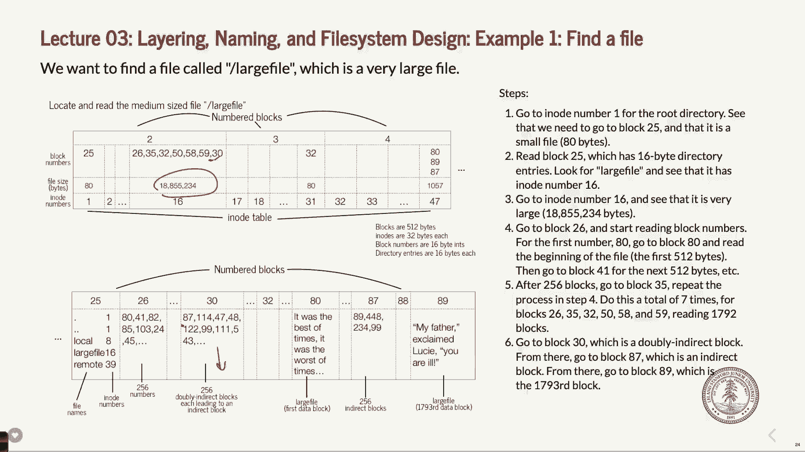

# 3：Unix v6 文件系统 📂

在本节课中，我们将学习 Unix 第六版（v6）文件系统。这是一个关于文件系统如何构建的经典案例研究。我们将了解其核心概念，包括磁盘结构、i节点、目录以及如何通过路径查找文件。课程最后，我们将通过三个具体示例来巩固理解。

---

## 概述：从内存到磁盘 💾

上一节我们介绍了计算机内存（RAM）可以被视为一个巨大的、可按字节寻址的数组。本节中，我们来看看持久化存储设备（如硬盘或SSD）是如何工作的。

与RAM不同，磁盘以**块**（或**扇区**）为单位进行读写。每个块的大小是固定的（例如512字节）。这意味着，即使你只想读取或写入一个字节，也必须操作整个512字节的块。

磁盘提供给操作系统的API非常简单，主要是读取和写入指定编号的块。

为了简化讨论，除非特别说明，我们将“块”和“扇区”视为同义词。

---

## 磁盘布局 🗺️

Unix v6文件系统将磁盘空间组织成几个关键部分。下图展示了其基本结构：

以下是磁盘布局的详细说明：

*   **块0：引导块**。此块包含启动计算机所需的代码，我们无需深入关注。
*   **块1：超级块**。此块包含关于文件系统本身的信息（如总大小、空闲块数量等），供操作系统使用。
*   **元数据区**。此区域存储文件的**元数据**，即描述文件自身的信息。
*   **数据区**。此区域存储文件的实际内容（**有效载荷**）。

整个磁盘空间由元数据区和数据区共享。你可以将其类比为堆分配器：一部分空间用于存储数据本身，另一部分用于管理这些数据的元数据。

---

## 文件与数据块 📄

文件的实际内容存储在数据区的512字节块中。

*   一个文件至少占用一个块（512字节）。
*   如果一个文件大于512字节，它会占用多个块。
*   这些块在磁盘上**不需要连续存储**。文件可以分散在不同的位置。

例如：
*   一个32字节的文件占用1个块（但只使用了其中的32字节）。
*   一个1028字节的文件占用3个块（前两个块完全使用，第三个块只使用了一部分）。

---

## i节点：文件的元数据核心 🔍

为了追踪文件内容存储在哪些块中，我们需要元数据。在Unix v6中，每个文件（或目录）都有一个对应的**i节点**。

i节点是一个**32字节**的数据结构，它存储了关于文件的几乎所有信息：

*   文件类型（普通文件、目录、链接）
*   文件大小（字节数）
*   文件权限
*   时间戳（创建、修改时间）
*   **块地址列表**：最多8个块编号，指向存储文件内容的磁盘块。

i节点本身也存储在磁盘上，位于**元数据区**。每个512字节的磁盘块可以容纳 **16个** i节点（因为 16 * 32 = 512）。

**关键点**：文件名**并不**存储在i节点中。i节点只通过一个数字（i节点号）来标识。文件名的管理由另一个机制处理，我们稍后会看到。

---

## 目录：文件名到i节点的映射 📁

人类使用文件名，而系统内部使用i节点号。**目录**就是连接这两者的桥梁。

**目录本身是一种特殊类型的文件**。它的内容不是普通数据，而是一个表格，其中每一行将一个**文件名**映射到一个**i节点号**。

在Unix v6中，目录文件的每一行是**16字节**：
*   **14字节**：文件名（不以空字符结尾）。
*   **2字节**：对应的i节点号（小端字节序）。

因此，一个512字节的块可以存储 512 / 16 = **32** 个目录项。

操作系统将目录文件的内容隐藏起来，用户不能直接读取其原始字节。

---

## 路径解析：查找文件的过程 🧭

现在，我们可以理解如何通过路径（如 `/users/class/cs110/assign1`）找到文件了。

过程是迭代的：
1.  从根目录 `/` 开始。我们知道根目录的i节点号是固定的（例如1或2，取决于系统）。找到其i节点，进而找到存储其内容的磁盘块。
2.  读取根目录的内容（即文件名-i节点号映射表），查找路径的第一个组成部分（例如 `users`）。找到其i节点号。
3.  根据找到的i节点号，定位到 `users` 目录的i节点，进而找到存储其内容的磁盘块。
4.  读取 `users` 目录的内容，查找下一个组成部分（例如 `class`）。重复此过程。
5.  最终，找到目标文件（如 `assign1`）的i节点号。通过该i节点的块地址列表，即可读取文件的实际内容。

这个过程就像沿着路径逐级打开文件夹，直到找到目标。

---

## 大文件与间接寻址 🐘

之前提到，i节点只能直接存储**8个**块地址。如果一个文件超过8个块（即 > 8 * 512 = 4096 字节），该怎么办？

Unix v6 使用**间接寻址**来解决这个问题。

### 单层间接寻址
当文件被标记为“大文件”时，i节点中的前7个块地址不再直接指向数据块，而是指向**间接块**。
*   每个间接块大小为512字节。
*   由于每个块地址需要2字节存储，一个间接块可以存储 512 / 2 = **256** 个数据块地址。
*   这样，通过7个间接块，可以管理 7 * 256 = 1792 个数据块，加上原本可能有的直接块。

### 双层间接寻址
如果文件更大，i节点中的**第8个**块地址被用作**双层间接块**。
*   它指向一个块，这个块里存储的不是数据块地址，而是**256个间接块的地址**。
*   每个间接块又可以指向256个数据块。
*   因此，通过一个双层间接块，最多可以管理 256 * 256 = 65536 个数据块。

### 容量计算
综合来看，一个Unix v6文件的最大容量为：
*   **直接/间接部分**：7个间接块 * 256 块/间接块 = 1792 个数据块。
*   **双层间接部分**：1个双层间接块 * 256 间接块/双层间接块 * 256 块/间接块 = 65536 个数据块。
*   **总计数据块**：1792 + 65536 = 67328 个。
*   **最大文件大小**：67328 块 * 512 字节/块 ≈ **34 MB**。

对于1970年代的标准来说，34MB已经非常大了。

---

## 实践示例 🛠️

上一节我们介绍了文件系统的核心原理，本节中我们通过三个具体例子来看看如何应用这些知识。

以下是查找和读取文件时需要遵循的步骤摘要：
1.  **解析路径**：从根目录开始，逐级查找目录，将文件名转换为i节点号。
2.  **获取i节点**：根据i节点号，在元数据区找到对应的i节点结构。
3.  **判断文件类型与大小**：从i节点中读取文件类型和大小。
4.  **定位数据块**：
    *   如果文件是**小文件**（大小 ≤ 4096字节），直接使用i节点中的块地址列表。
    *   如果文件是**大文件**（大小 > 4096字节）：
        *   前7个地址指向**间接块**。需要先读取间接块，从中获取实际的数据块地址列表。
        *   第8个地址可能指向**双层间接块**，需要多一层查找。
5.  **读取数据**：按照获得的块地址顺序，从数据区读取块内容。对于最后一个块，需要根据文件大小计算实际有效的字节数。

---

### 示例1：读取小文件 `/local/files/fairytale.txt`
假设文件大小为1057字节（< 4096字节）。
1.  找到根目录 `/` 的i节点（假设为1），读取其内容（块25）。
2.  在根目录中查找 `local`，找到其i节点号为16。
3.  读取i节点16，找到 `local` 目录的内容块（块27和54）。在块27中找到 `files` 目录，其i节点号为31。
4.  读取i节点31，找到 `files` 目录的内容块（块32）。在块32中找到 `fairytale.txt`，其i节点号为47。
5.  读取i节点47。由于文件大小1057 < 4096，i节点中的地址（如80, 89, 87）直接指向数据块。
6.  依次读取块80、89、87的内容。注意，最后一个块（87）可能未满，需根据文件大小计算有效数据范围。

### 示例2：读取中等文件 `/medfile`
假设文件大小为800,000字节（> 4096字节，但未使用双层间接块）。
1.  通过根目录找到 `medfile` 的i节点（例如16）。
2.  读取i节点16。由于文件大小 > 4096，它被标记为大文件。其前7个地址（如26, 30...）现在指向**间接块**。
3.  例如，读取第一个间接块（块26）。该块包含256个两字节的数据块地址（如80, 87, ...）。
4.  按照顺序，读取地址80指向的数据块（文件开头），然后地址87指向的数据块，以此类推，处理完这256个块。
5.  接着处理i节点中的下一个地址（如30），读取下一个间接块，获取下一批256个数据块地址，继续读取。
6.  重复此过程，直到读取完文件的所有数据块。同样需要注意最后一个数据块的有效数据范围。

### 示例3：读取大文件 `/bigfile`
假设文件大小为18 MB（> 917,504字节，需要使用双层间接块）。
1.  通过根目录找到 `bigfile` 的i节点。
2.  读取i节点。它是大文件。前7个地址按**示例2**的方式处理（单层间接）。
3.  对于第8个地址（例如指向块30），它现在是一个**双层间接块**。
4.  读取块30。它包含256个两字节的地址，每个地址指向一个**间接块**（例如第一个地址指向块87）。
5.  读取第一个间接块（块87）。这个块本身又包含256个数据块地址。
6.  按照块87中的地址列表，读取第一批256个数据块。
7.  返回双层间接块（块30），读取下一个地址（例如指向块114），获取下一个间接块，再读取下一批256个数据块。
8.  重复此过程，直到通过双层间接机制读取完文件的所有剩余数据。

---

## 总结 📚

本节课中，我们一起学习了Unix第六版文件系统的核心设计。

我们首先了解了磁盘的基本读写单位——块。然后，探讨了Unix v6如何将磁盘划分为引导块、超级块、元数据区和数据区。**i节点**作为32字节的元数据结构，是文件系统的核心，它存储了文件属性并管理其数据块地址。**目录**作为一种特殊文件，实现了文件名到i节点号的映射，使得路径解析成为可能。最后，我们深入研究了**间接寻址**机制，它通过单层和双层间接块，巧妙地扩展了单个文件的管理能力，使其最大可达到约34MB。

通过三个逐步深入的示例，我们实践了从路径解析到数据读取的完整流程。理解这套机制，是完成相关编程任务（如文件系统遍历器）的重要基础。请记住，这是一个特定历史时期的经典设计，现代文件系统更为复杂，但其核心思想——元数据与数据分离、通过索引进行高效查找——依然具有重要价值。