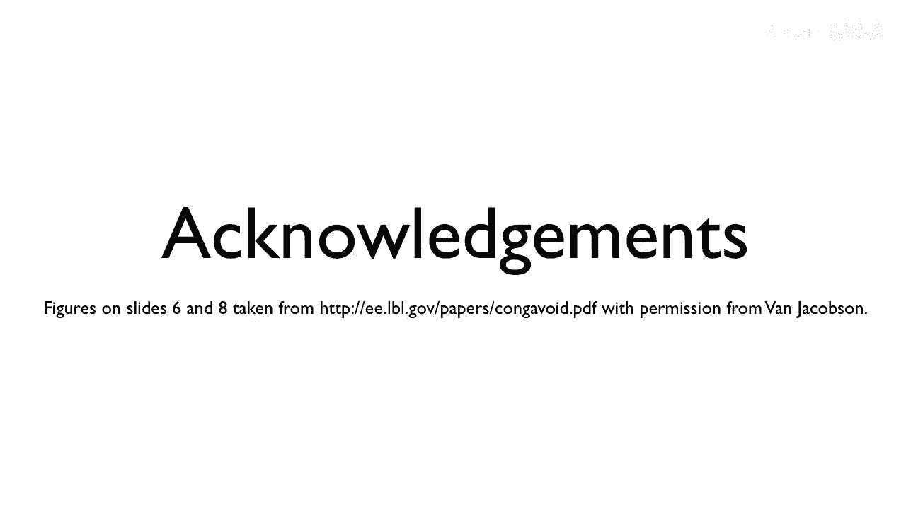

# 61：TCP Tahoe 的 RTT 估计与自时钟机制 ⏱️


在本节课中，我们将学习 TCP Tahoe 协议中引入的两个关键机制：**往返时间估计**和**自时钟**。这些机制与拥塞窗口、慢启动等概念共同构成了 TCP 的拥塞控制基础，使得互联网能够稳定工作。


---


## 回顾 TCP Tahoe 的三个基本机制


上一节我们介绍了 TCP Tahoe 的三个基本机制，它们共同实现了拥塞控制。本节中，我们来看看其中两个更深入的机制：RTT 估计和自时钟。


---


## RTT 估计的重要性


往返时间估计对于重传和超时至关重要。如果 RTT 估计过短，会导致不必要的重传，浪费网络容量并可能错误触发慢启动。如果 RTT 估计过长，则会在数据包实际丢失后等待过久才重传，降低效率。


在分组交换网络中，RTT 是高度动态变化的，网络负载的变化也会显著影响延迟。因此，需要一个能够快速、准确估计路径延迟的算法。


---


## 简单的 RTT 估计算法及其问题


在 TCP Tahoe 之前，使用一种简单的估计算法。该算法维护一个 RTT 估计值 `r`，并通过指数加权移动平均来更新它。


以下是该算法的核心公式：


```
r = α * r + (1 - α) * m
```


其中：
*   `r` 是当前的 RTT 估计值。
*   `m` 是最近一次测量的 RTT 值。
*   `α` 是历史样本的权重因子（0 < α < 1）。α 值越高，表示越重视历史数据；α 值越低，表示越重视最新测量。


超时时间则设置为 `β * r`，通常 `β = 2`。这意味着，如果超过两倍的平均估计时间仍未收到确认，就触发超时。


然而，这种方法存在一个问题：它只考虑了 RTT 的平均值，而没有考虑其**方差**。对于 RTT 分布很集中的连接，`β=2` 过于保守，会导致不必要的等待。对于 RTT 分布很分散的连接，`β=2` 又过于激进，会导致大量不必要的重传。


---


## TCP Tahoe 的改进：引入方差估计


TCP Tahoe 通过将 RTT 的**方差**概念纳入估计，解决了上述问题。算法不仅计算 RTT 的指数加权移动平均，还计算估计误差的指数加权移动平均方差。


以下是改进后的估计算法步骤：


1.  **计算平均 RTT**：
    ```
    Err = M - R
    R = R + g * Err
    ```
2.  **计算平均偏差**：
    ```
    D = D + h * (|Err| - D)
    ```
3.  **设置超时时间**：
    ```
    Timeout = R + 4 * D
    ```


其中：
*   `R` 是估计的平均 RTT。
*   `M` 是最近一次测量的 RTT。
*   `Err` 是测量误差。
*   `D` 是平均偏差（方差的近似）。
*   `g` 和 `h` 是增益因子（通常 `g=1/8`, `h=1/4`）。
*   超时时间设置为 `R + 4 * D`。


这样，当 RTT 分布集中（方差 `D` 小）时，超时时间接近 `R`，可以快速响应丢包。当 RTT 分布分散（方差 `D` 大）时，超时时间会显著大于 `R`，避免因网络抖动而误判丢包。


---


## 自时钟机制


TCP Tahoe 的第三个重要改进是**自时钟**机制。这是其最伟大的概念贡献之一。


自时钟的核心思想是：**根据接收到的确认来定时发送新的数据包**。其概念模型如下：


1.  发送方有一个“大管道”，可以快速产生数据包。
2.  网络中间存在一个瓶颈链路。
3.  快速发送的数据包经过瓶颈链路时会被“拉伸”，在时间上间隔开来到达接收方。
4.  接收方每收到一个数据包，就发送一个确认。
5.  这些确认包经过瓶颈链路返回发送方时，其到达间隔反映了接收方收到数据包的间隔，即瓶颈链路允许的速率。
6.  发送方只有在收到一个确认后，才发送一个新的数据包。


通过这种方式，发送方发送数据包的速率会自动匹配网络瓶颈链路所能处理的速率，从而避免一次性注入大量数据包导致队列溢出和拥塞。这实现了“管道填充而不溢出”的目标。


此外，接收方应积极发送确认（例如重复确认），这为发送方提供了重要的网络状态信号（如丢包），并帮助其维持自时钟节奏。


---


## 总结与展望


本节课中，我们一起学习了 TCP Tahoe 协议中两个关键的增强机制：
1.  **改进的 RTT 估计**：通过引入**方差**计算，使超时设定更能适应网络抖动的实际情况，减少了不必要的重传和等待。
2.  **自时钟**：通过“收到确认再发送新包”的规则，使发送速率自动适应网络瓶颈带宽，从根源上平滑流量，避免拥塞。


这些机制与拥塞窗口、慢启动共同构成了 TCP Tahoe 的拥塞控制框架。Van Jacobson 在1988年发表的关于 TCP Tahoe 的论文里程碑式地解决了当时互联网的拥塞崩溃问题。




在接下来的课程中，我们将了解 TCP 拥塞控制的后续发展，如 TCP Reno 和 NewReno，它们引入了快速重传、快速恢复等新机制，进一步优化了性能。