# 48：第37讲 - 可靠性、奇偶校验、纠错码与磁盘阵列 🛡️💾

在本节课中，我们将学习计算机体系结构中的第六个伟大思想：**通过冗余实现的可靠性**。我们将探讨为何可靠性至关重要，了解如何度量它，并学习几种利用冗余来检测和纠正错误、提高系统可用性的关键技术。

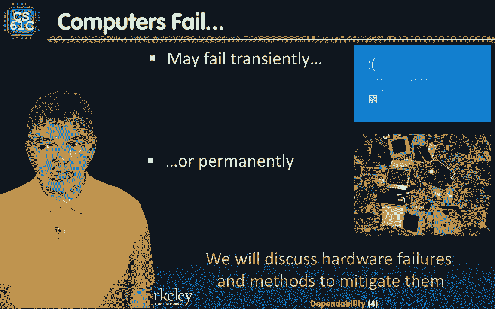

---

## 模块概述与重要性 🔍

这是一个关于可靠性的简短模块。我们之前已经讨论了计算机体系结构中的其他伟大思想，如抽象层、摩尔定律、内存层次结构和并行性。然而，我们尚未探讨第六个重要思想：**通过冗余实现的可靠性**。

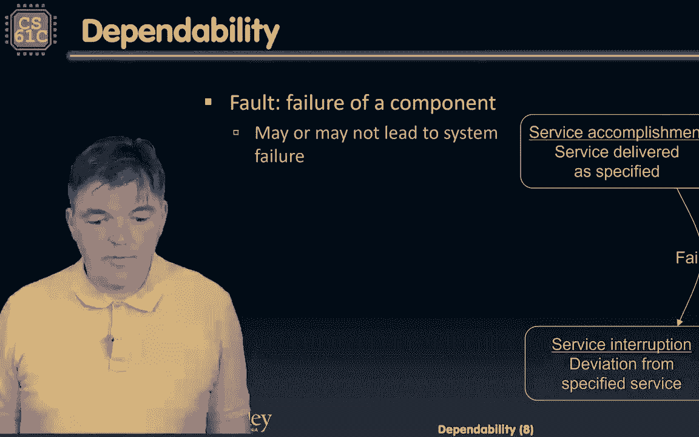

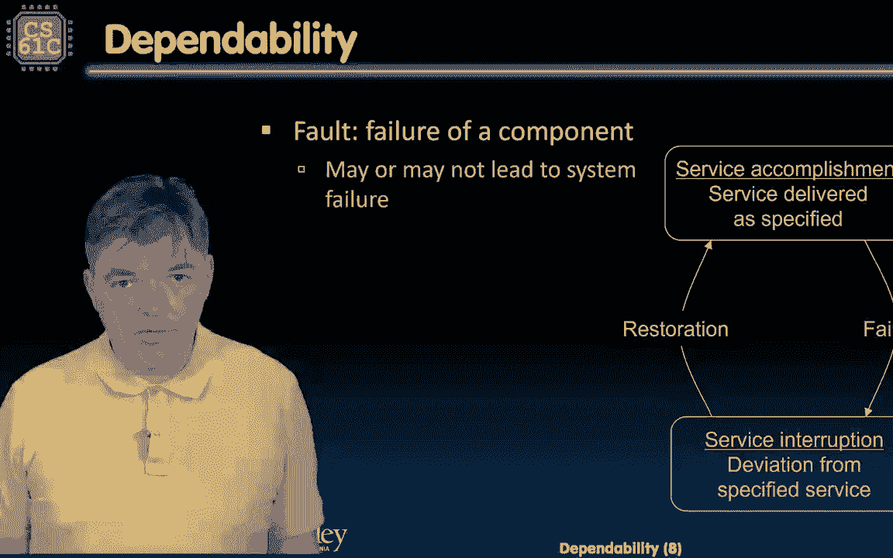

为什么可靠性如此重要？因为我们在日常生活中越来越依赖计算机系统。金融交易、汽车驾驶等关键领域都由计算机支持。计算机确实会发生故障，这些故障可能是**瞬态**的（如蓝屏死机后系统可恢复），也可能是**永久性**的（硬件永久损坏）。

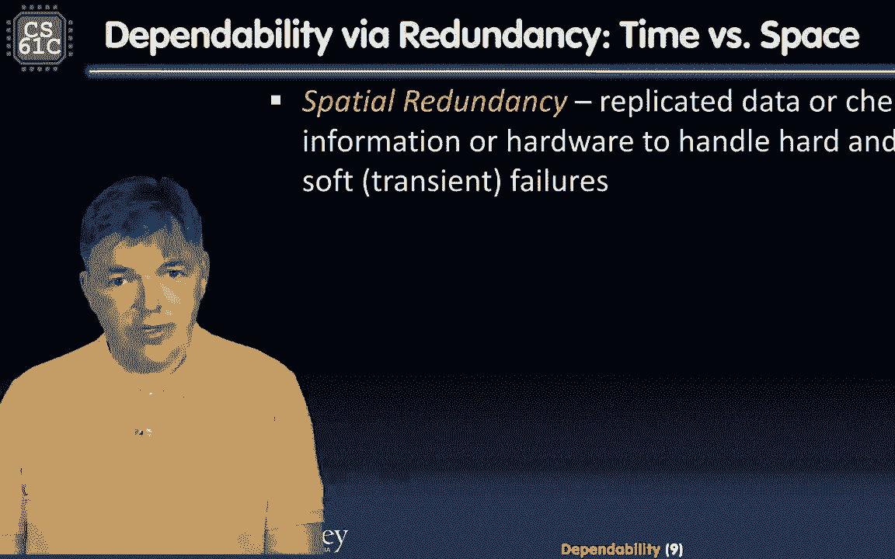

本模块将重点讨论如何减轻这些硬件故障。其核心思想是**冗余**——即拥有多个副本或备用组件。例如：
*   在存储系统中使用冗余内存。
*   在多核处理器中，制造商可能会禁用有缺陷的核心，将其作为七核而非八核芯片出售。
*   通过投票机制（如三取二）确保计算正确性。
*   在数据中心使用磁盘阵列（RAID），当单个磁盘故障时，数据不会丢失。
*   在内存（DRAM）中使用额外的奇偶校验位来检测错误。

接下来，我们将首先学习如何度量可靠性。

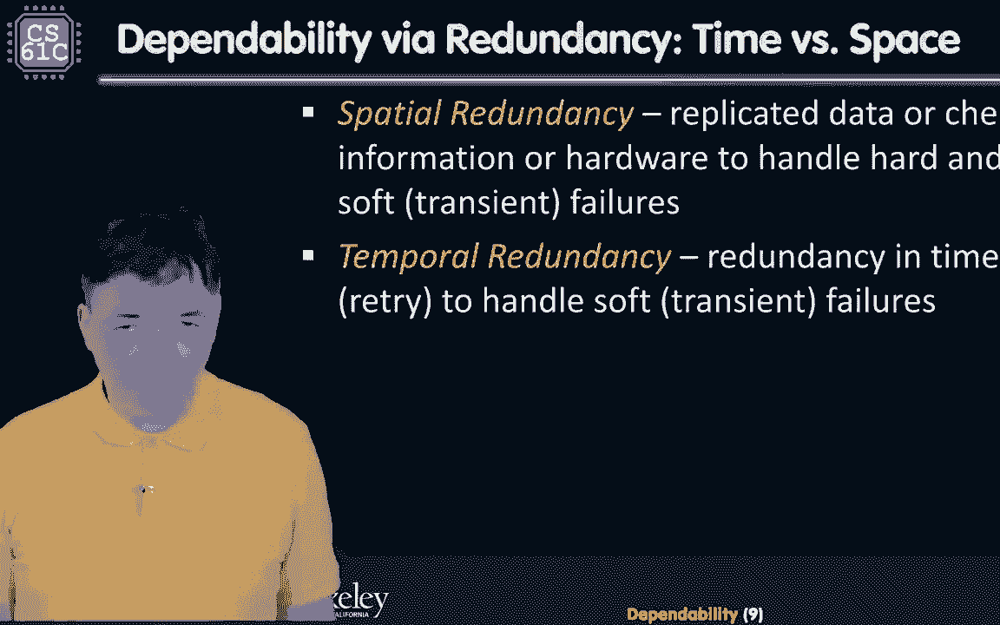

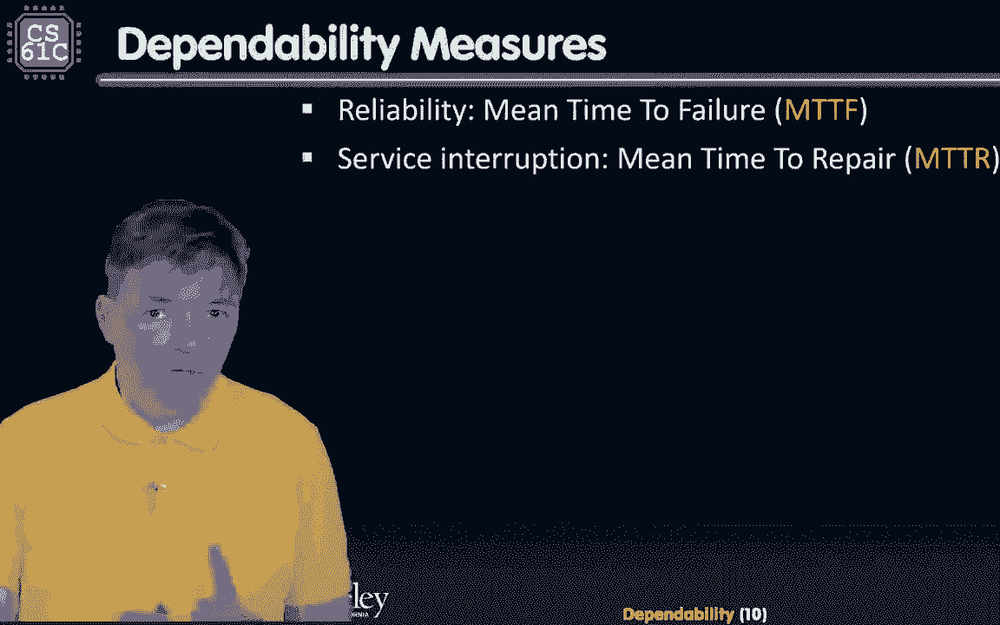

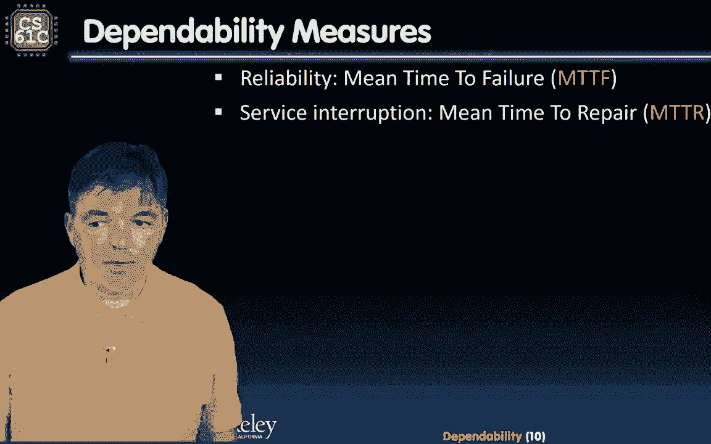

---

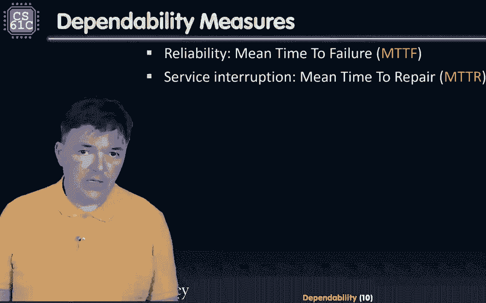

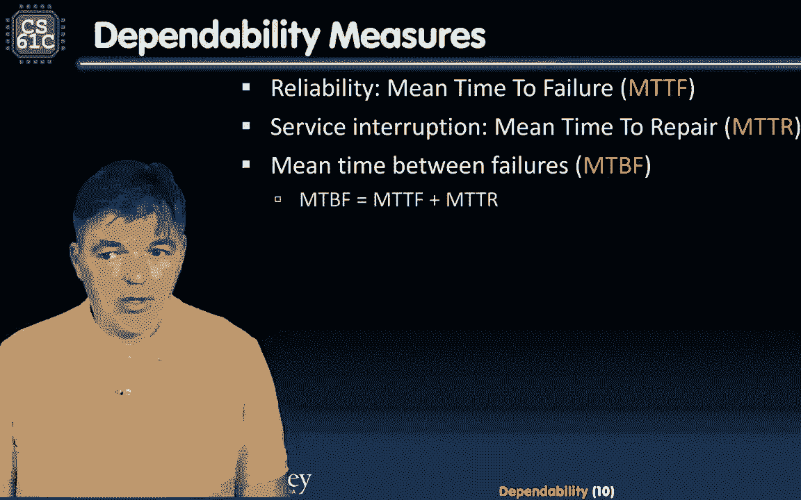

## 可靠性度量 📏

上一节我们介绍了冗余的基本概念。本节中，我们来看看如何衡量一个系统的可靠性。在计算机系统中，我们需要一些度量标准来判断是否以及改进了多少。

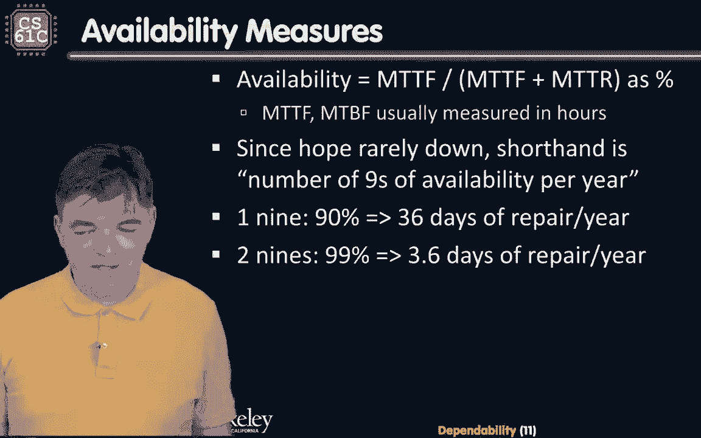

首先，理解计算机系统的运行状态：
1.  **正常运行**：系统提供服务。
2.  **故障**：系统中某个组件发生故障。**故障不一定导致系统失效**，这取决于该组件是否被使用以及是否存在冗余。
3.  **失效**：系统从正常运行状态转移到**服务中断**状态。
4.  **恢复**：系统从服务中断状态**修复**并回到正常运行状态。

关键度量指标包括：
*   **故障发生的频率**。
*   **从故障中恢复需要多长时间**。

冗余可以在**空间**和**时间**两个维度上应用：
*   **空间冗余**：拥有多个副本（如多个计算单元、多份数据副本、冗余设备或添加冗余位）。
*   **时间冗余**：如果检测到计算失败或服务未完成，简单地**重复执行**操作。

以下是几个核心的可靠性度量指标：

*   **平均无故障时间 (MTTF)**：测量系统或组件在发生故障前平均能正常运行的时间。公式为：
    `MTTF = 总正常运行时间 / 故障次数`
*   **平均修复时间 (MTTR)**：测量修复故障并恢复服务所需的平均时间。
*   **平均失效间隔时间 (MTBF)**：指两次故障之间的平均时间，它是MTTF和MTTR之和。公式为：
    `MTBF = MTTF + MTTR`
*   **可用性 (Availability)**：系统处于可服务状态的时间比例。公式为：
    `可用性 = MTTF / (MTTF + MTTR) = MTTF / MTBF`

提高可用性的方法：增加MTTF（使组件更耐用或增加冗余）或减少MTTR（改进故障检测和修复工具）。

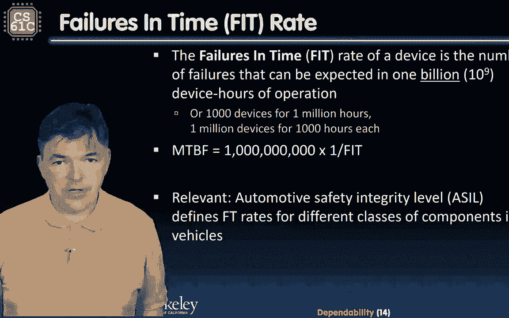

---

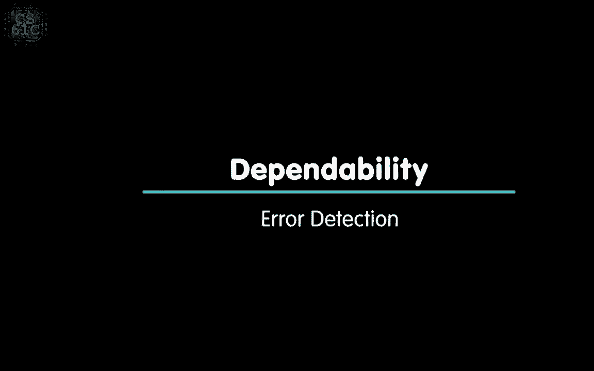

## 可用性与“9”的追求 🎯

上一节我们定义了可靠性的度量指标。本节中，我们深入看看**可用性**这个关键指标。

可用性通常以百分比形式表示，并且计算机系统追求极高的可用性，常用“几个9”来描述：
*   **90% 可用性**：相当于一年有36.5天服务中断。
*   **99% 可用性**：相当于一年有3.65天服务中断。
*   **99.9% 可用性（三个9）**：相当于一年有8.76小时服务中断。
*   **99.99% 可用性（四个9）**：相当于一年有52.6分钟服务中断。
*   **99.999% 可用性（五个9）**：相当于一年只有5.26分钟服务中断。

现代关键服务（如YouTube、云计算平台）通常设计为四个9或五个9的可用性。系统宕机的代价非常高昂，可能达到每分钟数百万美元的损失。

对于拥有大量组件的系统（如数据中心），我们还需要关注**年化故障率 (AFR)**。例如，一个拥有1000块磁盘的数据中心，若每块磁盘的MTTF为10万小时，则：
`年化故障率 ≈ (1000 盘 * 8760 小时/年) / 100000 小时/盘 ≈ 87.6 盘/年`
这相当于约8.8%的年化故障率，与实际研究中磁盘驱动器的故障率（1-3年约1.7%-8.6%）相符。

另一个度量是**故障率 (FIT)**，常用于汽车电子等领域，表示十亿设备运行小时中预期的故障数。例如，`MTBF = 10^9 / FIT`。

可靠性设计的一个关键原则是：**避免单点故障**。系统的整体可靠性受其最不可靠组件的制约。

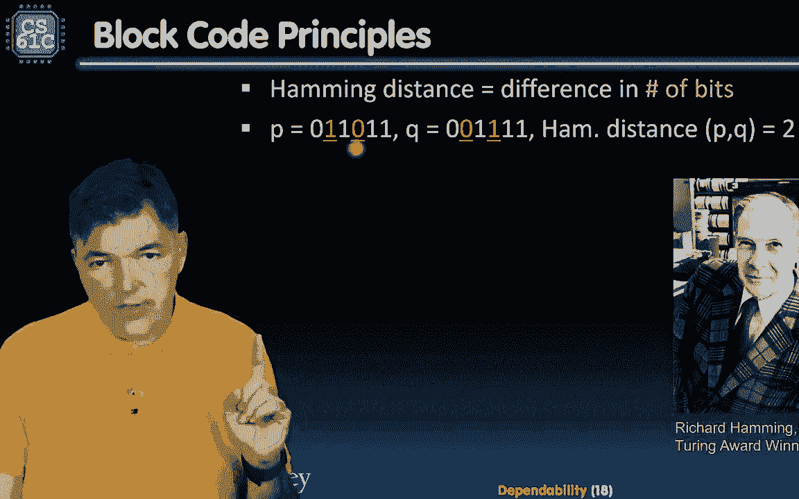

接下来，我们将探讨如何检测这些故障。

---

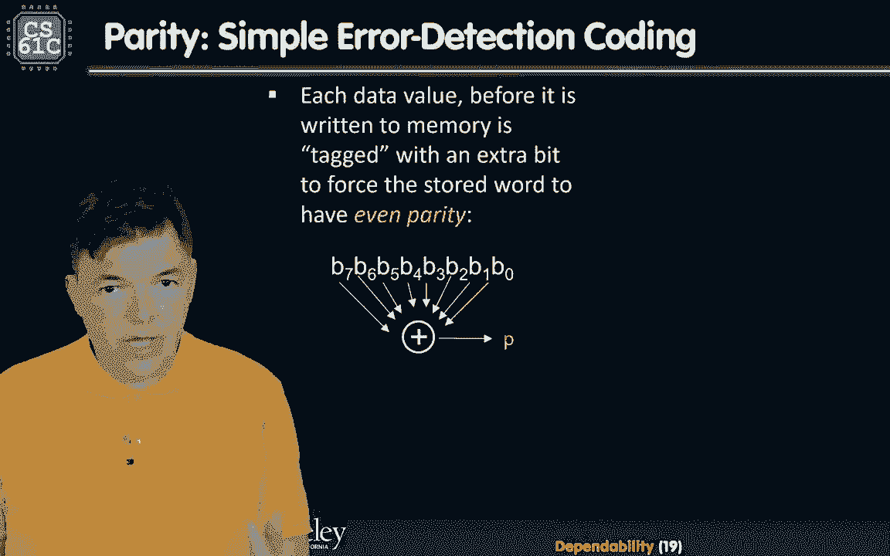

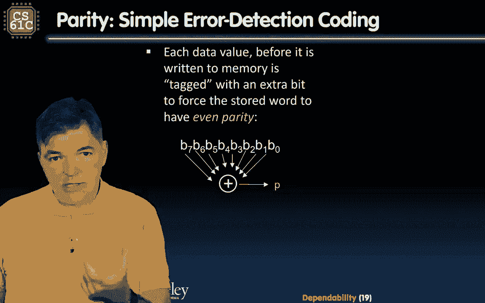

## 错误检测：奇偶校验 🧮

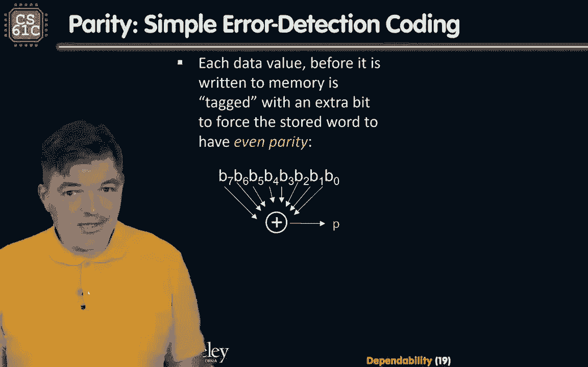

上一节我们学习了如何度量可靠性。在尝试添加冗余之前，我们首先需要弄清楚如何检测系统中的错误或故障。

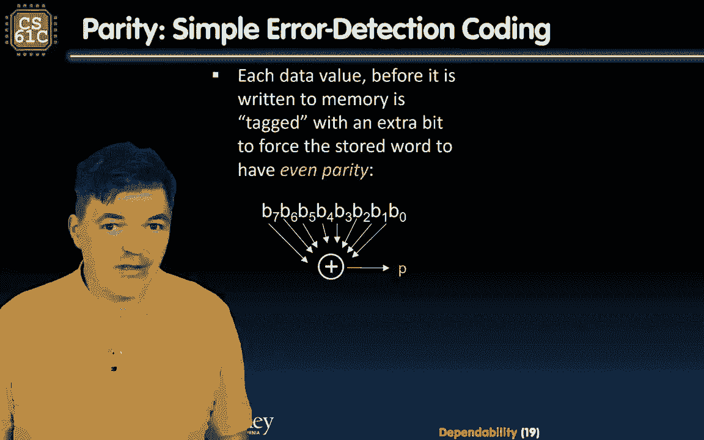

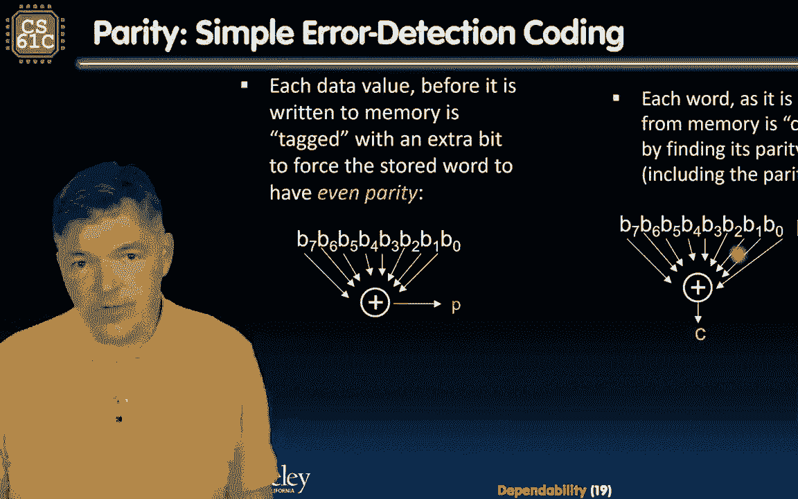

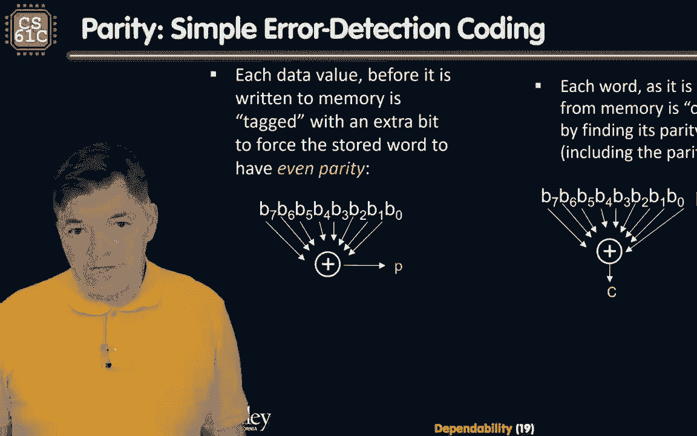

计算机系统中的错误可能发生在任何地方，但尤其常见于内存（DRAM）。DRAM中的每个比特都是一个微小的电容器。电荷可能受到电源扰动或宇宙射线等粒子的干扰而改变，导致存储的`0`变成`1`或反之。这种错误称为**软错误**。与之相对的是**硬错误**，即存储单元物理性永久损坏。

防御软错误的方法是使用**错误检测与纠正码 (ECC)**。其核心思想是在存储数据时添加一些冗余位，形成“码字”。如果错误导致一个有效码字变成无效码字，我们就能检测到问题。

理解这些代码需要一个重要概念：**汉明距离**。它指的是两个等长二进制串之间不同比特位的数量。例如：
*   字 P = `0101`， 字 Q = `0011`， 汉明距离为 2。
*   字 P = `0101`， 字 Q = `1101`， 汉明距离为 3。

如果我们存储的码字之间的最小汉明距离为2，那么发生**单比特错误**时，新产生的字将与任何有效码字都至少有一个比特的差异，从而能被检测为无效。

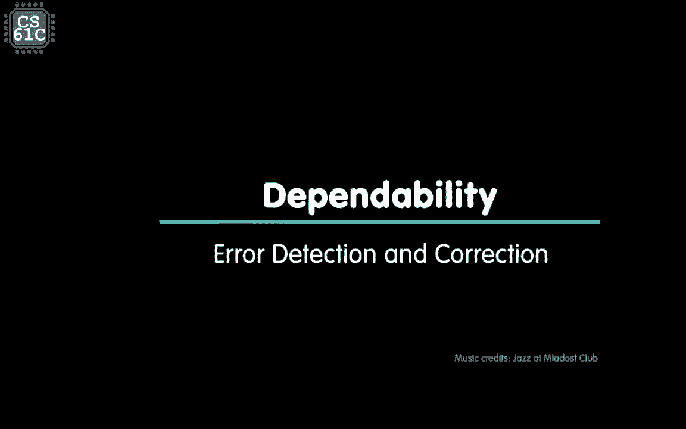

一个最常用的简单错误检测码是**奇偶校验**。
*   **编码**：对于一个数据字（例如8位），我们计算所有比特的异或（XOR），产生一个**奇偶校验位**，使得整个9位码字中`1`的个数为偶数（偶校验）。然后将这9位一起存入内存。
*   **检测**：读取时，再次计算这9位的异或。如果结果为`0`，则奇偶性为偶，没有检测到错误（或发生了偶数个比特错误）；如果结果为`1`，则检测到错误（发生了奇数个比特错误）。

奇偶校验码的最小汉明距离为2，因此它能检测**任何单比特错误**（以及任意奇数个比特错误），但无法检测偶数个比特错误，也无法纠正错误。

---

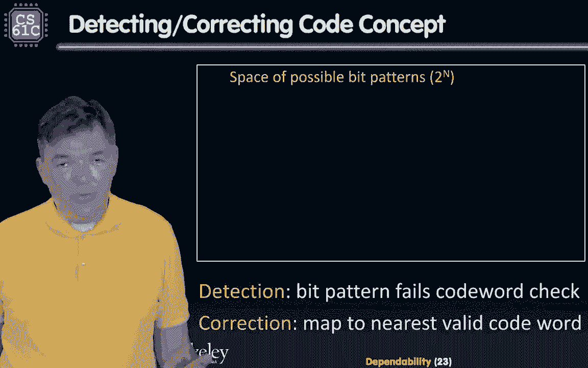

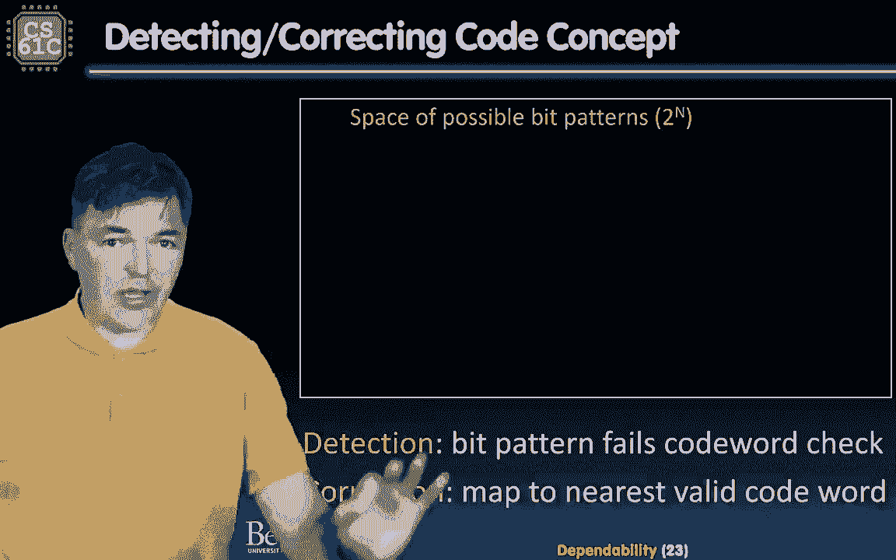

## 错误纠正：汉明码 🔧

上一节我们看到了如何使用奇偶校验位检测错误。但奇偶校验只能告诉我们“有错误”，却不知道错误在哪里，也无法纠正。本节中我们来看看如何添加更多冗余以执行**纠错**。

要进行单比特错误的纠正，码字之间的最小**汉明距离需要为3**。这样，任何一个单比特错误产生的无效码字，都**唯一地**最接近某一个有效码字。通过将其“纠正”为这个最近的有效码字，我们就能恢复原始数据。

理查德·汉明提出的**汉明码**就是这样一种能实现**单纠错、双检错 (SECDED)** 的编码。其巧妙之处在于将奇偶校验位与数据位**交织**放置。

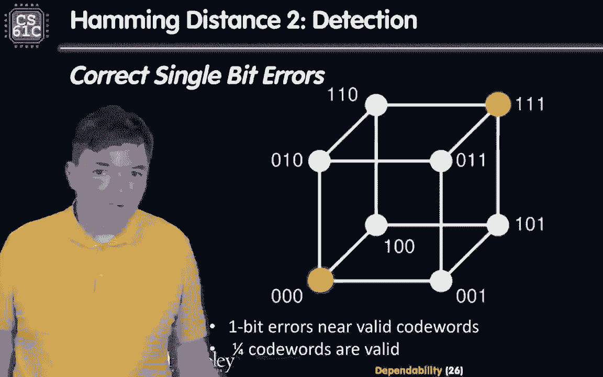

以下是汉明码编码的一个简化示例（对8位数据编码）：
1.  确定码字位位置（1 到 12）。
2.  将数据位（D0-D7）放入位位置 3, 5, 6, 7, 9, 10, 11, 12。
3.  奇偶校验位（P1, P2, P4, P8）放入位位置 1, 2, 4, 8（这些是2的幂次方位）。
4.  每个奇偶校验位负责覆盖特定的一组位（包括一些数据位和其他奇偶位），确保该组的奇偶性为偶。
    *   P1 覆盖所有位位置二进制表示中最低位为1的位（1, 3, 5, 7, 9, 11）。
    *   P2 覆盖所有位位置二进制表示中次低位为1的位（2, 3, 6, 7, 10, 11）。
    *   P4 覆盖所有位位置二进制表示中第三位为1的位（4, 5, 6, 7, 12）。
    *   P8 覆盖所有位位置二进制表示中第四位为1的位（8, 9, 10, 11, 12）。

**解码与纠错过程**：
1.  读取码字后，重新计算四个奇偶校验组。
2.  如果所有组校验都通过（偶校验），则没有错误。
3.  如果某些组校验失败，将失败组的索引（如P2和P8）相加，其和（如2+8=10）直接指出了**出错比特的位置**。
4.  翻转该出错比特，即完成纠错。

汉明码仅用4个校验位就保护了8位数据，开销为50%，远优于简单的三重复制（开销200%）。更高级的系统（如服务器）可能会使用能纠正多比特错误的更强编码。

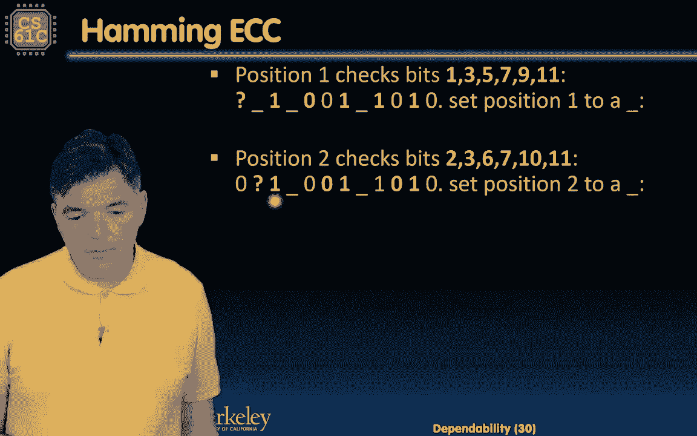

---

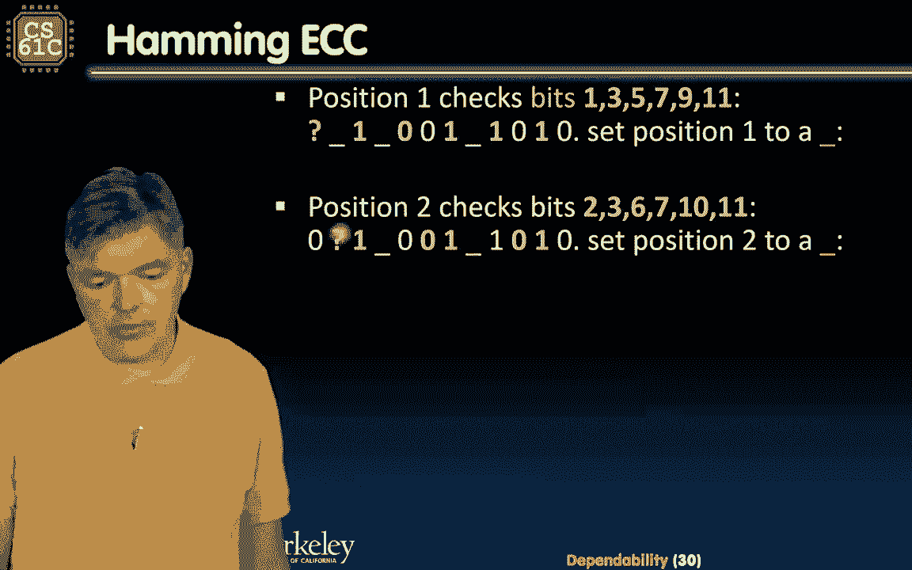

## 硬件冗余：磁盘阵列 (RAID) 💽

上一节我们学习了如何用比特级冗余（ECC）应对软错误。本节我们来看看当硬件发生永久性故障（如硬盘损坏）时该怎么办。此时，ECC可能不够用，我们需要组件级的冗余——**备用件**。

一个经典的例子是**廉价磁盘冗余阵列 (RAID)**。它由一组廉价的普通磁盘组成，通过数据分布和冗余策略，提供更高的性能、容量和可靠性。

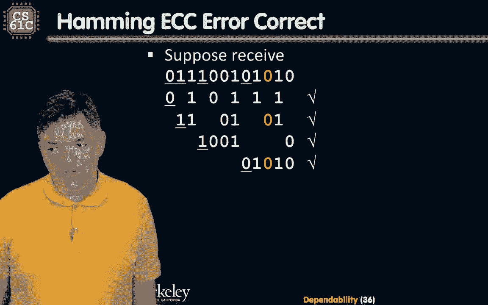

RAID 的核心思想之一是**条带化**：将文件分割成块，并行写入多个磁盘，从而提高I/O速度。同时，通过引入冗余磁盘，可以在某个磁盘故障时重建数据，保证服务不中断。

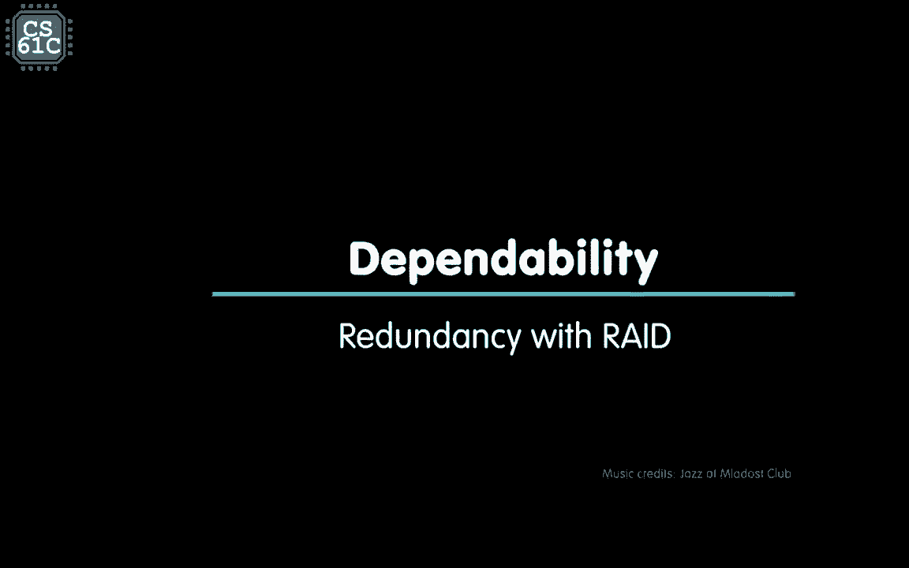

以下是几种常见的RAID级别：

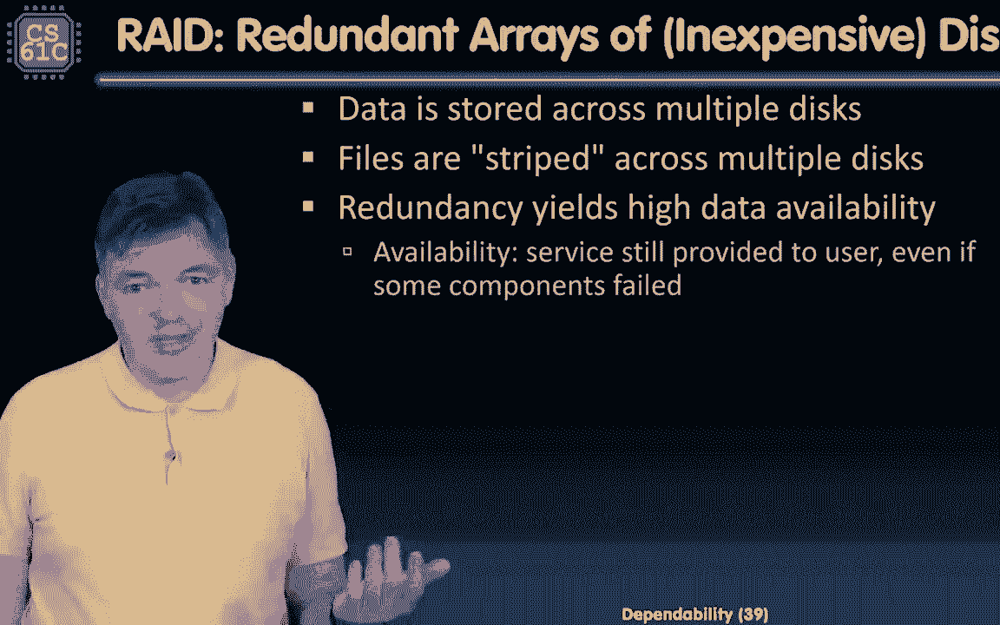

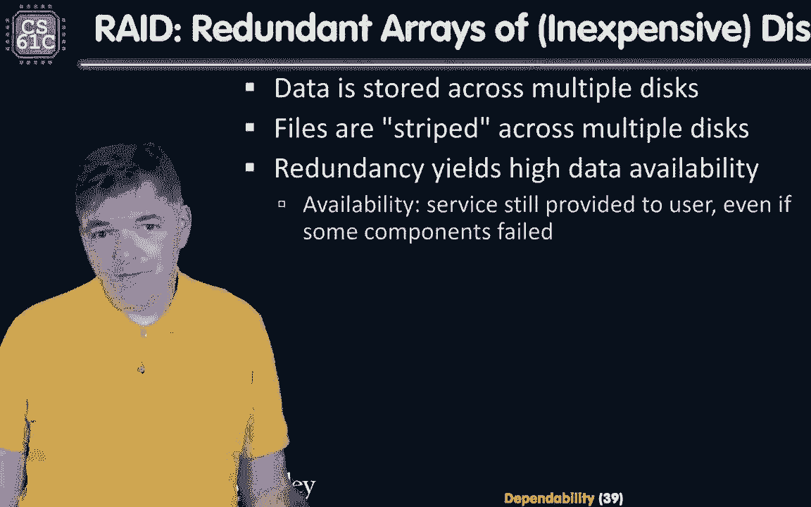

*   **RAID 0**：仅条带化，无冗余。提高了速度，但没有容错能力。
*   **RAID 1**：**镜像**。每个数据盘都有一个完整的备份盘。提供完全的冗余，但存储开销为100%（利用率50%）。
*   **RAID 3/4**：**带专用奇偶校验盘的条带化**。
    *   数据条带化分布在多个磁盘上。
    *   使用一个**专用的磁盘**存储所有数据条的奇偶校验信息（通过异或计算得出）。
    *   任何一个数据盘故障，都可以用剩余数据盘和奇偶校验盘的数据重建出来。
    *   **缺点**：奇偶校验盘成为写操作的瓶颈，因为每次写数据盘都需要更新它。
*   **RAID 5**：**分布式奇偶校验条带化**。
    *   与RAID 4类似，但**奇偶校验信息不再集中于一个磁盘，而是均匀分布在所有磁盘上**。
    *   这消除了奇偶校验盘的瓶颈，因为写操作可以分散到多个磁盘上同时更新各自的奇偶校验块。
    *   这是最常用的RAID级别之一，在性能、容量和可靠性之间取得了良好平衡。

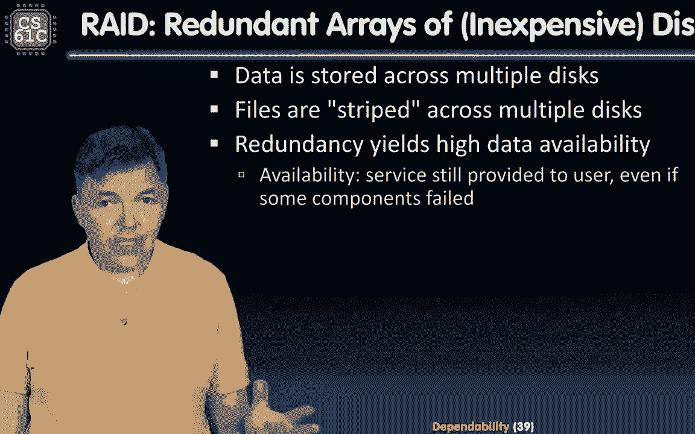

还有更高级的RAID级别（如RAID 6，能容忍两块磁盘同时故障），但基本原理相似。

---

## 总结 📚

在本节课中，我们一起学习了如何通过冗余来提高计算机系统的可靠性。

我们首先了解了为什么可靠性至关重要，并学习了度量可靠性的关键指标：**平均无故障时间 (MTTF)**、**平均修复时间 (MTTR)** 和**可用性**。高可用性系统常以“几个9”为目标。

接着，我们探讨了两种主要的冗余形式：
1.  **空间冗余**：添加额外的硬件（位、组件、磁盘）。
2.  **时间冗余**：重复执行失败的操作。

在错误处理方面，我们深入学习了两种编码技术：
*   **奇偶校验**：通过添加一个校验位，实现**单比特错误检测**（汉明距离为2）。
*   **汉明码**：通过交织多个奇偶校验位，实现**单比特错误纠正和双比特错误检测**（汉明距离为3）。这是一种高效利用冗余的优雅方法。

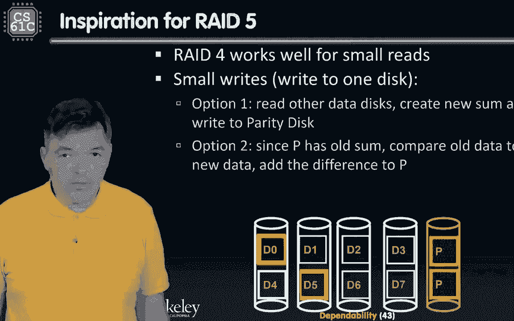

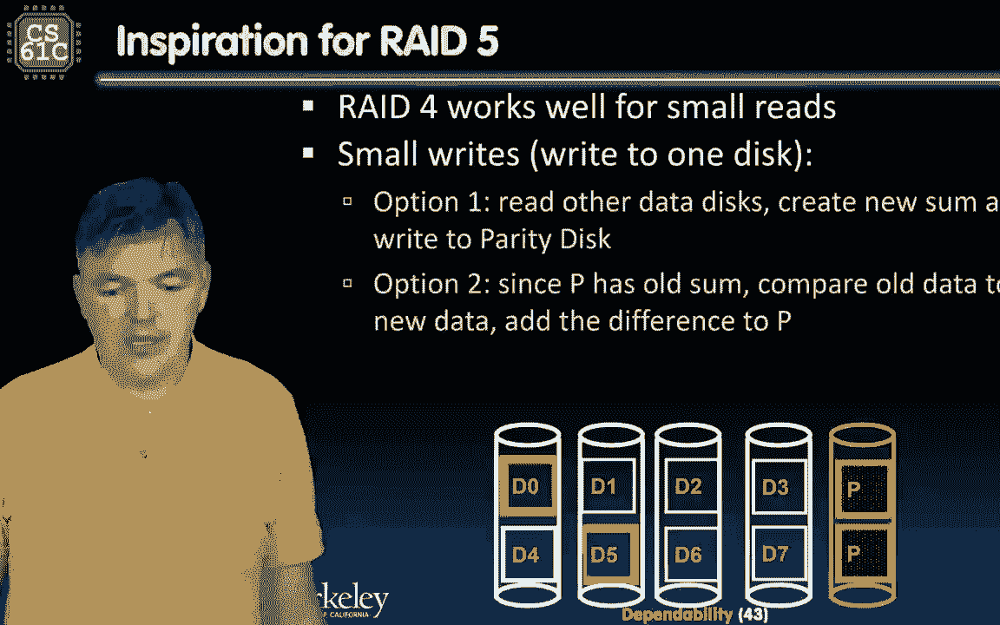

最后，我们研究了硬件组件级的冗余实例——**RAID磁盘阵列**。它通过条带化提升性能，并通过镜像或奇偶校验提供冗余，从而在磁盘故障时保障数据可用性和系统可靠性。我们了解了RAID 1、RAID 4和RAID 5等不同级别的工作原理和权衡。

总而言之，冗余是构建可靠计算机系统的基石，它使我们能够在组件必然会发生故障的现实世界中，依然构建出高度可用的服务。