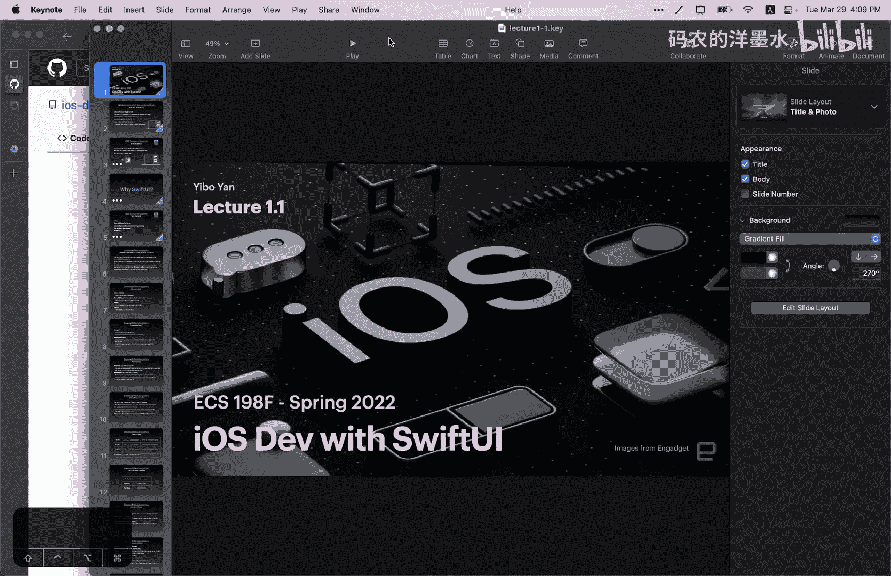
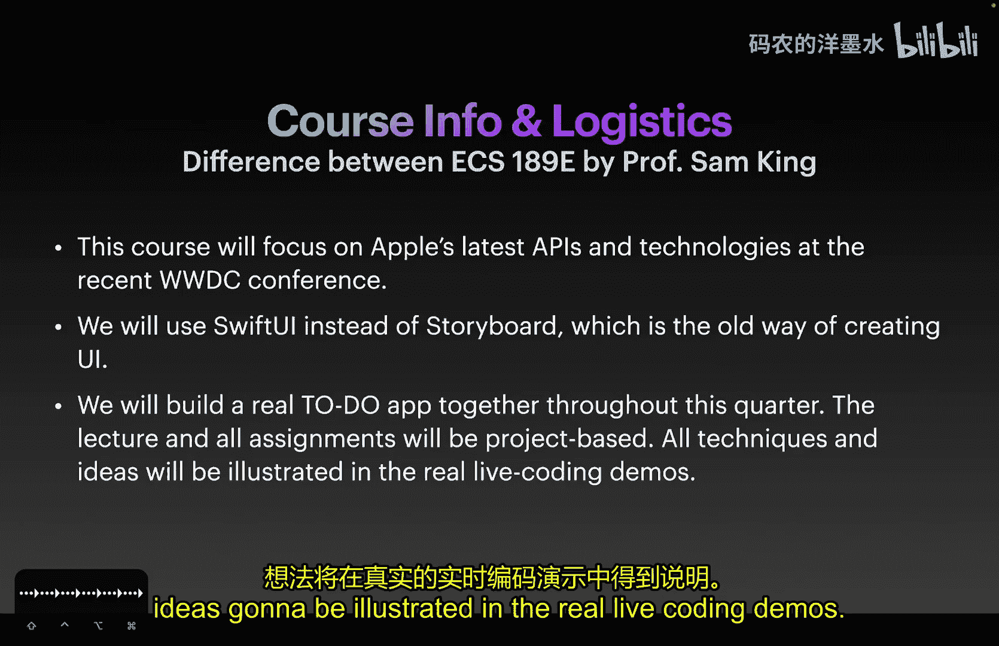
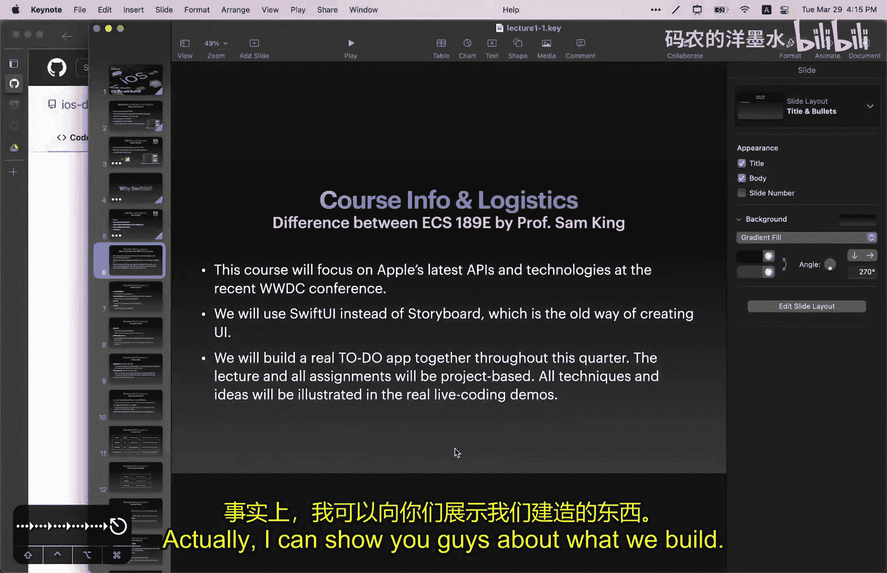
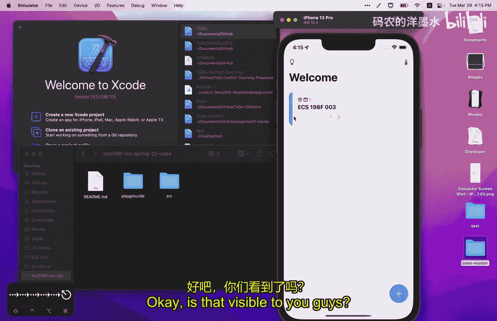
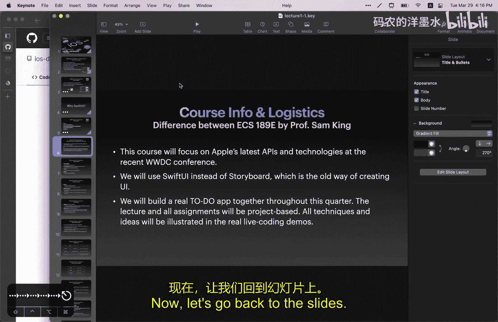
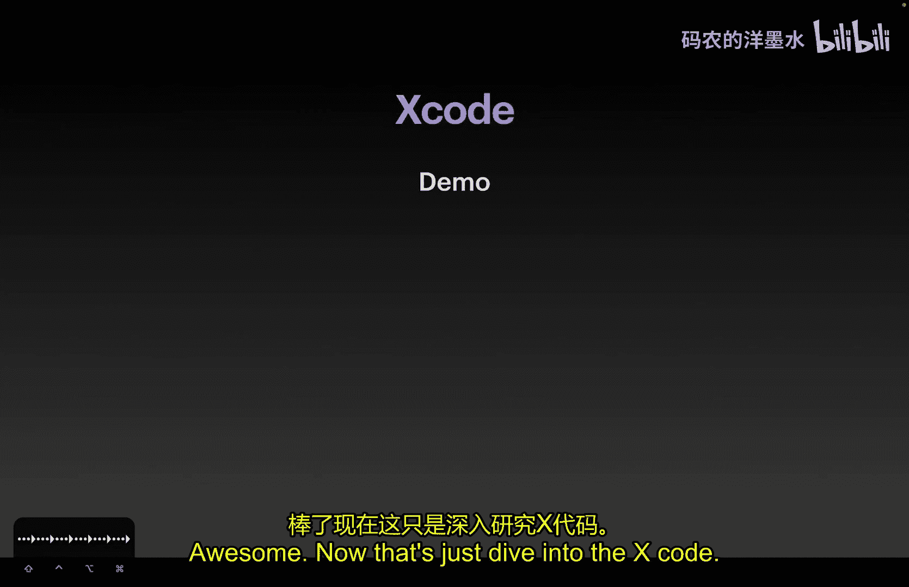
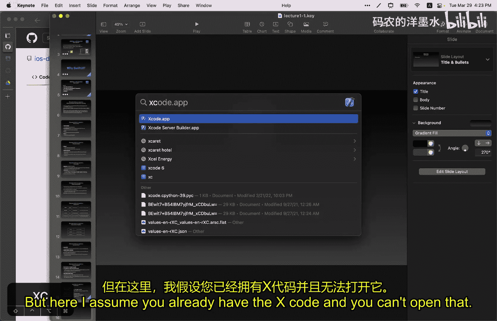
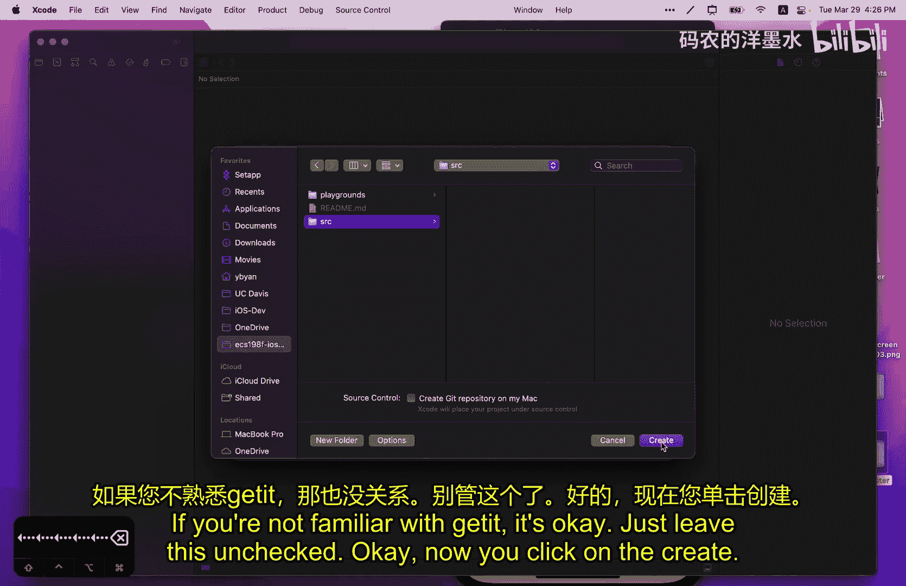
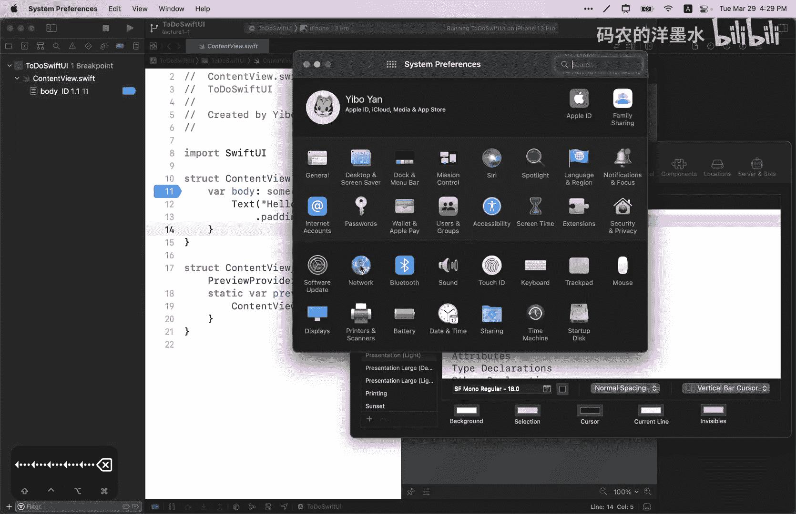
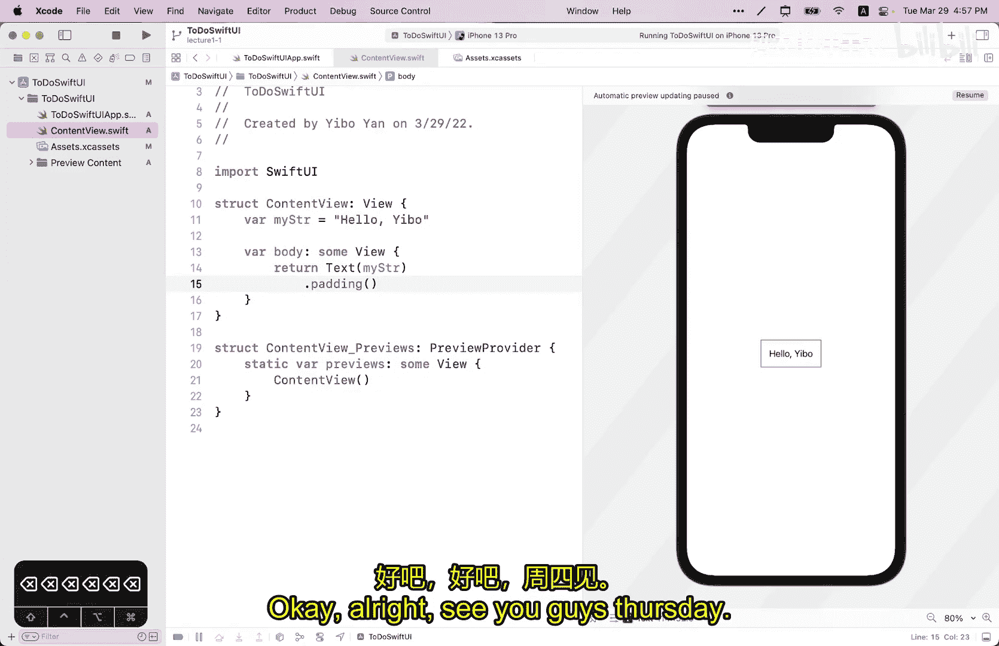

# 001：课程导论与Swift基础



在本节课中，我们将学习iOS开发课程的基本信息、开发环境Xcode的初步使用以及Swift编程语言的基础语法。课程将重点介绍SwiftUI这一构建用户界面的现代技术。

## 课程概述与目标

欢迎来到E 190 AF课程，本节我们将使用SwiftUI进行iOS开发。本课程将涵盖以下核心主题：
*   Swift语言的基本语法和使用方法。
*   SwiftUI技术，这是苹果近年来发布的用于为iOS、iPadOS等平台应用构建用户界面的新技术。
*   SwiftUI中的状态管理以及闭包、高阶函数、属性包装器等高级特性。

## 为什么选择SwiftUI？









上一节我们介绍了课程目标，本节中我们来看看为什么选择SwiftUI作为核心技术。

SwiftUI是苹果公司随iOS 13一同推出的新技术，它是一种为苹果平台应用构建用户界面的新方式。选择SwiftUI的主要原因如下：
*   **代表未来**：SwiftUI旨在取代旧的UI构建方式（如Storyboard），是苹果主推的未来技术。
*   **跨平台**：掌握SwiftUI后，其知识可以应用于苹果的所有平台，包括tvOS、watchOS和macOS。
*   **易于上手**：它采用声明式UI编程范式。声明式编程意味着你只需向计算机描述你想要什么，计算机会自行处理如何实现。这与需要精确指定每一步操作的命令式编程相比，入门更简单。
*   **动画支持**：在SwiftUI中应用动画非常简便，这对于创建具有苹果产品特色的流畅交互体验至关重要。

本课程与之前的EC 189E课程（由Samuel King教授开设）有显著不同。旧课程侧重于旧有技术，而本课程将聚焦于苹果最新的API、技术和Swift语法，并使用SwiftUI替代Storyboard。整个学期的讲座、作业，包括最终的团队项目，都将以项目为基础，所有技术和概念都将在真实的编码演示中讲解。

## 课程信息与要求

了解了技术选型后，接下来我们看看课程的具体安排和要求。

以下是本课程的一些基本信息：
*   **课程资料**：所有幻灯片将在课后发布到Canvas。
*   **讨论平台**：我们将使用Discord进行即时交流，并使用GitHub Discussions进行线程式问答，便于搜索历史问题。
*   **先修要求**：EC 36B和EC 32B是本课程的必修先修课。本课程虽为iOS编程新手设计，但假设你已了解面向对象编程等基础知识。EC 150和EC 14A（操作系统和编程语言）课程也被推荐，但非必需。
*   **设备要求**：你需要一台Mac设备来运行Xcode（iOS开发的集成开发环境）。无需实体iPhone，我们将使用模拟器进行开发和测试。如果你没有Mac，可以使用CSF设备。
*   **软件安装**：所有安装要求将在本周四发布的“作业0”中详细列出。



关于课程人员：
*   本课程有两位助教：Yibo Yan（主讲）和Even Huang。
*   课程监督教授是Nina Manta。关于课程后勤或作业的问题，请直接联系主讲或助教，除非绝对必要，否则不要联系Manta教授。



重要注意事项：
*   本课程为2个学分的P/NP课程。
*   主讲将提供每周可选材料，供希望深入学习的同学使用。
*   每节课后，助教整理的课程摘要文档将与幻灯片一同上传至Canvas。

## 评分标准



在明确了课程要求后，我们来看看如何取得好成绩。

本课程的评分构成如下：
*   **介绍性作业（作业0）**：旨在帮助你搭建本地开发环境，将于本周四发布。
*   **四次常规作业**：均为项目制，主要围绕构建待办事项应用的各个部分展开（例如创建自定义视图或添加新功能）。每次作业有一周时间完成，难度适中。
*   **期末项目**：这是一个小组项目，需要3-5人组队。项目包括现场演示和代码提交，并对组员进行互评。项目从第7周开始，有约四周时间完成，最终演示在6月2日（本学期最后一个讲座日）进行。更多细节将在第5或第6周公布。



## Xcode开发环境入门

现在，让我们开始实践，首先熟悉我们的主要工具——Xcode。

你将根据“作业0”的指引安装Xcode。打开Xcode后，你会看到欢迎界面，可以创建新项目、克隆GitHub仓库或打开现有项目。

要创建一个新的iOS项目，请选择“iOS”而非“Multiplatform”，然后在“Application”标签下选择“App”。点击“Next”后，你需要：
*   填写产品名称（例如“TodoAppSwift”）。
*   团队选择“None”。
*   组织标识符通常是你个人网站域名的反写（例如，网站为`www.yibo.com`，则标识符可为`com.yibo`）。
*   在界面选项中选择“SwiftUI”，语言选择“Swift”。
*   暂时可以不勾选“Use Core Data”和“Include Tests”。

创建项目后，你会看到一个基础模板。点击播放按钮即可在模拟器中运行应用。你可以通过设备选择栏切换不同的模拟器（如iPhone 13 Pro）。

Xcode主界面主要分为以下几个区域：
*   **导航器面板（左侧）**：默认是项目导航器，显示项目文件结构。其他选项包括搜索导航器、问题导航器（显示编译警告/错误）、调试导航器（显示调用栈）和断点导航器。
*   **编辑器区域（中间）**：编写代码的地方。在行号上单击可以设置断点；右键点击断点可以删除它。
*   **属性面板（右侧）**：显示所选文件或视图的属性。点击“？”图标可以快速查看帮助文档。
*   **预览面板（右侧，可能需手动开启）**：这是Xcode的强大功能，可以实时预览SwiftUI视图的变化，无需每次都重新编译运行整个应用。点击“Resume”即可激活。

项目模板包含几个关键文件：
*   `[项目名]App.swift`：应用的入口点。
*   `ContentView.swift`：默认的主视图文件，包含一个`ContentView`结构体，定义了你在模拟器中看到的界面。其后的`ContentView_Previews`结构体用于生成预览。
*   `Assets.xcassets`：存放图片、颜色等资源的中央位置。

常用快捷键：
*   **快速操作**：按住 `Command` 键并点击代码元素（如`ContentView`），会弹出可用操作菜单（如跳转到定义）。
*   **快速帮助**：按住 `Option` 键并点击代码元素，会弹出该元素的文档说明。
*   **快速跳转**：按住 `Control + Command` 并点击代码元素，可以跳转到其声明位置。

## Swift基础语法

熟悉了开发环境后，本节我们来学习Swift语言的一些基础语法。

你可以使用Xcode Playground来快速测试Swift代码。通过 `File > New > Playground` 创建，选择“Blank”模板。在Playground中，你可以逐行运行代码并立即看到结果。

**变量与常量**
*   使用 `var` 关键字声明**变量**（可变）。
    ```swift
    var greeting = "Hello"
    greeting = "Hello World" // 可以重新赋值
    ```
*   使用 `let` 关键字声明**常量**（不可变）。
    ```swift
    let myConstant = "My Constant"
    // myConstant = "Changed" // 错误：无法给常量赋值
    ```

**类型系统**
Swift是强类型且类型安全的语言。每个变量都有类型。
*   **类型推断**：编译器通常能根据初始值推断类型。
    ```swift
    var myInt = 1 // 推断为 Int
    var myBool = true // 推断为 Bool
    ```
*   **类型注解**：你可以显式指定变量类型。
    ```swift
    var myExplicitString: String = "Hello"
    var myFloat: Float = 3.14 // 显式指定为Float，否则3.14会被推断为Double
    ```
    按住 `Option` 键点击变量名，可以查看编译器推断出的类型。

**基本数据类型**
Swift包含多种基本数据类型：
*   `Int`：整数。
*   `Double` / `Float`：浮点数。
*   `Bool`：布尔值（`true`或`false`）。
*   `String`：字符串。

**集合类型**
*   **数组**：使用方括号 `[]` 声明。
    ```swift
    var numbers: [Int] = [] // 空整数数组，类型注解
    var inferredNumbers = [1, 2, 3] // 推断为 [Int]
    var anotherArray = Array<Int>() // 另一种初始化方式
    ```
*   **字典**：使用 `[KeyType: ValueType]` 语法声明。
    ```swift
    var dict: [Int: String] = [:] // 空字典，键为Int，值为String
    var scores = [1: "One", 2: "Two"] // 推断为 [Int: String]
    ```

## 在SwiftUI视图中使用变量

最后，让我们将学到的Swift知识应用到SwiftUI视图中。

在 `ContentView.swift` 文件中，`ContentView` 是一个结构体。我们可以在其中声明变量。
```swift
struct ContentView: View {
    var myString = "Hello" // 在结构体内声明变量

    var body: some View {
        Text(myString) // 使用变量而非硬编码字符串
    }
}
```
`body` 属性是一个计算属性，它返回一个 `View`。`some View` 是一种不透明返回类型，目前可以理解为它返回某种遵循 `View` 协议的类型。当 `body` 中只有一行表达式时，可以省略 `return` 关键字。

修改代码后，预览面板可能会暂停，点击 “Resume” 即可更新预览。要测试交互功能（如按钮），需要点击预览面板上的播放按钮在可交互的模拟器中运行。

你可以使用 `Command + B` 快捷键快速编译项目，检查是否有错误。

## 总结



本节课中我们一起学习了iOS开发课程的导论部分。我们了解了课程目标、为什么选择SwiftUI作为核心技术，以及课程的具体安排、要求和评分标准。我们初步探索了Xcode开发环境，学习了如何创建项目、使用界面和快捷键。最后，我们掌握了Swift语言的基础语法，包括变量与常量的声明、类型系统、基本数据类型和集合类型，并尝试在SwiftUI视图中使用变量。下节课我们将更深入地学习Swift语言。