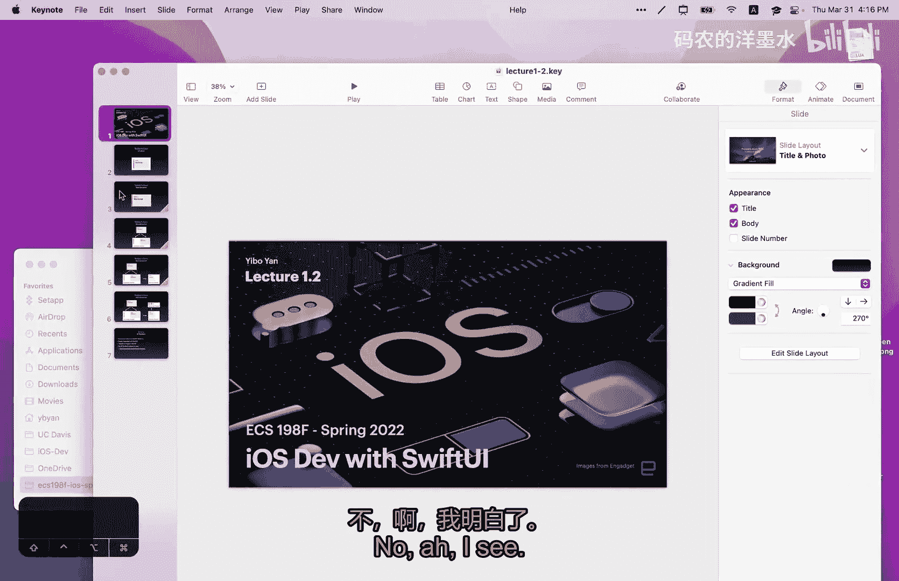
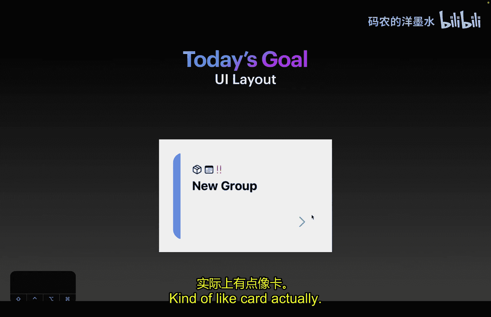
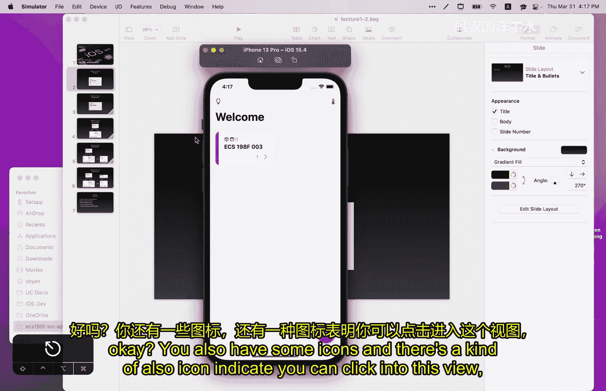
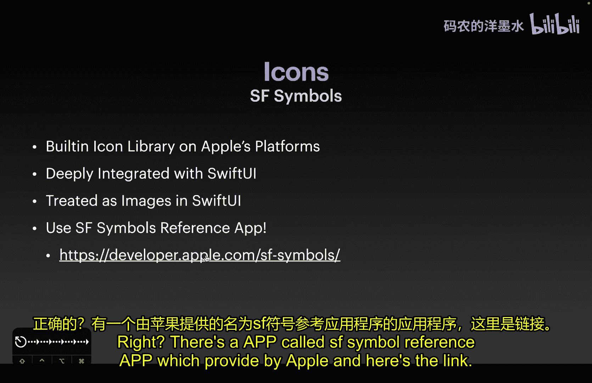
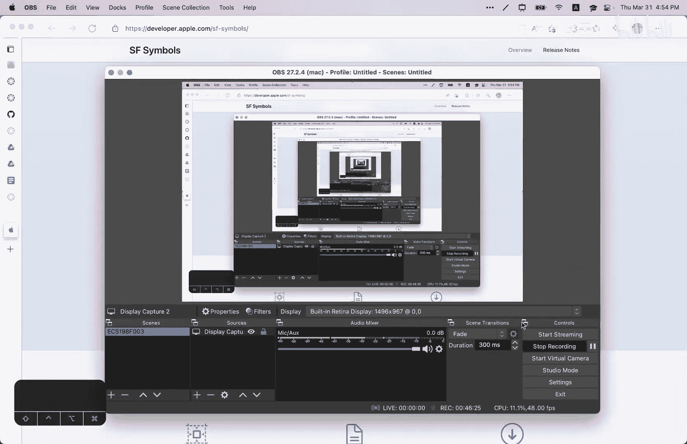

# 002：视图与布局 🧩

在本节课中，我们将学习SwiftUI的基本语法，特别是如何构建视图的布局。我们将通过创建一个“提醒事项分组卡片”的视图来实践这些概念。课程结束时，你将掌握如何使用各种视图容器和修饰符来组合和美化你的界面。

---

## 作业与课程安排

作业零现已发布。你可以在课程模块或主页找到它。

以下是接受作业的步骤：
1.  点击作业链接。
2.  在弹出的页面中选择你的姓名和学号。
3.  点击“接受作业”。
4.  GitHub将为你创建一个代码仓库。刷新页面后，你将看到一个指向该仓库的链接。
5.  将你的所有代码上传并推送到这个仓库。
6.  复制仓库链接，并提交到Canvas平台。

关于课程录像，目前的政策是根据需求提供。如果你需要录像，可以联系我获取链接。





---



## 理解 `some View` 与协议

上一节我们介绍了视图的基本概念，本节中我们来看看 `some View` 这个关键字的具体含义。

视图（`View`）实际上是一个协议（Protocol），而不是一个具体的类型。目前，你可以将它理解为定义某些事物必须遵循的一套规则。



例如，当你定义一个名为 `ContentView` 的结构体（`struct`），并在其后使用 `: View` 时，这意味着 `ContentView` 这个结构体**遵循**了 `View` 协议。它必须满足 `View` 协议的要求，即提供一个名为 `body` 的变量，其类型同样是 `some View`。

`some` 关键字的作用是让编译器进行类型推断。因为 `View` 是协议，不能直接用作常规类型。`some View` 告诉编译器：“这里有一个遵循 `View` 协议的具体类型，由你来推断它是什么”。

例如，`Text` 是一个具体的结构体类型，同时它也遵循 `View` 协议。在编译时，编译器会将 `some View` 推断为 `Text`。因此，你也可以直接将 `body` 的类型声明为 `Text`，代码同样能通过编译。

```swift
// 使用 some View，由编译器推断类型
var body: some View {
    Text("Hello")
}

// 直接声明为具体类型 Text，效果相同
var body: Text {
    Text("Hello")
}
```

你可以通过按住 `Option` 键并点击代码中的类型（如 `Text`）来查看其文档，确认它遵循了哪些协议。

---

## 构建“提醒分组卡片”视图 🃏

我们的目标是创建一个如下图所示的“提醒分组卡片”视图。它包含一个左侧的彩色标签，以及右侧由图标、文字等组成的垂直布局。


### 视图解构

首先，我们需要将这个复杂的视图分解成多个简单的部分：
1.  整个卡片可以水平分割为两部分：**左侧的彩色标签**和**右侧的主要内容区**。
2.  右侧的主要内容区可以垂直分割为四个部分：顶部的**三个图标**、**分组名称**、一个**填充空间的空白区域**和底部的**箭头图标**。
3.  顶部的三个图标本身又是一个水平排列的布局。

### 使用 SF Symbols 图标库

Apple 提供了一个名为 **SF Symbols** 的集成图标库，可以在 iOS、macOS 等平台上使用。在 SwiftUI 中，我们将这些图标视为 `Image`。

要查找和使用图标，你需要下载 **SF Symbols** 参考应用。在应用中，你可以浏览所有图标，查看其名称和属性，并将名称用于你的代码中。

### 开始编码

首先，在 Xcode 中创建一个新的 SwiftUI View 文件，命名为 `GroupCardView`。

#### 1. 水平布局：HStack

我们使用 `HStack` 来水平排列左侧的彩色条和右侧的内容。

```swift
HStack {
    Color.blue // 左侧蓝色标签
    Text("New Group") // 右侧文本（临时占位）
}
```

#### 2. 嵌套垂直布局：VStack

右侧内容是一个垂直布局。我们将文本放入 `VStack`，并在其上方和下方添加其他元素。

```swift
HStack {
    Color.blue
    VStack {
        // 顶部：三个水平排列的图标 (HStack)
        HStack {
            Image(systemName: "star.fill")
            Image(systemName: "exclamationmark.triangle.fill")
            Image(systemName: "checkmark.circle.fill")
        }
        Text("New Group") // 分组名称
        Spacer() // 填充空白空间的视图
        Image(systemName: "chevron.right") // 底部箭头图标
    }
}
```

#### 3. 调整视图尺寸与边框

预览可能占满全屏，我们可以使用 `.frame()` 修饰符来指定视图的尺寸。

```swift
GroupCardView()
    .frame(width: 200, height: 150) // 设置宽高
    .border(Color.red, width: 2) // 添加红色边框以便观察
```

#### 4. 调整内部间距与对齐

*   **调整彩色条宽度**： 同样使用 `.frame()` 修饰符。
    ```swift
    Color.blue
        .frame(width: 20) // 将蓝色条宽度设为20
    ```
*   **使用 Spacer 填充空间**： `Spacer()` 会占据父视图提供的所有剩余空间，常用于推动其他视图靠边。
    ```swift
    VStack {
        // ... 图标和文本
        Spacer() // 将底部图标推到底部
        Image(systemName: "chevron.right")
    }
    ```
*   **调整内边距**： 使用 `.padding()` 在视图周围添加空白。
    ```swift
    VStack {
        // ... 内容
    }
    .padding() // 在VStack四周添加默认内边距
    ```
*   **控制内部对齐**： 在 `VStack` 中，可以使用 `alignment` 参数控制其内部子视图的水平对齐方式。使用 `.leading` 使其左对齐（对于英文是左边，对于阿拉伯文等则是右边，具有语言自适应性）。
    ```swift
    VStack(alignment: .leading) { // 子视图左对齐
        // ... 内容
    }
    ```
*   **调整栈内间距**： 使用 `spacing` 参数控制 `HStack` 或 `VStack` 内部元素间的距离。
    ```swift
    VStack(alignment: .leading, spacing: 5) { // 元素间距为5
        // ... 内容
    }
    HStack(spacing: 0) { // 图标间无间距
        // ... 图标
    }
    ```

#### 5. 美化视图：圆角、背景与颜色

*   **添加圆角**： 使用 `.cornerRadius()` 修饰符。
    ```swift
    .cornerRadius(10)
    ```
*   **添加背景色**： 使用 `.background()` 修饰符。
    ```swift
    .background(Color.gray.opacity(0.2)) // 半透明灰色背景
    ```
*   **修改图标颜色**： 使用 `.foregroundColor()` 修饰符。
    ```swift
    Image(systemName: "exclamationmark.triangle.fill")
        .foregroundColor(.red) // 将该图标设为红色
    ```
*   **修改文本样式**： 使用 `.font()` 和 `.fontWeight()` 修饰符。
    ```swift
    Text("New Group")
        .font(.headline) // 使用预设标题字体
        .fontWeight(.bold) // 加粗
    ```

#### 6. 提取变量与自定义视图

为了使视图可复用，我们可以将固定值提取为变量。

```swift
struct GroupCardView: View {
    var groupName: String = "New Group" // 分组名称变量
    var labelColor: Color = .blue // 标签颜色变量
    var stackSpacing: CGFloat = 0 // 栈间距变量，指定为CGFloat类型

    var body: some View {
        // 在body中使用这些变量
        HStack {
            labelColor
                .frame(width: 20)
            VStack(alignment: .leading, spacing: stackSpacing) {
                // ... 图标
                Text(groupName)
                    .font(.headline)
                    .fontWeight(.bold)
                Spacer()
                // ... 箭头图标
            }
            .padding()
        }
        .frame(width: 200, height: 150)
        .background(Color.gray.opacity(0.2))
        .cornerRadius(10)
    }
}
```

创建视图实例时，可以传入自定义参数：

```swift
// 在预览或父视图中使用
GroupCardView(groupName: "Shopping List", labelColor: .green)
```

#### 7. 利用预览进行快速原型设计

预览（Preview）本身也是一个视图，你可以在其中放置多个视图实例，并应用不同的修饰符来快速测试不同状态下的外观。

```swift
struct GroupCardView_Previews: PreviewProvider {
    static var previews: some View {
        VStack {
            GroupCardView(groupName: "Work", labelColor: .blue)
            GroupCardView(groupName: "Personal", labelColor: .purple)
                .frame(width: 300) // 测试不同宽度
        }
    }
}
```

---

## 总结 🎯



本节课中我们一起学习了 SwiftUI 视图与布局的核心知识。我们了解了 `some View` 和协议的概念，并通过构建一个“提醒分组卡片”视图，实践了如何使用 `HStack`、`VStack` 和 `Spacer` 进行布局组合。我们还学习了如何运用 `.frame()`、`.padding()`、`.background()`、`.cornerRadius()` 等视图修饰符来调整视图的尺寸、间距和外观。最后，我们通过将数据提取为变量，使视图变得可定制和可复用。记住，多利用预览功能进行快速原型设计，可以极大地提高开发效率。