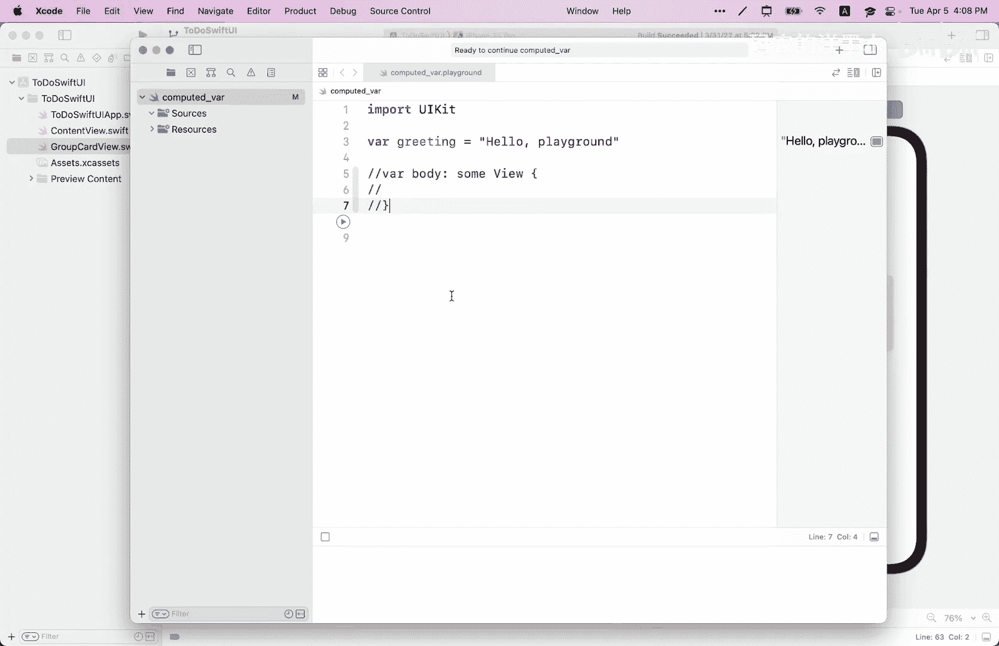
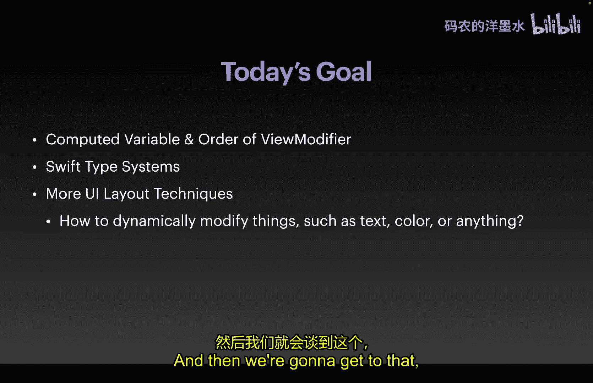
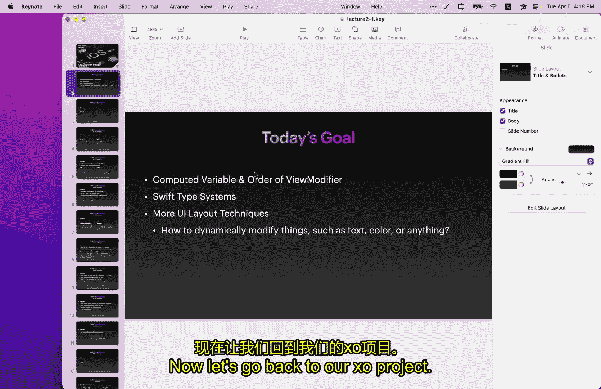
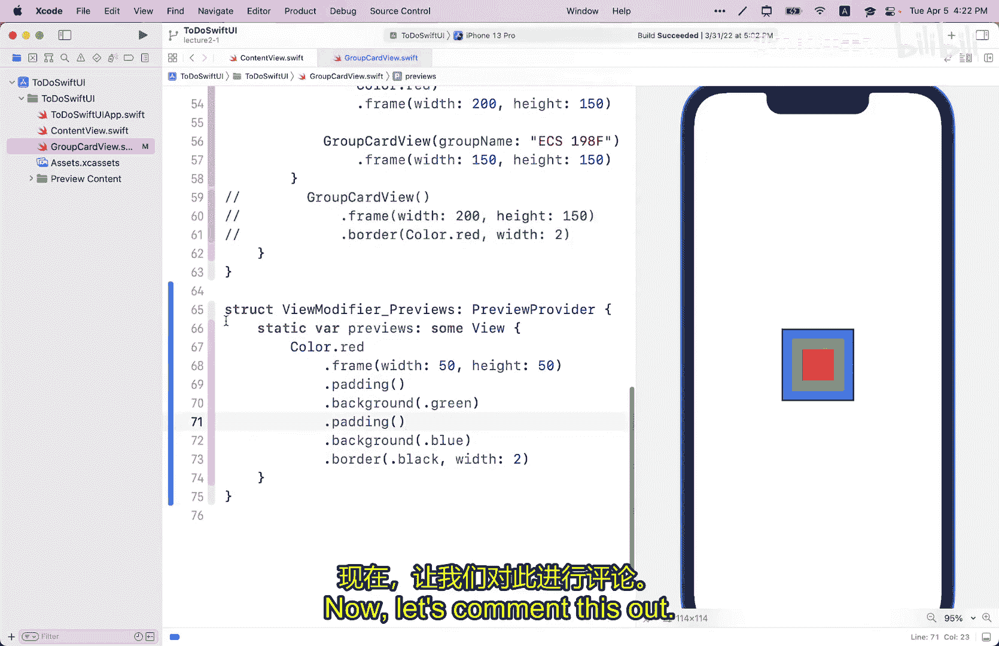
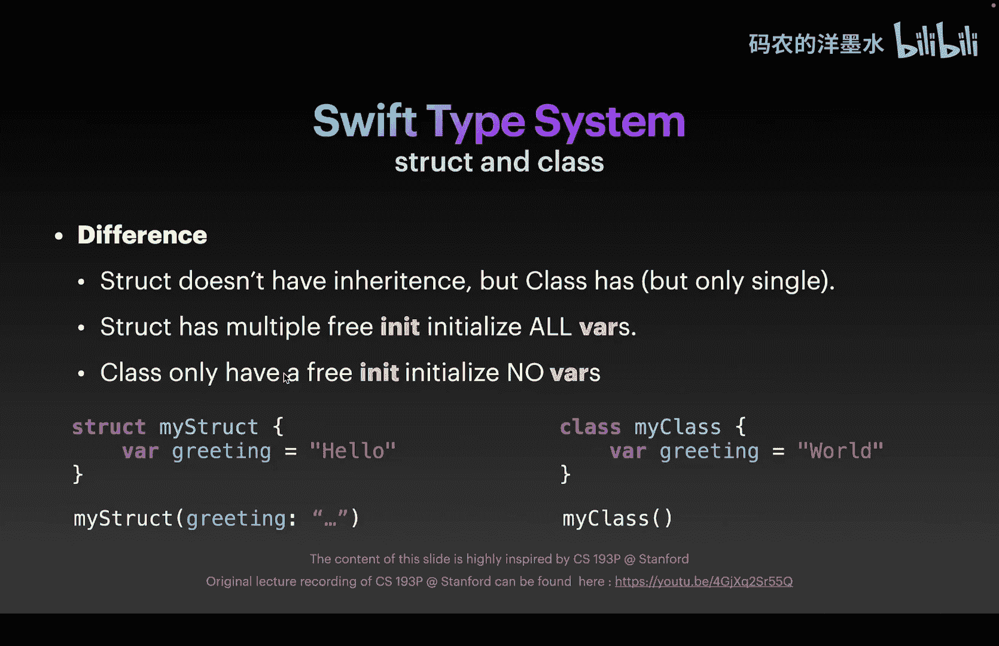
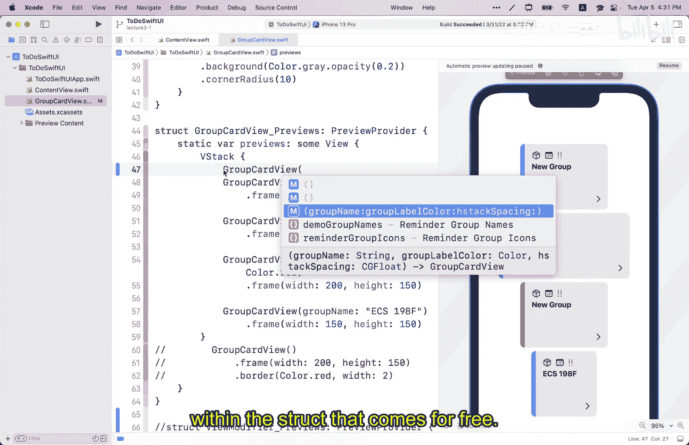
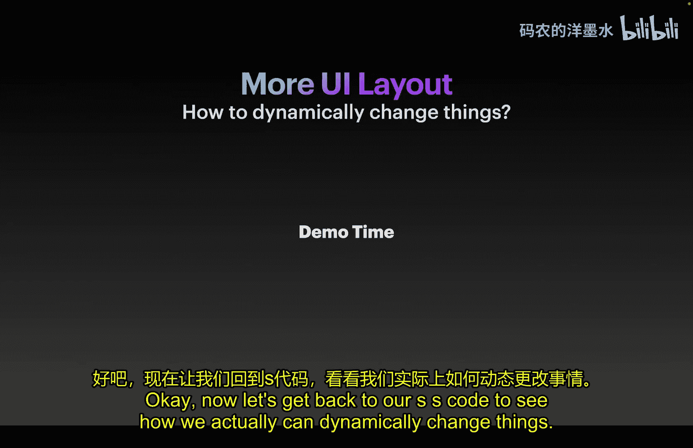
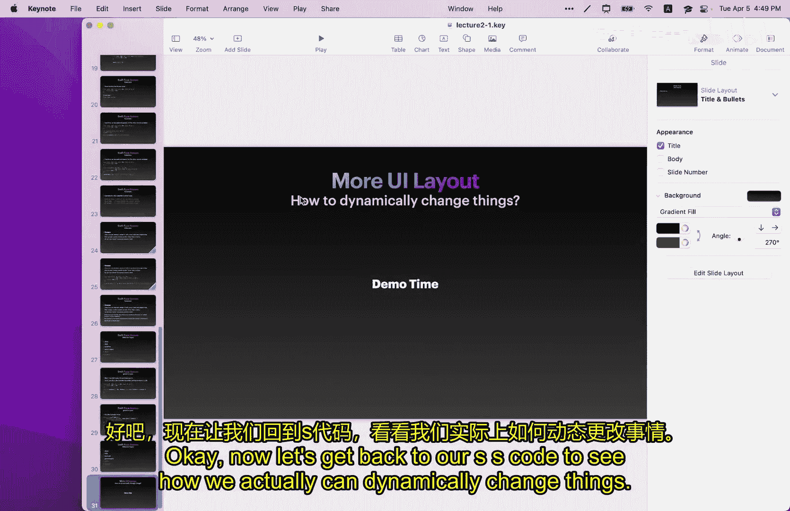
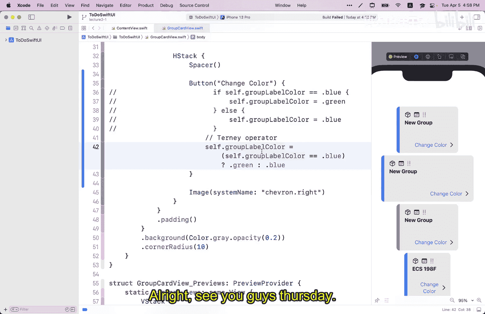

# 003：结构体与状态 🏗️



## 概述
在本节课中，我们将要学习 Swift 类型系统中的核心概念，包括计算属性、视图修饰符的顺序、结构体与类的区别、函数类型、闭包以及泛型。我们还将探索如何在 SwiftUI 中通过 `@State` 属性包装器来管理可变状态，并构建交互式界面。



---

## 计算属性 💻
计算属性是 Swift 中一种特殊的属性，它不直接存储值，而是提供一个 getter 来在每次访问时计算值。在 SwiftUI 中，每个视图的 `body` 属性就是一个典型的计算属性。

以下是如何定义和使用计算属性的示例：




```swift
let name = "John"
let age = 25

var greeting: String {
    "Hello, my name is \(name)."
}
var greetingWithAge: String {
    "\(greeting) I am \(age) years old."
}

print(greetingWithAge) // 输出：Hello, my name is John. I am 25 years old.
```

计算属性是只读的（get-only），这意味着你不能直接给它赋值。尝试赋值会导致编译错误。



---

## 视图修饰符的顺序 🎨
在 SwiftUI 中，视图修饰符（如 `.frame()`、`.padding()`、`.border()`）的顺序至关重要。每个修饰符都会接收前一个修饰符返回的视图，进行修改，然后返回一个新的视图。

让我们通过一个例子来看看顺序的影响：

```swift
Color.red
    .frame(width: 100, height: 100) // 1. 将红色颜色视图设置为矩形
    .padding()                      // 2. 为矩形添加内边距
    .border(Color.black, width: 2)  // 3. 为带内边距的视图添加黑色边框
    .background(Color.blue)         // 4. 为整个视图添加蓝色背景
```

如果交换 `.padding()` 和 `.border()` 的顺序，边框将直接应用于红色矩形，而不是带内边距的矩形，从而产生不同的视觉效果。

---

## 结构体与类 🧱
结构体（`struct`）和类（`class`）是 Swift 中两种主要的自定义类型。它们语法相似，但在行为上有根本区别。

### 相似之处
*   都可以包含存储属性、计算属性、常量和函数。
*   都可以有初始化器（构造器）。
*   都可以遵循协议（Protocol）和使用扩展（Extension）。



### 关键区别
1.  **值类型 vs 引用类型**：结构体是**值类型**。当赋值或传递给函数时，会创建一份**副本**。类是**引用类型**。赋值或传递时，传递的是对同一实例的**引用**。
2.  **继承**：结构体不支持继承。类支持**单继承**。
3.  **初始化器**：结构体自动获得一个逐一成员初始化器。类只获得一个无参数的默认初始化器。
4.  **可变性**：结构体实例是**不可变**的。要修改其属性，必须在方法前标记 `mutating` 关键字，这会在底层创建一个新的结构体实例。



```swift
// 结构体示例
struct MyStruct {
    var greeting: String
    // 需要 mutating 关键字来修改属性
    mutating func changeGreeting(to newGreeting: String) {
        greeting = newGreeting // 实际上创建了一个新实例
    }
}

// 类示例
class MyClass {
    var greeting: String
    init(greeting: String) { self.greeting = greeting }
    // 可以直接修改属性
    func changeGreeting(to newGreeting: String) {
        greeting = newGreeting
    }
}
```

Swift 对结构体采用了**写时复制**优化，只有在实际修改值时才会产生复制开销，提高了性能。

---

## 函数与闭包 🔧
在 Swift 中，函数是一等公民，拥有明确的类型，可以像变量一样被赋值和传递。

### 函数类型与参数标签
函数类型由参数类型和返回类型组成，例如 `(Int, Int) -> Int`。
Swift 函数参数有**外部参数名**（调用时使用）和**内部参数名**（函数体内使用），这使函数调用读起来更自然。

```swift
func add(_ lhs: Int, to rhs: Int) -> Int {
    return lhs + rhs
}
let result = add(5, to: 3) // 外部调用使用 `to`
```

### 将函数作为变量
```swift
let operation: (Int, Int) -> Int = add
let result2 = operation(5, 3) // result2 为 8
```

### 闭包
闭包是**内联**的函数，可以捕获和存储其所在上下文中的常量和变量。它是 Swift 函数式编程的基石。

```swift
func calculate(_ a: Int, _ b: Int, using op: (Int, Int) -> Int) -> Int {
    return op(a, b)
}

// 传递一个闭包（内联函数）
let result3 = calculate(10, 20) { (x, y) in
    return x + y
}
// 简写形式
let result4 = calculate(10, 20) { $0 + $1 }
```

---

## 泛型类型 🌐
泛型让你能编写灵活、可重用的函数和类型，它们可以处理任意类型，同时保持类型安全。

```swift
// 一个泛型函数，可以交换任意类型的两个值
func swapTwoValues<T>(_ a: inout T, _ b: inout T) {
    let temporaryA = a
    a = b
    b = temporaryA
}

var num1 = 100
var num2 = 200
swapTwoValues(&num1, &num2)

var str1 = "hello"
var str2 = "world"
swapTwoValues(&str1, &str2)
```

在实际使用中，泛型常与协议结合，为类型添加约束（例如，要求泛型类型 `T` 必须遵循 `Equatable` 协议）。





---

## 在 SwiftUI 中管理状态 🎛️
上一节我们介绍了结构体的不可变性。本节中我们来看看如何在 SwiftUI 视图中修改数据。由于视图是结构体，直接修改其属性是不允许的。SwiftUI 提供了 `@State` 属性包装器来解决这个问题。

### 使用 `@State` 创建可变状态
`@State` 标记的属性值由 SwiftUI 管理。当值改变时，SwiftUI 会自动销毁旧视图并创建一个包含新值的新视图，从而实现界面更新。

```swift
struct ContentView: View {
    // 使用 @State 包装需要修改的属性
    @State private var groupLabelColor: Color = .blue

    var body: some View {
        VStack {
            Text("Group Label")
                .foregroundColor(groupLabelColor) // 文本颜色绑定到状态

            Button("Change Color") {
                // 在按钮动作中修改状态
                // 使用三元运算符进行条件赋值
                groupLabelColor = (groupLabelColor == .blue) ? .green : .blue
            }
        }
    }
}
```

### 交互与预览
包含交互元素（如 `Button`）的视图在静态预览中无法操作。需要点击预览画布上的“播放”按钮在模拟器中运行，才能测试交互功能。

---



## 总结 🎯
本节课中我们一起学习了 Swift 类型系统的多个核心概念。我们了解了计算属性的工作原理，明确了视图修饰符顺序的重要性，并深入探讨了结构体（值类型、不可变）与类（引用类型、可变）的关键区别。我们还学习了函数类型、闭包和泛型，这些是构建复杂、灵活代码的基础。最后，我们掌握了如何在 SwiftUI 中使用 `@State` 属性包装器来管理视图内的可变状态，从而创建出可以响应用户交互的动态界面。这些知识是进一步学习 SwiftUI 和 iOS 开发的重要基石。