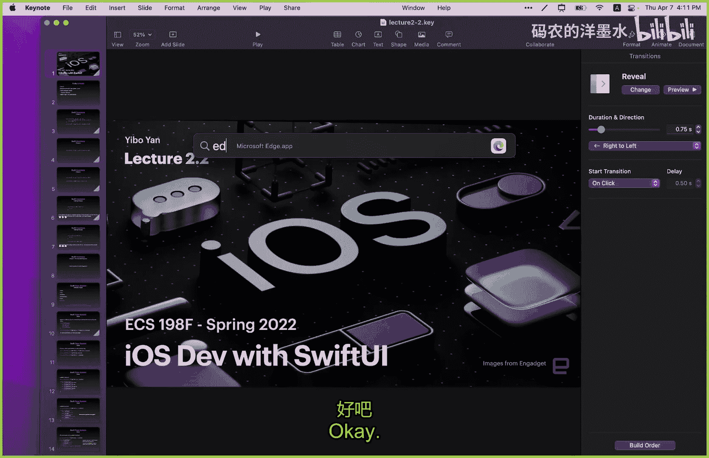
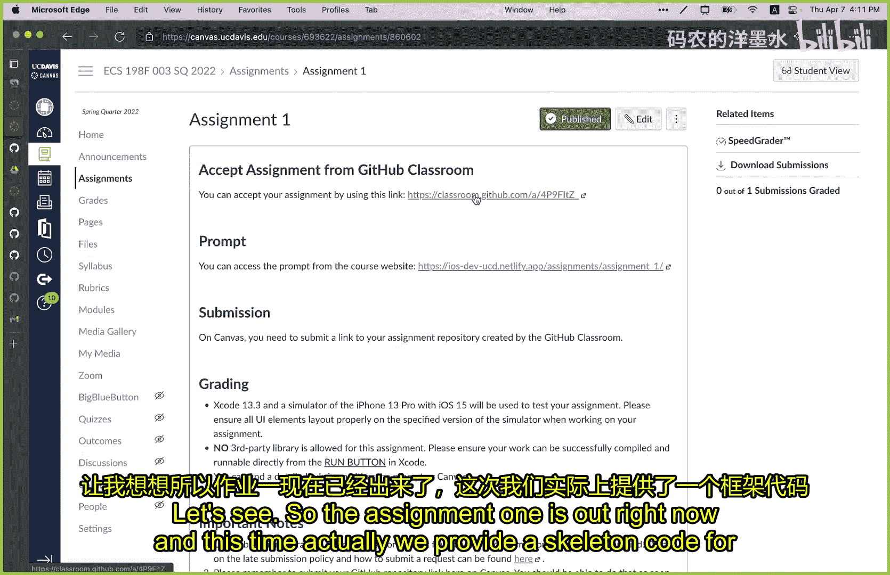
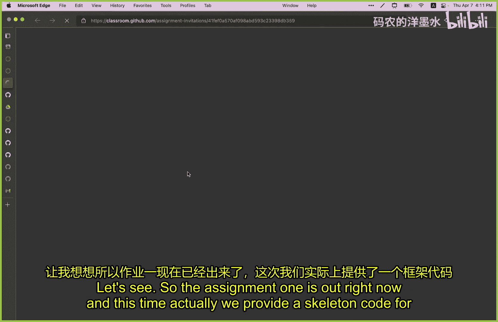
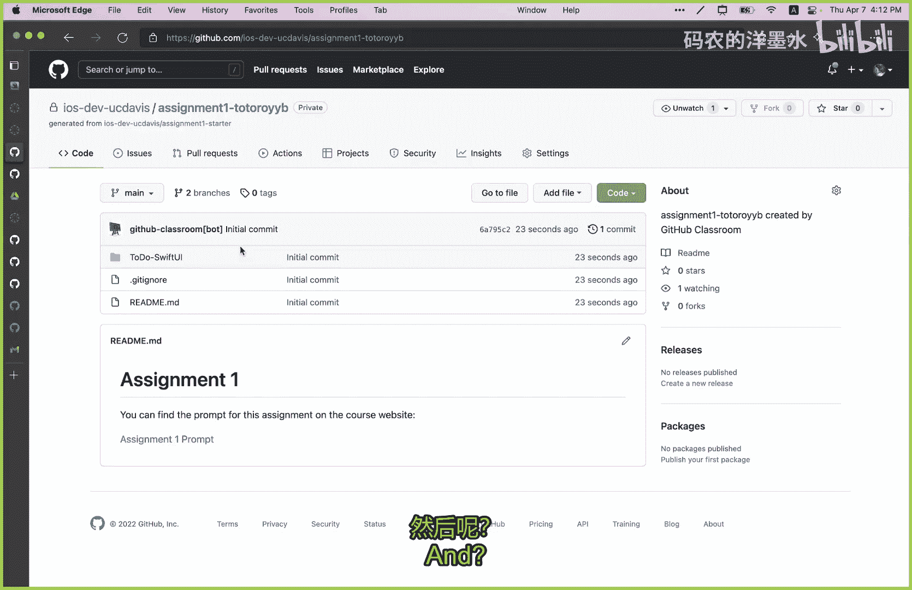
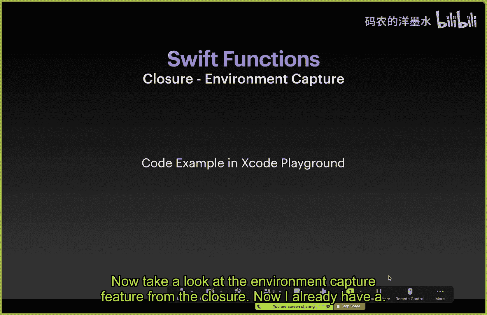
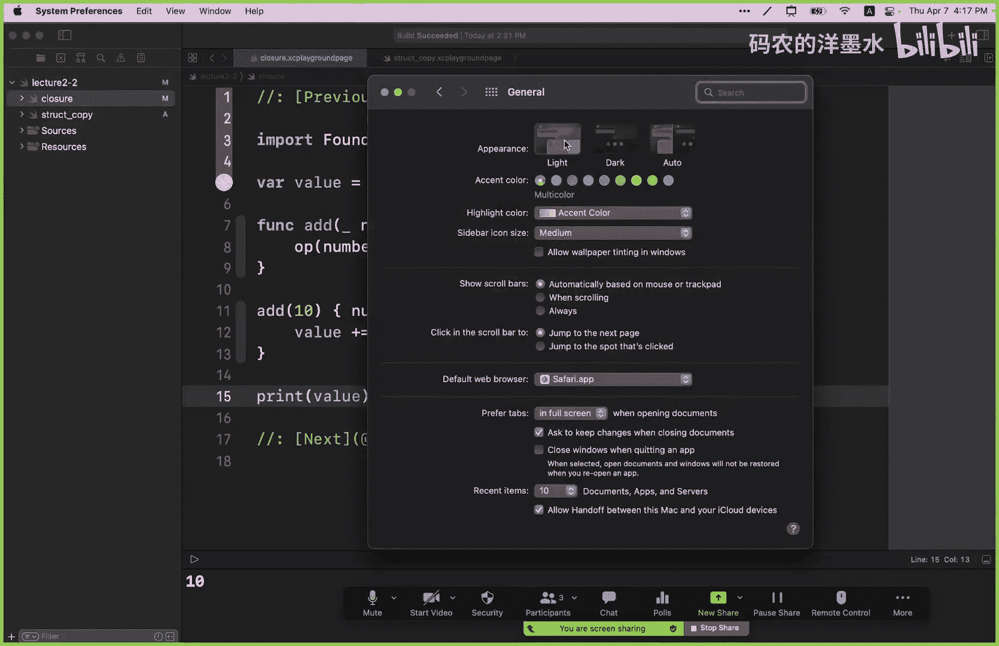
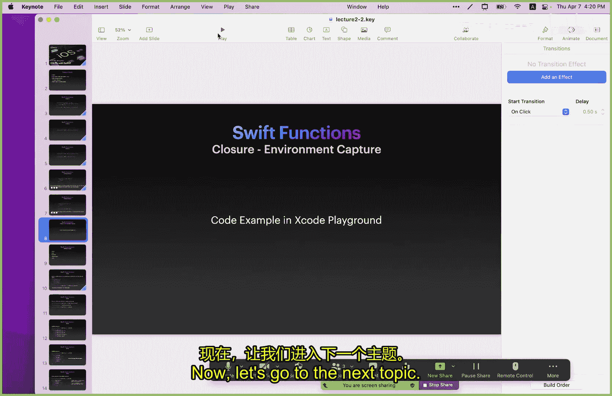
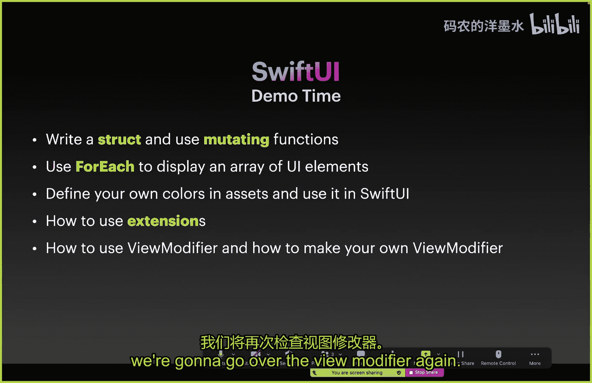
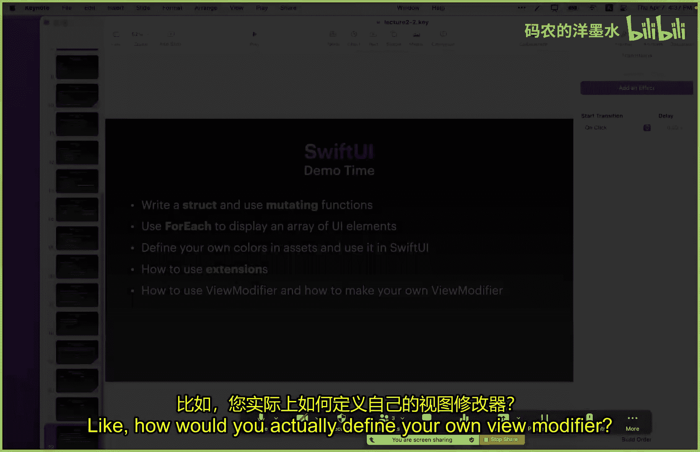
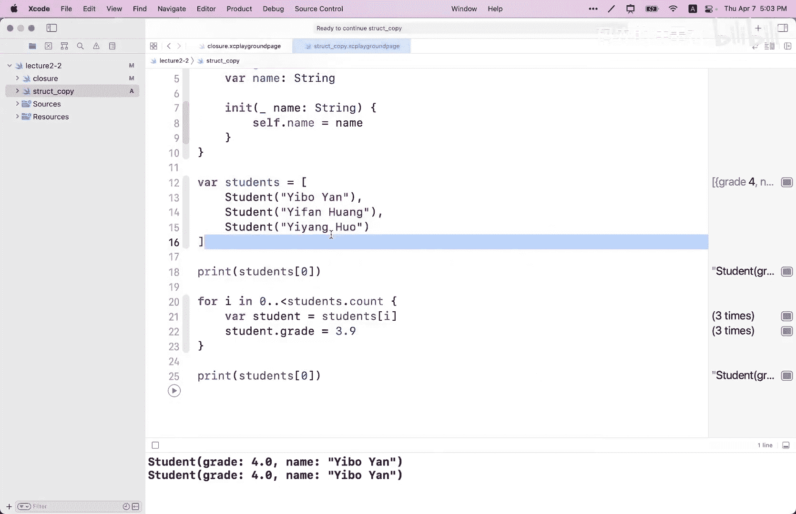

# 004：枚举、闭包与属性观察器









在本节课中，我们将学习Swift语言中的几个核心概念：闭包、枚举和属性观察器。我们将通过实例演示如何简化闭包语法，如何使用枚举表示离散状态，以及如何利用属性观察器响应属性值的变化。课程最后，我们将通过一个创建`ReminderGroup`结构体的实战演示，来巩固这些知识。

## 闭包

上一节我们介绍了函数，本节中我们来看看闭包。闭包是自包含的代码块，可以在代码中被传递和使用。Swift中的闭包语法非常灵活，提供了多种简化方式。

### 简化闭包语法

以下是一个计算函数，它接受两个整数和一个操作闭包作为参数。

```swift
func calculate(_ a: Int, _ b: Int, op: (Int, Int) -> Int) -> Int {
    return op(a, b)
}
```



我们可以通过以下步骤简化闭包调用：



1.  **省略`return`关键字**：当闭包体只有一行返回值的代码时，可以省略`return`。
2.  **尾随闭包**：如果闭包是函数的最后一个参数，可以将其写在函数调用括号之后。
3.  **参数名称缩写**：Swift自动为内联闭包提供参数名称缩写，如`$0`、`$1`，分别代表第一个和第二个参数。

简化后的调用如下：

```swift
let result = calculate(5, 3) { $0 + $1 }
```

### 捕获环境值




闭包可以捕获并存储其所在上下文中的任何常量和变量的引用。这意味着闭包可以访问和修改这些值，即使定义这些值的原作用域已经不存在。

```swift
var value = 0

func add(_ number: Int, op: (Int) -> Void) {
    op(number)
}

add(10) { number in
    value += number
}
print(value) // 输出：10
```

在上面的例子中，闭包捕获了外部变量`value`并修改了它的值。

## 枚举

枚举定义了一个通用类型的一组相关值，使你可以在代码中以类型安全的方式使用这些值。

### 定义与使用

以下是一个表示航班状态的枚举：

```swift
enum FlightStatus {
    case canceled
    case delayed
    case onSchedule
    case tookOff
}
```

你可以这样使用它：

```swift
var currentStatus: FlightStatus = .canceled
```

### 使用`switch`语句匹配枚举值

你可以使用`switch`语句来匹配不同的枚举值。Swift中的`switch`语句不会自动贯穿，每个`case`后隐含了`break`。

```swift
switch currentStatus {
case .canceled:
    print("航班已取消")
case .delayed:
    print("航班延误")
case .onSchedule:
    print("航班准点")
case .tookOff:
    print("航班已起飞")
}
```

### 关联值

枚举成员可以关联任意类型的值，这个特性使得枚举可以存储额外的定制信息。

以下是带有关联值的枚举声明：

```swift
enum FlightStatus {
    case canceled(reason: String)
    case delayed(minutes: Int)
    case onSchedule
}
```

创建带有关联值的枚举实例：

```swift
let status = FlightStatus.canceled(reason: "机械故障")
```

使用`switch`语句提取关联值：

```swift
switch status {
case .canceled(let reason):
    print("取消原因：\(reason)")
case .delayed(let minutes):
    print("延误\(minutes)分钟")
case .onSchedule:
    print("准点")
}
```





### 遍历所有枚举值

通过遵循`CaseIterable`协议，可以轻松获取枚举的所有情况。

```swift
enum CompassDirection: CaseIterable {
    case north, south, east, west
}

for direction in CompassDirection.allCases {
    print(direction)
}
```

## 属性观察器

属性观察器监控和响应属性值的变化。每次属性被设置新值时都会调用它们，即使新值与当前值相同。

### `willSet` 与 `didSet`

Swift提供了两个属性观察器：
*   `willSet`：在值被存储之前调用。
*   `didSet`：在新值被存储之后立即调用。

以下是使用属性观察器的示例：

```swift
var number: Int = 5 {
    willSet {
        print("即将把值从 \(number) 设置为 \(newValue)")
    }
    didSet {
        print("已经将值从 \(oldValue) 更改为 \(number)")
    }
}

number = 10
// 输出：
// 即将把值从 5 设置为 10
// 已经将值从 5 更改为 10
```

在`willSet`中，可以使用默认参数`newValue`访问即将设置的新值。在`didSet`中，可以使用默认参数`oldValue`访问属性修改前的旧值。

## 实战：创建`ReminderGroup`结构体

现在，让我们将所学知识应用于实践，创建一个表示提醒事项组的结构体。

### 定义结构体

我们创建一个`ReminderGroup`结构体，包含名称、提醒事项ID数组和标签颜色。

```swift
import SwiftUI

struct ReminderGroup {
    var name: String = "未命名分组"
    var reminderIDs: [UUID] = []
    var labelColor: Color = .blue

    // 自定义初始化方法
    init(name: String) {
        self.name = name
    }

    // 修改名称的变异方法
    mutating func changeName(to name: String) {
        self.name = name
    }

    // 修改标签颜色的变异方法
    mutating func changeLabelColor(to color: Color) {
        self.labelColor = color
    }
}
```

**关键点**：
*   在Swift中，结构体是值类型，默认不可变。
*   若要修改结构体内部的属性，需要在方法前加上`mutating`关键字。编译器会为此生成一个新实例并替换旧实例。

### 在视图中使用结构体

我们可以在SwiftUI视图中使用这个结构体。

```swift
struct GroupCardView: View {
    @State private var reminderGroup: ReminderGroup

    // 初始化视图时创建ReminderGroup
    init(name: String) {
        _reminderGroup = State(initialValue: ReminderGroup(name: name))
    }

    // 计算属性，简化对结构体属性的访问
    var groupName: String {
        reminderGroup.name
    }

    var labelColor: Color {
        reminderGroup.labelColor
    }

    var body: some View {
        VStack {
            Text(groupName)
                .foregroundColor(labelColor)
            Button("更改颜色") {
                // 调用变异方法修改颜色
                reminderGroup.changeLabelColor(to: .random())
            }
        }
    }
}
```

### 添加自定义颜色

你可以在Xcode的`Assets.xcassets`资源目录中添加自定义颜色集，并在代码中通过名称使用它们。

1.  在`Assets.xcassets`中点击"+"，选择"Color Set"。
2.  为其命名，例如"CardBackground"。
3.  在属性检查器中，为"Any Appearance"和"Dark Appearance"分别设置颜色值。
4.  在代码中使用：`Color("CardBackground")`。

## 关于值类型的注意事项

最后，我们回顾一个关于值类型的重要概念。由于结构体是值类型，当你通过索引访问数组中的结构体元素并修改其副本时，并不会改变数组中的原始元素。

```swift
struct Student {
    var grade: Int
    var name: String
}

var students = [Student(grade: 90, name: "Alice"), Student(grade: 85, name: "Bob")]

// 这种方式不会修改数组中的元素
for student in students {
    var tempStudent = student
    tempStudent.grade = 100 // 只修改了临时副本
}

print(students[0].grade) // 输出仍然是 90

// 正确的方式：通过索引直接修改数组中的元素
for index in students.indices {
    students[index].grade = 100
}

print(students[0].grade) // 输出现在是 100
```

---



本节课中我们一起学习了Swift中的闭包简化语法、枚举的定义与关联值使用，以及如何通过属性观察器`willSet`和`didSet`来响应属性变化。最后，我们通过创建`ReminderGroup`结构体的实战练习，巩固了结构体、变异方法以及在SwiftUI视图中管理状态的知识。理解值类型和引用类型的区别对于编写正确的Swift代码至关重要。