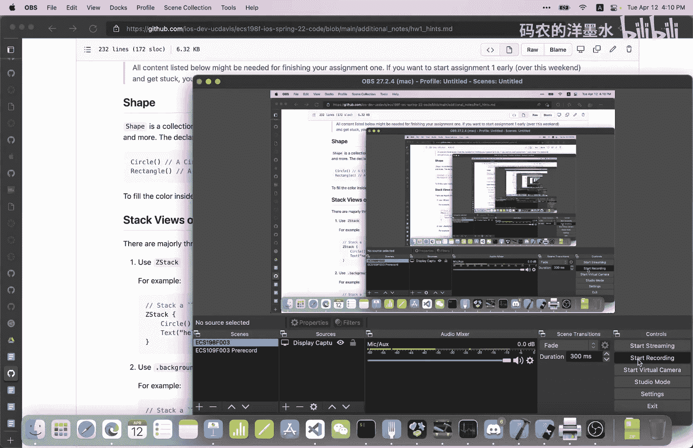
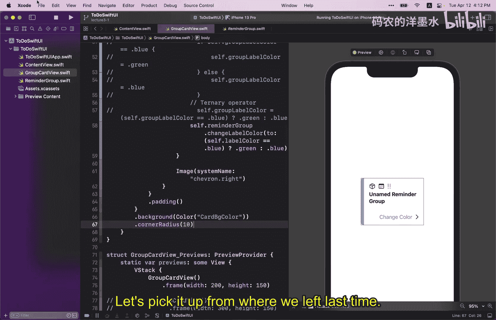
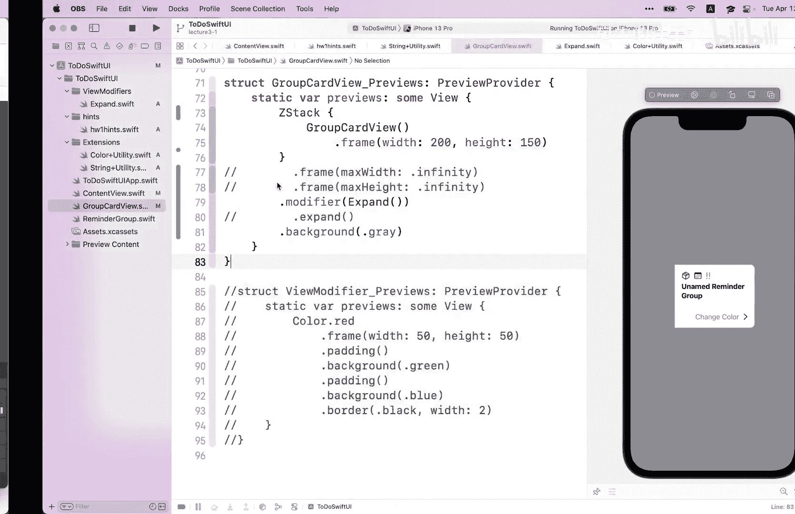

# 005：扩展与视图修饰器 🛠️





在本节课中，我们将学习 SwiftUI 中的两个重要概念：**扩展** 和 **视图修饰器**。我们将了解如何通过扩展为现有类型添加新功能，以及如何创建和使用自定义的视图修饰器来封装和复用视图样式。

---

## 扩展：为现有类型添加功能

上一节我们介绍了如何构建基本的视图。本节中，我们来看看如何通过 **扩展** 来增强 Swift 标准库中已有类型的功能。

扩展允许我们为现有的类、结构体、枚举或协议添加新的功能，而无需修改其原始源代码。这在 SwiftUI 开发中非常有用，例如，为 `Color` 类型添加自定义的系统颜色。

### 创建颜色扩展

以下是创建 `Color` 扩展的步骤：

1.  创建一个新的 Swift 文件来组织扩展代码。通常的命名约定是 `类型名+功能描述.swift`，例如 `Color+Utility.swift`。
2.  在文件中使用 `extension` 关键字定义扩展。
3.  在扩展中添加新的静态计算属性或方法。

```swift
// 在 Color+Utility.swift 文件中
import SwiftUI

extension Color {
    // 添加一个名为 systemBackground 的静态计算属性
    static var systemBackground: Color {
        // 返回一个自定义颜色，这里示例为白色
        Color(white: 0.95)
    }
}
```

定义完成后，你就可以像使用系统自带颜色一样使用它：`Color.systemBackground`。

### 扩展使类型遵循协议

另一个常见用途是让现有类型遵循某个协议。例如，在使用 `ForEach` 视图时，数据源中的元素需要遵循 `Identifiable` 协议。我们可以通过扩展让 `String` 类型遵循该协议。

```swift
// 在 String+Identifiable.swift 文件中
import SwiftUI

extension String: Identifiable {
    // Identifiable 协议要求一个 id 属性
    public var id: UUID {
        // 为每个字符串生成一个唯一的 UUID 作为标识符
        UUID()
    }
}
```

经过此扩展，`String` 数组就可以直接用于 `ForEach` 视图了。

---

## 构建动态列表视图

了解了扩展的用法后，我们可以利用它来构建更动态的界面。本节我们将学习如何使用 `ForEach` 和 `ScrollView` 创建一个可滚动的列表。

`ForEach` 视图可以遍历一个集合，并为其中的每个元素创建一个视图。它要求集合中的元素是 `Identifiable` 的，这就是我们之前为 `String` 添加扩展的原因。

```swift
struct ContentView: View {
    // 使用闭包初始化器创建一个字符串数组
    let reminderGroupNames: [String] = {
        var names = [String]()
        for i in 0...10 {
            names.append("Group \(i)")
        }
        return names
    }()

    var body: some View {
        // 使用 ScrollView 实现垂直滚动
        ScrollView {
            // 遍历数组，为每个字符串创建一个 GroupCardView
            ForEach(reminderGroupNames) { name in
                GroupCardView(name: name)
                    .padding(.horizontal)
            }
        }
        .background(Color.gray) // 为滚动视图添加背景色
    }
}
```

---

## 视图修饰器：封装与复用视图样式

在 SwiftUI 中，我们通过链式调用视图修饰器（如 `.padding()`、`.background()`）来修改视图。为了代码的整洁和复用，我们可以创建自定义的视图修饰器。

### 创建自定义视图修饰器

要创建自定义视图修饰器，需要定义一个遵循 `ViewModifier` 协议的结构体。该协议要求实现一个 `body` 方法，该方法接收一个 `Content`（即被修饰的视图），并返回应用了修改后的新视图。

例如，创建一个让视图在水平和垂直方向上都尽可能扩展的修饰器：

```swift
// 在 ExpandViewModifier.swift 文件中
import SwiftUI

struct Expand: ViewModifier {
    func body(content: Content) -> some View {
        content
            .frame(maxWidth: .infinity, maxHeight: .infinity)
    }
}
```

### 使用自定义修饰器

定义好后，可以通过 `.modifier()` 方法来使用它：

```swift
struct SomeView: View {
    var body: some View {
        Text("Hello, World!")
            .modifier(Expand()) // 应用自定义的 Expand 修饰器
            .background(Color.red)
    }
}
```

为了获得更原生、更简洁的调用方式（如 `.expand()`），我们将在后续课程中介绍如何通过进一步的扩展来实现。

---

## 其他实用技巧

在结束之前，这里还有一些有助于完成作业的实用技巧：

### 使用形状（Shapes）

SwiftUI 提供了多种内置形状，如 `Rectangle`、`Circle`、`RoundedRectangle` 等。它们本身也是视图，可以使用 `.fill()` 修饰器来设置颜色。

```swift
Circle()
    .fill(Color.red) // 用红色填充圆形
    .frame(width: 100, height: 100)
```

### 布局叠加的三种方式

以下是三种将视图叠加在一起的方法：

1.  **ZStack**：沿 Z 轴（垂直于屏幕的方向）叠加视图。
    ```swift
    ZStack {
        Rectangle().fill(Color.blue)
        Circle().fill(Color.red)
    }
    ```
2.  **.background()**：为主视图添加一个背景视图。
    ```swift
    Circle()
        .fill(Color.red)
        .background(
            Rectangle().fill(Color.blue)
        )
    ```
3.  **.overlay()**：在主视图之上添加一个覆盖视图。
    ```swift
    Rectangle()
        .fill(Color.blue)
        .overlay(
            Circle().fill(Color.red)
        )
    ```

### 条件渲染与三元运算符

你可以在视图构建代码中直接使用 Swift 的条件语句（`if-else`、`switch`）或三元运算符来进行条件渲染。

```swift
@State private var isOn = false

var body: some View {
    VStack {
        // 使用 if-else
        if isOn {
            Image(systemName: "lightbulb.fill")
        } else {
            Image(systemName: "lightbulb")
        }

        // 使用三元运算符在修饰器中
        Image(systemName: "star")
            .foregroundColor(isOn ? .yellow : .gray)

        // 点击切换状态
        Button("Toggle") {
            isOn.toggle()
        }
    }
}
```

### 添加点击手势

即使不是 `Button`，也可以使用 `.onTapGesture` 修饰器为任何视图添加点击交互。

```swift
Image(systemName: "heart")
    .onTapGesture {
        print("Image was tapped!")
    }
```

### 调整图片尺寸

默认情况下，`Image` 视图不会自动缩放以填充其框架。需要使用 `.resizable()` 修饰器使其可调整大小。

```swift
Image(systemName: "gear")
    .resizable() // 使图片可调整大小
    .frame(width: 50, height: 50) // 然后设置框架
```

---

## 总结



本节课中我们一起学习了 SwiftUI 中的两个核心概念：**扩展** 和 **视图修饰器**。我们掌握了如何通过扩展为 `Color`、`String` 等现有类型添加自定义功能，以及如何创建 `ViewModifier` 来封装和复用视图样式逻辑。此外，我们还探讨了构建动态列表、使用形状、多种布局叠加方式、条件渲染和手势处理等实用技巧，这些知识将帮助你更高效地构建 SwiftUI 应用并完成相关作业。