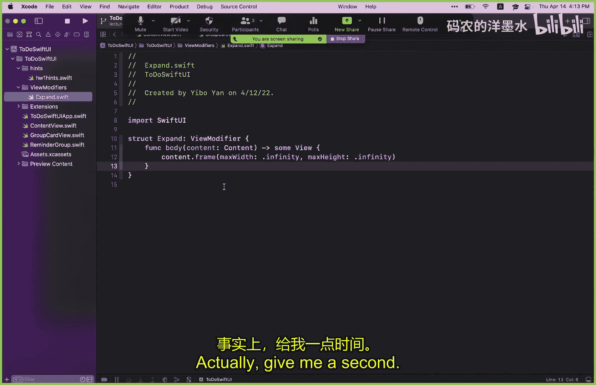
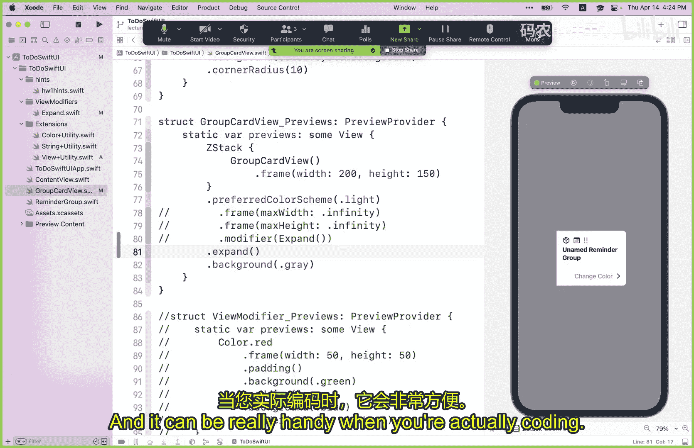
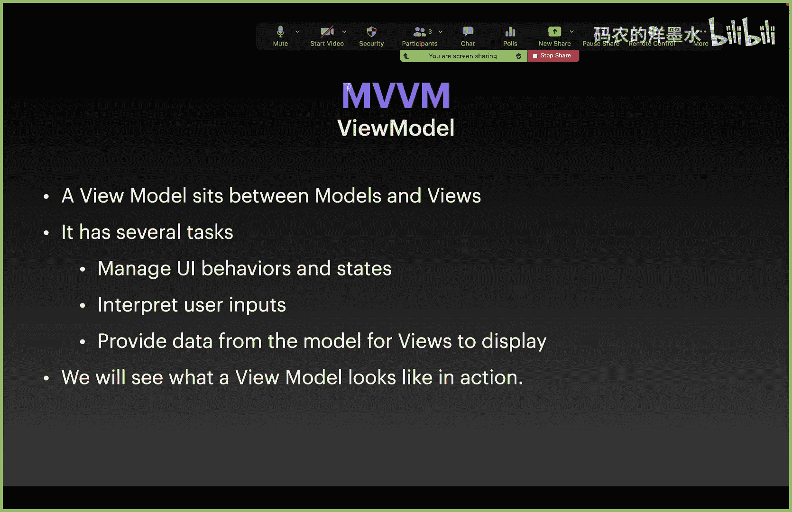
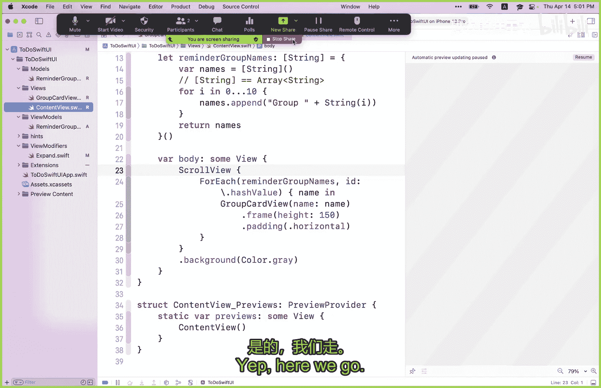
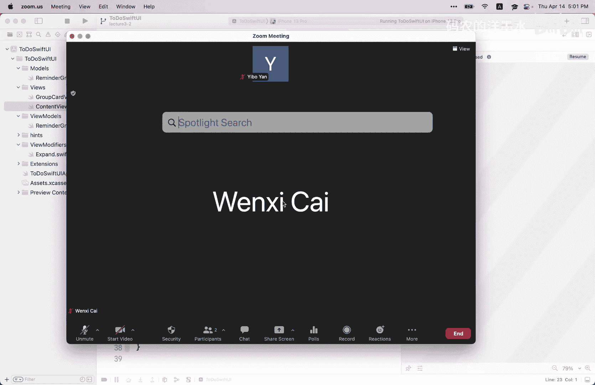

# 006：协议与MVVM入门



在本节课中，我们将要学习Swift中的协议（Protocol）以及一个重要的架构设计模式——MVVM（Model-View-ViewModel）。我们将从自定义视图修饰符开始，逐步深入到协议的定义与使用，最后学习如何将MVVM模式应用到我们的项目中，以更好地组织代码。

## 自定义视图修饰符进阶

上一节我们介绍了如何定义一个简单的自定义视图修饰符。本节中，我们来看看如何让它变得更灵活。

我们之前定义的 `expand` 修饰符会同时向水平和垂直方向扩展视图。现在，我们希望它能根据需求只向特定方向扩展。

首先，我们修改 `Expand` 结构体，为其添加两个布尔属性来控制扩展方向。

```swift
struct Expand: ViewModifier {
    var horizontal: Bool = true
    var vertical: Bool = true

    func body(content: Content) -> some View {
        content
            .frame(maxWidth: horizontal ? .infinity : nil,
                   maxHeight: vertical ? .infinity : nil)
    }
}
```

这里使用了三元运算符。如果 `horizontal` 为 `true`，则 `maxWidth` 设为 `.infinity`（无限大），否则设为 `nil`，表示使用视图的默认尺寸。垂直方向同理。

为了使调用更清晰，我们可以定义一个枚举来表示扩展方向。

```swift
enum ExpandDirection {
    case horizontal
    case vertical
    case all
}
```

然后，为 `Expand` 结构体创建一个接受 `ExpandDirection` 参数的构造器。

```swift
init(direction: ExpandDirection = .all) {
    switch direction {
    case .horizontal:
        self.horizontal = true
        self.vertical = false
    case .vertical:
        self.horizontal = false
        self.vertical = true
    case .all:
        self.horizontal = true
        self.vertical = true
    }
}
```

现在，我们可以这样使用它：`view.modifier(Expand(direction: .vertical))`。



为了让语法更接近SwiftUI原生风格（如 `.background()`），我们可以通过扩展 `View` 协议来创建一个便捷方法。

```swift
extension View {
    func expand(direction: ExpandDirection = .all) -> some View {
        self.modifier(Expand(direction: direction))
    }
}
```

现在，我们可以直接在视图上调用 `.expand(.vertical)`，代码更加简洁直观。

## 理解协议（Protocol）

协议是Swift类型系统的核心。它定义了一组属性、方法或其他要求的蓝图。类、结构体或枚举可以通过遵循（conform to）协议来满足这些要求。

### 定义与遵循协议

以下是一个定义协议的示例：

```swift
protocol Greetable {
    func greet()
    func greet(with sentence: String)
}
```

任何遵循 `Greetable` 协议的类型都必须实现这两个方法。

```swift
class Student: Greetable {
    func greet() {
        print("Student says hello.")
    }
    func greet(with sentence: String) {
        print(sentence)
    }
}
```

### 协议中的属性与关联类型

协议可以要求遵循的类型提供特定名称和类型的属性。

```swift
protocol Greetable {
    var greeter: String { get }
    func greet()
}
```

这里的 `{ get }` 表示该属性必须是可读的（gettable）。如果写成 `{ get set }`，则表示属性必须是可读可写的（gettable and settable），这会限制遵循的类型不能使用常量（`let`）或只读计算属性。

当希望协议中的某个属性或类型是泛型时，我们使用**关联类型**。

```swift
protocol Greetable {
    associatedtype Greeter
    var greeter: Greeter { get }
    func greet()
}
```

现在，遵循协议的类型可以自己决定 `greeter` 属性的具体类型（如 `String`, `Int` 等）。

### 提供协议默认实现

有时，我们希望为协议中的某些方法提供默认实现，以避免重复代码。这需要通过扩展协议来实现。

```swift
extension Greetable {
    func greet() {
        print("\(greeter) says hello!")
    }
    func greet(with sentence: String) {
        print(sentence)
    }
}
```

当一个类型遵循该协议时，如果它没有自己实现这些方法，就会自动使用协议扩展中的默认实现。

## 架构模式：MVVM入门

随着应用规模增长，良好的代码组织结构变得至关重要。MVVM（Model-View-ViewModel）是一种广泛用于SwiftUI的架构设计模式，它有助于分离关注点，使代码更易于维护和测试。

### MVVM的核心概念



MVVM将应用分为三个主要部分：
*   **Model（模型）**：代表数据和业务逻辑。例如，我们之前定义的 `ReminderGroup` 和 `Reminder` 结构体。
*   **View（视图）**：负责用户界面（UI）的展示和布局。所有SwiftUI的 `View` 都属于这一层。
*   **ViewModel（视图模型）**：作为 `View` 和 `Model` 之间的桥梁。它从 `Model` 获取数据，处理用户输入，并准备好数据供 `View` 显示。

它们之间的通信关系是：
1.  **View → ViewModel**：当用户与界面交互（如点击按钮）时，`View` 会调用 `ViewModel` 中定义的方法。
2.  **ViewModel → Model**：`ViewModel` 执行方法，可能会修改底层的数据（`Model`）。
3.  **Model → ViewModel → View**：当 `Model` 的数据发生变化时，`ViewModel` 会接收到通知，然后触发 `View` 更新其界面。

### 在项目中实践MVVM

让我们重构之前的代码，引入 `ViewModel`。

首先，在项目中创建 `Models`、`Views` 和 `ViewModels` 三个文件夹，将对应的文件归类。

**1. 创建 ViewModel**

为 `ReminderGroup` 创建一个对应的 ViewModel。

```swift
// ReminderGroupViewModel.swift
import SwiftUI

class ReminderGroupViewModel: ObservableObject {
    @Published var reminderGroup: ReminderGroup

    init(name: String = "Default Group") {
        self.reminderGroup = ReminderGroup(name: name)
    }

    var labelColor: Color {
        reminderGroup.labelColor
    }

    var name: String {
        reminderGroup.name
    }

    func changeLabelColor() {
        reminderGroup.changeLabelColor()
    }
}
```

注意两个关键点：
*   `ObservableObject`：这是一个协议，允许类的实例被SwiftUI视图观察。当它的 `@Published` 属性发生变化时，所有观察它的视图都会收到通知并更新。
*   `@Published`：这个属性包装器用于标记那些当其值改变时需要通知视图的属性。这里，`reminderGroup` 被标记为 `@Published`。

**2. 修改 View 以使用 ViewModel**

现在，修改 `GroupCardView`，让它依赖于 `ReminderGroupViewModel` 而不是直接的 `ReminderGroup`。

```swift
struct GroupCardView: View {
    @ObservedObject var viewModel: ReminderGroupViewModel

    init(viewModel: ReminderGroupViewModel = ReminderGroupViewModel()) {
        self.viewModel = viewModel
    }

    var body: some View {
        HStack {
            Text(viewModel.name)
                .font(.headline)
            Spacer()
            Circle()
                .fill(viewModel.labelColor)
                .frame(width: 20, height: 20)
        }
        .padding()
        .background(Color.gray.opacity(0.1))
        .cornerRadius(10)
        .onTapGesture {
            viewModel.changeLabelColor()
        }
    }
}
```

关键修改：
*   `@ObservedObject`：这个属性包装器告诉SwiftUI，这个视图需要观察 `ReminderGroupViewModel` 实例的变化。当 `ViewModel` 中 `@Published` 的属性（即 `reminderGroup`）改变时，这个视图会重新计算 `body`。
*   所有对 `reminderGroup` 的直接访问（如 `reminderGroup.name`）都改为通过 `viewModel` 的相应属性（如 `viewModel.name`）或方法（如 `viewModel.changeLabelColor()`）来访问。

通过这样的重构，`View` 不再直接操作 `Model`。所有的业务逻辑和数据转换都集中在 `ViewModel` 中。这使得 `View` 保持简洁，只专注于UI；`Model` 保持纯净，只关注数据；而 `ViewModel` 负责协调两者。这种分离大大提高了代码的可测试性和可维护性。

## 总结

本节课中我们一起学习了两个重要主题。首先，我们深入探讨了**协议**，学习了如何定义协议、要求属性和方法、使用关联类型以及通过扩展提供默认实现。协议是Swift实现多态和构建灵活架构的基石。





接着，我们引入了**MVVM架构模式**。我们了解了Model、View和ViewModel各自的职责，并通过实践将项目重构为MVVM结构。我们学习了 `ObservableObject`、`@Published` 和 `@ObservedObject` 这些关键工具，它们共同协作，实现了数据变化时UI的自动响应更新。掌握MVVM是构建复杂、可维护SwiftUI应用的关键一步。