# 007：导航与动画实践 🧭✨

在本节课中，我们将要学习SwiftUI中的两个核心主题：**导航**与**动画**。我们将了解如何在不同视图之间进行切换，以及如何为应用添加流畅的动画效果。课程内容将涵盖计算变量的getter和setter、导航视图与链接的使用，以及两种主要的动画实现方式。

## 计算变量的Getter与Setter 🔢

上一节我们介绍了计算变量的基本概念。本节中我们来看看如何为计算变量定义可读写的getter和setter。

到目前为止，我们所见过的计算变量都是只读的。这意味着我们只能读取它的值，而不能给它赋值。实际上，只读计算变量隐式地定义了一个getter。Getter定义了当我们访问这个计算变量时，其值应如何计算。

例如，我们有一个`Circle`类，它有一个存储属性`radius`和一个计算属性`parameter`（周长）。

```swift
class Circle {
    var radius: Double = 0.0
    var parameter: Double {
        return 2 * .pi * radius
    }
}
```

上面的代码等价于显式地定义一个getter：

```swift
class Circle {
    var radius: Double = 0.0
    var parameter: Double {
        get {
            return 2 * .pi * radius
        }
    }
}
```

现在，让我们看看setter。我们可以为计算变量显式定义一个setter，它定义了当我们给这个变量赋值时应执行的操作。

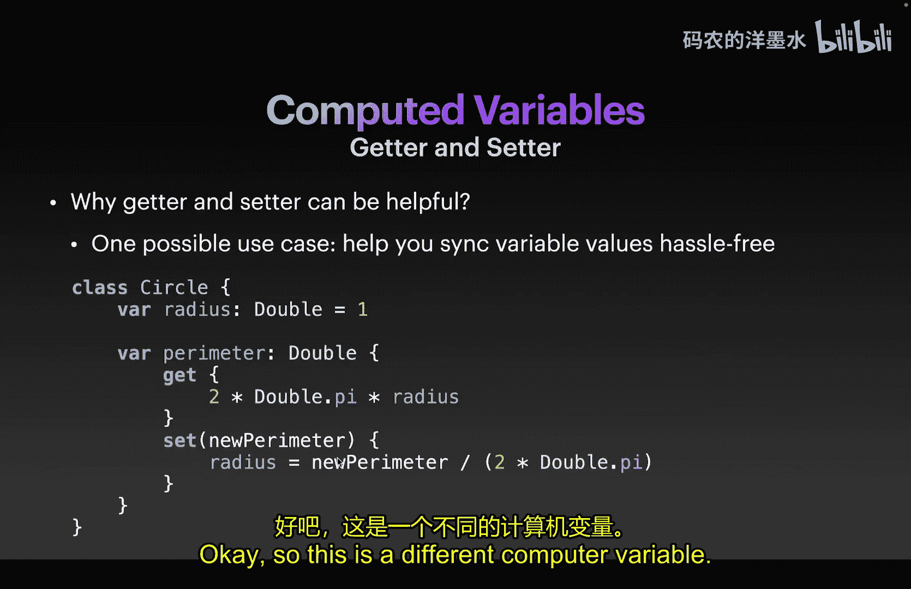

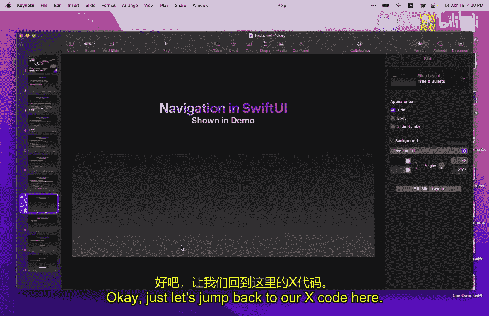

```swift
class Circle {
    var radius: Double = 0.0
    var parameter: Double {
        get {
            return 2 * .pi * radius
        }
        set(newParameter) {
            radius = newParameter / (2 * .pi)
        }
    }
}
```

在setter的代码块中，我们可以使用`newValue`这个默认参数名来代表将要赋予的新值。你也可以自定义参数名，例如`set(newParameter)`。

使用带有getter和setter的计算变量可以帮助我们以无负担的方式同步多个变量的值。例如，如果我们希望`Circle`的`radius`和`parameter`始终保持同步，使用计算属性可以避免在多个函数中手动更新两个值，从而减少出错的可能。

需要注意的是，之前在协议中提到的`get`和`set`关键字，与这里计算变量的getter和setter是不同的概念。在协议中，如果一个属性被声明为`{ get set }`，那么遵循该协议的类型就不能使用只读计算变量来实现它，而必须使用可读写的属性（如存储属性或带有setter的计算属性）。

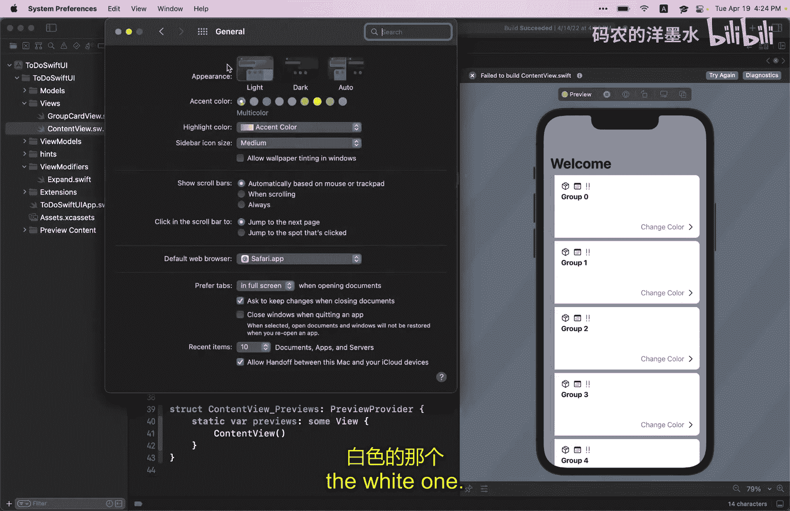

## 导航视图与链接 🧭

了解了计算变量后，我们进入下一个主题：如何在SwiftUI应用中实现视图间的导航。

导航视图（`NavigationView`）是构建层级式界面的基础。通常，我们会将`NavigationView`与`NavigationLink`结合使用。`NavigationView`提供了一个导航栏和堆栈式的视图管理，而`NavigationLink`则充当了触发导航的按钮。

首先，我们来看如何在视图中添加一个`NavigationView`。只需将你的主视图（例如一个`ScrollView`）包裹在`NavigationView`中即可。

```swift
struct SchoolView: View {
    var body: some View {
        NavigationView {
            ScrollView {
                // ... 你的内容
            }
        }
    }
}
```

默认情况下，`NavigationView`顶部会预留一个导航栏的空间。你可以使用`.navigationBarHidden(true)`修饰符来隐藏它。要为导航视图添加标题，需要将`.navigationTitle(_:)`修饰符应用在`NavigationView`内部的视图上，而不是`NavigationView`本身。

```swift
NavigationView {
    ScrollView {
        // ...
    }
    .navigationTitle("我的标题")
}
```

接下来，我们需要让视图能够跳转。这需要使用`NavigationLink`。它接受两个主要参数：`destination`（目标视图）和`label`（链接的标签外观）。

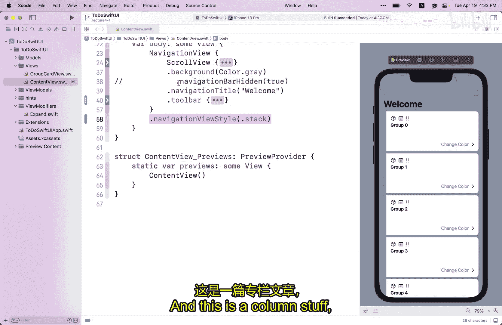

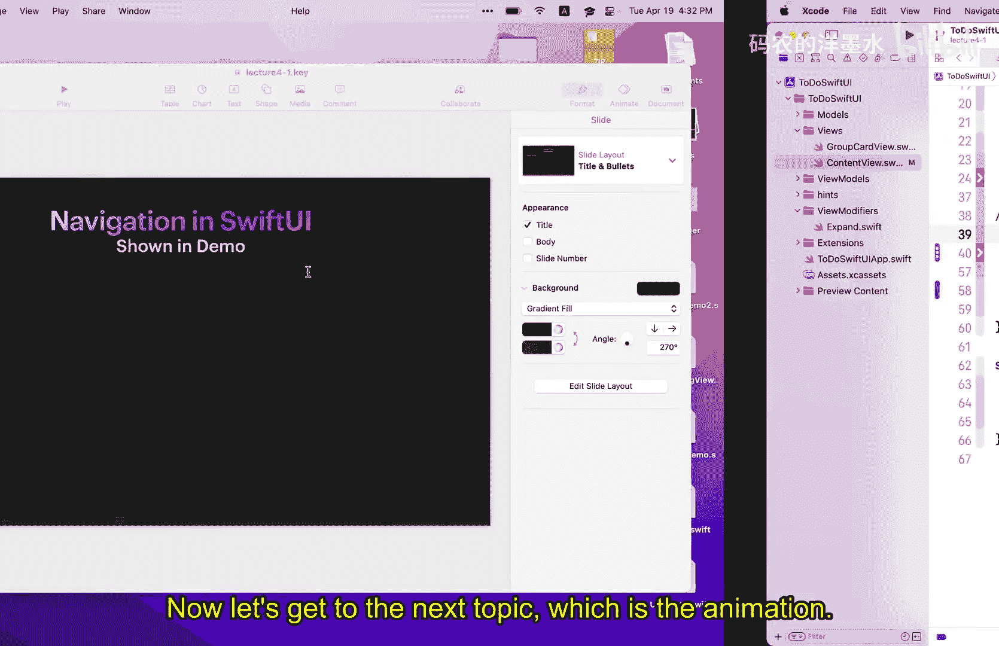

```swift
NavigationLink(destination: Text("详情视图")) {
    GroupCardView(group: group)
}
```

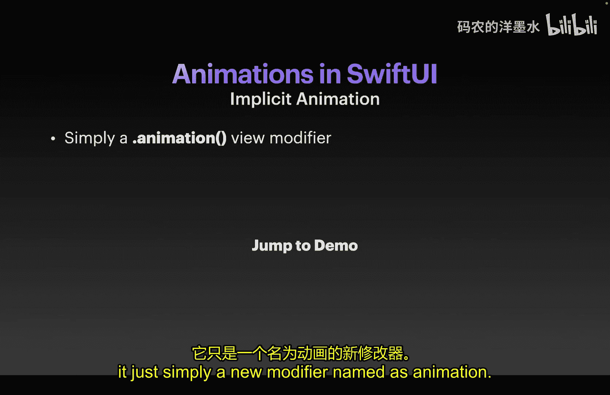

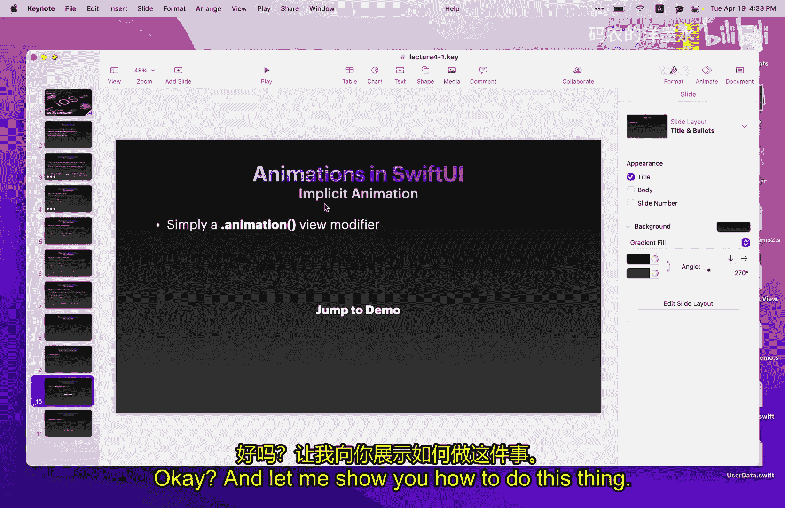

在上面的例子中，当用户点击`GroupCardView`时，应用会导航到一个显示“详情视图”的文本视图。我们同样可以在目标视图中使用`.navigationTitle`来设置其导航栏标题。

有时，我们希望在导航栏的左侧或右侧添加按钮。这可以通过`.toolbar`修饰符和`ToolbarItem`来实现。我们可以指定按钮的位置（`.navigationBarLeading` 或 `.navigationBarTrailing`）。

```swift
.toolbar {
    ToolbarItem(placement: .navigationBarLeading) {
        Button(action: {}) {
            Image(systemName: "square.and.arrow.up")
        }
    }
    ToolbarItem(placement: .navigationBarTrailing) {
        Button(action: {}) {
            Image(systemName: "gearshape")
        }
    }
}
```

最后，关于`NavigationView`的样式，在iPhone上默认是堆栈（`stack`）样式，在iPad上还可以选择列（`columns`）样式。为了避免某些动画错误，建议显式地设置导航视图的样式。

```swift
NavigationView {
    // ...
}
.navigationViewStyle(.stack)
```

## 动画：隐式与显式 ✨

现在，我们进入本节课最有趣的部分：为SwiftUI视图添加动画。SwiftUI主要提供了两种动画方式：隐式动画和显式动画。

### 隐式动画

隐式动画通过`.animation(_:value:)`视图修饰符来实现。你只需要在视图上添加这个修饰符，并指定要观察哪个值的改变。当这个值发生变化时，SwiftUI会自动为视图的状态变化添加动画效果。

```swift
Rectangle()
    .frame(width: width, height: height)
    .animation(.default, value: width)
```

在上面的代码中，当`width`变量改变时，矩形宽度变化的过渡将以默认的线性动画进行。你可以更换不同的动画类型，例如弹性动画：

```swift
.animation(.interpolatingSpring(stiffness: 100, damping: 10), value: scale)
```

需要注意的是，`.animation`修饰符只应用于添加了该修饰符的视图本身。如果要让父视图或兄弟视图也一起动画，需要在它们身上也添加相应的动画修饰符。

### 显式动画

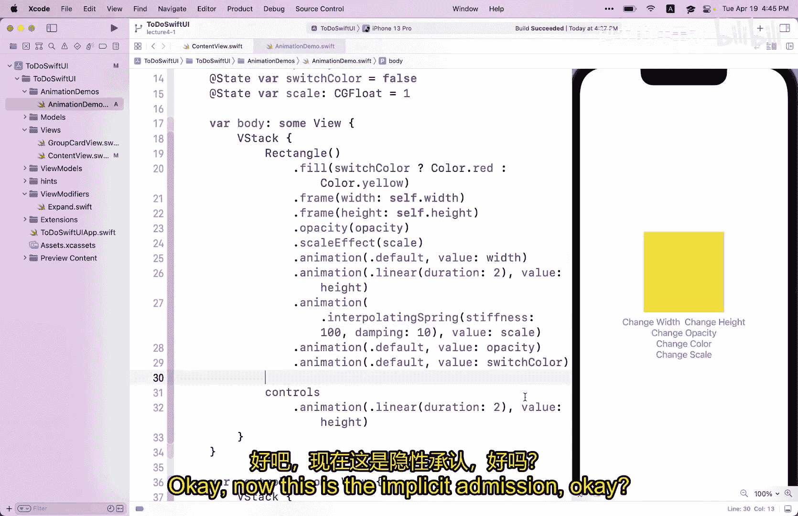


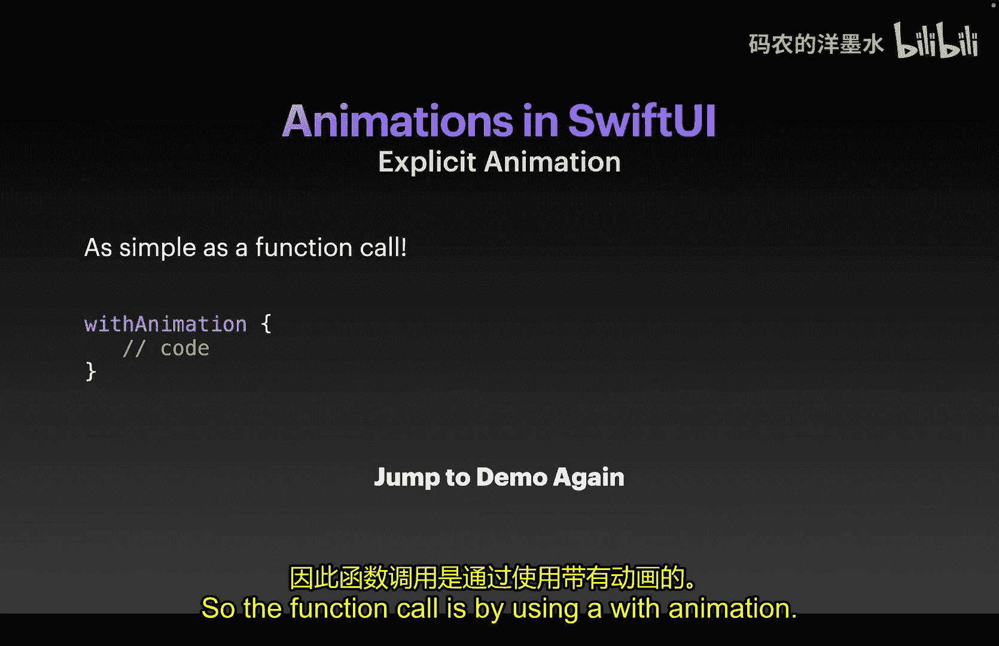

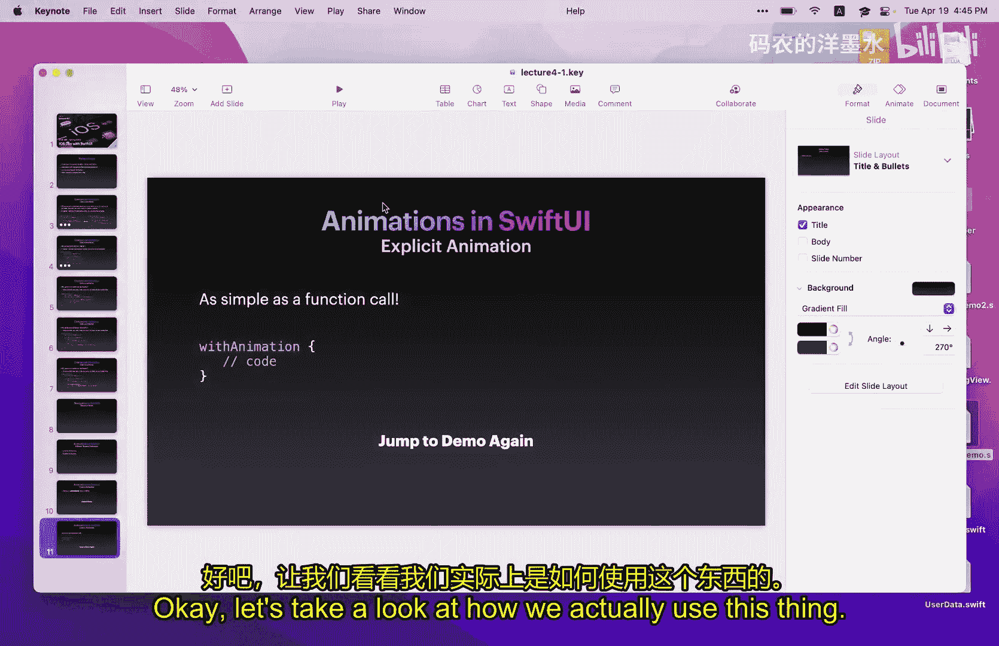

显式动画通过`withAnimation`函数调用来实现。它将你想要执行动画的代码包裹在一个闭包中。这种方式让你可以更精确地控制何时触发动画，并可以添加条件逻辑。

```swift
Button("改变宽度") {
    if width == 300 {
        width = 150 // 没有动画
    } else {
        withAnimation(.default) {
            width = 300 // 有动画
        }
    }
}
```

在上面的例子中，只有当宽度从150增长到300时才会产生动画，而从300缩小到150时则是瞬间完成的。`withAnimation`函数同样可以接受一个动画参数来定义动画的时序曲线。

### 视图过渡的注意事项

无论是隐式还是显式动画，`.animation`修饰符主要适用于那些始终在屏幕上的视图的属性变化（如尺寸、颜色、不透明度）。对于视图的“出现”和“消失”（例如通过`if`语句条件渲染），`.animation`修饰符可能无法直接产生理想的过渡效果。

```swift
// 这种方式可能无法产生出现/消失的动画
if showRectangle {
    Rectangle()
        .animation(.default, value: showRectangle) // 这行可能无效
}
```

要实现视图出现和消失的动画，我们需要使用**视图过渡（View Transition）**，这涉及到`transition`修饰符，我们将在下一节课中详细讨论。

## 实践：创建一个进度环 🎯

让我们结合所学，创建一个带有动画的进度环。这个组件可以直观地展示任务的完成进度。

首先，我们定义一个`ProgressRingView`，它包含进度值、颜色、圆环宽度等属性。

```swift
struct ProgressRingView: View {
    var progress: Double // 0到1之间
    var color: Color = .blue
    var lineWidth: CGFloat = 20

    var body: some View {
        ZStack {
            // 背景环
            Circle()
                .stroke(Color.gray.opacity(0.3), lineWidth: lineWidth)
            // 前景进度环
            Circle()
                .trim(from: 0, to: progress)
                .stroke(color,
                        style: StrokeStyle(lineWidth: lineWidth, lineCap: .round))
                .rotationEffect(.degrees(-90)) // 让进度从顶部开始
                .animation(.default, value: progress) // 添加动画
        }
    }
}
```

在这个视图中，我们使用两个`Circle`形状叠加。一个作为灰色背景环，另一个使用`.trim(from:to:)`修饰符来绘制进度部分，并通过`.rotationEffect`让它从12点钟方向开始填充。最后，我们为`progress`属性添加了`.animation`修饰符，这样当进度值改变时，圆环的填充就会产生平滑的动画效果。

## 总结 📚

本节课中我们一起学习了SwiftUI中导航与动画的核心知识。

*   我们首先深入了解了计算变量的**getter和setter**，明白了如何创建可读写的计算属性来同步数据。
*   接着，我们探索了**导航**系统，学会了使用`NavigationView`搭建框架，用`NavigationLink`创建跳转链接，并用`.toolbar`在导航栏上添加按钮。
*   然后，我们重点研究了**动画**的两种实现方式：通过`.animation`修饰符的**隐式动画**，以及通过`withAnimation`函数包裹代码的**显式动画**。我们了解到隐式动画适用于持续在屏视图的属性变化，而显式动画则提供更精细的控制。
*   最后，我们通过创建一个**动画进度环**的实践，综合运用了形状绘制和动画知识。

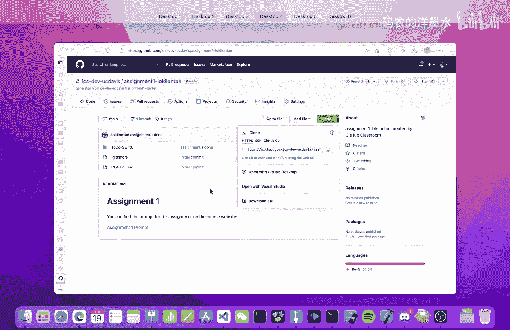

记住，对于视图的进入和退出动画（即视图过渡），我们需要使用`transition`修饰符，这将是下节课的内容。掌握这些导航与动画的基础，你已经能够为你的应用添加丰富的交互和视觉动效了。