# 008：LazyGrid、视图过渡与动画

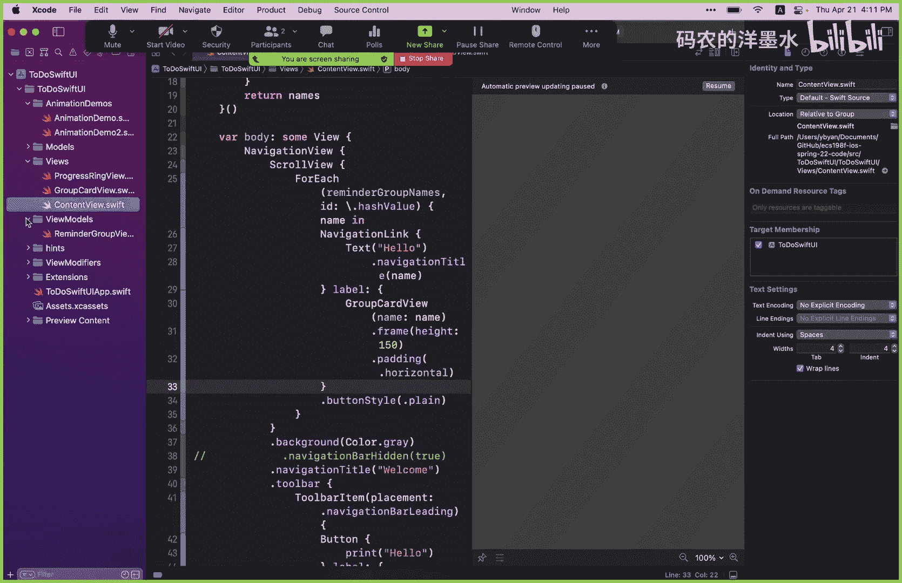

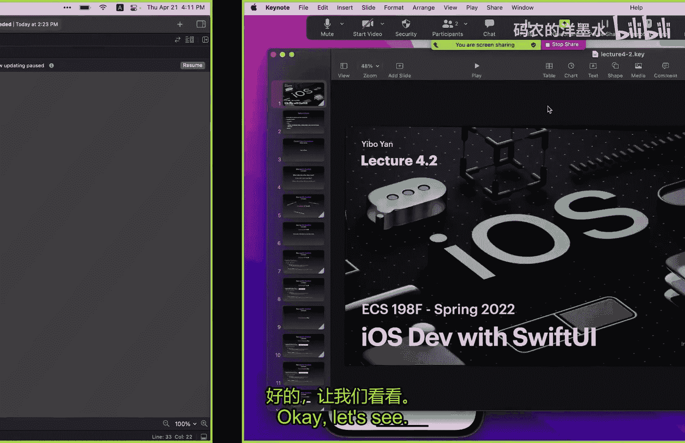

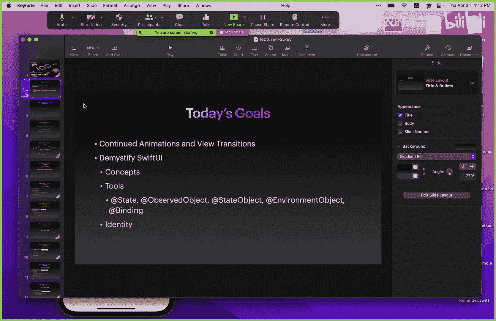

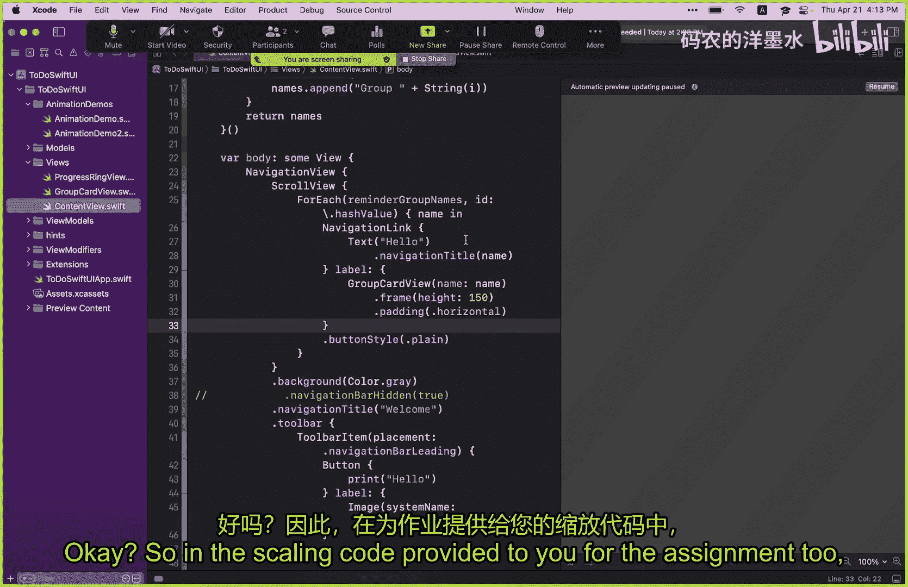

在本节课中，我们将学习如何使用LazyGrid创建网格布局，以及如何为视图的显示和隐藏添加自定义的过渡动画。我们还将初步了解如何在不同视图之间绑定数据。

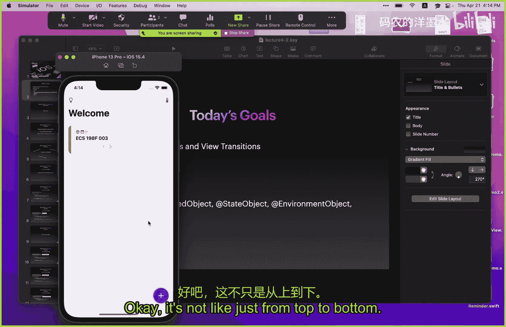

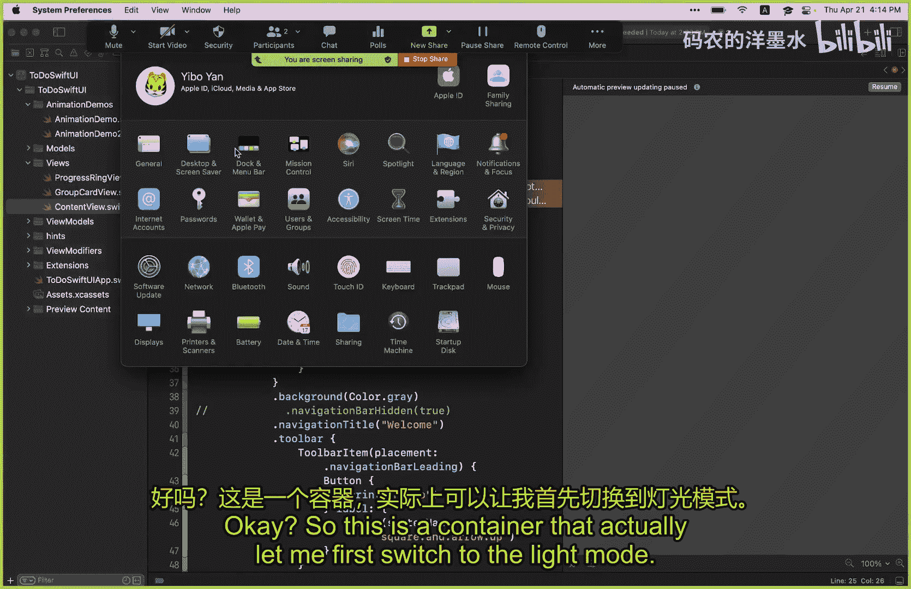

## 概述

上一节我们介绍了基础的动画原理。本节中，我们来看看如何实现更复杂的网格布局和视图过渡效果。我们将创建一个包含浮动按钮和弹出面板的界面，并为其添加流畅的动画。

## 使用LazyGrid创建网格布局

到目前为止，我们看到的视图布局大多是从上到下的简单排列。但在实际应用中，我们经常需要网格布局。SwiftUI提供了`LazyVGrid`和`LazyHGrid`容器来实现这一功能。

`LazyVGrid`会先水平排列项目，当空间不足时自动换行，形成垂直网格。`LazyHGrid`则相反。之所以称为“Lazy”（惰性），是因为它只会创建当前屏幕上可见的视图单元格。当用户滚动时，离开屏幕的视图会被回收并用于显示新的数据，这大大提升了应用性能和响应速度。

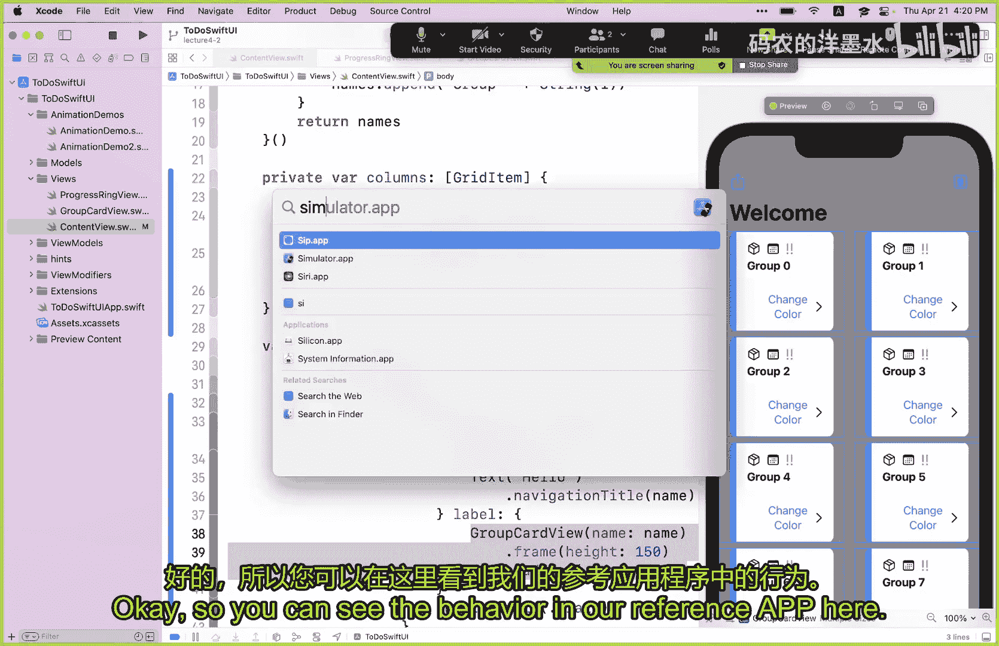

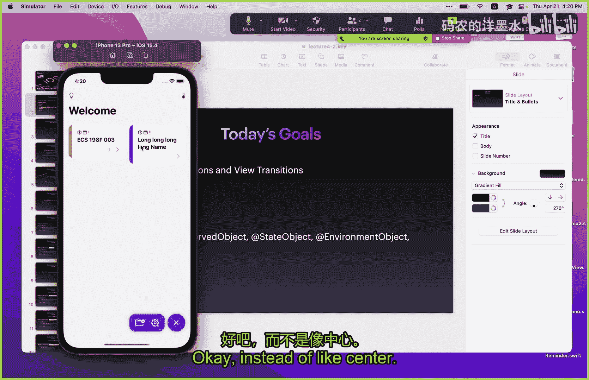

以下是创建一个两列网格布局的步骤：

1.  首先，将你的视图内容（例如一个`ForEach`循环）嵌入到`LazyVGrid`容器中。
2.  `LazyVGrid`需要两个参数：一个定义列布局的`columns`数组，以及视图内容。
3.  `columns`数组由`GridItem`组成。每个`GridItem`定义一列的属性。

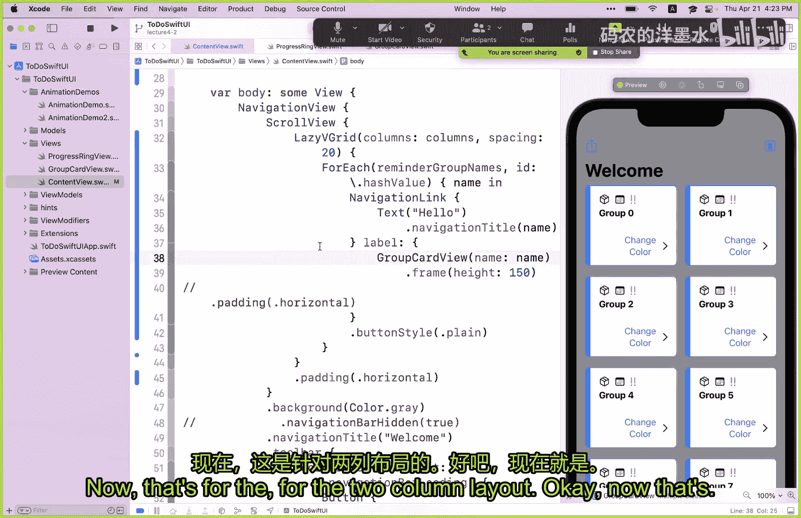

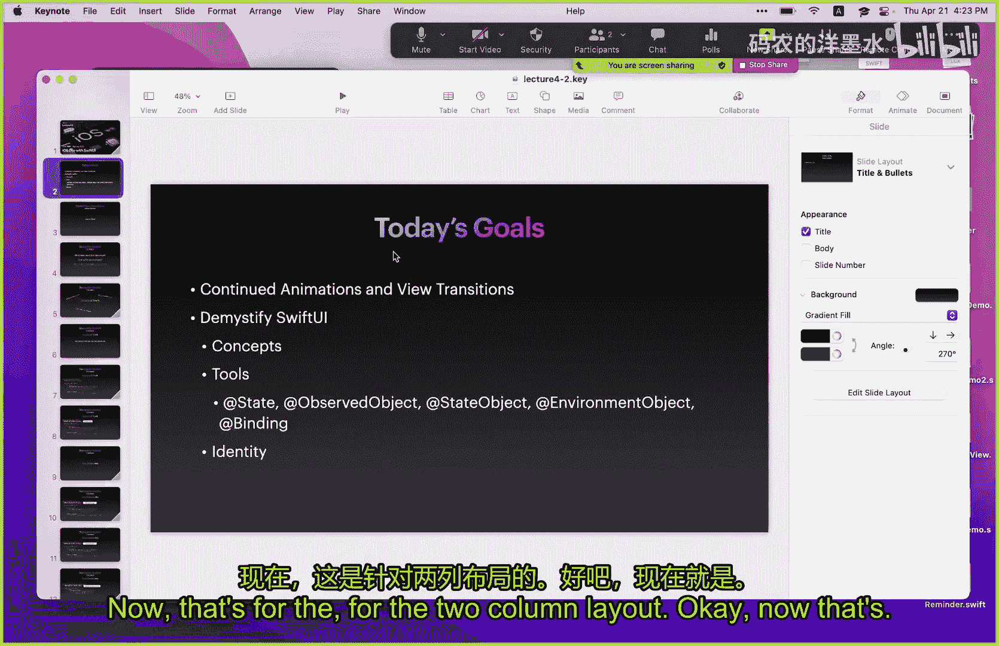

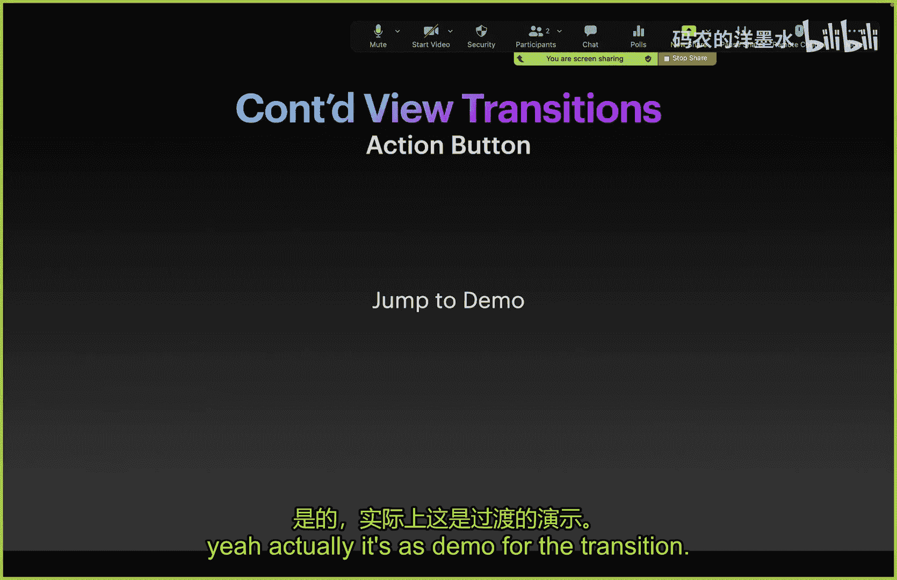

```swift
// 定义一个包含两个GridItem的数组，创建两列布局
let columns = [
    GridItem(.flexible(minimum: 80), spacing: 10, alignment: .top),
    GridItem(.flexible(minimum: 80), spacing: 10, alignment: .top)
]

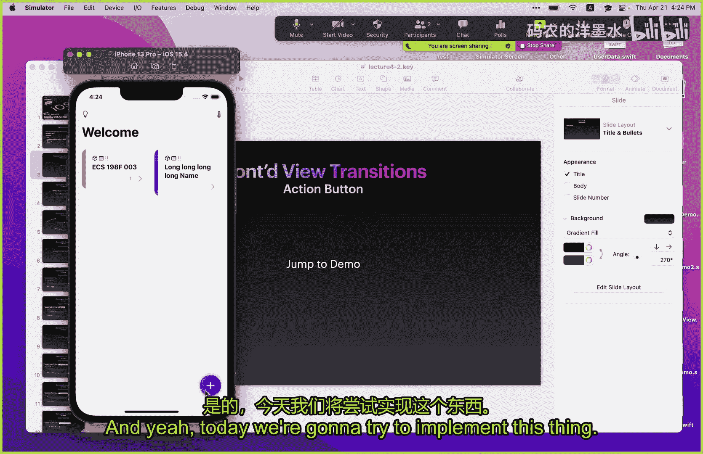

LazyVGrid(columns: columns, spacing: 20) {
    ForEach(items) { item in
        ItemView(item: item)
    }
}
.padding(.horizontal)
```

**代码解释**：
*   `GridItem(.flexible(minimum: 80))`：定义列宽至少为80点，但可以灵活扩展以填满可用空间。
*   `spacing: 10`：定义列与列之间的间距。
*   `alignment: .top`：定义列内所有项目的垂直对齐方式为顶部对齐。
*   `LazyVGrid(spacing: 20)`：定义行与行之间的间距。
*   `.padding(.horizontal)`：为整个网格添加水平方向的内边距，使其不紧贴屏幕边缘。

## 实现浮动按钮与过渡动画

接下来，我们将实现一个点击后会旋转并弹出菜单的浮动按钮。这涉及到视图的状态变化和过渡动画。

### 创建基础浮动按钮

首先，我们创建一个圆形按钮视图。

```swift
struct ActionButton: View {
    // 控制弹出面板是否显示的状态变量
    @State private var showMore = false

    var body: some View {
        VStack {
            Spacer()
            HStack {
                Spacer()
                Image(systemName: "plus")
                    .font(.system(size: 22))
                    .foregroundColor(.white)
                    .frame(width: 60, height: 60)
                    .background(Color.blue)
                    .clipShape(Circle())
                    // 添加点击手势，切换showMore状态
                    .onTapGesture {
                        withAnimation(.bouncy) {
                            showMore.toggle()
                        }
                    }
                    // 根据状态旋转按钮
                    .rotationEffect(.degrees(showMore ? 135 : 0))
            }
        }
        .padding()
    }
}
```

**代码解释**：
*   `@State private var showMore`：这是一个状态变量，用于跟踪弹出面板的显示状态。
*   `.onTapGesture`：为图片添加点击手势。点击时，在`withAnimation`块内切换`showMore`的状态，这将使所有受该状态影响的可动画属性产生动画效果。
*   `.rotationEffect(.degrees(showMore ? 135 : 0))`：根据`showMore`的值，将按钮旋转0度或135度。由于这个修饰符在动画块内被触发，旋转会产生动画。

### 自定义动画曲线

我们可以将常用的动画曲线定义为扩展，以便复用并使代码更清晰。

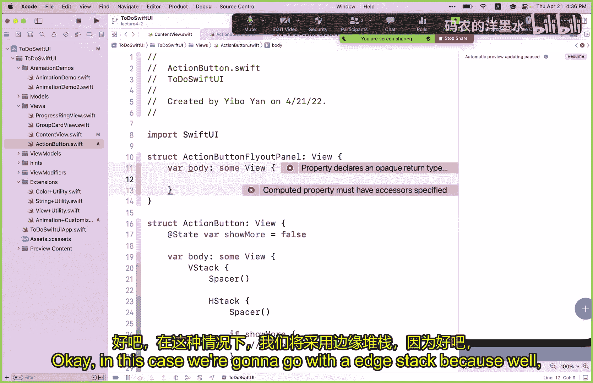

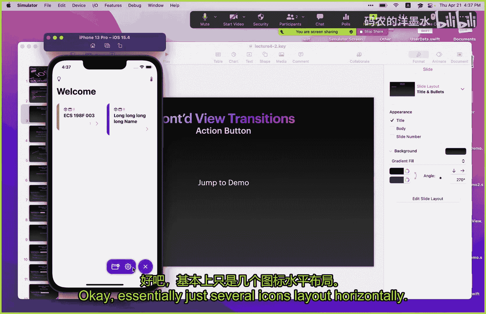

```swift
// 在独立的Swift文件中定义扩展
import SwiftUI

extension Animation {
    static let bouncy = Animation.spring(response: 0.55, dampingFraction: 0.6, blendDuration: 0)
}
```

然后在视图中直接使用`.bouncy`。

### 创建弹出面板视图

弹出面板是一个包含多个按钮的水平布局视图。

```swift
struct ActionButtonFlyoutPanel: View {
    // 使用@Binding来接收父视图的状态
    @Binding var showMore: Bool

    var body: some View {
        HStack(spacing: 20) {
            Button(action: { print("Folder tapped") }) {
                Image(systemName: "folder.badge.plus")
            }
            Button(action: { 
                withAnimation(.bouncy) {
                    showMore = false // 点击关闭按钮，隐藏面板
                }
            }) {
                Image(systemName: "xmark")
            }
        }
        .foregroundColor(.white)
        .padding()
        .frame(height: 35)
        .background(Color.blue)
        .cornerRadius(10)
    }
}
```

**核心概念：@Binding**
*   `@Binding`属性包装器用于创建一个到父视图状态的双向连接。
*   子视图（`ActionButtonFlyoutPanel`）通过`@Binding`接收一个状态（`showMore`），当它修改这个绑定时，更改会直接反映到父视图（`ActionButton`）的`@State`变量上。
*   在父视图中，使用`$`符号（如`$showMore`）来传递一个绑定。

### 组合视图并添加过渡

现在，将弹出面板条件性地添加到主视图中，并为其添加进入和退出的过渡效果。

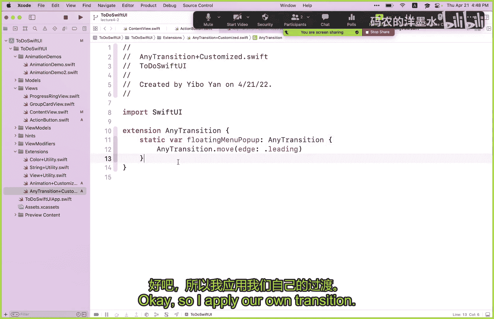


```swift
struct ActionButton: View {
    @State private var showMore = false

    var body: some View {
        VStack {
            Spacer()
            HStack {
                Spacer()
                // 条件显示弹出面板
                if showMore {
                    ActionButtonFlyoutPanel(showMore: $showMore)
                        .transition(.floatingMenuPopup) // 应用自定义过渡
                }
                Image(systemName: "plus")
                    ... // 按钮的其他修饰符
                    .onTapGesture { ... }
                    .rotationEffect(...)
            }
        }
        .padding()
    }
}
```

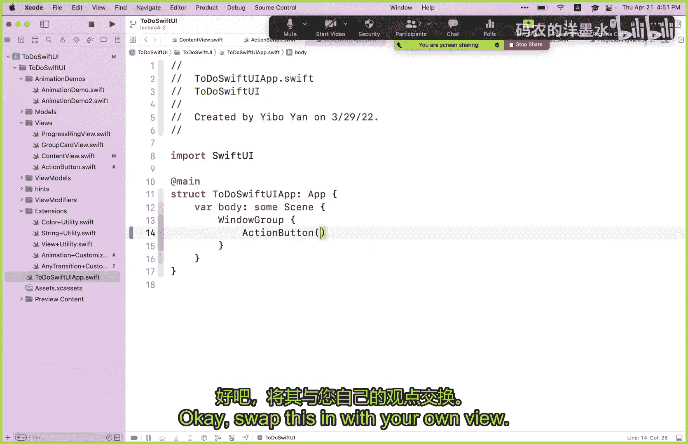

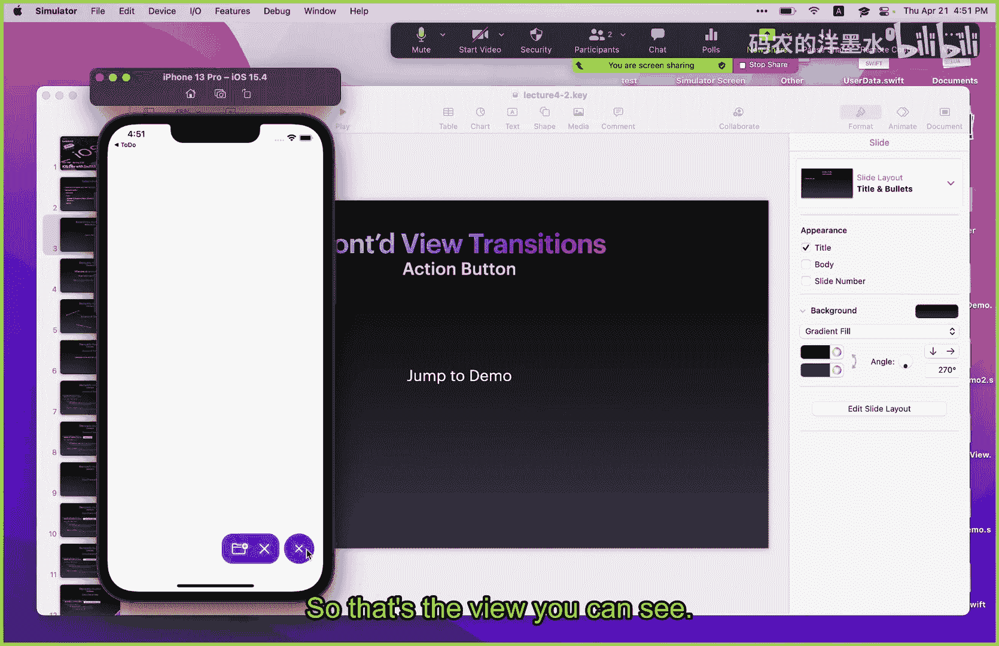

### 自定义视图过渡

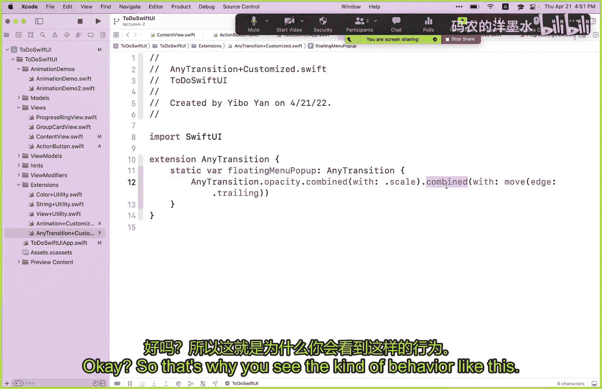

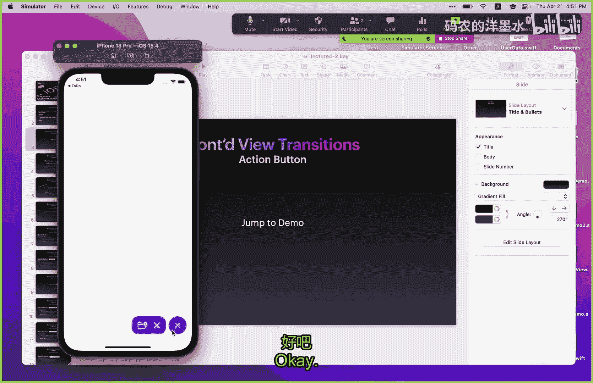

默认的视图过渡是淡入淡出（opacity）。我们可以创建更丰富的自定义过渡。

```swift
import SwiftUI

extension AnyTransition {
    static var floatingMenuPopup: AnyTransition {
        // 组合多个过渡效果
        .opacity
            .combined(with: .scale(scale: 0.8))
            .combined(with: .move(edge: .trailing))
    }
}
```

**代码解释**：
*   `AnyTransition` 类型代表一种过渡效果。
*   使用`.combined(with:)`方法可以将多个基础过渡效果组合起来。
*   上述自定义过渡的效果是：视图消失时，会同时产生淡出、缩小并向屏幕右侧移动的动画。

如果需要视图出现和消失时使用不同的动画，可以使用`.asymmetric`过渡：

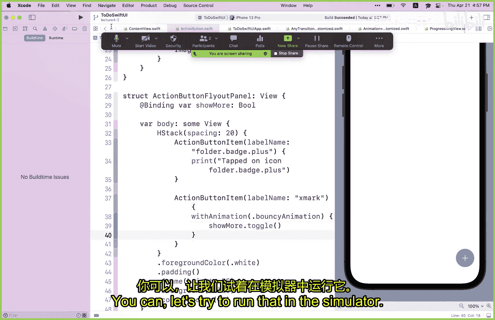

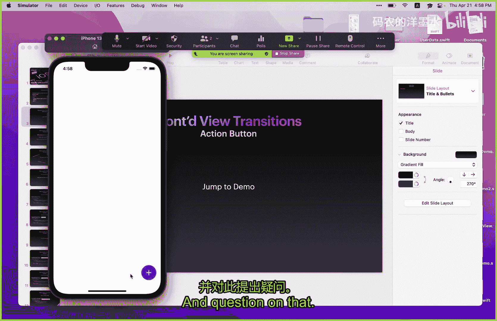

```swift
static var customTransition: AnyTransition {
    .asymmetric(
        insertion: .scale.combined(with: .opacity), // 插入时的动画
        removal: .move(edge: .leading) // 移除时的动画
    )
}
```

## 总结

本节课我们一起学习了三个核心内容：
1.  **LazyGrid布局**：使用`LazyVGrid`或`LazyHGrid`创建高效的网格布局，通过`GridItem`配置列或行的属性。
2.  **视图过渡**：使用`transition`修饰符为视图的插入和移除添加动画效果，并学会了如何组合或自定义这些过渡。
3.  **数据绑定**：了解了`@State`用于管理视图内部状态，而`@Binding`用于在父子视图之间建立状态的双向连接，使得数据变更能够同步。

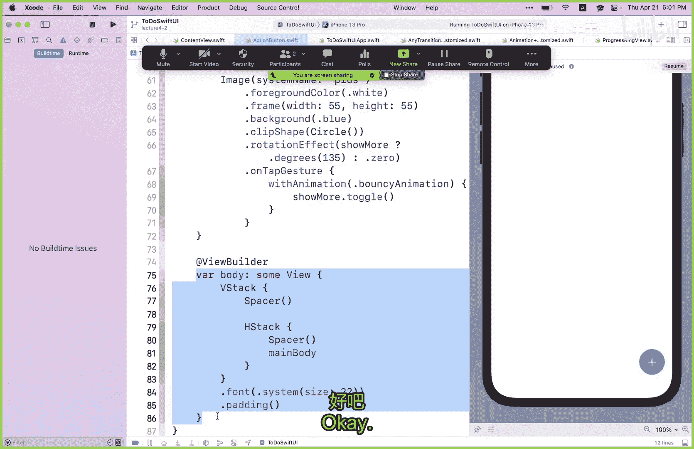

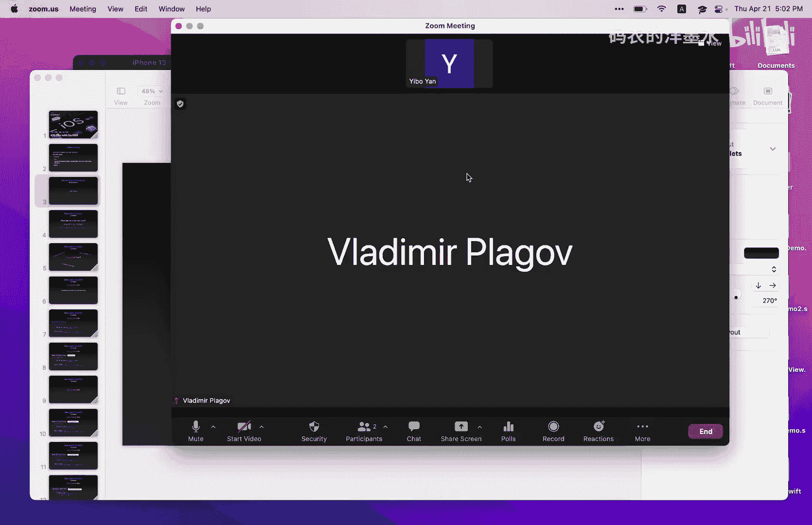

通过将这些技术结合起来，你已经能够创建出拥有复杂布局和流畅交互动画的iOS应用界面了。