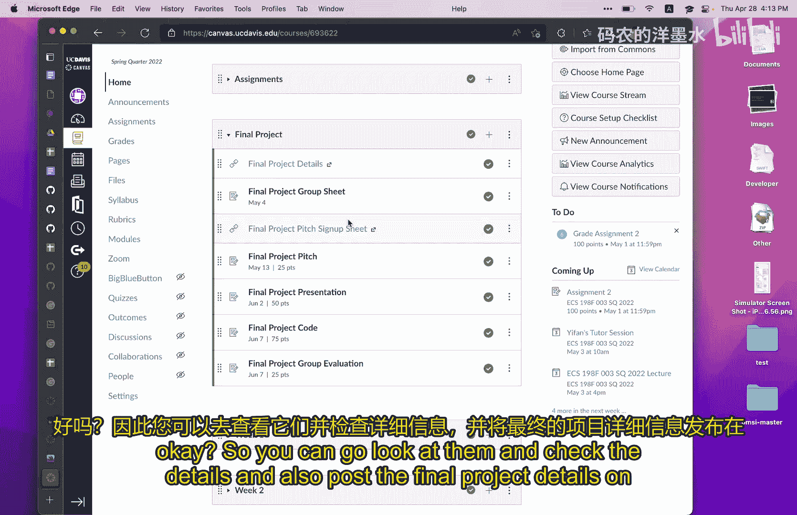
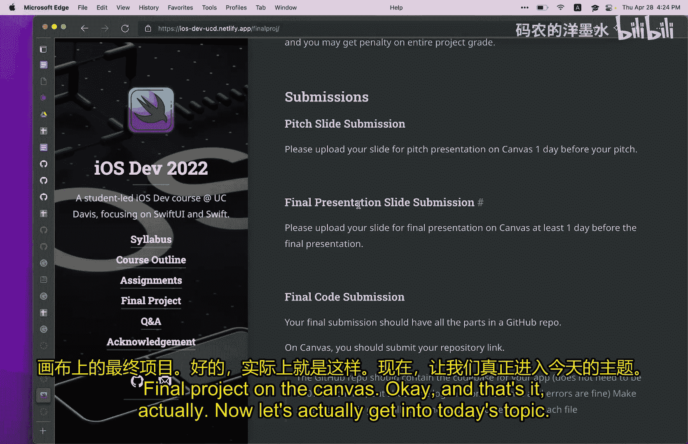
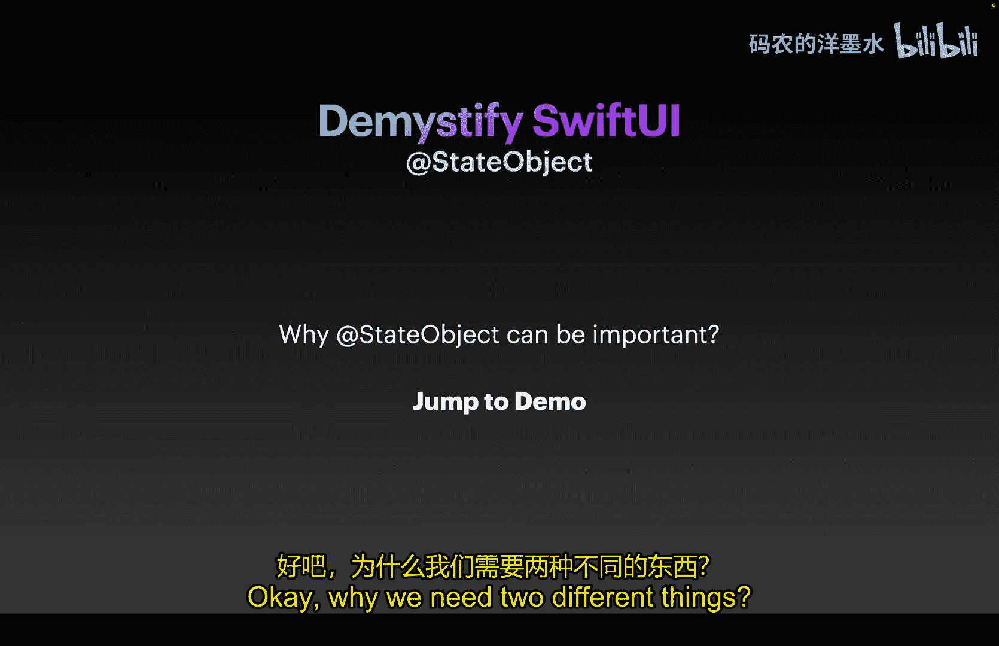
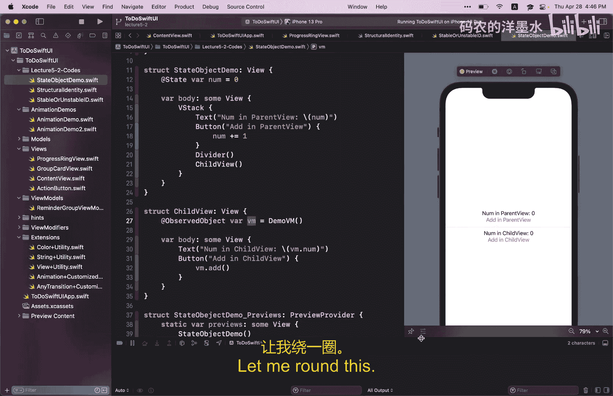
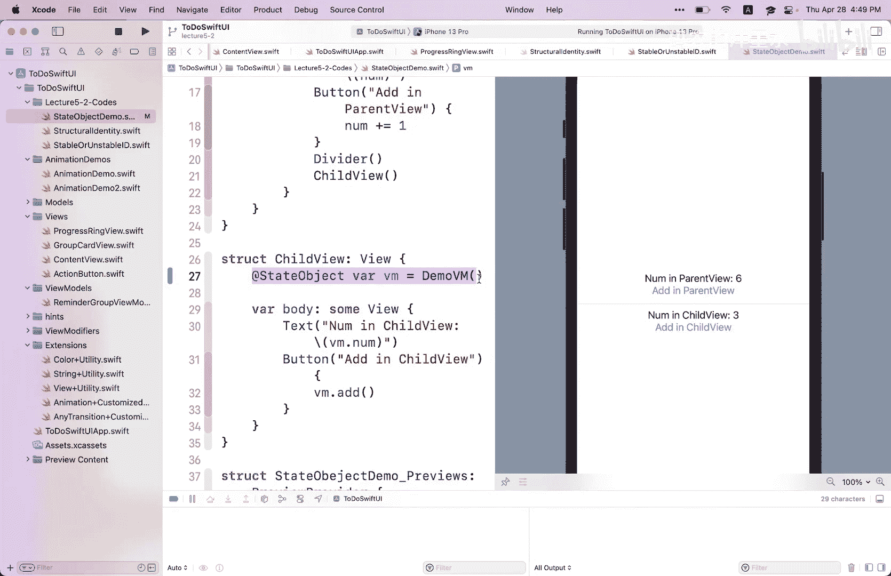
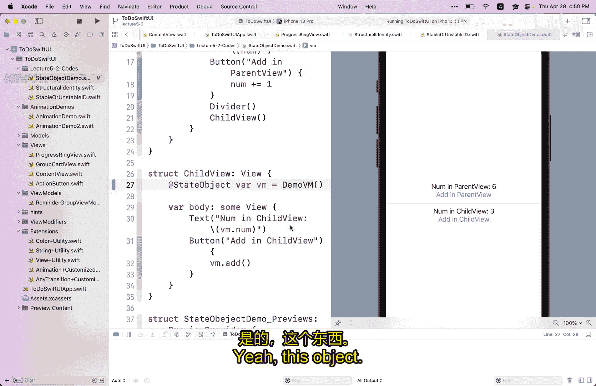
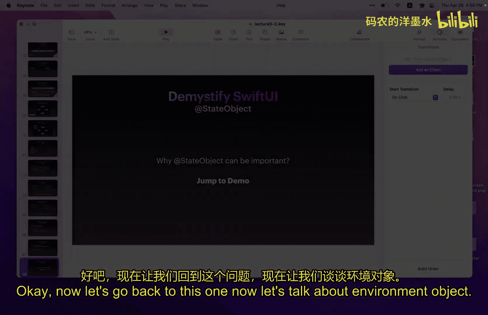
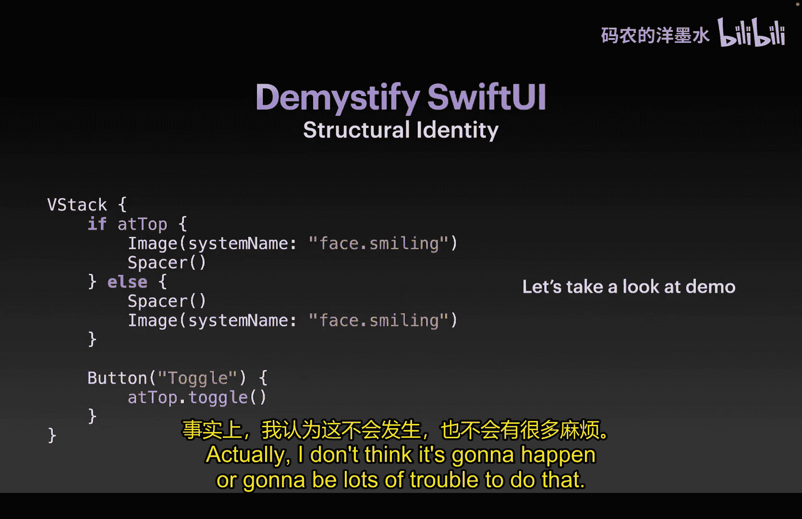
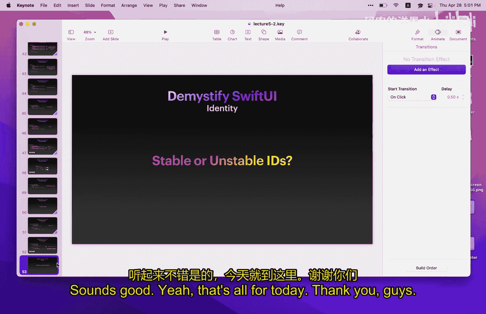

# 009：视图生命周期与身份



在本节课中，我们将要学习SwiftUI中两个核心概念：视图的生命周期与身份。理解这些概念对于构建高效、响应迅速的应用程序至关重要。

## 最终项目概述

在深入技术细节之前，我们先简要介绍本课程的最终项目安排。最终项目需要以3-4人的小组形式完成。项目流程主要包括：组队、项目提案演示、最终演示和代码提交。所有详细要求已发布在课程网站和Canvas上。

## 视图构建的三个核心问题

上一节我们介绍了最终项目的安排，本节中我们来看看构建SwiftUI视图时需要思考的三个核心问题。当您构建一个视图时，本质上是在思考以下三点：

1.  **视图需要什么数据？** (`What data does this view need?`)
2.  **如何使用这些数据？** (`How will you use that data?`)
3.  **数据从何而来？** (`Where does the data come from?`)

## 数据源与所有权

理解了构建视图的基本问题后，我们需要明确数据的来源和管理者。

*   **数据源**：这是您希望使用的数据的原始来源。例如，数据库可以作为一个数据源。
*   **数据所有权**：指的是哪个视图负责创建和管理特定的数据状态。例如，使用 `@State` 修饰的变量由声明它的视图所有，并随该视图的生命周期共存亡。



## 视图的生命周期

现在，让我们深入了解视图从创建到销毁的整个过程，即视图的生命周期。

视图的生命周期始于它出现在屏幕上，止于它从屏幕上消失。在这个过程中，有两个重要的视图修饰符：

*   **`.onAppear`**：当视图出现在屏幕上时，此闭包内的代码会被执行。
*   **`.onDisappear`**：当视图从屏幕上消失时，此闭包内的代码会被执行。

```swift
struct ProgressView: View {
    var ratio: Double

    var body: some View {
        // 视图主体内容
    }
    .onAppear {
        print("视图出现了")
    }
    .onDisappear {
        print("视图消失了")
    }
}
```

**重要提示**：视图结构体（`struct`）的初始化器（`init`）和 `body` 属性可能会被SwiftUI频繁调用。因此，应避免在初始化器内执行耗时操作，保持视图的轻量化。

## 数据管理工具详解

了解了生命周期后，我们需要合适的工具来管理视图中的数据。SwiftUI提供了多种属性包装器。

### @State

`@State` 用于声明由当前视图拥有的可变状态。它适用于值类型数据（如 `String`, `Int`, `Bool`），并用于管理视图的临时状态（如一个控制菜单是否展开的布尔值）。

**注意事项**：
*   不要将 `@State` 变量传递给子视图并让子视图也用 `@State` 修饰它。
*   不要在引用类型（如 `class` 实例）上使用 `@State`。

### @ObservedObject

`@ObservedObject` 用于观察一个外部的、符合 `ObservableObject` 协议的引用类型对象（通常是 `class`）。该对象的生命周期不由当前视图管理，通常通过初始化器从父视图传入。

```swift
class DemoViewModel: ObservableObject {
    @Published var number = 0
    func add() { number += 1 }
}

struct ChildView: View {
    @ObservedObject var viewModel: DemoViewModel // 从父视图传入
    var body: some View {
        Text("\(viewModel.number)")
    }
}
```

### @StateObject

`@StateObject` 是 `@State` 和 `@ObservedObject` 的结合。它用于在当前视图内部**创建并拥有**一个可观察对象。与 `@ObservedObject` 不同，`@StateObject` 确保该对象在视图的整个生命周期中只会被创建一次，即使视图被重新计算。

```swift
struct ParentView: View {
    @StateObject var viewModel = DemoViewModel() // 在此视图内部创建并拥有
    var body: some View {
        ChildView(viewModel: viewModel)
    }
}
```



### @EnvironmentObject



`@EnvironmentObject` 用于在视图层次结构中共享数据，而无需通过每个视图的初始化器逐层传递。它在顶层视图通过 `.environmentObject()` 修饰符注入数据，任何子视图都可以通过声明 `@EnvironmentObject` 来获取它。

```swift
// 在顶层（如 App 层级）注入
ContentView()
    .environmentObject(SettingsViewModel())

// 在任意深度的子视图中获取
struct DeepChildView: View {
    @EnvironmentObject var settings: SettingsViewModel // 直接获取，无需传递
    var body: some View {
        Text(settings.username)
    }
}
```




## 视图身份





最后，我们来探讨视图身份的概念。视图身份帮助SwiftUI识别哪些视图是相同的，这对于性能优化和实现流畅动画至关重要。

### 显式身份

通过为视图提供明确的标识符。有两种常见方式：
1.  在 `ForEach` 中使用 `id:` 参数或让数据模型遵循 `Identifiable` 协议。
2.  使用 `.id()` 视图修饰符直接指定。

```swift
ForEach(items, id: \.self) { item in ... }
// 或
View().id(someUniqueIdentifier)
```

### 结构身份（隐式身份）

当您没有提供显式ID时，SwiftUI会通过视图的结构（视图的类型、修饰符顺序等）来推断其身份。这是SwiftUI的默认行为。

**关键点**：为了确保动画正常工作，您应该确保需要动画过渡的两个视图在SwiftUI看来是**同一个视图**（具有稳定的身份），而不是结构相似的两个不同视图。避免使用条件语句（如 `if-else`）来返回完全不同的视图结构以实现布局变化，而应使用修改同一视图属性的方式（如改变对齐方式 `.alignmentGuide`）。



```swift
// 推荐：通过修改同一视图的属性来变化
VStack {
    Image(systemName: "smiley")
        .frame(maxHeight: .infinity, alignment: isTop ? .top : .bottom) // 改变对齐方式
    Button("切换") { withAnimation { isTop.toggle() } }
}

// 不推荐：条件语句返回不同结构，可能导致身份识别问题
VStack {
    if isTop {
        Image(systemName: "smiley")
        Spacer()
    } else {
        Spacer()
        Image(systemName: "smiley")
    }
    Button("切换") { isTop.toggle() }
}
```

## 总结




本节课中我们一起学习了SwiftUI的核心机制。我们首先探讨了构建视图时需要思考的三个数据问题，然后深入了解了视图的生命周期及其事件（`.onAppear` 和 `.onDisappear`）。接着，我们系统学习了四种管理数据的属性包装器：`@State`、`@ObservedObject`、`@StateObject` 和 `@EnvironmentObject`，明确了它们各自的使用场景和所有权。最后，我们引入了视图身份的概念，区分了显式身份与结构身份，并理解了保持视图身份稳定对于实现流畅动画的重要性。掌握这些概念将帮助您构建出更健壮、更高效的SwiftUI应用。