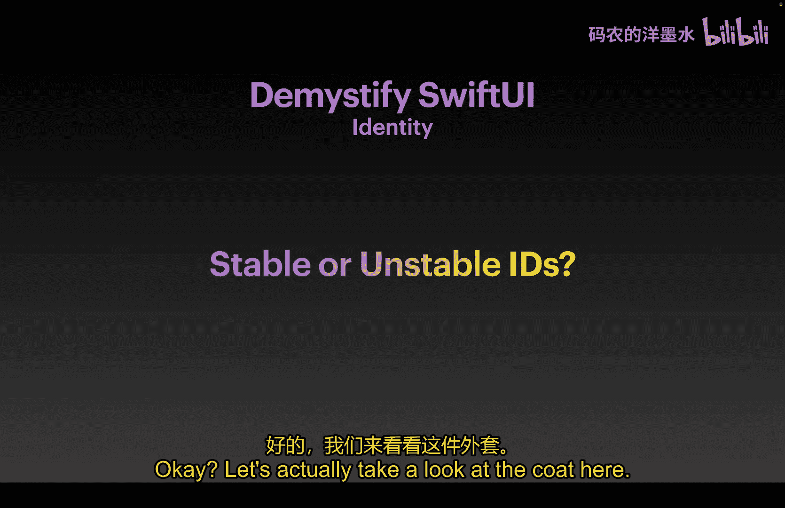
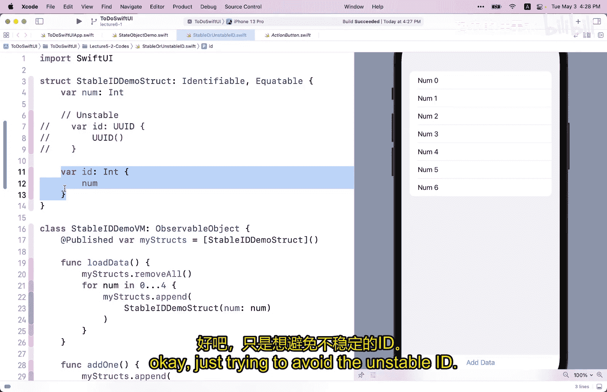
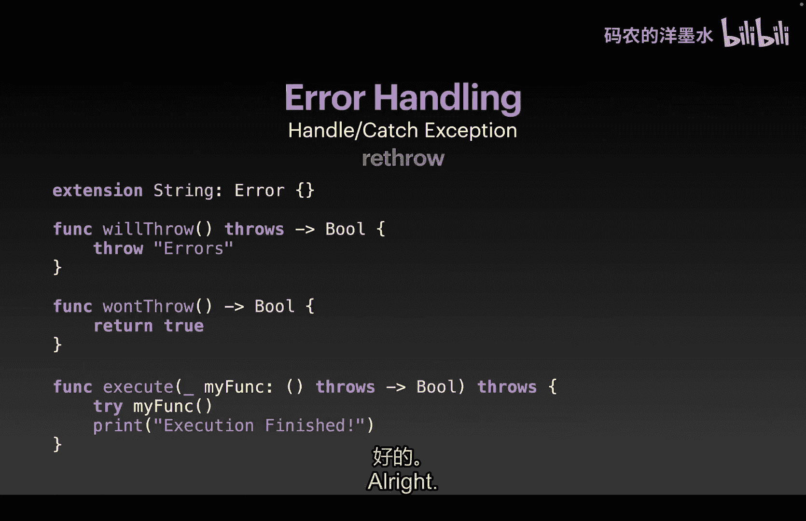
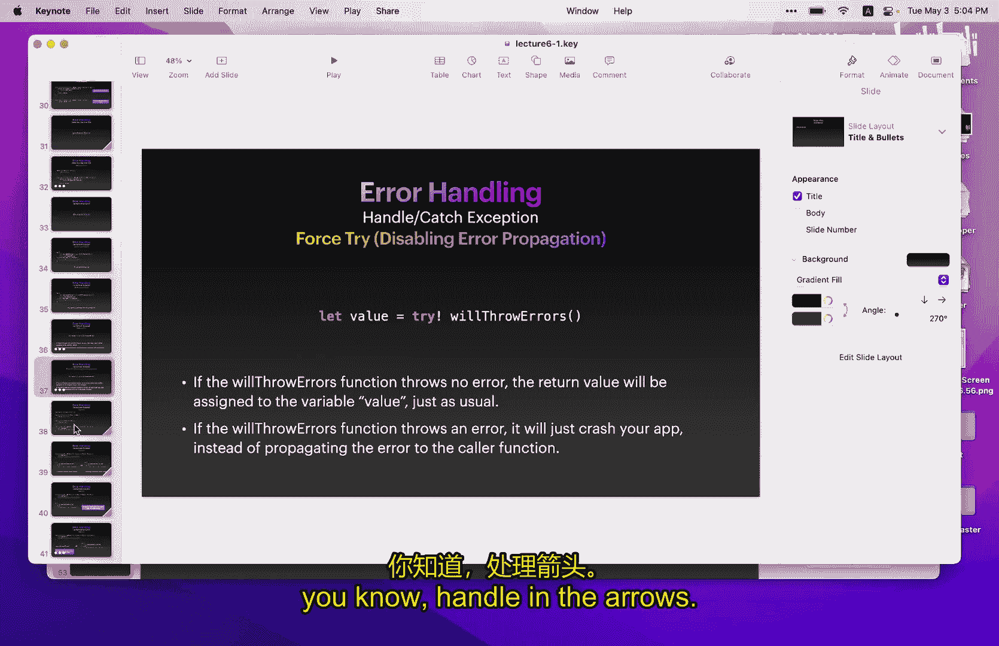

# 010：可选类型与错误处理 🧩


在本节课中，我们将要学习 Swift 中两个核心概念：**可选类型** 和 **错误处理**。可选类型用于表示一个值可能存在，也可能不存在的情况。错误处理则提供了一种结构化的方式来应对和处理程序运行时可能出现的错误。理解这两个概念对于编写健壮、安全的 Swift 和 SwiftUI 应用至关重要。

## 可选类型简介

可选类型是一种可以表示两种状态的类型：要么包含一个值，要么为 `nil`（表示没有值）。它是在 Swift 中表达不确定性的一种安全方式。

在 Swift 中，通过在类型后面添加一个问号 `?` 来声明一个可选类型。例如，`String?` 表示一个“可选字符串”。

```swift
var greeting: String? // 这是一个可选字符串，当前值为 nil
greeting = "Hello"    // 现在它包含一个字符串值
```



在底层，可选类型实际上是一个枚举，定义大致如下：
```swift
enum Optional<Wrapped> {
    case some(Wrapped) // 包含一个值
    case none          // 不包含值，即 nil
}
```

## 解包可选值

由于可选值可能为 `nil`，你不能直接使用它。在使用其内部值之前，必须进行“解包”。以下是几种主要的解包方法。

### 1. 可选绑定

可选绑定是安全解包可选值最常用的方法。它使用 `if let` 或 `guard let` 语法来检查可选值是否包含有效数据。

**if let 绑定**
`if let` 在条件为真（即可选值有值）时，创建一个临时常量或变量来持有解包后的值，并执行代码块。



```swift
func say(greeting: String?) {
    if let validGreeting = greeting {
        print("\(validGreeting), World!")
    } else {
        print("No valid greeting provided.")
    }
}
```

**guard let 绑定**
`guard let` 与 `if let` 类似，但更侧重于“提前退出”。如果可选值为 `nil`，它要求你必须离开当前作用域（如使用 `return`, `break`, `continue` 或 `throw`）。

```swift
func sayWithGuard(greeting: String?) {
    guard let validGreeting = greeting else {
        print("No valid greeting provided.")
        return // 必须退出当前作用域
    }
    // 从这里开始，validGreeting 在函数剩余部分都是非可选类型
    print("\(validGreeting), World!")
}
```

**选择指南**
*   `if let` 让你专注于“有值”时的处理路径。
*   `guard let` 让你专注于“无值”（错误）时的处理路径，并确保在条件不满足时立即退出。

### 2. 可选链式调用

当你需要通过一个可能为 `nil` 的可选值去访问其属性、方法或下标时，可以使用可选链式调用。在可选值后面加上问号 `?` 即可。

```swift
var greeting: String? = "Hello"
let numberOfCharacters = greeting?.count // numberOfCharacters 是 Int? 类型
```
如果 `greeting` 为 `nil`，那么 `greeting?.count` 的调用将直接返回 `nil`，而不会导致运行时错误。

### 3. 空合运算符

空合运算符 `??` 提供了一种为可选值提供默认值的简洁方式。如果可选值为 `nil`，则使用 `??` 后面的默认值。

```swift
let greeting: String? = nil
let finalGreeting = greeting ?? "Default Greeting" // finalGreeting 是 String 类型，值为 "Default Greeting"
```
你甚至可以链式使用空合运算符：
```swift
let name: String? = nil
let displayText = greeting ?? name ?? "No data available"
```

### 4. 强制解包

通过在可选值后面添加感叹号 `!`，可以强制解包。但这意味着你向编译器保证该可选值绝对不为 `nil`。如果运行时该值恰好为 `nil`，程序会触发运行时错误并崩溃。

```swift
let sureGreeting: String? = "Hello"
let forcedString: String = sureGreeting! // 强制解包，获得 String 类型
```
**警告**：强制解包非常危险，除非你 100% 确定该值不为 `nil`，否则应尽量避免使用。在课程作业中通常不允许使用强制解包。

## 错误处理

错误处理允许你响应程序中的错误条件，并以可控的方式从错误中恢复。

### 1. 定义与抛出错误

首先，你需要定义表示错误的类型。任何遵循 `Error` 协议的类型都可以用作错误。

```swift
enum DataError: Error {
    case noData
    case invalidFormat
}
```

要抛出一个错误，在函数声明的参数列表和返回箭头之间使用 `throws` 关键字。在函数体内，使用 `throw` 语句抛出具体的错误实例。

```swift
func fetchData(from url: String) throws -> String {
    guard !url.isEmpty else {
        throw DataError.noData // 抛出错误
    }
    // ... 尝试获取数据
    return "Fetched Data"
}
```

### 2. 处理错误：Do-Try-Catch

调用可能抛出错误的函数时，必须使用 `try` 关键字，并将其包裹在 `do-catch` 块中。在 `catch` 分句中处理具体的错误。

```swift
do {
    let data = try fetchData(from: "") // 使用 try 调用可能抛出错误的函数
    print(data)
} catch DataError.noData {
    print("错误：没有提供数据源。")
} catch {
    print("发生了未知错误：\(error)") // `error` 是 catch 块中可用的局部错误变量
}
```

### 3. 其他错误处理技巧

**可选 Try**
使用 `try?` 会将函数的返回值转换为可选类型。如果函数成功执行，则返回其值（包装在可选类型中）；如果抛出错误，则返回 `nil`。

```swift
let possibleData = try? fetchData(from: "someUrl") // possibleData 是 String? 类型
```

**强制 Try**
使用 `try!` 表示你确信该函数不会抛出错误。如果它确实抛出了错误，程序会触发运行时错误并崩溃。与强制解包类似，应谨慎使用。

```swift
let sureData = try! fetchData(from: "validUrl") // sureData 是 String 类型，假定不会出错
```



## 总结

本节课中我们一起学习了 Swift 中可选类型和错误处理的核心机制。

*   **可选类型** 是安全处理值缺失情况的关键工具，我们掌握了通过**可选绑定**、**可选链**、**空合运算符**来安全地解包和使用可选值，并了解了**强制解包**的风险。
*   **错误处理** 提供了一种结构化的方式来管理运行时异常。我们学习了如何通过遵循 `Error` 协议来**定义错误类型**，如何使用 `throws` 和 `throw` 来**抛出错误**，以及如何使用 `do-try-catch` 块、`try?` 和 `try!` 来**捕获和处理错误**。



熟练运用这些技术，将使你能够编写出更健壮、更易于维护的 Swift 和 SwiftUI 应用程序。