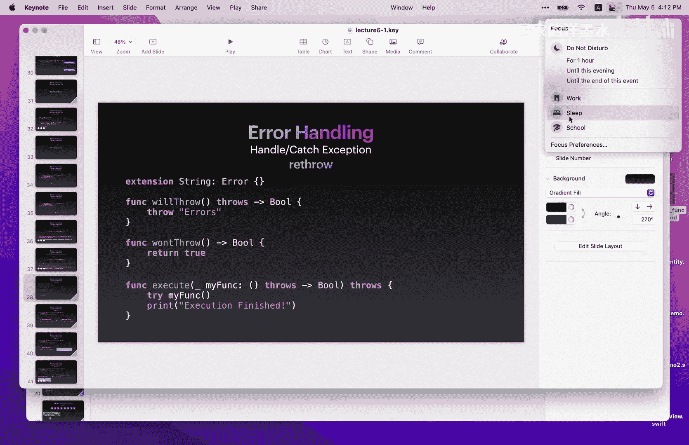
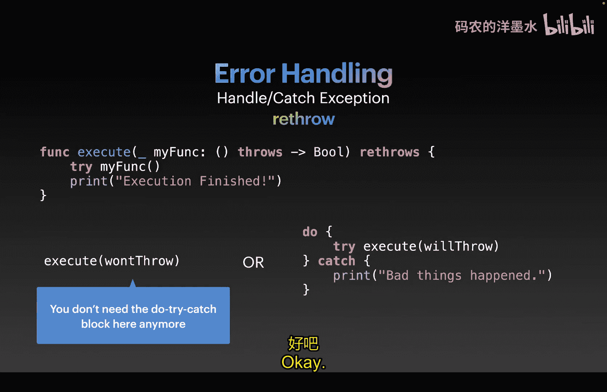
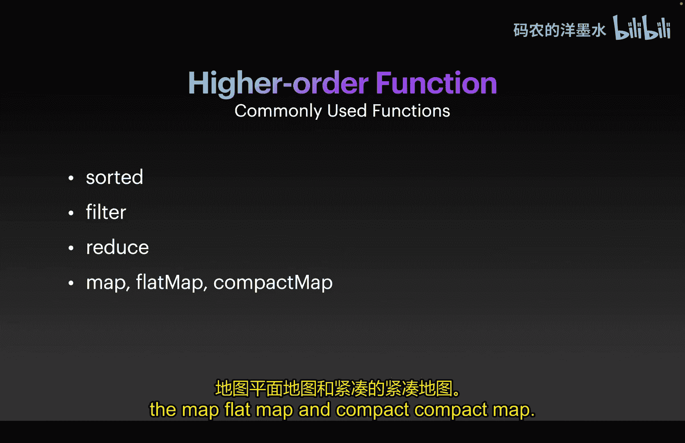
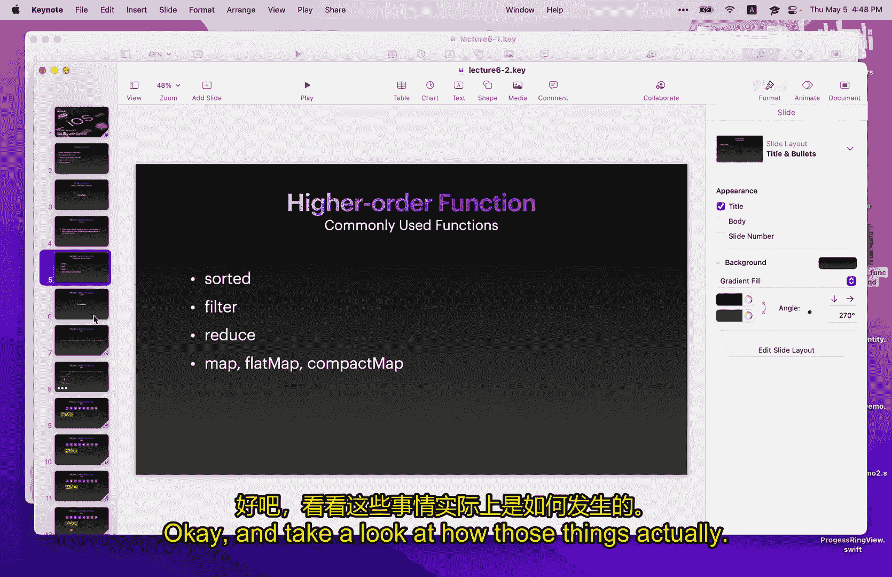
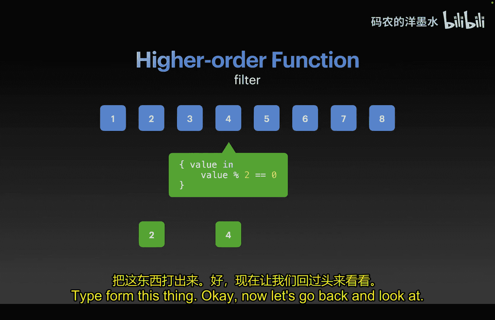
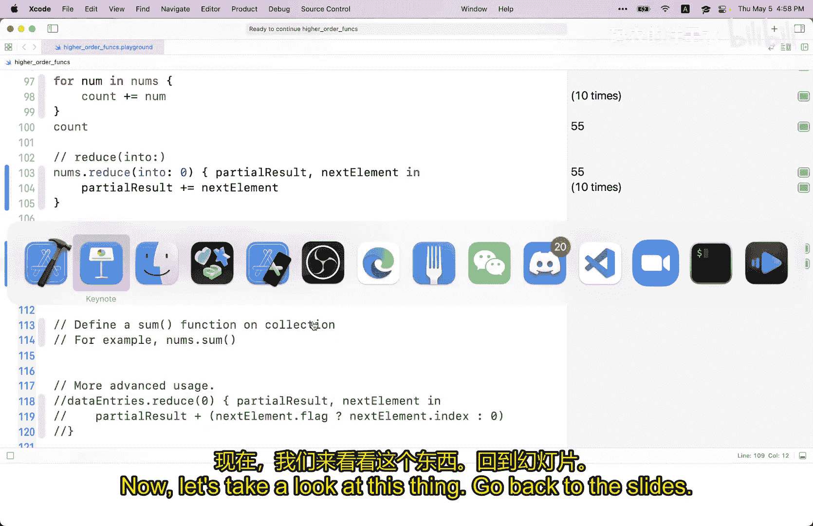
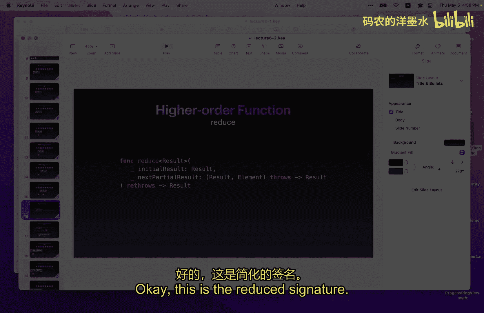
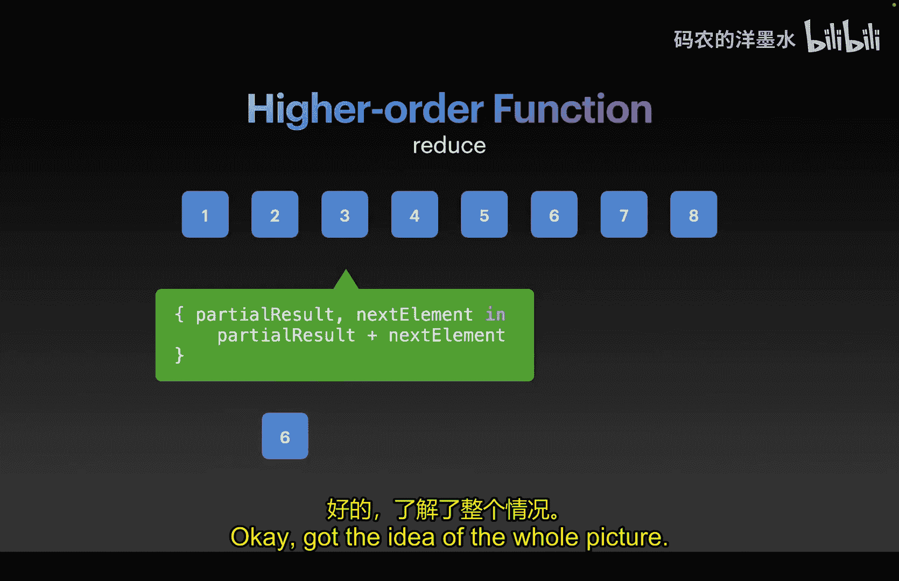
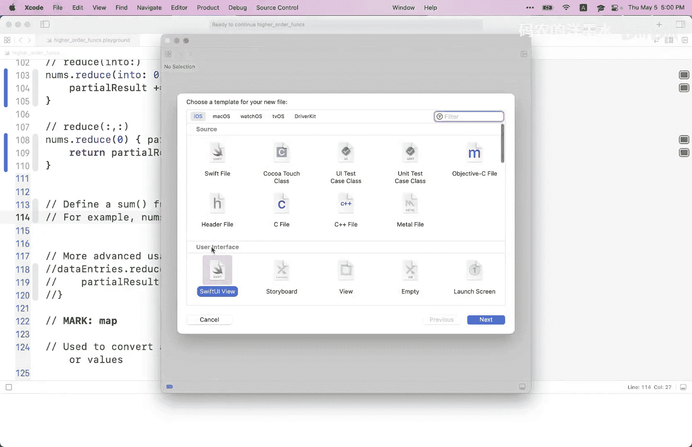

# 011：高阶函数与原生视图



在本节课中，我们将要学习两个核心主题：Swift 中的 `rethrows` 关键字，以及一些在 SwiftUI 中常用的原生视图组件，如 `Sheet`、`Form`、`Section` 和 `TextField`。最后，我们会深入探讨高阶函数的概念，包括 `sorted`、`filter` 和 `reduce` 的用法。

## `rethrows` 关键字详解

首先，我们来探讨 `rethrows` 关键字。这个关键字用于修饰一个函数，表明该函数本身不抛出错误，但它所调用的函数参数可能会抛出错误。使用 `rethrows` 可以让调用代码在传入不会抛出错误的函数时，无需使用 `do-try-catch` 块。

上一节我们介绍了 `rethrows` 的基本概念，本节中我们来看看具体的代码示例。





```swift
// 1. 扩展 String 使其遵循 Error 协议
extension String: Error {}
// 2. 定义两个函数
func functionThatThrows() throws {
    throw "发生错误"
}
func functionThatDoesNotThrow() -> Bool {
    return true
}

// 3. 定义一个执行函数，使用 `rethrows`
func execute(_ operation: () throws -> Void) rethrows {
    try operation()
    print("执行完成")
}
```

以下是 `execute` 函数的使用方式：

*   当传入 `functionThatDoesNotThrow` 时，由于该函数不会抛出错误，调用 `execute` 时无需错误处理。
*   当传入 `functionThatThrows` 时，因为该函数会抛出错误，调用 `execute` 时必须使用 `do-try-catch` 块。

```swift
// 调用不会抛出的函数，无需 do-try-catch
execute(functionThatDoesNotThrow)

// 调用会抛出的函数，必须使用 do-try-catch
do {
    try execute(functionThatThrows)
} catch {
    print("糟糕的事情发生了: \(error)")
}
```


如果将 `execute` 函数的 `rethrows` 改为 `throws`，那么即使传入不会抛出错误的函数，调用时也必须使用 `do-try-catch` 块，这会使代码变得冗余。`rethrows` 关键字让 Swift 编译器能够根据传入的函数参数智能地推断是否需要错误处理。


## 作业点评与视图身份标识

在开始新内容前，我们先回顾一下第二次作业中的一个常见问题，它涉及到 SwiftUI 中视图的身份标识和动画。

问题出现在一个按钮上，该按钮根据状态显示不同的图标（如展开/收起），但图标切换时没有平滑的动画效果。

核心问题在于使用了 `if-else` 语句来创建两个完全不同的视图。SwiftUI 将这两个图标视为两个独立的视图，因此无法自动为它们之间的转换添加动画。

解决方案是使用三元运算符 `? :` 来修改同一个视图的属性（如图标名称），而不是创建两个视图。这样，SwiftUI 会将其视为同一个视图的状态变化，从而能够应用平滑的动画。

```swift
// 推荐做法：修改同一视图的属性
Image(systemName: showMore ? "chevron.up" : "chevron.down")

// 可能导致动画问题的做法：创建两个不同的视图
if showMore {
    Image(systemName: "chevron.up")
} else {
    Image(systemName: "chevron.down")
}
```

通常，更推荐使用三元运算符或直接应用视图修饰符来改变视图状态，这有助于 SwiftUI 正确识别视图身份并管理动画。

## SwiftUI 原生视图组件

接下来，我们看看在第三次作业中可能会用到的几个 SwiftUI 原生视图组件：`Sheet`、`Form`、`Section` 和 `TextField`。

### 使用 Sheet 呈现模态视图

`Sheet` 用于从屏幕底部弹出模态视图。要使用它，首先需要一个 `@State` 布尔值来控制 `Sheet` 的显示状态。

```swift
struct ContentView: View {
    @State private var showSheet = false

    var body: some View {
        NavigationView {
            Text("主内容")
                .toolbar {
                    ToolbarItem(placement: .navigationBarTrailing) {
                        Button(action: {
                            showSheet.toggle() // 切换状态
                        }) {
                            Image(systemName: "gear")
                        }
                    }
                }
                .sheet(isPresented: $showSheet) {
                    Text("你好，这是一个 Sheet！") // Sheet 的内容视图
                }
        }
    }
}
```


当按钮被点击时，`showSheet` 变为 `true`，`Sheet` 会以默认的动画效果弹出。背景视图会自动变暗，这些效果都由 SwiftUI 自动处理。

### 使用 Form 和 Section 构建表单




`Form` 是用于分组设置项或数据输入项的容器，`Section` 则用于在 `Form` 内对内容进行视觉上的分组。

以下是创建带标题 `Section` 的方法：

```swift
struct MyFormView: View {
    var body: some View {
        Form {
            Section("演示区域") {
                Text("你好")
            }
        }
    }
}
```

你也可以创建带有自定义标题的 `Section`，例如使用 `Label` 组合文本和图标：

```swift
Section {
    Text("你好")
} header: {
    Label("演示区域", systemImage: "star.fill")
        .foregroundColor(.red)
}
```

### 使用 TextField 进行文本输入

`TextField` 是一个让用户输入文本的控件。它需要一个 `@State` 变量来绑定用户输入的文字。

```swift
struct MyTextView: View {
    @State private var myText = ""

    var body: some View {
        VStack {
            TextField("请输入内容", text: $myText)
            Text("你输入了: \(myText)")
        }
    }
}
```

在上面的代码中，`TextField` 的第一个参数是占位符文本，第二个参数 `text` 需要传入一个与 `@State` 变量绑定的 `Binding`（通过 `$` 前缀创建）。下方 `Text` 视图会实时显示输入的内容。

## 高阶函数

现在，让我们进入本节课的核心部分：高阶函数。高阶函数是指那些以函数作为参数，或者将函数作为返回值的函数。它们是函数式编程的基石。我们将重点学习 `sorted`、`filter` 和 `reduce`。

### Sorted 函数

`sorted` 函数用于对集合（如数组）进行排序。默认情况下，它返回一个升序排列的新数组。

```swift
let numbers = [5, 3, 8, 1, 2]
let sortedNumbers = numbers.sorted() // [1, 2, 3, 5, 8]
```

如果你想自定义排序规则，例如降序排列，可以传入一个比较函数：

```swift
// 完整闭包写法
let descendingNumbers = numbers.sorted { a, b in
    return a > b
}

// 简写闭包写法（使用 $0, $1 代表参数）
let descendingNumbersShort = numbers.sorted { $0 > $1 }

// 甚至可以直接使用操作符函数
let descendingNumbersOperator = numbers.sorted(by: >)
```

`sorted` 函数接收一个类型为 `(Element, Element) -> Bool` 的闭包。如果闭包返回 `true`，则第一个参数应排在第二个参数之前。

你也可以实现更复杂的排序逻辑，例如让偶数排在奇数前面：




```swift
let customSorted = numbers.sorted { a, _ in
    return a % 2 == 0 // 偶数返回 true，排前面
}
// 结果示例: [2, 8, 5, 3, 1] (偶数在前，但各自内部顺序未定义)
```

### Filter 函数

`filter` 函数用于根据条件筛选集合中的元素。它接收一个返回 `Bool` 的闭包（谓词），仅保留使闭包返回 `true` 的元素。



```swift
// 筛选出偶数
let evenNumbers = numbers.filter { value in
    return value % 2 == 0
}
// 简写：let evenNumbers = numbers.filter { $0 % 2 == 0 }
// 结果: [8, 2]

// 筛选出大于 5 的数
let greaterThanFive = numbers.filter { $0 > 5 }
// 结果: [8]
```

`filter` 的工作原理是遍历集合中的每个元素，将元素传入谓词闭包。如果闭包返回 `true`，则该元素被保留在新数组中；如果返回 `false`，则被跳过。

### Reduce 函数

`reduce` 函数用于将集合中的所有元素组合成一个单一的值，例如计算总和。它接收一个初始值和一个组合闭包。

`reduce` 有两种形式：`reduce(into:)` 和 `reduce(_:_:)`。`reduce(into:)` 性能通常更好，因为它使用 `inout` 参数避免中间值的复制。

首先，了解一下 `inout` 关键字。它允许函数内部修改传入参数的值，效果类似于传递引用。

```swift
func swapValues(_ a: inout Int, _ b: inout Int) {
    let temp = a
    a = b
    b = temp
}

var x = 10
var y = 20
swapValues(&x, &y) // 调用时需要在变量前加 &
// 现在 x = 20, y = 10
```

现在来看 `reduce` 的用法。计算数组总和：





```swift
// 使用 reduce(into:)， partialResult 是 inout 参数
let sumInto = numbers.reduce(into: 0) { partialResult, nextElement in
    partialResult += nextElement
}

// 使用 reduce(_:_:)，必须显式返回新值
let sum = numbers.reduce(0) { partialResult, nextElement in
    return partialResult + nextElement
}
// 简写：let sum = numbers.reduce(0, +)
```

`reduce` 的工作过程如下：
1.  从初始值 `0` 开始。
2.  将当前结果（`partialResult`，初始为0）和第一个元素（`nextElement`，1）传入闭包，得到新结果 `1`。
3.  将新结果 `1` 和第二个元素 `2` 传入闭包，得到结果 `3`。
4.  依此类推，遍历所有元素，最终得到总和。





本节课中我们一起学习了 `rethrows` 关键字在错误处理中的便利性，回顾了视图身份标识对动画的重要性，并实践了 `Sheet`、`Form`、`Section` 和 `TextField` 等 SwiftUI 原生视图的用法。最后，我们深入探讨了 `sorted`、`filter` 和 `reduce` 这几个强大高阶函数的工作原理与使用场景，它们是处理集合数据的利器。