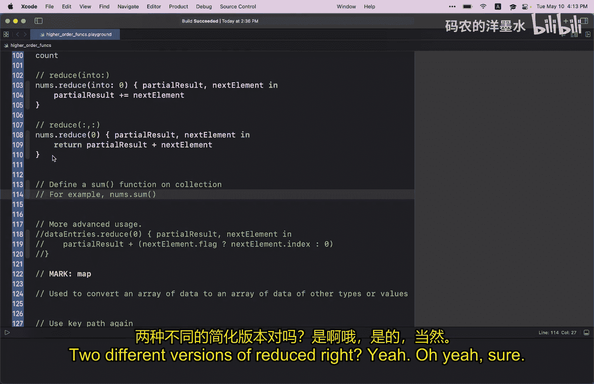
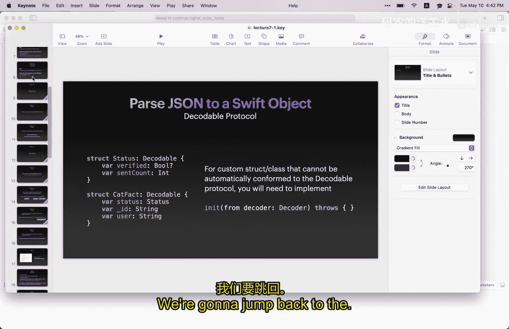
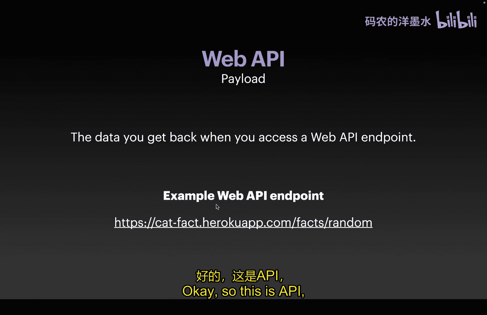
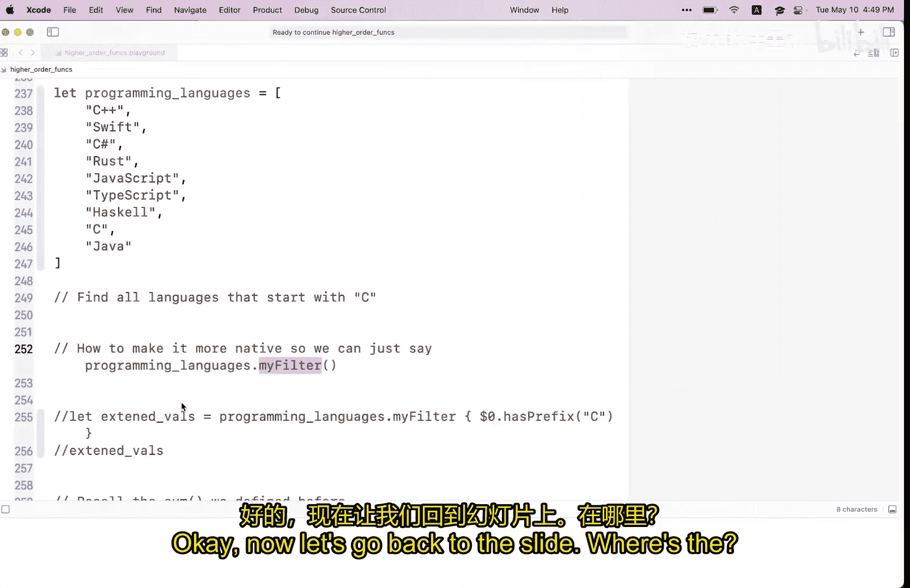
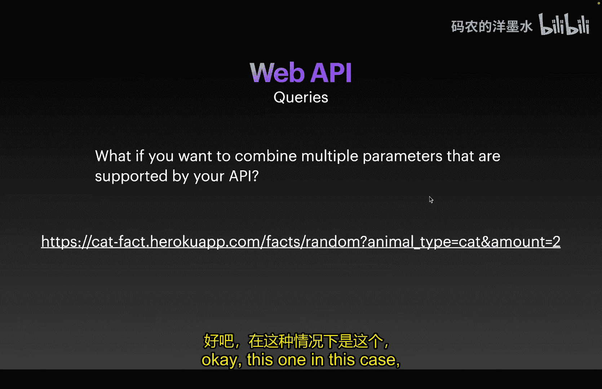
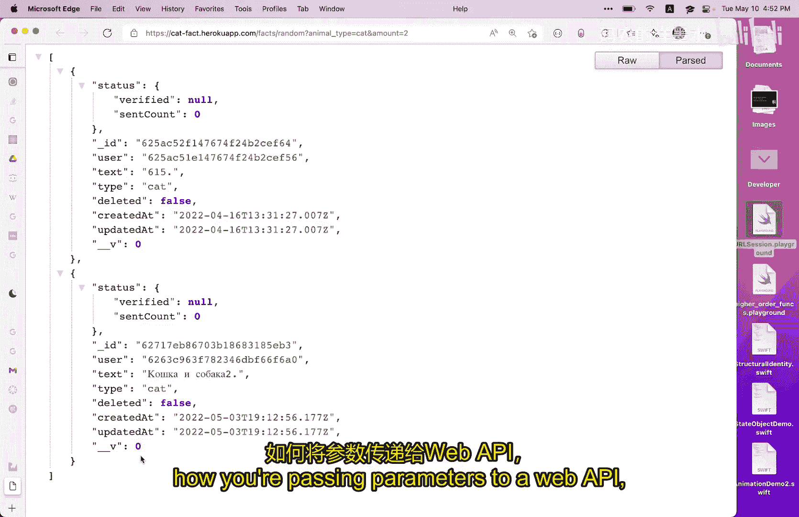
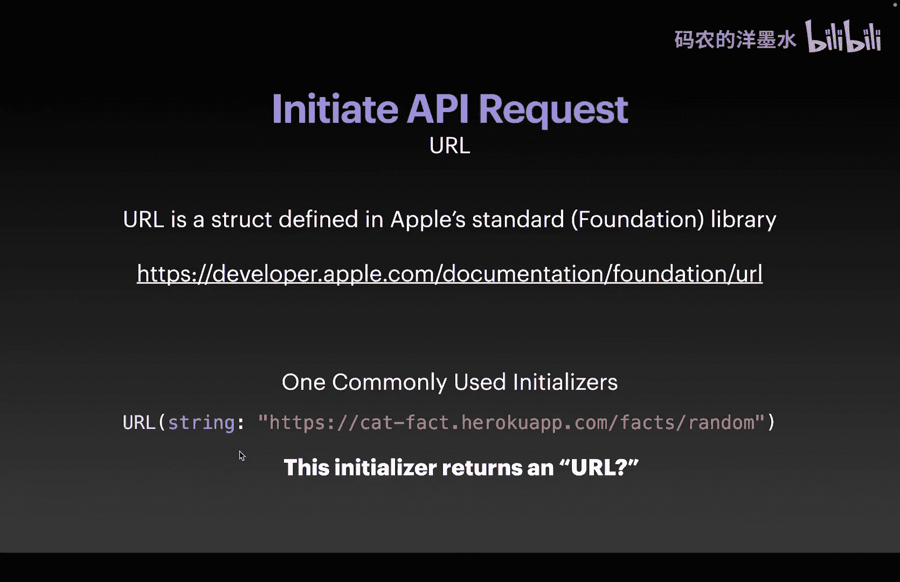

# 012：高阶函数进阶与Web API



在本节课中，我们将学习Swift中高阶函数的进阶用法，并初步了解如何与Web API进行交互。课程分为两部分：首先，我们将深入探讨`reduce`、`map`、`flatMap`等函数的自定义与组合使用；其次，我们将介绍Web API的基本概念、JSON数据格式以及如何在Swift中发起网络请求。

## 高阶函数进阶

上一节我们介绍了`reduce`函数的基本用法。本节中，我们来看看如何为集合类型自定义一个`sum`函数，并探索其他高阶函数的应用。

### 为集合扩展`sum`函数

Swift标准库的`Array`没有直接提供`sum`方法。我们可以通过扩展`Collection`协议来实现它。

以下是实现步骤：
1.  扩展`Collection`协议。
2.  使用`where`子句约束集合的元素类型必须遵循`AdditiveArithmetic`协议（这意味着元素可以相加）。
3.  在扩展中，使用`reduce`函数和`+`运算符来计算总和。

```swift
extension Collection where Element: AdditiveArithmetic {
    func sum() -> Element {
        return self.reduce(Element.zero, +)
    }
}

// 使用示例
let numbers = Array(1...10)
print(numbers.sum()) // 输出：55
```

**核心概念解释**：
*   `AdditiveArithmetic`：一个协议，要求遵循该类型的值可以相加，并且有一个表示“零”的值（例如，`Int`的`0`，`Double`的`0.0`）。
*   `Element.zero`：访问该元素类型的“零”值。

### `map`函数的使用

`map`函数用于将一个集合中的元素转换为另一种类型，并返回一个新的集合。

以下是`map`函数的基本用法：
```swift
// 将每个元素乘以10
let multipliedNumbers = numbers.map { value in
    return value * 10
}
// 简写形式
let multipliedNumbersShort = numbers.map { $0 * 10 }
print(multipliedNumbersShort) // 输出：[10, 20, 30, 40, 50, 60, 70, 80, 90, 100]

// 从自定义结构体数组中提取特定字段
struct DataEntry {
    let index: Int
    let flag: Bool
}
let dataEntries = (0...10).map { DataEntry(index: $0, flag: $0 > 4) }

let indices = dataEntries.map { $0.index }
print(indices) // 输出：[0, 1, 2, 3, 4, 5, 6, 7, 8, 9, 10]
```

### `compactMap`与`flatMap`函数

有时转换可能产生可选值，`compactMap`可以自动过滤掉结果为`nil`的项。

以下是`compactMap`的示例：
```swift
// 只提取 flag 为 true 的元素的 index，否则返回 nil
let optionalIndices = dataEntries.map { entry -> Int? in
    return entry.flag ? entry.index : nil
}
print(optionalIndices) // 包含 nil 的数组

// 使用 compactMap 过滤掉 nil
let validIndices = dataEntries.compactMap { entry -> Int? in
    return entry.flag ? entry.index : nil
}
print(validIndices) // 输出：[5, 6, 7, 8, 9, 10]
```

`flatMap`常用于处理嵌套数组（二维数组），将其“扁平化”为一维数组。

以下是`flatMap`的示例：
```swift
let nestedArray = [[1, 2, 3], [4, 5, 6], [7, 8, 9]]
let flattenedArray = nestedArray.flatMap { $0 }
print(flattenedArray) // 输出：[1, 2, 3, 4, 5, 6, 7, 8, 9]

// 结合 map 操作：扁平化并对每个元素加1
let processedArray = nestedArray.flatMap { subArray in
    subArray.map { $0 + 1 }
}
print(processedArray) // 输出：[2, 3, 4, 5, 6, 7, 8, 9, 10]
```

### 高阶函数的链式调用

高阶函数可以像链条一样连接起来，让数据转换流程非常清晰。

以下是一个链式调用的示例：
```swift
let result = numbers
    .map { $0 * 3 }          // 每个元素乘以3
    .filter { $0 % 2 == 0 }  // 过滤出偶数
    .sorted()                // 排序
    .compactMap { $0 > 15 ? $0 : nil } // 只保留大于15的值
print(result)
```

### 自定义泛型`filter`函数

为了深入理解，我们可以尝试自己实现一个泛型的`filter`函数。

以下是实现一个通用`myFilter`函数的步骤：
1.  定义一个泛型函数，适用于任何元素类型的数组。
2.  函数接受一个数组和一个返回`Bool`的判断闭包作为参数。
3.  遍历数组，使用闭包判断是否将元素加入结果数组。

```swift
func myFilter<Element>(_ data: [Element], _ isIncluded: (Element) -> Bool) -> [Element] {
    var result: [Element] = []
    for item in data {
        if isIncluded(item) {
            result.append(item)
        }
    }
    return result
}

// 使用示例
let evenNumbers = myFilter(numbers) { $0 % 2 == 0 }
print(evenNumbers) // 输出：[2, 4, 6, 8, 10]

let doubles = [1.1, 2.2, 3.3]
let filteredDoubles = myFilter(doubles) { $0 > 2.0 }
print(filteredDoubles) // 输出：[2.2, 3.3]
```



---

## Web API 基础

了解了Swift中的高阶函数后，我们转向另一个重要主题：如何让我们的应用与网络服务器通信，即使用Web API。

### 核心概念与术语

*   **API**：应用程序编程接口。它定义了软件组件之间如何交互。
*   **Web API**：通过互联网（通常使用HTTP/HTTPS协议）提供的API，允许客户端（如我们的iOS应用）从远程服务器请求或发送数据。
*   **REST**：表述性状态转移。它是一种设计Web API的架构风格，强调无状态通信和标准HTTP方法。
*   **HTTP方法**：客户端向服务器表明操作意图的方式。最常用的两种是：
    *   **GET**：用于从服务器**获取**数据。
    *   **POST**：用于向服务器**创建**或提交数据。
*   **端点**：Web API的特定URL地址，每个地址对应一种功能或资源。
*   **查询参数**：附加在URL末尾，用于向API传递额外信息。格式为`?key1=value1&key2=value2`。
    *   示例：`https://api.example.com/facts?animal_type=cat&amount=2`
*   **Payload**：指通过API请求或响应传输的实际数据内容。

### JSON 数据格式

Web API 返回的数据通常采用 **JSON** 格式。



*   **JSON**：JavaScript对象表示法。它是一种轻量级的数据交换格式。
*   **特点**：
    1.  易于人类阅读和编写。
    2.  易于机器解析和生成。
    3.  独立于编程语言。
    4.  本质上是文本字符串，需要在代码中解析成对象。



一个JSON数据示例：
```json
{
  "_id": "58e008780aac31001185ed05",
  "text": "A cat's purr may be a form of self-healing.",
  "user": {
    "_id": "58e007480aac31001185ecef",
    "name": {
      "first": "Alex",
      "last": "Wohlbruck"
    }
  },
  "status": {
    "verified": true,
    "sentCount": 1
  }
}
```

### 将JSON映射到Swift结构体

要在Swift中使用JSON数据，我们需要定义与之对应的模型结构体。





根据上面的JSON，我们可以创建如下Swift结构体：
```swift
struct UserName: Codable {
    let first: String
    let last: String
}

struct User: Codable {
    let _id: String
    let name: UserName
}

struct Status: Codable {
    let verified: Bool? // 注意：JSON中可能是null，所以定义为可选类型
    let sentCount: Int
}

struct CatFact: Codable { // 遵循Codable协议以便解码
    let _id: String
    let text: String
    let user: User
    let status: Status
}
```
**关键点**：
*   结构体属性名应与JSON中的键名保持一致。
*   类型需要匹配（`String`， `Int`， `Bool`等）。
*   如果JSON中某个值可能为`null`，则在Swift中应使用可选类型（如`Bool?`）。
*   让结构体遵循`Codable`协议，Swift就能自动或半自动地完成JSON与模型之间的转换。

### 发起API请求

在Swift中，我们使用`URL`、`URLRequest`和`URLSession`来发起网络请求。

以下是发起一个简单GET请求的基本步骤：
1.  使用字符串创建`URL`对象。初始化可能失败，所以返回可选值。
2.  使用`URL`创建`URLRequest`。
3.  使用`URLSession`发起数据任务，并在完成闭包中处理返回的数据或错误。

```swift
// 1. 创建URL
let urlString = "https://cat-fact.herokuapp.com/facts/random?animal_type=cat&amount=2"
guard let url = URL(string: urlString) else {
    print("无效的URL")
    return
}

// 2. 创建请求
let request = URLRequest(url: url)

// 3. 发起网络任务
let task = URLSession.shared.dataTask(with: request) { data, response, error in
    // 检查错误
    if let error = error {
        print("请求错误: \(error)")
        return
    }
    
    // 检查是否有数据返回
    guard let data = data else {
        print("未收到数据")
        return
    }
    
    // 尝试解析JSON数据
    do {
        // 假设返回的是单个CatFact对象
        let decoder = JSONDecoder()
        let catFact = try decoder.decode(CatFact.self, from: data)
        print("获取到猫趣闻：\(catFact.text)")
        
        // 或者，如果返回的是CatFact数组
        // let catFacts = try decoder.decode([CatFact].self, from: data)
        
    } catch {
        print("JSON解析失败: \(error)")
    }
}
task.resume() // 不要忘记启动任务
```

---



本节课中我们一起学习了Swift高阶函数的进阶技巧，包括自定义集合扩展、`map`/`compactMap`/`flatMap`的深入使用以及函数的链式调用。随后，我们引入了Web API的概念，了解了JSON数据格式，并学习了如何定义对应的Swift模型以及发起一个基本网络请求来获取并解析数据。这些是构建能够与网络服务交互的现代iOS应用的基础。