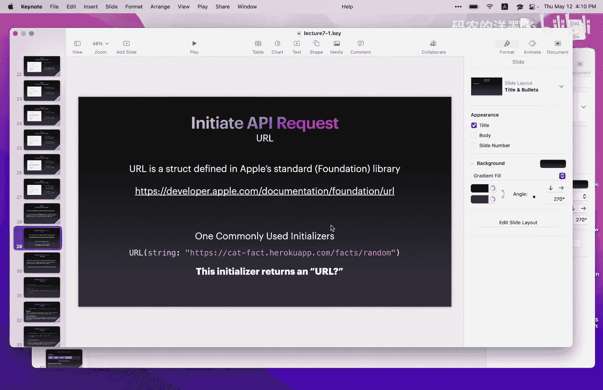
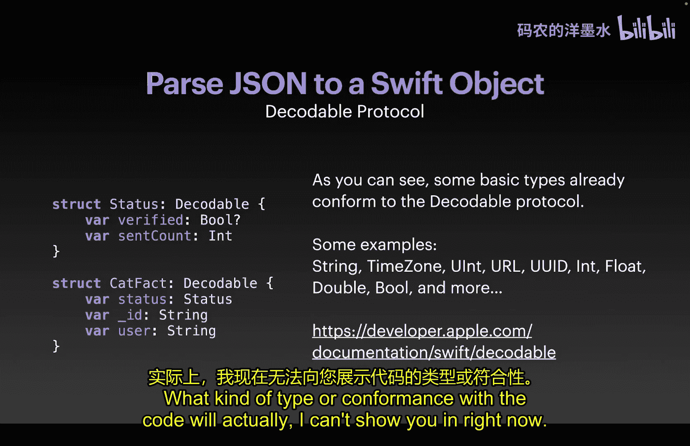
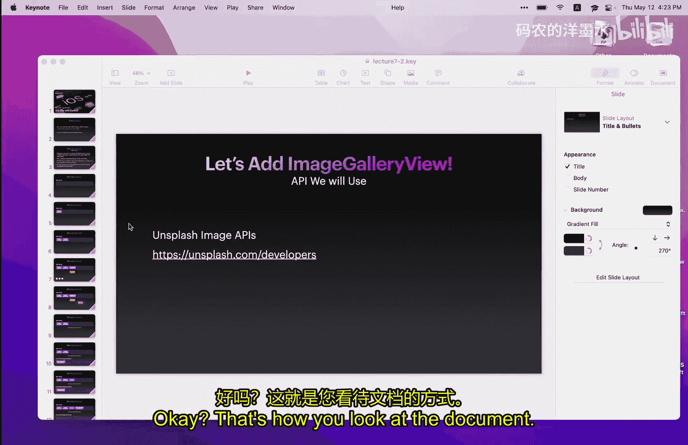
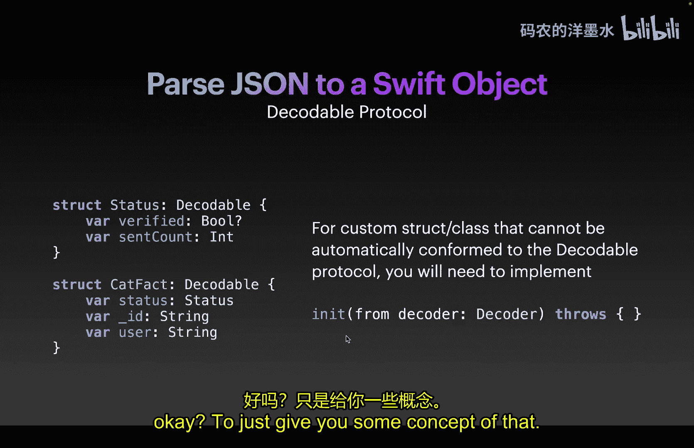
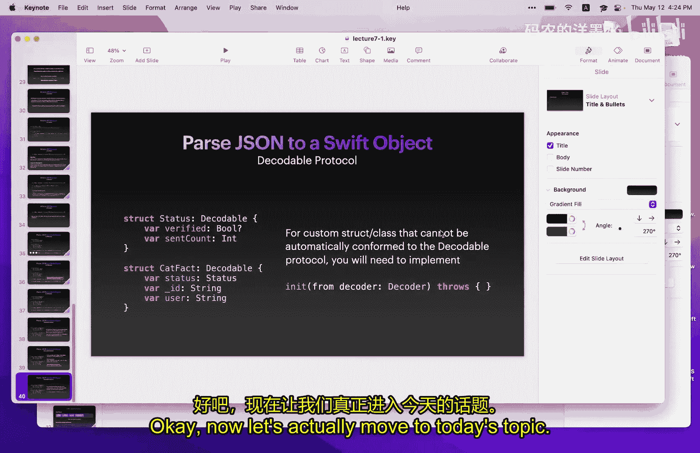
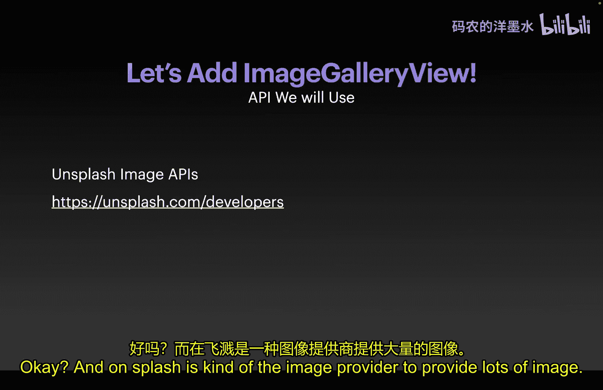
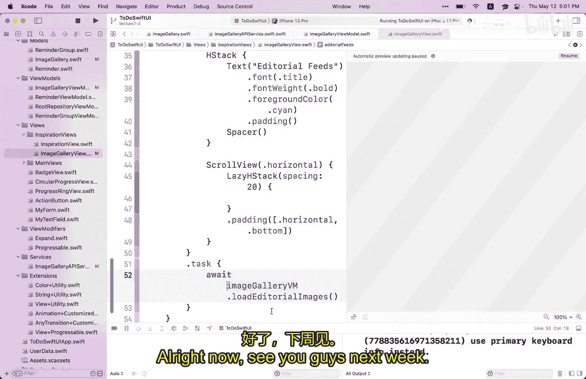

# 013：异步API与JSON解码 🚀



在本节课中，我们将学习如何从网络API获取数据，并解析JSON格式的响应。我们将介绍`URL`、`URLSession`等核心类，并了解如何使用`Codable`协议将JSON数据转换为Swift对象。此外，我们还将初步探讨异步编程的概念，为后续深入学习并发模型打下基础。

## 网络请求基础

上一节我们介绍了Web API的基本概念和术语。本节中，我们来看看如何在Swift中发起一个实际的网络请求。

### 创建URL

首先，我们需要创建一个`URL`对象来表示要访问的网络地址。`URL`结构体有一个常用的初始化器，它接收一个字符串参数。

```swift
let url = URL(string: "https://catfact.ninja/fact")
```

需要注意的是，这个初始化器返回一个可选类型（`URL?`）。如果传入的字符串不是一个有效的URL，它将返回`nil`。因此，我们必须进行错误处理。

```swift
if let url = URL(string: "https://catfact.ninja/fact") {
    // 使用有效的url
} else {
    // 处理无效的URL字符串
}
```

### 使用URLSession发起请求

`URLSession`是Foundation库中的一个类，它提供了从网络端点下载和上传数据的API。我们可以使用它的共享单例来发起请求。

以下是发起一个简单GET请求的步骤：

```swift
// 1. 创建URL
guard let url = URL(string: "https://catfact.ninja/fact") else {
    print("无效的URL")
    return
}

// 2. 发起异步请求
do {
    let (data, response) = try await URLSession.shared.data(from: url)
    // 处理返回的数据和响应
} catch {
    print("请求失败: \(error)")
}
```

`URLSession.shared.data(from:)`方法是一个异步函数（用`async`标记），它会返回一个包含`Data`和`URLResponse`的元组。我们使用`try await`关键字来调用它。



### 处理响应




`data`变量包含了从API端点返回的完整载荷信息，它是一个字节数组形式的数据。`response`变量则包含了API调用的完整头部响应信息，我们可以用它进行初步的错误检查，例如检查状态码。





```swift
guard let httpResponse = response as? HTTPURLResponse,
      httpResponse.statusCode == 200 else {
    print("收到错误的HTTP状态码")
    return
}
```

### 解析数据为字符串

我们可以将`Data`对象解析为字符串，以便查看原始响应内容。

```swift
if let responseString = String(data: data, encoding: .utf8) {
    print("响应字符串: \(responseString)")
}
```

## 解析JSON数据为对象

通常，我们不仅仅想要字符串，更希望将JSON数据解析为结构化的Swift对象。

### 定义数据模型

首先，我们需要定义与JSON结构对应的Swift结构体。例如，对于返回猫咪事实的API，我们定义如下结构：

```swift
struct Status: Codable {
    let verified: Bool
    let sentCount: Int
}

struct CatFact: Codable {
    let status: Status
    let text: String
}
```

### 使用JSONDecoder

Swift标准库提供了`JSONDecoder`类，用于将JSON格式的`Data`解码为遵循`Codable`协议的对象。

```swift
let decoder = JSONDecoder()
do {
    let catFact = try decoder.decode(CatFact.self, from: data)
    print("解析成功: \(catFact.text)")
} catch {
    print("解析JSON失败: \(error)")
}
```

### 遵循Codable协议




要让解码工作，我们的结构体必须遵循`Codable`协议。幸运的是，如果结构体中的所有属性类型本身已经遵循`Codable`（例如`String`、`Int`、`Bool`以及包含`Codable`属性的自定义类型），Swift编译器会自动为我们合成所需的代码。我们只需要声明遵循协议即可。

```swift
struct CatFact: Codable {
    // ... 属性定义
}
```

许多Swift标准库类型（如`String`、`URL`、`UUID`、`Int`、`Double`、`Bool`等）都已遵循`Codable`协议。

## 异步编程简介

在之前的代码中，我们看到了`await`关键字。现在，我们来简单了解为什么需要异步编程。

### 主线程与阻塞

当你的应用启动时，系统会为你的应用创建一个主线程。所有UI更新、渲染和用户交互（如点击、滑动）都发生在这个主线程上。到目前为止，我们在课程中编写的所有代码也都在主线程上运行。

问题在于，网络请求通常需要花费相对较长的时间。如果我们在主线程上同步执行网络请求，主线程就会被“阻塞”，直到请求完成。在此期间，应用界面会失去响应，用户无法进行任何操作。

### 异步函数与后台线程

异步函数可以将耗时任务（如网络请求）转移到后台线程执行，从而避免阻塞主线程。当任务完成后，如果需要更新UI，我们必须将相关操作移回主线程执行，因为所有UI更新都必须在主线程上进行。

### 关键字与语法

定义一个异步函数需要使用`async`关键字。

```swift
func fetchDataFromServer() async -> Data? {
    // ... 异步操作
}
```

调用一个异步函数时，需要使用`await`关键字。

```swift
let data = await fetchDataFromServer()
```

在SwiftUI视图中，我们可以在`.task`修饰符内调用异步函数，这类似于`.onAppear`，但专为异步操作设计。

```swift
ImageGalleryView()
    .task {
        await viewModel.loadImages()
    }
```

## 实战：创建图片库视图

接下来，我们将通过一个实战项目来应用所学知识，创建一个从Unsplash API获取图片的图片库视图。我们将遵循MVVM设计模式。

### 1. 创建数据模型 (Model)

首先，根据Unsplash API返回的JSON结构定义数据模型。我们主要关心图片的`id`和不同尺寸的`urls`。

```swift
struct ImageGallery: Codable, Identifiable {
    let id: String
    let urls: ImageURLs

    struct ImageURLs: Codable {
        let raw: String
        let full: String
        let regular: String
        // ... 其他尺寸
    }
}

// 为常用类型创建别名，方便使用
typealias Images = [ImageGallery]
```

### 2. 创建网络服务 (Service)

我们创建一个`ImageGalleryAPIService`类，其中包含发起网络请求的静态方法。需要根据Unsplash API文档设置端点URL和必要的客户端ID。

```swift
class ImageGalleryAPIService {
    static let clientID = "你的客户端ID"
    static let editorialEndpoint = "https://api.unsplash.com/photos"
    static let randomEndpoint = "https://api.unsplash.com/photos/random"

    static func fetchEditorialImages() async -> Images? {
        return await fetchResults(from: editorialEndpoint)
    }

    static func fetchRandomImages(count: Int = 10) async -> Images? {
        let endpoint = "\(randomEndpoint)?count=\(count)"
        return await fetchResults(from: endpoint)
    }

    private static func fetchResults(from endpoint: String) async -> Images? {
        // 1. 创建URL
        guard let url = URL(string: endpoint) else {
            print("无效的端点")
            return nil
        }

        // 2. 创建请求并添加认证头
        var request = URLRequest(url: url)
        request.setValue("Client-ID \(clientID)", forHTTPHeaderField: "Authorization")

        // 3. 发起异步请求
        do {
            let (data, response) = try await URLSession.shared.data(for: request)

            // 4. 检查HTTP状态码
            guard let httpResponse = response as? HTTPURLResponse,
                  httpResponse.statusCode == 200 else {
                print("API请求失败")
                return nil
            }

            // 5. 解码JSON数据
            let decoder = JSONDecoder()
            let images = try decoder.decode(Images.self, from: data)
            return images

        } catch {
            print("请求或解码失败: \(error)")
            return nil
        }
    }
}
```

### 3. 创建视图模型 (ViewModel)

视图模型负责从服务层获取数据，并管理状态。

```swift
class ImageGalleryViewModel: ObservableObject {
    @Published var editorialImages: Images = []
    @Published var randomImages: Images = []

    func loadEditorialImages() async {
        // 调用异步服务函数
        guard let results = await ImageGalleryAPIService.fetchEditorialImages() else {
            return
        }

        // 确保UI更新在主线程上进行
        await MainActor.run {
            self.editorialImages = results
        }
    }

    func loadRandomImages() async {
        guard let results = await ImageGalleryAPIService.fetchRandomImages() else {
            return
        }
        await MainActor.run {
            self.randomImages = results
        }
    }
}
```

### 4. 创建视图 (View)

最后，创建SwiftUI视图来显示图片。使用`.task`修饰符在视图出现时触发数据加载。

```swift
struct ImageGalleryView: View {
    @StateObject private var viewModel = ImageGalleryViewModel()

    var body: some View {
        ScrollView {
            LazyVGrid(columns: [GridItem(.adaptive(minimum: 100))]) {
                ForEach(viewModel.editorialImages) { image in
                    // 使用AsyncImage异步加载和显示图片
                    AsyncImage(url: URL(string: image.urls.regular)) { phase in
                        switch phase {
                        case .empty:
                            ProgressView()
                        case .success(let image):
                            image.resizable().scaledToFill()
                        case .failure:
                            Image(systemName: "photo")
                        @unknown default:
                            EmptyView()
                        }
                    }
                    .frame(minHeight: 100)
                    .clipped()
                }
            }
        }
        .task {
            // 视图出现时加载数据
            await viewModel.loadEditorialImages()
        }
    }
}
```

## 总结



本节课中，我们一起学习了iOS开发中网络请求和JSON解析的核心知识。我们了解了如何使用`URL`和`URLSession`发起网络请求，掌握了通过`Codable`协议和`JSONDecoder`将JSON数据映射到Swift对象的方法。我们还初步接触了异步编程的概念，理解了为何要将耗时操作移出主线程以保持UI流畅，并学习了`async`/`await`的基本用法。最后，我们通过一个从Unsplash获取图片的实战项目，将所有这些概念串联起来，构建了一个完整的图片库视图。这些知识是构建与网络交互的现代iOS应用的基础。