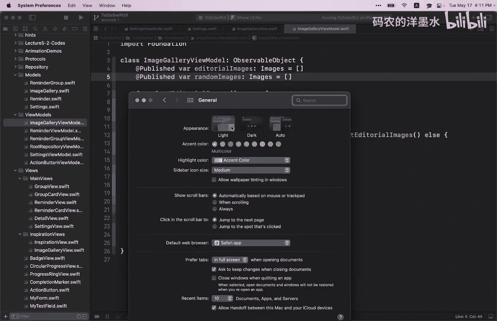
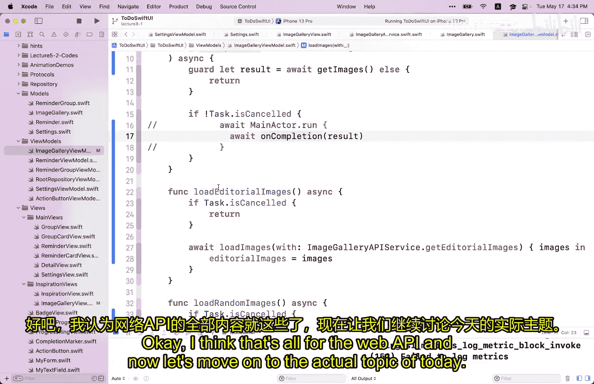
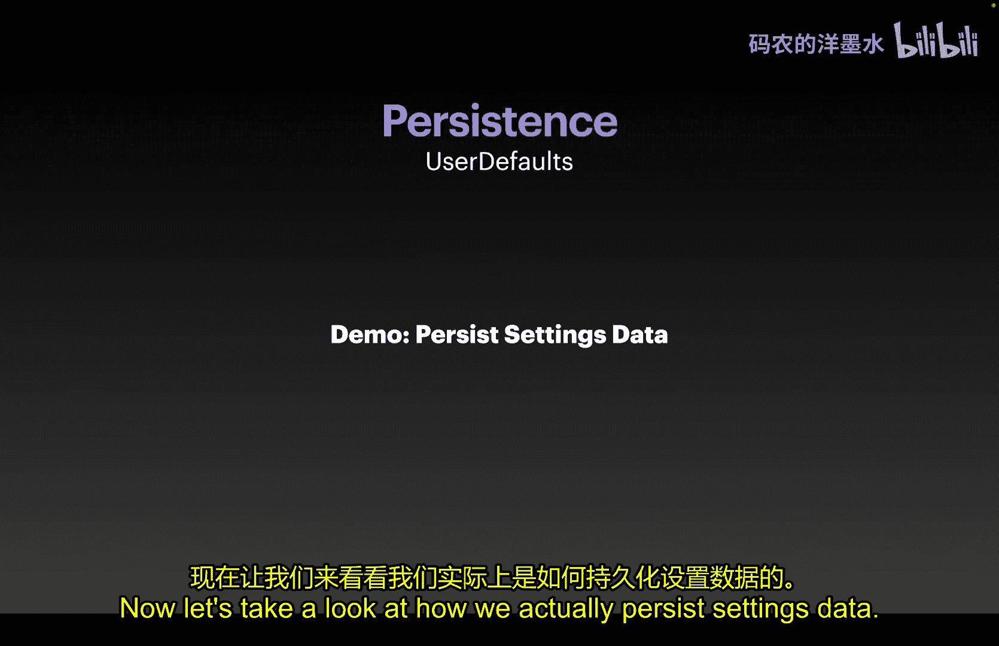
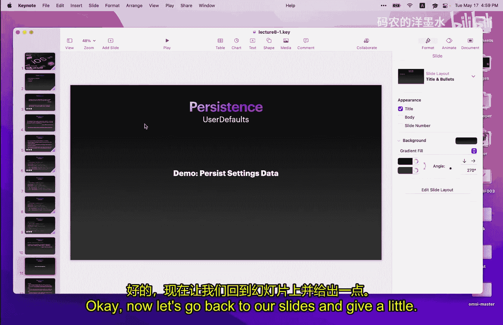
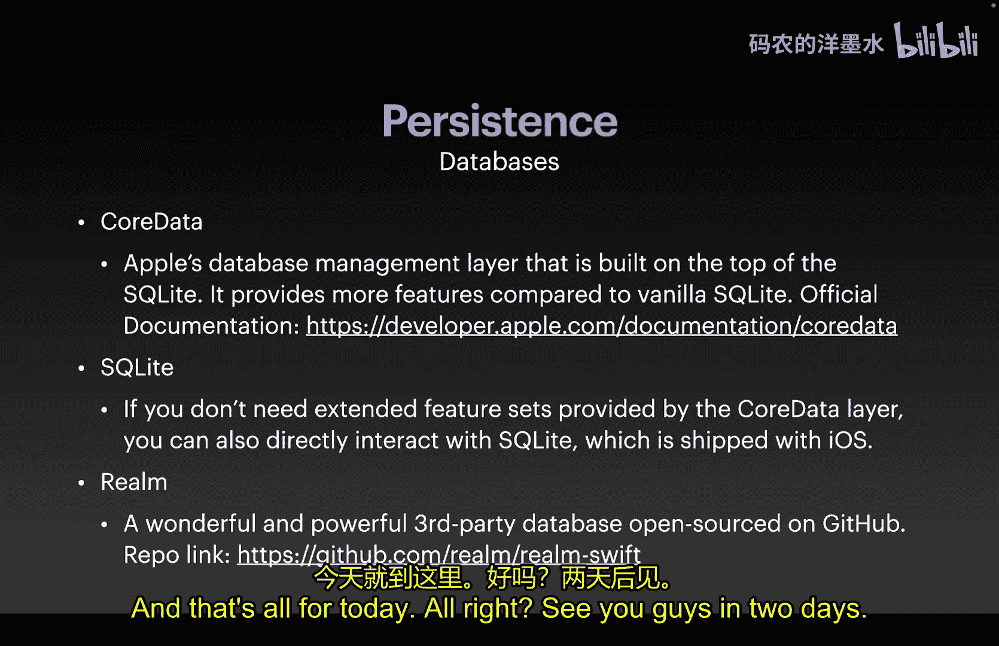

# 014：数据持久化 📱💾



在本节课中，我们将学习如何为iOS应用实现数据持久化。我们将首先回顾并完成上一节课的图片画廊应用，然后重点介绍如何使用`UserDefaults`来保存和加载用户的偏好设置数据。

---

## 回顾：图片画廊应用

上一节我们介绍了API服务层、视图模型和数据模型。本节中，我们来看看如何将这些数据在视图中展示出来。

首先，我们有一个`ImageGallery`模型，它包含图片的ID和一个包含不同尺寸图片URL的结构体。

```swift
struct ImageGallery: Codable {
    let id: String
    let urls: ImageURLs
}
struct ImageURLs: Codable {
    let regular: String
}
```

为了在视图中显示从网络获取的图片，我们创建了一个构建图片视图的函数。这个函数使用SwiftUI原生的`AsyncImage`视图来异步加载图片。

以下是构建图片视图的函数：

```swift
func buildImageView(for image: ImageGallery) -> some View {
    // 1. 获取常规尺寸图片的URL
    guard let imageUrl = URL(string: image.urls.regular) else {
        return AnyView(Text("Invalid URL"))
    }
    
    // 2. 使用AsyncImage异步加载
    return AnyView(
        AsyncImage(url: imageUrl) { phase in
            switch phase {
            case .success(let image):
                // 加载成功，显示图片
                image
                    .resizable()
                    .aspectRatio(contentMode: .fill)
            case .failure(_):
                // 加载失败，显示占位符
                Text("Failed to load")
            case .empty:
                // 加载中，显示加载指示器
                Text("Loading...")
            @unknown default:
                EmptyView()
            }
        }
        .frame(height: 200)
        .clipShape(RoundedRectangle(cornerRadius: 10))
    )
}
```

这个函数处理了加载的不同阶段：成功、失败和进行中。我们为图片应用了固定的高度和圆角。

在视图模型中，我们通过调用API服务来获取“编辑推荐”和“随机”图片列表。为了减少代码重复，我们创建了一个通用的加载函数。

以下是通用的图片加载函数：

```swift
func loadImages(
    using fetchFunction: @escaping () async throws -> [ImageGallery],
    onCompletion: @escaping ([ImageGallery]) -> Void
) {
    Task {
        do {
            let images = try await fetchFunction()
            // 确保UI更新在主线程进行
            await MainActor.run {
                onCompletion(images)
            }
        } catch {
            print("Failed to load images: \(error)")
        }
    }
}
```

然后，在视图的`.task`修饰符中调用这个函数来触发数据加载。

```swift
.task {
    await viewModel.loadEditorialImages()
    await viewModel.loadRandomImages()
}
```

现在，我们的应用可以显示从网络API获取的图片了。但是，应用的设置（如是否禁用步骤预览）在应用关闭后不会被记住。接下来，我们将解决这个问题。

---

## 数据持久化简介

数据持久化指的是将应用的状态数据保存下来，使其在创建它的进程结束后依然存在。换句话说，我们希望将数据保存在设备的某个地方，以便应用之后可以重新获取，即使应用被关闭或终止。

对于保存简单的用户偏好设置，iOS提供了一个非常方便的工具：`UserDefaults`。

---

## 使用 UserDefaults

`UserDefaults` 是Foundation框架中的一个类，它提供了一个与默认系统交互的编程接口。你可以把它理解为一个简单的键值对存储系统，类似于字典。

**核心概念**：
*   **键值对存储**：通过一个唯一的键（`String`类型）来存储和检索值。
*   **支持的数据类型**：`String`, `Int`, `Double`, `Bool`, `Data`, `Date`, `Array`, `Dictionary`。
*   **存储位置**：数据最终会被写入一个文件（通常是plist文件）保存在设备文件系统中。

### 如何存储数据



要存储数据，首先获取`UserDefaults.standard`单例实例，然后使用`set(_:forKey:)`方法。

```swift
let defaults = UserDefaults.standard
// 存储不同类型的数据
defaults.set(25, forKey: "userAge")
defaults.set("John", forKey: "userName")
defaults.set(Date(), forKey: "lastLogin")
```

### 如何检索数据

检索数据时，可以使用类型特定的方法（如`integer(forKey:)`）来直接获取对应类型的值。

```swift
let age = defaults.integer(forKey: "userAge") // 返回 Int
let name = defaults.string(forKey: "userName") // 返回 String?
```

对于`Date`等没有特定方法的数据类型，可以使用通用的`object(forKey:)`方法，然后进行类型转换。

```swift
if let lastLogin = defaults.object(forKey: "lastLogin") as? Date {
    // 使用 lastLogin
}
```

---

## 实践：持久化应用设置

让我们回到项目，将用户的设置保存到`UserDefaults`中。我们的`Settings`模型结构体如下：



```swift
struct Settings: Codable {
    var showStepPreview: Bool
    var notificationEnabled: Bool
    // ... 其他设置属性
}
```

为了将其保存到`UserDefaults`，我们需要将结构体转换为`Data`。这可以通过`JSONEncoder`来实现。

首先，在`Settings`结构体中添加一个计算属性来获取其JSON数据表示：

```swift
var json: Data? {
    let encoder = JSONEncoder()
    return try? encoder.encode(self)
}
```

同时，我们添加一个可失败初始化器，以便从`Data`中恢复`Settings`实例：

```swift
init?(json: Data?) {
    guard let data = json,
          let settings = try? JSONDecoder().decode(Settings.self, from: data) else {
        return nil
    }
    self = settings
}
```

接下来，我们创建一个`SettingsViewModel`来管理设置的加载和保存。

以下是视图模型的关键部分：

```swift
class SettingsViewModel: ObservableObject {
    @Published var settings = Settings()
    private let settingsKey = "appSettings"
    
    init() {
        loadSettings()
    }
    
    func loadSettings() {
        // 1. 从UserDefaults中获取Data
        if let data = UserDefaults.standard.data(forKey: settingsKey) {
            // 2. 尝试解码为Settings对象
            if let savedSettings = Settings(json: data) {
                settings = savedSettings
            }
        }
    }
    
    func saveSettings() {
        // 1. 将当前设置编码为Data
        if let data = settings.json {
            // 2. 存储到UserDefaults
            UserDefaults.standard.set(data, forKey: settingsKey)
        }
    }
}
```

最后，我们需要在设置发生改变时调用`saveSettings()`方法。一种直接的方法是在每个设置属性的`didSet`观察器中调用。

```swift
@Published var settings = Settings() {
    didSet {
        saveSettings()
    }
}
```

现在，当用户修改任何设置时，它们会自动保存到`UserDefaults`中。当应用下次启动时，`init()`中的`loadSettings()`会将这些设置加载回来。

---

## 进阶话题与总结

本节课中我们一起学习了如何使用`UserDefaults`实现简单的数据持久化。对于存储用户偏好和少量数据，它是一个完美且简单的选择。

然而，对于更复杂的数据（如大量结构化数据、关系型数据），你需要考虑真正的数据库解决方案。在iOS开发中，你有以下几个主要选择：

1.  **Core Data**：苹果官方提供的对象图管理和持久化框架，功能强大，但学习曲线较陡。
2.  **SQLite**：轻量级的关系型数据库，可以直接使用C接口或第三方封装库。
3.  **Realm**：一个流行的第三方移动数据库，以其易用性和高性能著称。




对于你的期末项目，如果只需要保存用户设置，`UserDefaults`或SwiftUI提供的`@AppStorage`属性包装器就足够了。如果需要管理更复杂的数据，可以开始探索上述数据库选项。



**总结**：我们完成了图片画廊的数据展示，并成功实现了应用设置的持久化。你学会了`UserDefaults`的基本用法，包括存储、检索以及如何配合`Codable`协议来保存自定义对象。这是构建能记住用户偏好的、用户体验更佳的应用的重要一步。