# 015：GCD进阶与Swift Concurrency 🚀

在本节课中，我们将继续深入学习Grand Central Dispatch（GCD），并探讨一些高级概念，如调度屏障。随后，我们将开始介绍Swift Concurrency，这是Swift语言中用于处理异步代码的新范式，核心是`async/await`语法。我们将在下一讲中继续讨论Actor模型。

## GCD进阶概念 🔧

上一节我们介绍了全局队列（Global Queue）的基本用法。本节中，我们来看看如何更通用地访问全局队列，并深入探讨线程安全集合的实现。

访问全局队列的通用方式是使用`DispatchQueue`类的`global`实例。你可以指定服务质量（QoS），例如`.background`、`.userInitiated`、`.userInteractive`、`.default`或`.utility`。全局队列本身是一个并发队列，你可以使用`async`或`sync`方法提交任务。

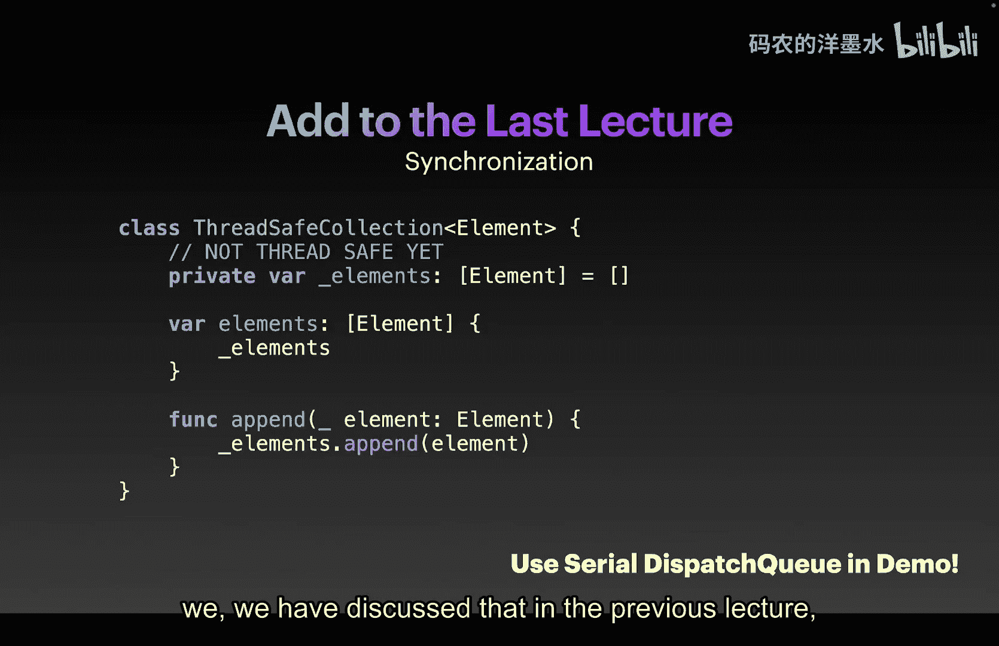

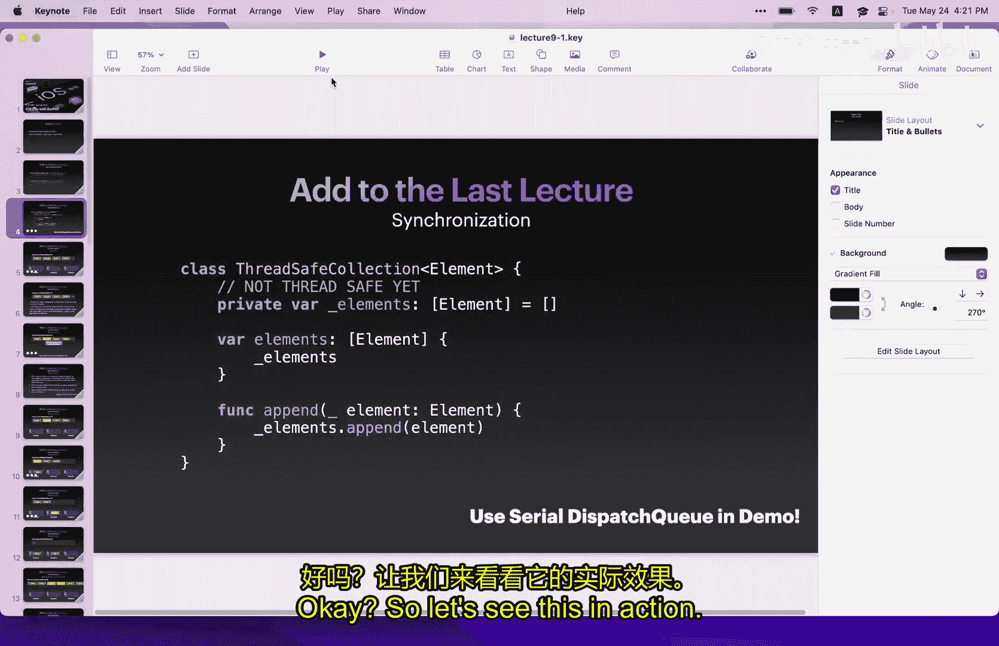

```swift
let queue = DispatchQueue.global(qos: .userInitiated)
queue.async {
    // 执行异步任务
}
```

现在，我们为同步部分补充一个要点。首先，请看以下代码块。

Swift标准库中的所有集合默认都不是线程安全的，其内部没有锁定机制。因此，如果你想实现一个线程安全的集合，需要自行处理同步。

以下是一个非线程安全集合的示例：

```swift
class ThreadUnsafeCollection<Element> {
    private var _elements: [Element] = []
    
    var elements: [Element] {
        return _elements
    }
    
    func append(_ element: Element) {
        _elements.append(element)
    }
}
```

这里存在什么问题？它不是线程安全的。例如，可能有多个线程同时尝试读取数据，而另一些线程尝试追加数据，这些操作可能相互交错，导致数据竞争。


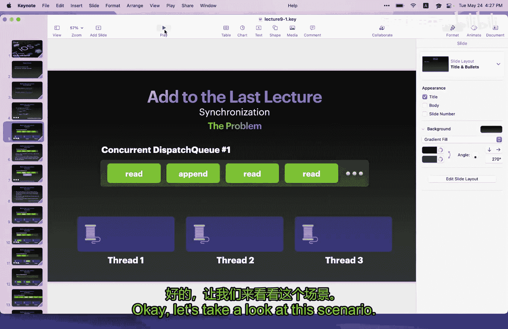

任何解决方案？我们在上一讲讨论过，可以使用串行调度队列。让我们看看如何实现。

## 使用串行队列实现线程安全 🛡️

以下是使用串行队列保护读写操作的实现：

```swift
class ThreadSafeCollection<Element> {
    private var _elements: [Element] = []
    private let queue = DispatchQueue(label: "com.example.ThreadSafeCollection")
    
    var elements: [Element] {
        return queue.sync {
            return _elements
        }
    }
    
    func append(_ element: Element) {
        queue.sync {
            _elements.append(element)
        }
    }
}
```

首先，我们注意到对于`append`函数，目前使用的是`sync`方法。但想象一下，如果有成千上万个线程正在读取这个集合，同时我们想在另一个线程中追加数据。由于这是同步方法，并且前面有很多任务，这个线程可能会被阻塞很长时间。

对于追加操作，我们只是想执行动作而不返回任何值。因此，在这种情况下，我们可以尝试用`async`方法替换`sync`方法来稍作改进。

```swift
func append(_ element: Element) {
    queue.async {
        self._elements.append(element)
    }
}
```

这样，当调用者尝试调用`append`函数时，它只是提交任务并立即返回，不会阻塞当前线程。

现在仍然存在一个大问题。我们使用串行队列实现了线程安全集合，但当我们尝试访问或向这个集合追加数据时，我们无法从并发中受益，因为所有操作都是串行化的。

有什么想法可以改进这一点吗？一个简单的想法是将串行队列改为并发队列，对吧？这是一个开始，但你会看到其他问题。

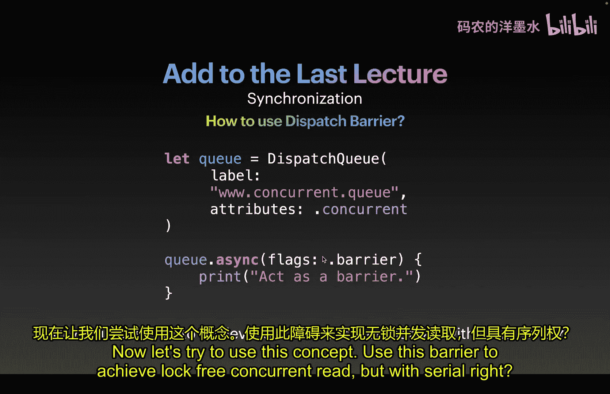

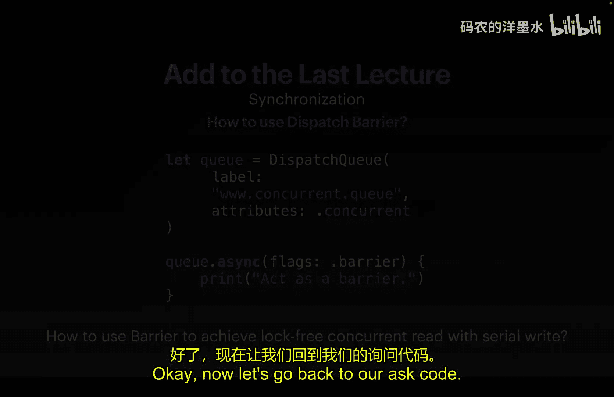

## 并发队列的挑战与调度屏障 🚧

首先，尝试将队列改为并发的：

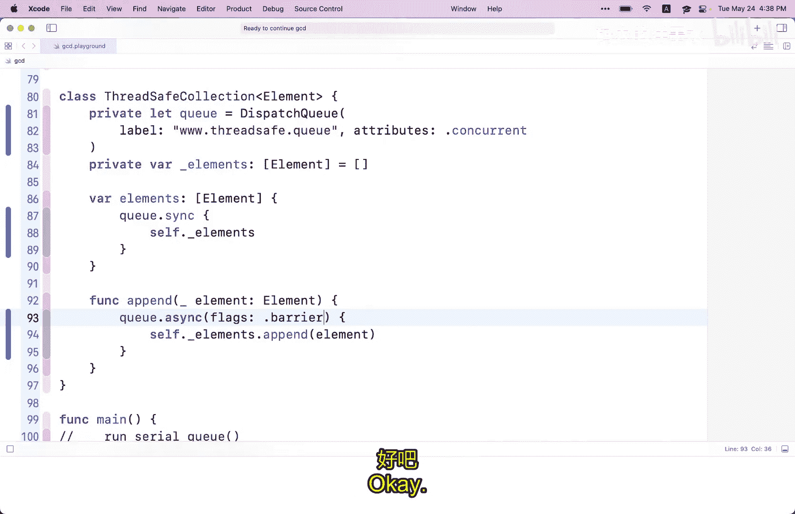

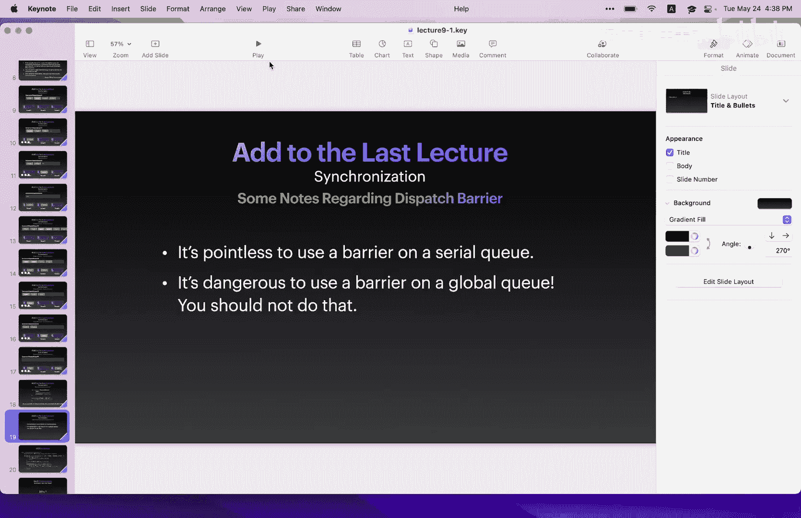

```swift
private let queue = DispatchQueue(label: "com.example.ThreadSafeCollection", attributes: .concurrent)
```

现在你可以从并发中受益，因为任务被并发调度。但是，问题又出现了：数据竞争可能再次发生，它不再安全。

让我们思考一下我们真正想要实现的行为。首先，我们希望它是线程安全的，即在并发访问时没有数据竞争。然而，我们也希望利用并发的优势，这意味着我们希望支持并发读取，但串行化写入操作。

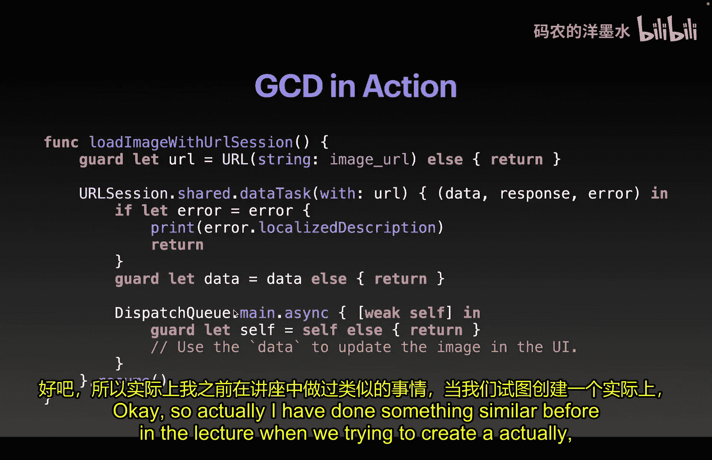


简而言之，我们希望**并发读取，串行写入**。人们通常使用特殊的锁来实现这种行为，通常称为读写锁（Read-Write Lock）。但在本例中，我们将尝试使用调度队列实现无锁的读写锁行为。

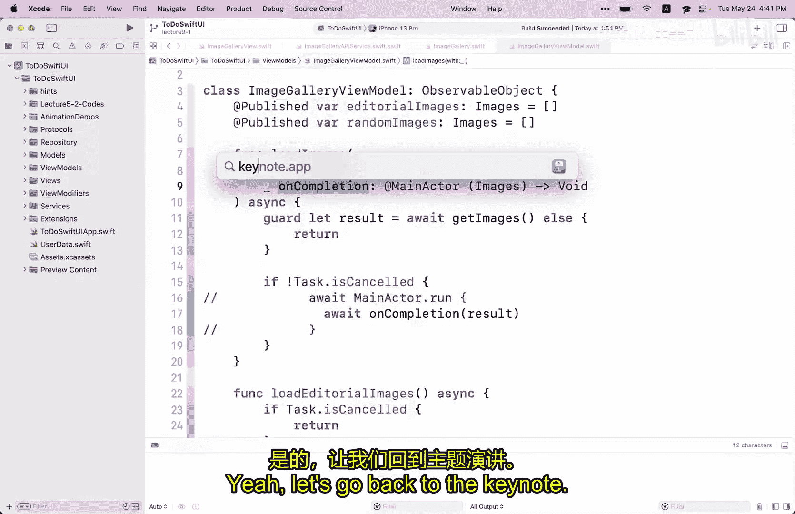

现在来看看一个新概念：**调度屏障（Dispatch Barrier）**。

调度屏障遵循三条规则：
1.  当向并发队列添加一个屏障任务时，队列会延迟执行该屏障块以及屏障之后提交的任何任务，直到所有先前提交的任务执行完毕。
2.  当实际执行到屏障任务时，队列将串行执行该屏障任务（一次一个）。
3.  当所有屏障块执行完毕后，队列恢复正常行为（即恢复并发调度）。

让我们看一个例子。假设我们有一个并发队列和三个可用线程。我们调度两个读取操作（标记为正常任务），然后是两个追加操作（标记为屏障），最后又是两个读取操作。

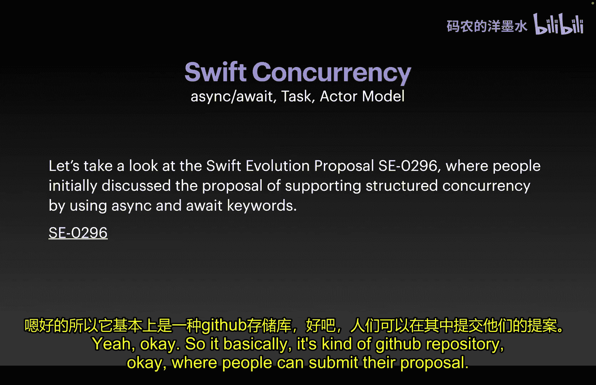

首先，并发队列会尝试并发调度两个读取操作到线程1和线程2。但它遇到了屏障，所以只会调度这两个读取操作。当这两个任务完成后，并发队列可以执行屏障块。但屏障块将串行执行，先调度第一个追加操作，完成后调度第二个。当所有屏障块执行完毕后，队列恢复正常行为，可以并发调度后续的两个读取操作。

## 调度屏障的语法与应用 💻

在代码中，你可以通过向`async`调用传递一个标志来创建屏障块：

```swift
queue.async(flags: .barrier) {
    // 这是一个屏障任务
    self._elements.append(element)
}
```

现在，让我们使用屏障概念来实现支持并发读取但串行写入的无锁集合：

```swift
class ImprovedThreadSafeCollection<Element> {
    private var _elements: [Element] = []
    private let queue = DispatchQueue(label: "com.example.ImprovedThreadSafeCollection", attributes: .concurrent)
    
    var elements: [Element] {
        return queue.sync {
            return _elements
        }
    }
    
    func append(_ element: Element) {
        queue.async(flags: .barrier) {
            self._elements.append(element)
        }
    }
}
```

现在，我们有了一个线程安全的集合，同时支持并发读取。当涉及到追加操作（即写入操作）时，它的行为类似于串行操作。但当涉及到读取时，可以并发进行。

关于调度屏障的注意事项：
1.  在串行队列上使用屏障是无意义的，因为所有任务本来就是串行执行的。
2.  在全局队列上使用屏障非常危险，因为全局队列是整个系统共享的，你不应该阻塞它。

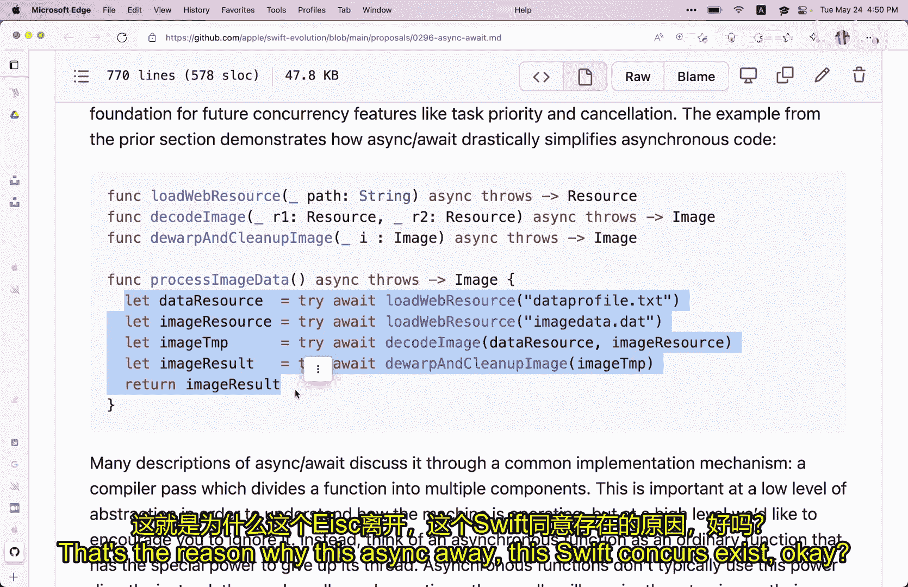

## 从GCD到Swift Concurrency的演进 🚀

我们之前已经见过使用GCD和完成处理程序（Completion Handler）的异步网络请求示例。例如，`URLSession`的`dataTask`方法内部就使用了GCD将任务分派到后台线程。完成处理程序在任务结束时被调用。

然而，GCD也存在一些问题，这促使了Swift Concurrency的出现。主要目标不是性能（GCD性能已经很优秀），而是为了**提高代码的可读性**。

使用完成处理程序的主要问题包括：
1.  **末日金字塔（Pyramid of Doom）**：当有多个嵌套的异步调用时，代码会变得难以阅读和跟踪。
2.  **错误处理复杂**：在多层嵌套的完成处理程序中，错误检查和处理会变得非常繁琐且容易出错。
3.  **容易遗漏调用**：在错误处理分支中，很容易忘记调用完成处理程序，导致难以调试的bug。

Swift Concurrency通过`async/await`关键字提供了结构化的并发编程方式，使异步代码看起来像同步代码一样清晰。

## Swift Concurrency 核心：async/await 与 Task 🧩

`async/await`是Swift语言内置的特性，用于支持结构化并发。但`async/await`本身并不自动提供并发执行，它主要提供了一种结构化的编程方式。

要在同步上下文中启动异步任务，你需要显式地创建一个并发上下文。这可以通过`Task`来实现：

```swift
Task {
    // 在这个闭包内是完整的并发上下文
    let images = await loadEditorialImages()
    // 更新UI等操作
}
```

`Task`可以接受优先级参数，例如`.userInitiated`。

一个重要的语言特性是`async let`。它允许你启动一个子任务并与其他代码并发运行，而不需要立即等待其结果。

比较以下两种方式：
*   **使用 `await`**：代码会等待该函数完成，然后才继续执行后续语句。
*   **使用 `async let`**：会创建一个子任务并发运行，立即返回一个占位符。只有在你实际使用其结果（使用`await`）时，才会等待任务完成并获取具体值。

这允许你在等待一个长时间运行任务的同时，执行其他不依赖于该结果的工作。

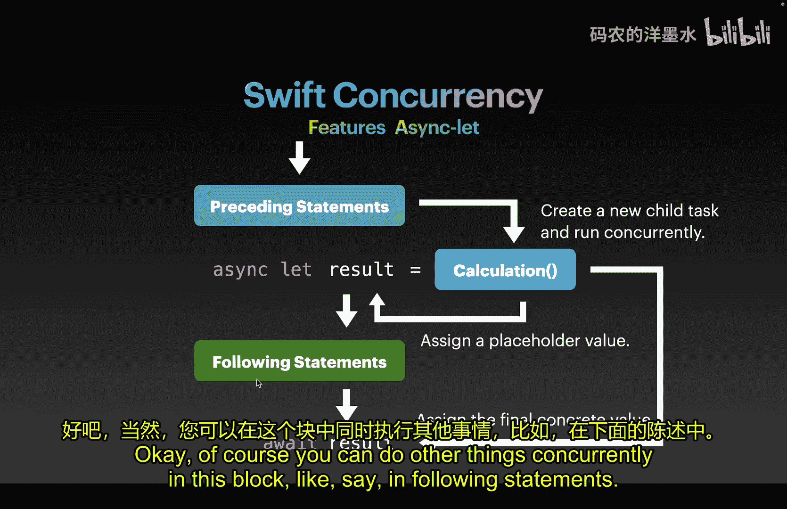

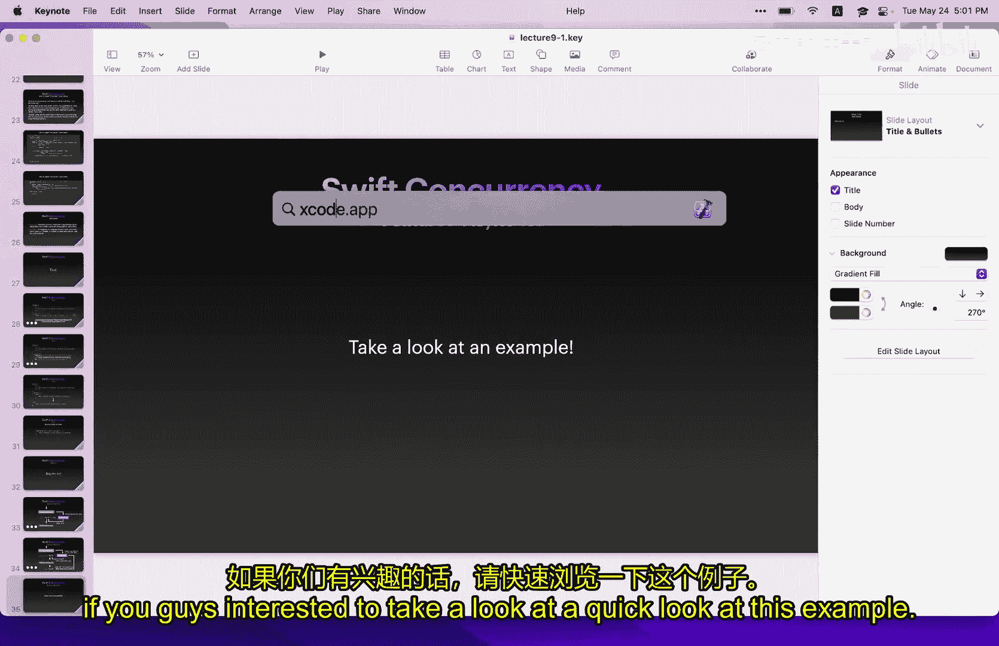

## 总结 📚

本节课中我们一起学习了：
1.  **GCD进阶**：回顾了全局队列，并深入探讨了使用串行和并发队列实现线程安全集合的挑战。
2.  **调度屏障**：学习了如何使用调度屏障在并发队列上实现“并发读取，串行写入”的线程安全模式，从而在保证安全性的同时提升性能。
3.  **Swift Concurrency的动机**：了解了传统基于GCD和完成处理程序的异步编程模式存在的问题，如代码嵌套过深（末日金字塔）、错误处理复杂等，这些问题催生了更结构化的解决方案。
4.  **Swift Concurrency 基础**：介绍了`async/await`关键字和`Task`的基本概念。`async/await`提供了编写异步代码的清晰语法，使其看起来像同步代码。`Task`用于在同步上下文中显式创建并发执行环境。我们还简要提到了`async let`，它允许并发启动子任务。

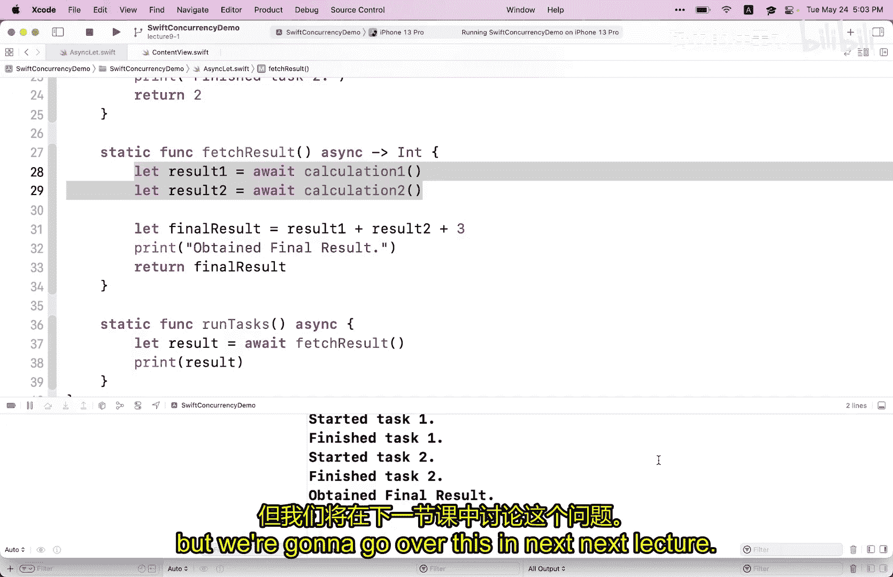

下一讲，我们将继续探讨Swift Concurrency的更多内容，包括Actor模型。