# 016：Swift并发进阶 🚀

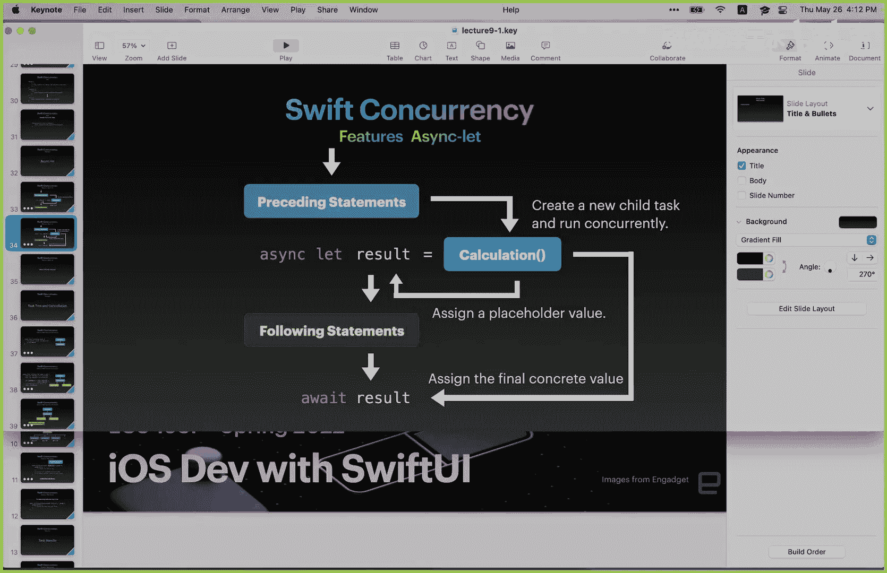

在本节课中，我们将深入学习Swift并发编程的进阶概念，包括`async let`、任务树与取消、只读异步属性、任务组、任务句柄、异步序列以及Actor模型。我们将通过具体的代码示例来理解这些概念，并学习如何在实际开发中应用它们。

---

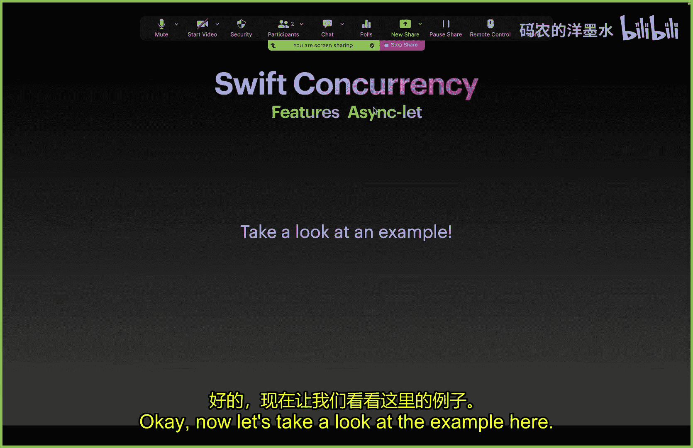


## 回顾：`async let` 🔄

上一节我们介绍了`async let`的基本用法。本节中，我们来看看它的具体工作机制。

`async let`是Swift并发系统提供的一个特性。当你使用`async let`时，代码的执行流程如下：
1.  首先执行所有前置语句。
2.  当遇到`async let`时，会创建一个新的子任务来并发执行计算函数。
3.  此时，结果变量只是一个占位符，并不包含实际值，计算在后台进行。
4.  程序会继续执行所有后续语句。
5.  直到我们真正需要使用这个结果时，使用`await`关键字等待计算函数完成，并将实际值赋给结果变量。

让我们看一个例子：

```swift
func fetchResult() async -> Int {
    // 使用旧语法，串行执行
    let result1 = await calculation1()
    let result2 = await calculation2()
    return result1 + result2 + 3
}
```

在这个函数中，`calculation1`和`calculation2`会串行执行，总共需要大约4秒（假设每个函数休眠2秒）。

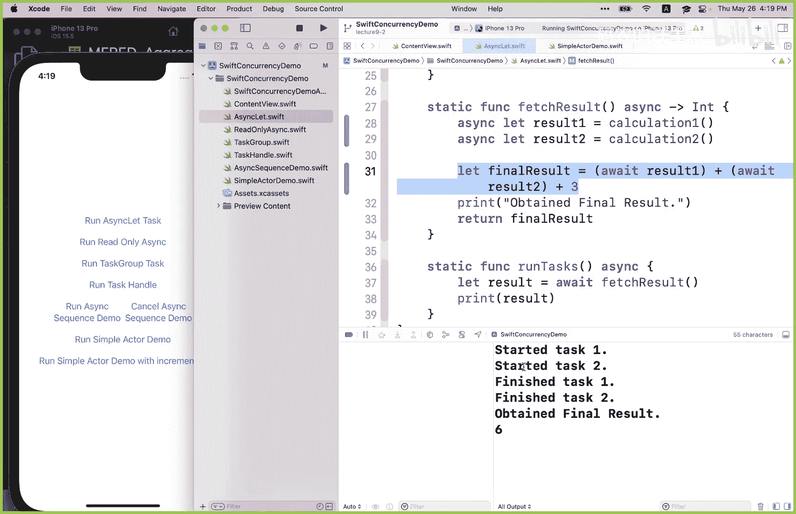

我们可以使用`async let`来让它们并发执行：

```swift
func fetchResult() async -> Int {
    // 使用 async let 并发执行
    async let result1 = calculation1()
    async let result2 = calculation2()
    // 当需要结果时再等待
    return await result1 + result2 + 3
}
```

现在，这两个计算会同时开始，整个函数只需大约2秒即可完成。

---

## 任务树与取消 🌳

当我们启动一个异步任务时，Swift的并发系统会在幕后创建一个任务树结构。

例如，调用`runTasks`函数会创建一个根任务。在`runTasks`内部`await`了`fetchResult`函数，系统会为`fetchResult`创建一个子任务。在`fetchResult`内部，如果使用了`async let`，则会为`calculation1`和`calculation2`创建更下层的子任务。

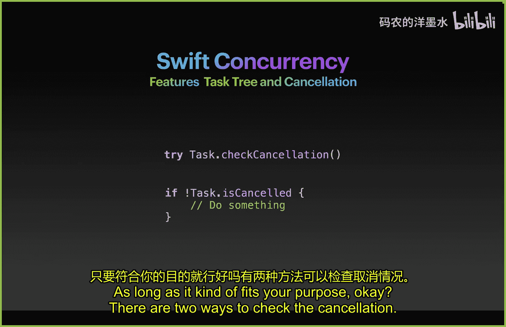

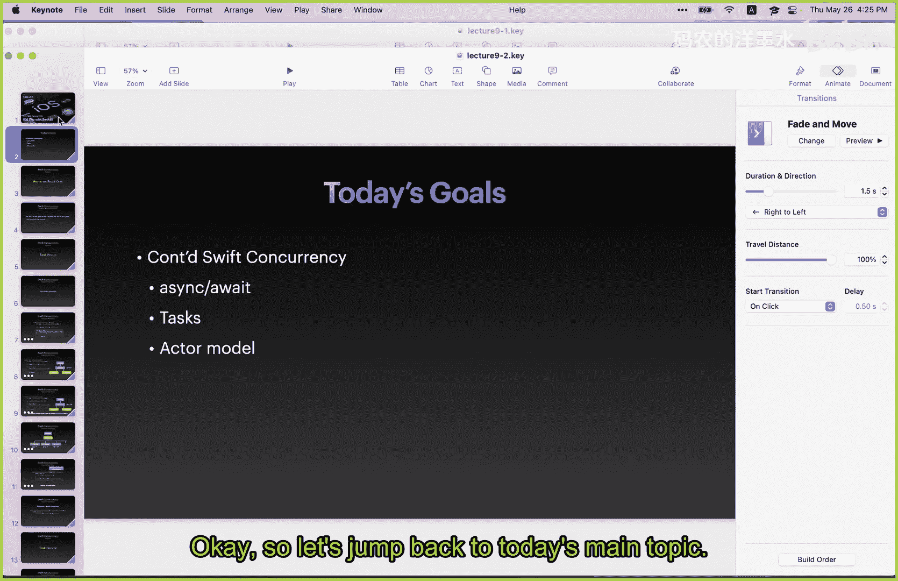

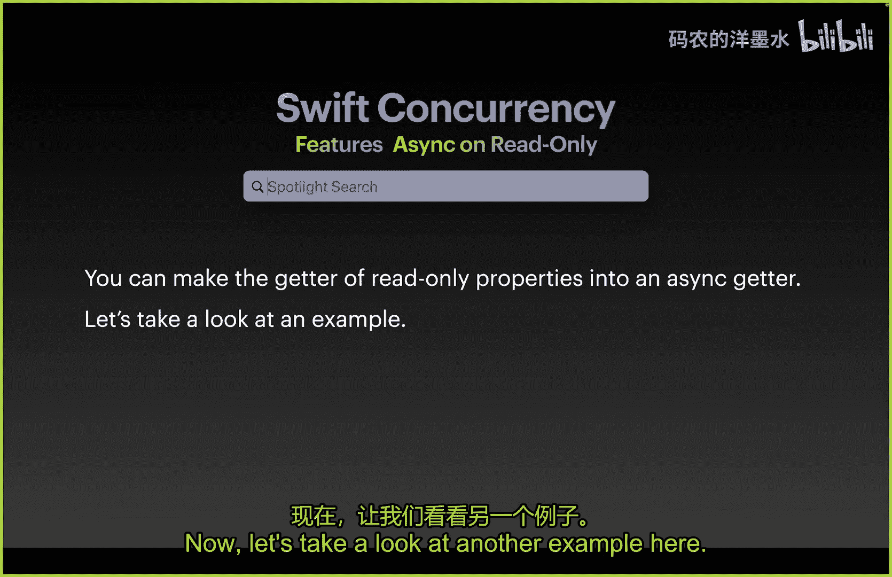

关于任务取消，有几点需要注意：
*   **取消只是一个标记**：当任务被取消（例如，因为父任务抛出了错误），系统会标记子任务为“已取消”，但**不会立即停止**任务的执行。
*   **需要手动检查**：开发者必须在代码中**手动检查取消状态**，并执行提前返回等清理操作。
*   **设计时需考虑取消**：在编写耗时操作时，应考虑取消的可能性，并实现优雅的终止逻辑。

有两种主要方法来检查任务是否被取消：

1.  使用 `Task.checkCancellation()`，如果任务已取消，它会抛出一个 `CancellationError`。
    ```swift
    try Task.checkCancellation()
    ```
2.  使用 `Task.isCancelled`，它返回一个布尔值。
    ```swift
    if Task.isCancelled {
        return // 或进行其他清理
    }
    ```

---

## 只读异步属性 📖

对于只读计算属性，你可以将其`getter`定义为异步的。

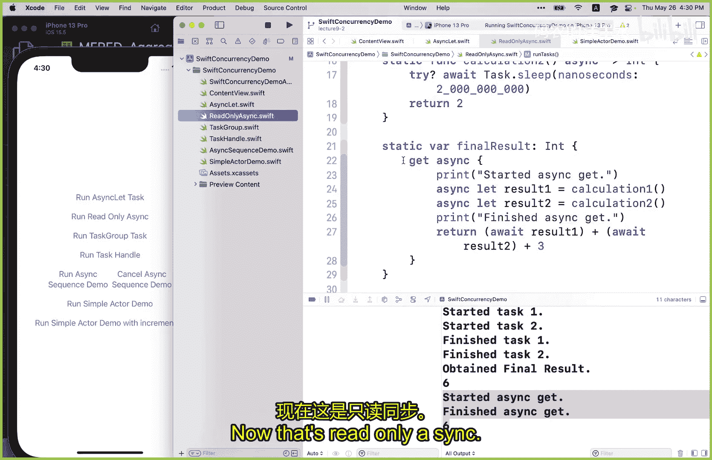

以下是一个例子，我们将`fetchResult`函数改成了一个异步计算属性：

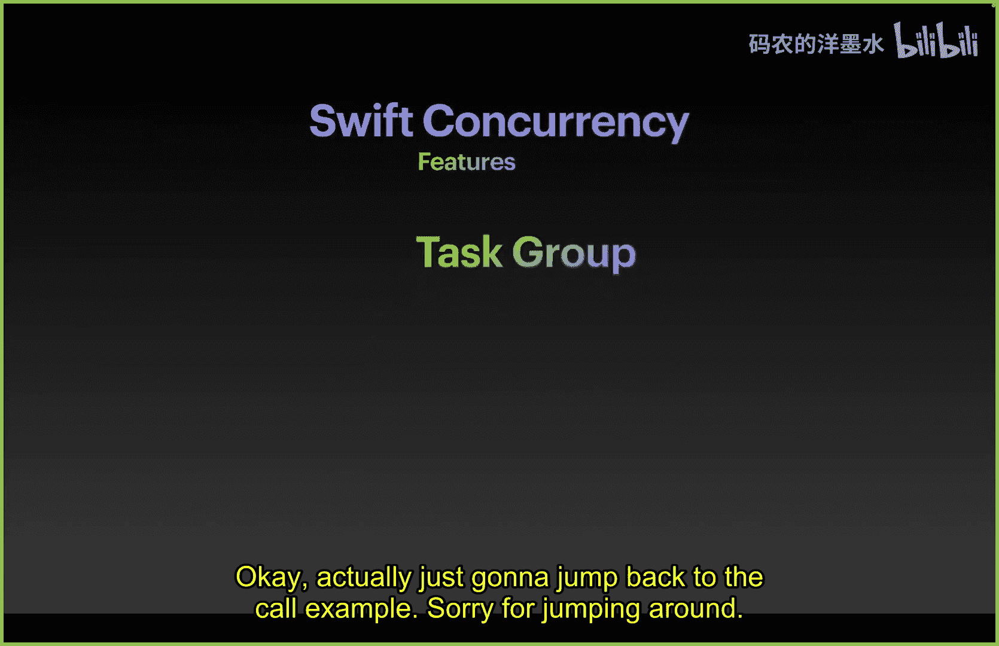

```swift
var finalResult: Int {
    get async {
        print("开始计算最终结果...")
        async let r1 = calculation1()
        async let r2 = calculation2()
        return await r1 + r2 + 3
    }
}
```

在调用方，你需要使用`await`来获取这个属性的值：

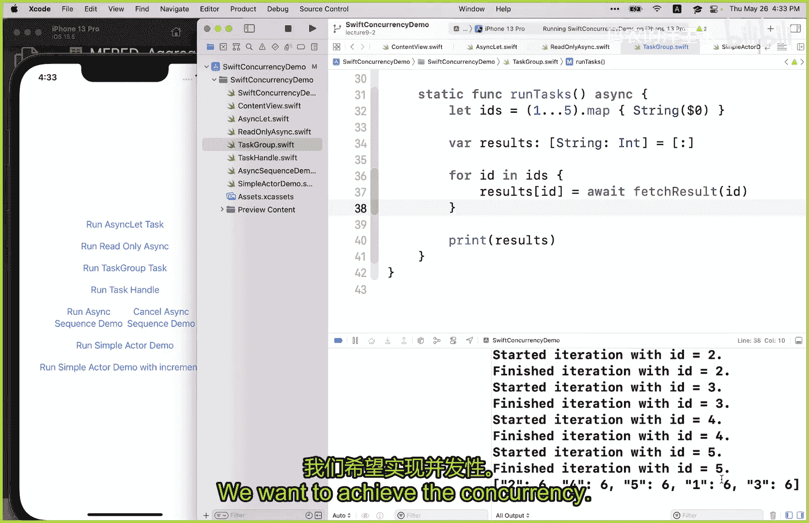

```swift
let result = await myObject.finalResult
```

**额外技巧**：
*   你可以对包含可等待（`await`）元素的数组使用`await`。
    ```swift
    let results = await [result1, result2, 3]
    let sum = results.reduce(0, +)
    ```
*   使用`defer`块来确保某些操作（如打印日志、释放锁）在函数返回（或抛出错误）后执行。
    ```swift
    func fetchResult() async -> Int {
        defer {
            print("fetchResult 执行完毕。")
        }
        // ... 异步计算 ...
        return result
    }
    ```

---

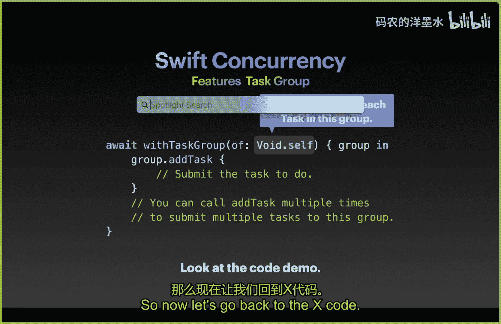

## 任务组 🤝

当需要动态创建一组并发任务时，`async let`就不够灵活了。这时可以使用**任务组**。

假设我们有一个ID数组，需要为每个ID并发地获取结果。串行版本如下：

```swift
var results: [String: Int] = [:]
for id in ids {
    results[id] = await fetchResult(for: id) // 串行，效率低
}
```

使用任务组可以将其改为并发执行：

```swift
var results: [String: Int] = [:]
await withTaskGroup(of: (String, Int).self) { group in
    for id in ids {
        group.addTask {
            // 每个任务返回一个 (ID, 结果) 的元组
            return (id, await self.fetchResult(for: id))
        }
    }
    // 等待并收集结果
    for await (id, result) in group {
        results[id] = result // 这里按完成顺序串行添加，是安全的
    }
}
```

**关键点**：
*   `withTaskGroup(of:...)` 用于创建任务组，需要指定每个子任务返回的类型。
*   `group.addTask` 用于向组内提交并发任务。
*   使用 `for await ... in group` 来异步迭代已完成的任务结果。`group` 是一个**异步序列**，它会按任务完成的顺序产出结果。
*   在 `for await` 循环内部将结果存入字典是**串行**的，因此不存在数据竞争问题。

如果任务可能抛出错误，可以使用 `withThrowingTaskGroup`。

---

## 任务句柄 🎮

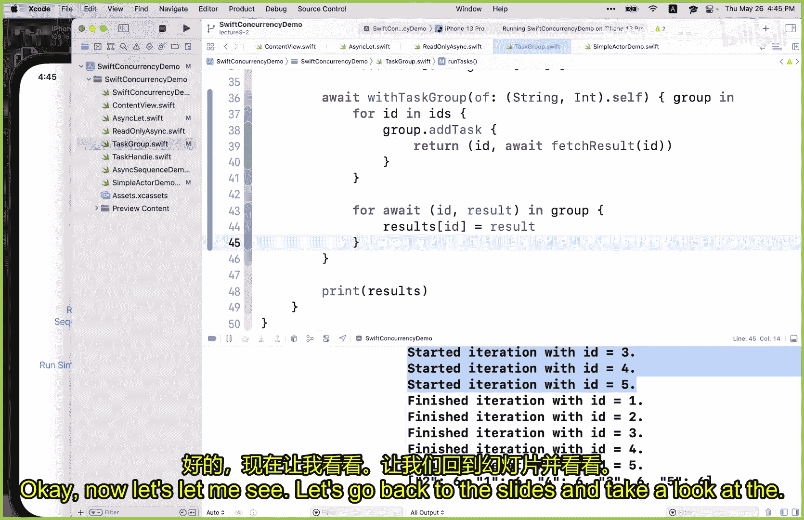

从同步环境启动异步任务时（使用 `Task { ... }`），会返回一个**任务句柄**。通过这个句柄，你可以手动取消任务。

```swift
// 启动任务并获取句柄
let handle = Task {
    await runSomeLongTask()
}
// ... 在某个时刻 ...
handle.cancel() // 手动取消任务
```

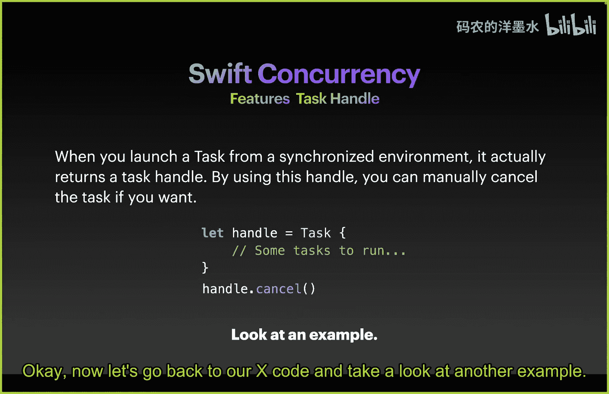

在任务内部，你仍然需要像之前一样检查取消状态。

---

## 异步序列 📜

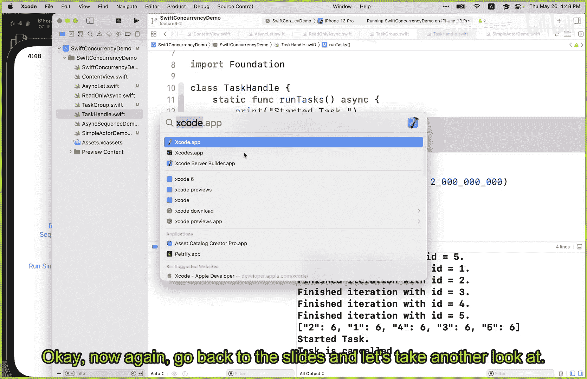

异步序列允许你异步地处理一系列值，而无需等待所有值都就绪。这在处理网络流或大文件时非常有用。

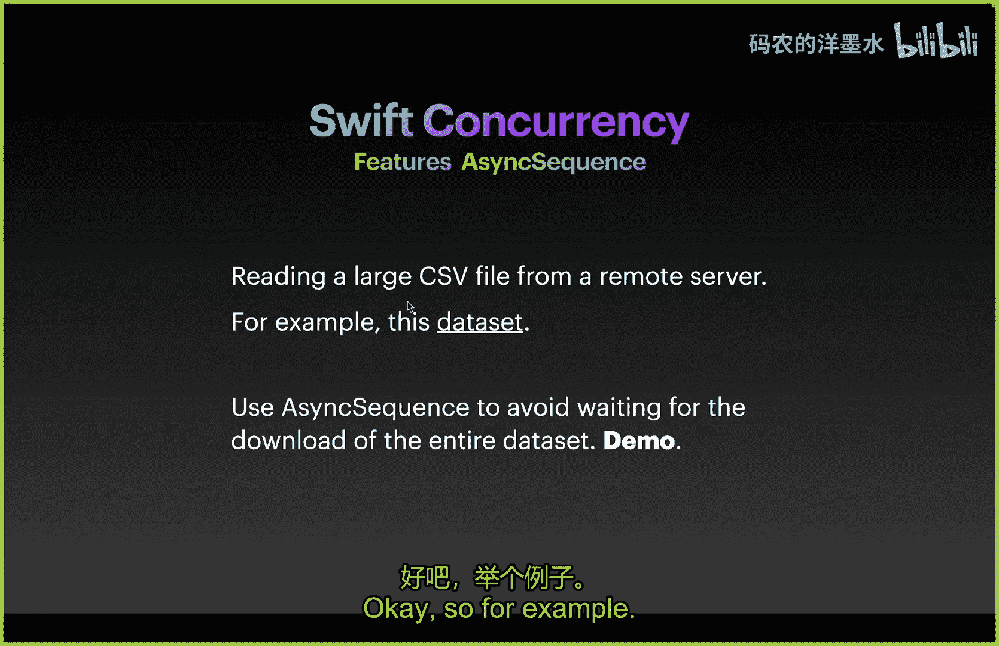

例如，使用 `URL` 的 `lines` 属性可以逐行异步读取一个远程大文件（如CSV），而不必一次性下载全部内容：

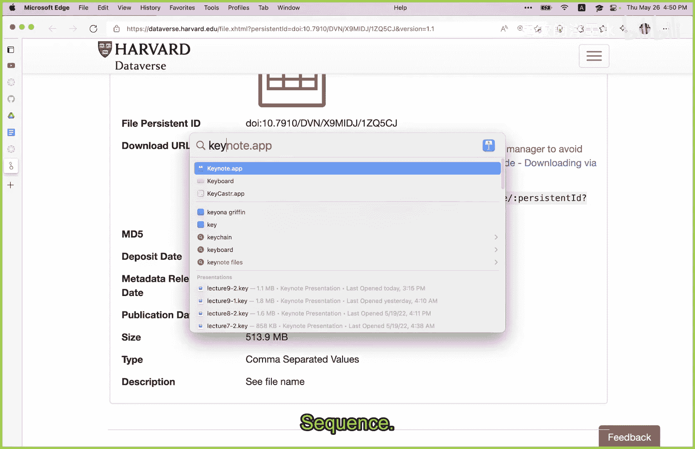

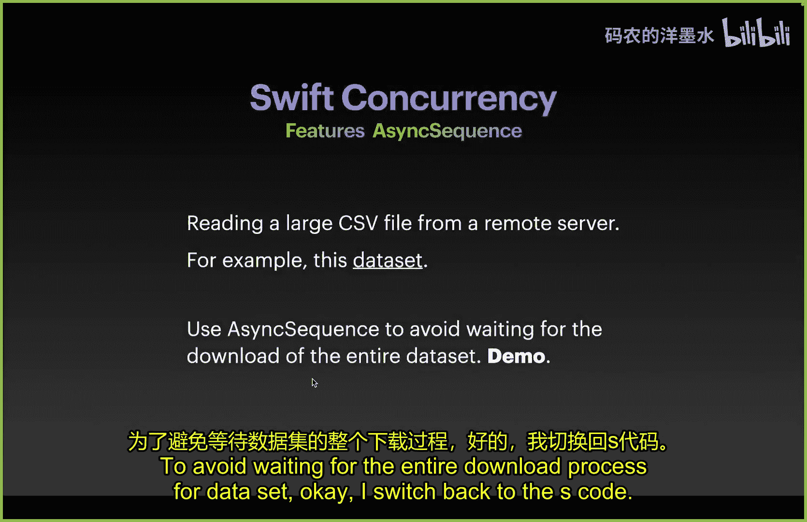

```swift
func fetchResult() async {
    guard let url = URL(string: "https://example.com/large-data.csv") else { return }
    do {
        // lines 返回一个异步序列
        for try await line in url.lines {
            // 处理每一行数据
            let columns = line.split(separator: ",")
            let firstSix = columns.prefix(6)
            print(firstSix)
            // 检查任务是否被取消
            try Task.checkCancellation()
        }
    } catch is CancellationError {
        print("任务被取消。")
    } catch {
        print("发生其他错误: \(error)")
    }
}
```

结合任务句柄，你可以轻松控制这类长时间运行任务的取消。

---

## Actor 模型 🎭

Actor 是 Swift 5.5 引入的一种新类型，用于在并发环境中安全地管理可变状态。它确保对其内部状态的访问是串行化的，从而防止数据竞争。

考虑一个简单的计数器类，在并发环境下递增会有数据竞争问题：

```swift
class Counter {
    var value = 0
    func increment() { value += 1 } // 并发调用不安全！
}
```

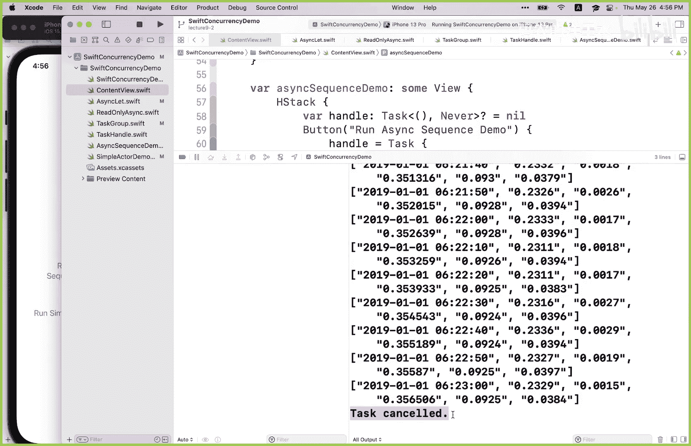

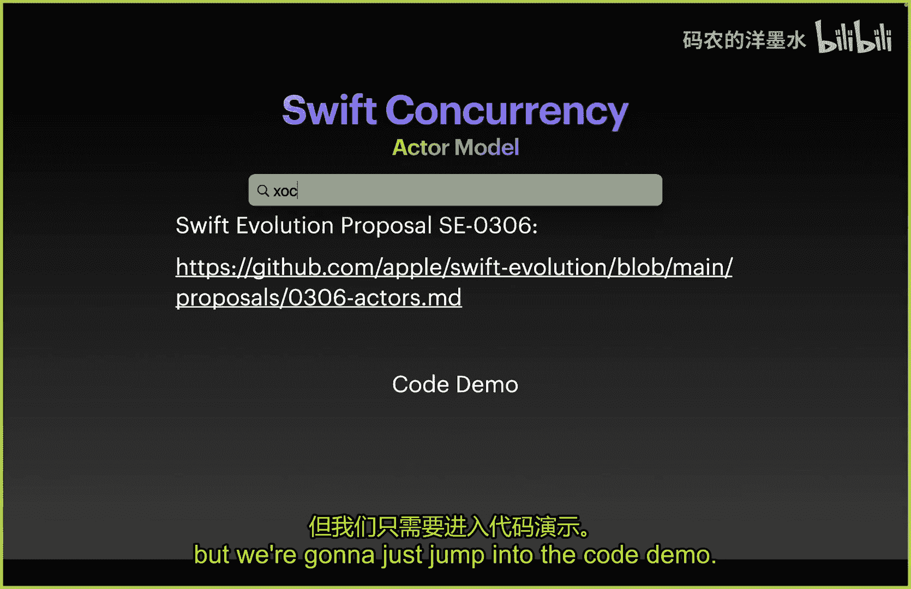

将其改为 `struct` 并标记 `mutating` 也不能解决并发访问的问题。这时可以将其定义为 `actor`：

```swift
actor Counter {
    private var value = 0
    func increment() {
        value += 1
    }
    func currentValue() -> Int {
        return value
    }
}
```

**关键变化**：
*   Actor 内部定义的函数和属性访问**自动变成异步的**。
*   从 actor 外部调用其方法或访问其属性时，**必须使用 `await`**。
    ```swift
    let counter = Counter()
    await counter.increment()
    let current = await counter.currentValue()
    ```
*   Actor 像是一个内置的串行队列管理器，确保所有对其状态的访问都是同步的（一次只处理一个请求）。
*   Actor 类似于类，是引用类型，但**不支持继承**。
*   Actor 可以遵循协议，也可以使用扩展。

---

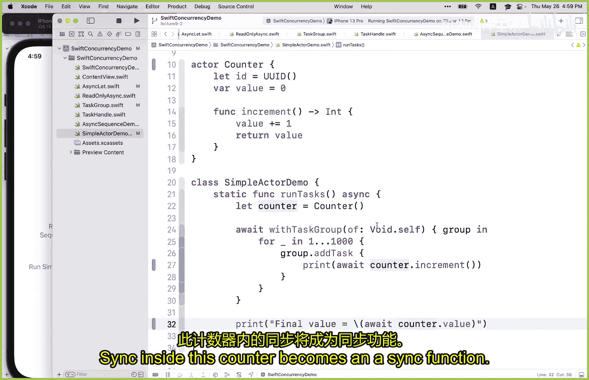

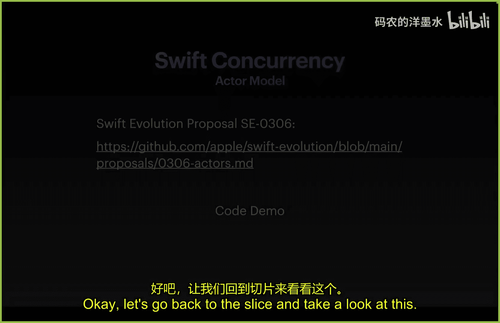

## 总结 📚

本节课我们一起深入学习了Swift并发的多个进阶主题：
1.  使用 **`async let`** 简化并发任务的启动和结果等待。
2.  理解了**任务树**的结构，以及如何通过检查 `Task.isCancelled` 或 `Task.checkCancellation()` 来响应**任务取消**。
3.  将只读计算属性定义为**异步属性**。
4.  利用**任务组**动态管理一组并发任务，并安全地收集结果。
5.  通过**任务句柄**手动控制任务的取消。
6.  使用**异步序列**高效处理流式数据或大型数据集。
7.  引入 **Actor 模型**，以一种类型安全的方式在并发程序中管理共享的可变状态，从根本上防止数据竞争。

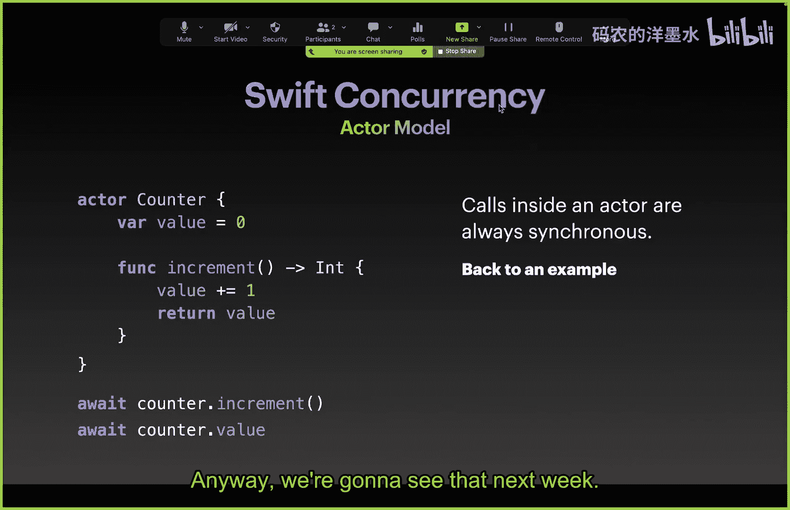

掌握这些概念将帮助你构建更高效、更健壮的并发Swift应用程序。下一节课，我们将探讨手势识别和其他高级UI主题。