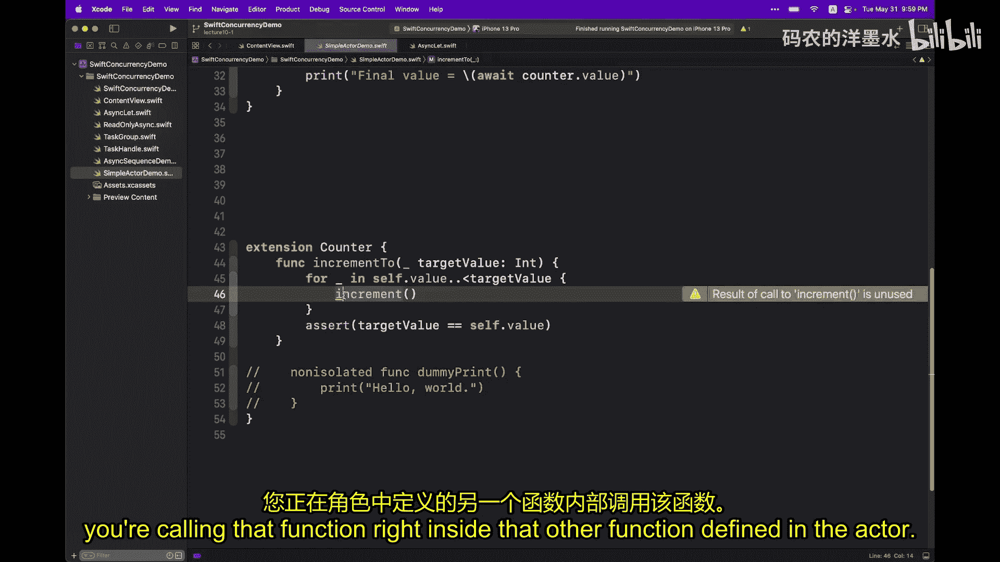
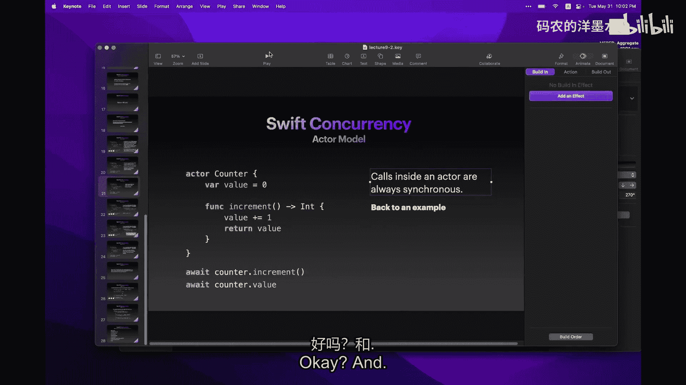
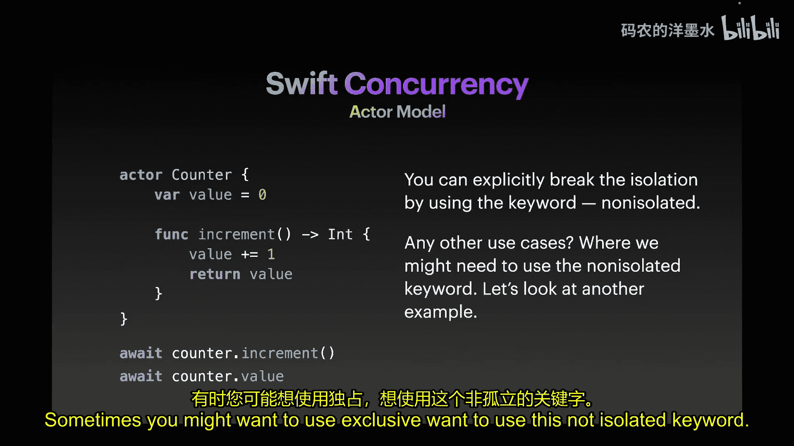
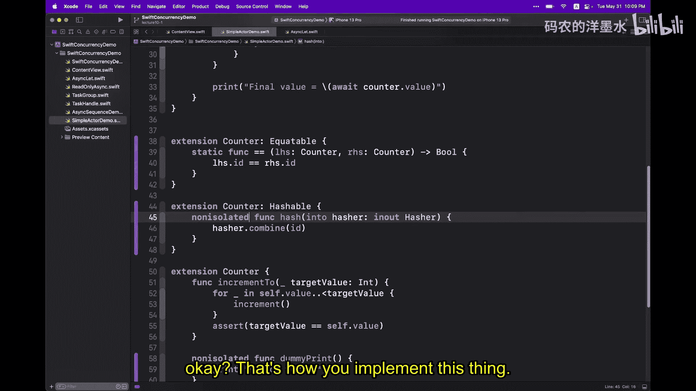
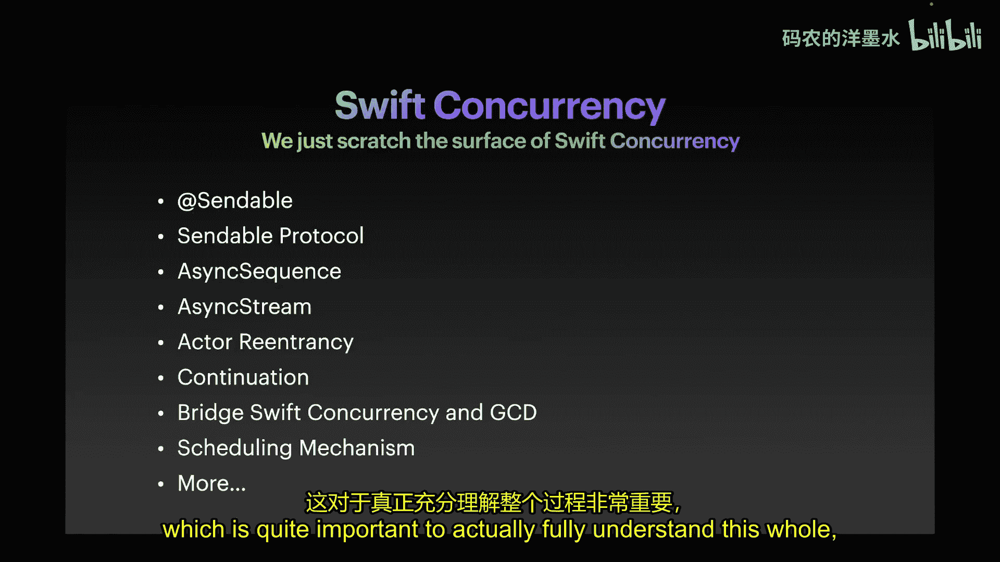
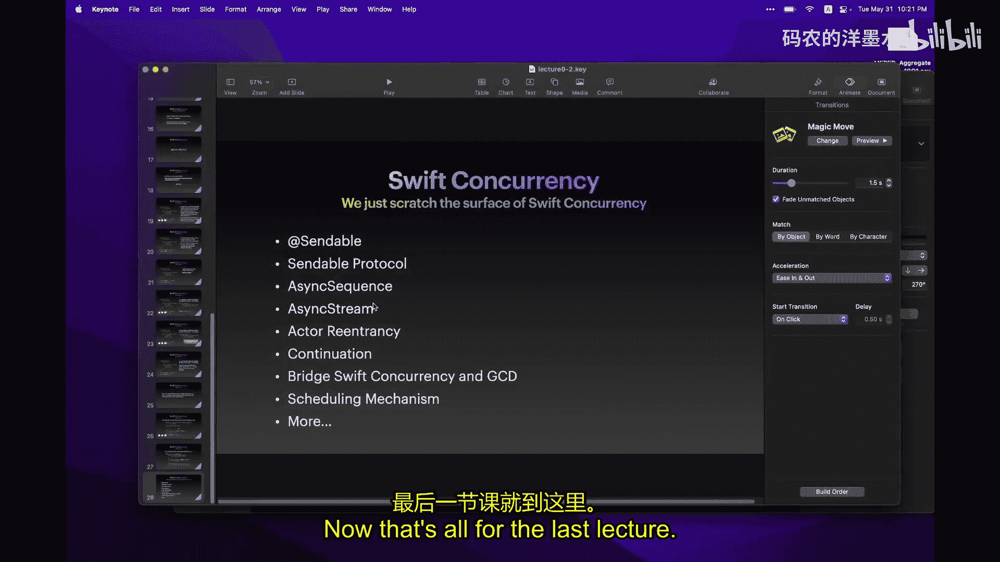
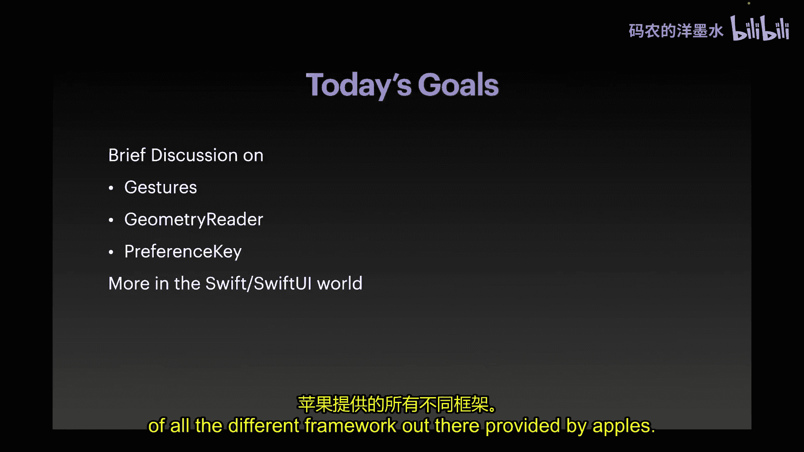
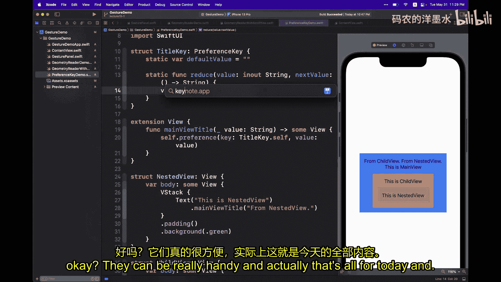
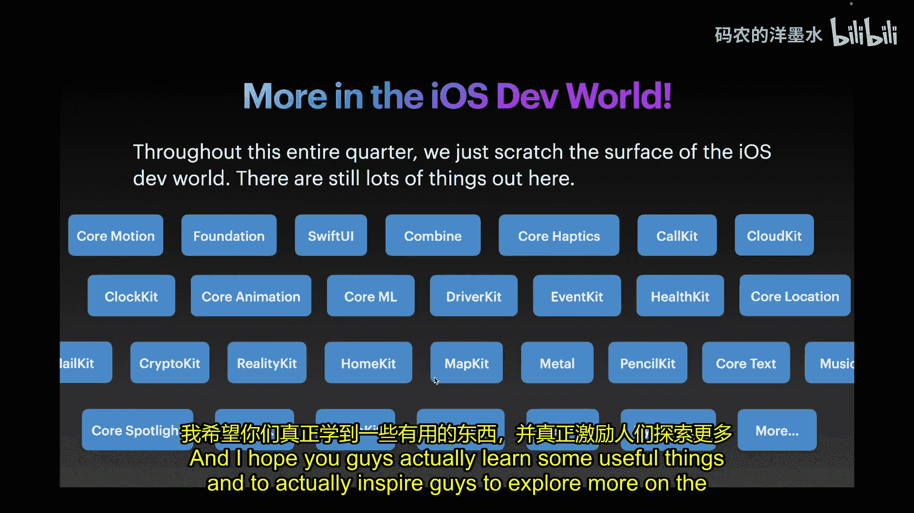

# 017：Actor、MainActor、手势与布局


## 概述
在本节课中，我们将学习 Swift 并发编程中的 Actor 模型和 MainActor，并探索 SwiftUI 中的手势识别、GeometryReader 以及 PreferenceKey 的使用。这些是构建现代、响应式 iOS 应用的重要工具。

---




## Actor 模型与 MainActor

上一节我们介绍了并发编程的基础。本节中，我们来看看 Swift 中用于安全处理并发的 Actor 模型。

### Actor 内部调用的同步性
Actor 内部的所有调用默认都是同步执行的。这意味着在 Actor 内部调用其自身的函数时，无需使用 `await` 关键字。




```swift
actor Counter {
    private var value = 0

    func increment() -> Int {
        value += 1
        return value
    }

    // 在 Actor 内部调用另一个函数，无需 await
    func increment2() {
        for _ in 0..<10 {
            increment() // 同步调用
        }
    }
}
```

### 使用 `assert` 进行调试
`assert` 函数用于在开发阶段验证条件。如果条件为假，应用会崩溃，这有助于快速定位问题。

```swift
assert(counter.value == 10, "Counter value should be 10 after incrementing.")
```



### 忽略函数返回值
如果一个函数的返回值通常不被使用，可以使用 `@discardableResult` 属性来消除编译器警告。

```swift
@discardableResult
func increment() -> Int {
    value += 1
    return value
}
```

### 使用 `nonisolated` 打破隔离
Actor 的隔离性保证了数据安全，但有时某些函数并不访问 Actor 的隔离状态。这时可以使用 `nonisolated` 关键字标记，允许外部直接调用而无需 `await`。



```swift
extension Counter {
    nonisolated func dummyPrint() {
        print("This is safe to call without await.")
    }
}
// 调用时
counter.dummyPrint() // 无需 await
```

但是，如果 `nonisolated` 函数尝试访问 Actor 的隔离属性，编译器会报错。

```swift
nonisolated func printValue() {
    print(value) // 错误：Actor-isolated property 'value' cannot be referenced from a non-isolated context
}
```

### 让 Actor 遵循协议
当需要让 Actor 遵循如 `Equatable` 或 `Hashable` 协议时，相关方法可能需要标记为 `nonisolated`，因为协议要求的方法可能不是隔离的。

```swift
extension Counter: Equatable {
    nonisolated static func == (lhs: Counter, rhs: Counter) -> Bool {
        // 比较逻辑，这里假设 Actor 有 `id` 属性
        return lhs.id == rhs.id
    }
}

extension Counter: Hashable {
    nonisolated func hash(into hasher: inout Hasher) {
        hasher.combine(id)
    }
}
```

### 认识 MainActor
`MainActor` 是一个特殊的全局 Actor，它确保所有任务都在主线程上执行，类似于 GCD 的主队列。这对于更新 UI 至关重要。





以下是几种确保代码在主线程运行的方法：



1.  使用 `@MainActor` 标记函数：
    ```swift
    @MainActor func updateUI() {
        // 更新 UI 的代码
    }
    // 调用时需要 await
    await updateUI()
    ```

2.  使用 `MainActor.run`：
    ```swift
    Task {
        await MainActor.run {
            // 更新 UI 的代码
        }
    }
    ```

3.  使用 `@MainActor` 标记整个类：
    ```swift
    @MainActor class UIHelper {
        func updateImage() { ... } // 自动在主线程运行
        nonisolated func fetchData() { ... } // 此函数可以不在主线程运行
    }
    ```

### 更多并发概念
Swift 并发中还有许多重要概念，由于时间有限，我们仅作列举，鼓励大家自行探索：
*   `Sendable` 协议：确保数据在并发环境中安全传递。
*   `AsyncSequence`：异步序列。
*   Actor 重入（Reentrancy）：解决优先级反转等问题。
*    Continuation：Swift 并发底层的工作单元。
*   与 GCD 的桥接。

---

## SwiftUI 手势处理

现在，让我们转向 SwiftUI 的交互部分，从手势识别开始。

### 点击手势
最基础的手势是点击。SwiftUI 提供了便捷的 `.onTapGesture` 修饰符。

```swift
struct ContentView: View {
    @State private var isTapped = false

    var body: some View {
        Circle()
            .fill(isTapped ? .green : .red)
            .frame(width: 100, height: 100)
            .onTapGesture {
                isTapped.toggle()
            }
    }
}
```

### 使用 `gesture` 修饰符
对于更复杂的手势，可以使用 `.gesture` 修饰符，它接受一个符合 `Gesture` 协议的对象。

以下是定义和使用 `TapGesture` 的另一种方式：

```swift
struct ContentView: View {
    @State private var isTapped = false

    // 定义手势
    var tapGesture: some Gesture {
        TapGesture(count: 2) // 双击
            .onEnded { _ in
                isTapped.toggle()
            }
    }

    var body: some View {
        Circle()
            .fill(isTapped ? .green : .red)
            .frame(width: 100, height: 100)
            .gesture(tapGesture) // 应用手势
    }
}
```

### 长按手势
`LongPressGesture` 可以检测长按操作。使用 `@GestureState` 属性包装器可以方便地管理手势过程中的临时状态，并在手势结束时自动重置。

```swift
struct ContentView: View {
    @GestureState private var isLongPressing = false

    var longPressGesture: some Gesture {
        LongPressGesture(minimumDuration: 2) // 最小持续2秒
            .updating($isLongPressing) { currentState, gestureState, _ in
                gestureState = currentState
            }
    }

    var body: some View {
        VStack {
            Circle()
                .fill(isLongPressing ? .blue : .gray)
                .frame(width: 100, height: 100)
                .gesture(longPressGesture)
            Text(isLongPressing ? "长按中..." : "未长按")
        }
    }
}
```

### 拖拽手势
`DragGesture` 用于处理拖拽操作。我们可以利用它来移动视图。

```swift
struct ContentView: View {
    @State private var offset = CGSize.zero

    var dragGesture: some Gesture {
        DragGesture()
            .onChanged { value in
                offset = value.translation
            }
            .onEnded { _ in
                withAnimation(.spring()) {
                    offset = .zero // 手势结束时弹回原位
                }
            }
    }

    var body: some View {
        Circle()
            .fill(.orange)
            .frame(width: 100, height: 100)
            .offset(offset)
            .gesture(dragGesture)
    }
}
```

### 缩放手势
`MagnificationGesture` 用于处理捏合缩放操作。

```swift
struct ContentView: View {
    @GestureState private var scale: CGFloat = 1.0

    var magnificationGesture: some Gesture {
        MagnificationGesture()
            .updating($scale) { currentScale, gestureScale, _ in
                gestureScale = currentScale
            }
    }

    var body: some View {
        Circle()
            .fill(.purple)
            .frame(width: 100, height: 100)
            .scaleEffect(scale)
            .gesture(magnificationGesture)
    }
}
```

### 手势组合
可以为一个视图同时添加多个手势，并通过修饰符控制它们的识别关系：
*   `.simultaneousGesture`：同时识别多个手势。
*   `.highPriorityGesture`：赋予某个手势更高优先级。
*   `.sequenceGesture`：按顺序识别手势（例如，先长按后拖拽）。

---

## GeometryReader 与布局

有时我们需要根据父视图的尺寸来调整子视图。`GeometryReader` 提供了一个读取容器视图几何信息的途径。

### 获取父视图尺寸
下面的例子使一个彩色方块始终占据其父视图宽度和高度的 50%。

```swift
struct GeometryReaderDemo: View {
    var body: some View {
        GeometryReader { proxy in
            Color.blue
                .frame(width: proxy.size.width / 2,
                       height: proxy.size.height / 2)
        }
        .frame(width: 200, height: 200) // 父视图尺寸
        .border(.green)
    }
}
```

### 创建滚动视差效果
`GeometryReader` 结合坐标空间，可以创建复杂的视觉效果，如根据滚动位置旋转视图。

```swift
struct ScrollView3DEffect: View {
    let colors: [Color] = [.red, .orange, .yellow, .green, .blue, .purple]
    @Namespace var mainCoordinateSpace

    var body: some View {
        ScrollView(.horizontal) {
            HStack {
                ForEach(colors.indices, id: \.self) { index in
                    colors[index]
                        .frame(width: 100, height: 150)
                        .cornerRadius(10)
                        .rotation3DEffect(
                            .degrees(getAngle(for: index)),
                            axis: (x: 0, y: 1, z: 0) // 绕 Y 轴旋转
                        )
                        .matchedGeometryEffect(id: "coordinateSpace", in: mainCoordinateSpace)
                }
            }
            .padding(.horizontal)
        }
        .coordinateSpace(name: "mainScrollSpace")
    }

    // 根据视图在滚动视图中的位置计算旋转角度
    private func getAngle(for index: Int) -> Double {
        // 这里需要利用 GeometryReader 获取每个子视图的 minX
        // 为简化示例，假设此逻辑已实现
        return Double(index) * -5 // 示例角度
    }
}
```

---

## PreferenceKey：子视图向父视图传递数据

`@State` 和 `@Binding` 用于父视图向子视图传递数据。`PreferenceKey` 则提供了子视图向祖先视图传递数据的机制，非常适用于收集子视图信息（如尺寸、位置）或设置全局属性（如导航栏标题）。

### 基本用法
以下示例展示了子视图如何修改父视图的标题。

1.  **定义 PreferenceKey**：
    ```swift
    struct TitleKey: PreferenceKey {
        // 1. 定义默认值
        static var defaultValue: String = ""

        // 2. 定义如何合并来自多个子视图的值
        static func reduce(value: inout String, nextValue: () -> String) {
            value = nextValue() // 这里简单地用子视图的值覆盖
            // 或者可以拼接：value += " " + nextValue()
        }
    }
    ```

2.  **子视图设置值**：
    ```swift
    struct ChildView: View {
        var body: some View {
            VStack {
                Text("子视图")
                Button("更改标题") {
                    // 通过 preference 传递数据
                }
            }
            .preference(key: TitleKey.self, value: "来自子视图的新标题")
        }
    }
    ```

3.  **父视图接收值**：
    ```swift
    struct ParentView: View {
        @State private var title = "Hello"

        var body: some View {
            VStack {
                Text(title)
                    .font(.largeTitle)
                ChildView()
            }
            .onPreferenceChange(TitleKey.self) { newTitle in
                title = newTitle // 接收并更新标题
            }
        }
    }
    ```

### 创建自定义修饰符
为了让代码更清晰，可以将 `preference` 封装成一个视图修饰符。

```swift
extension View {
    func mainViewTitle(_ title: String) -> some View {
        preference(key: TitleKey.self, value: title)
    }
}

// 在子视图中使用
ChildView()
    .mainViewTitle("设置好的标题")
```

### 合并多个子视图的值
当有多个子视图传递值时，`reduce` 方法决定了如何合并它们。例如，可以将所有子视图的标题拼接起来。

```swift
static func reduce(value: inout String, nextValue: () -> String) {
    if value.isEmpty {
        value = nextValue()
    } else {
        value += " | " + nextValue() // 用 "|" 连接多个标题
    }
}
```

---

## SwiftUI 与 iOS 开发生态

SwiftUI 是构建 iOS 应用的现代化框架，但它只是苹果庞大开发生态的一部分。要成为全面的 iOS 开发者，还可以探索以下领域：

*   **Core Data**：本地数据持久化框架。
*   **Core ML**：集成机器学习模型。
*   **ARKit**：开发增强现实体验。
*   **Core Motion**：处理设备运动传感器数据。
*   **Combine**：声明式的响应式编程框架。
*   **Core Haptics**：创建丰富的触觉反馈。
*   **WidgetKit**：开发主屏幕小组件。
*   **ClockKit**（WatchOS）：创建表盘复杂功能。

每个框架都针对特定需求，共同构成了强大的 iOS 开发工具集。




---



## 总结
本节课我们一起学习了 Swift 并发中的 Actor 和 MainActor，了解了如何安全地处理后台任务和主线程更新。接着，我们深入探讨了 SwiftUI 的手势识别，包括点击、长按、拖拽和缩放。然后，我们使用 `GeometryReader` 来根据布局几何信息调整视图，并实现了酷炫的滚动效果。最后，我们掌握了使用 `PreferenceKey` 实现子视图向父视图传递数据的技巧。这些知识是构建交互丰富、界面动态的 iOS 应用的核心。希望本课程能激发你进一步探索 SwiftUI 和整个 iOS 开发生态的兴趣。祝你开发愉快！