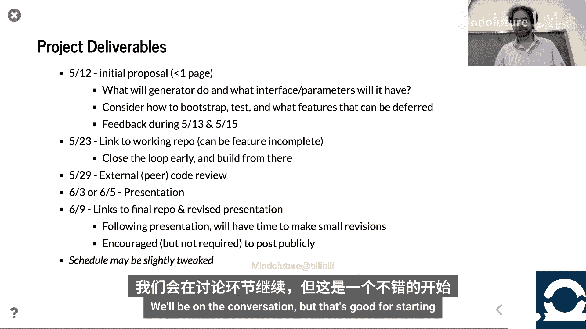

# 017：第12讲 - 浮点数并发与模式匹配


在本节课中，我们将完成关于函数式编程的讨论，并引入一个名为“模式匹配”的新概念。我们将看到如何利用这些工具，以更结构化、更可测试和更高效的方式来处理集合数据，并编写更简洁的代码。


---


## 函数式编程收尾：`flatMap`、`filter` 及其他


上一节我们介绍了`map`、`reduce`和`fold`等操作。本节中，我们将补充几个剩余的重要概念：`flatMap`、`filter`以及一些便捷的集合方法。


### 理解 `flatMap`


`map` 操作是“一对一”的：一个元素输入，一个元素输出。但有时，我们处理的对象本身就是一个集合，而映射函数返回的也是一个集合。这时，我们就得到了一个“集合的集合”。


`flatMap` 的作用是：对集合中的每个元素应用一个返回集合的函数，然后将所有这些结果集合“扁平化”地连接成一个单一的集合。你可以将其理解为先进行 `map`，然后对结果调用 `flatten`。


**代码示例：**
```scala
val range = 0 until 5
// 使用 map 生成集合的集合
val listOfLists = range.map(x => List.fill(x)(x))
// 使用 flatten 扁平化
val flattened = listOfLists.flatten
// 使用 flatMap 一步到位
val flatMapped = range.flatMap(x => List.fill(x)(x))
```


`flatMap` 的一个更常见用途是创建一种“一对多”或“过滤式”的映射。例如，映射函数可以返回零个、一个或多个元素。


**代码示例：**
```scala
val numbers = 0 until 10
// 使用 flatMap 实现过滤：只保留偶数
val evens = numbers.flatMap { x =>
  if (x % 2 == 0) Some(x) else None
}
```

### 使用 `filter`


`filter` 用于根据条件筛选集合中的元素。它接受一个返回布尔值的函数（谓词），保留使谓词为 `true` 的元素。


**代码示例：**
```scala
val isEven = (x: Int) => x % 2 == 0
val evens = numbers.filter(isEven)
// 使用 `filterNot` 筛选非偶数
val odds = numbers.filterNot(isEven)
```


### 便捷的集合谓词：`forall` 与 `exists`


以下是两个常用的集合谓词操作：
*   `forall`：检查集合中的**所有**元素是否都满足某个条件。
*   `exists`：检查集合中是否**至少存在一个**元素满足某个条件。

**代码示例：**
```scala
val allEven = evens.forall(isEven) // true
val anyEven = numbers.exists(isEven) // true
```

这些高阶函数封装了常见的遍历模式（如循环），使代码更声明式、更易于并行化，因为它们的语义不依赖于执行顺序。


### 综合示例：埃拉托斯特尼筛法求质数


让我们结合所学，用几行代码实现一个质数生成器。

**代码示例：**


```scala
def removeMultiplesOf(x: Int)(nums: Seq[Int]): Seq[Int] =
  nums.filterNot(_ % x == 0)
def sieve(nums: Seq[Int]): Seq[Int] = {
  if (nums.isEmpty) Seq.empty
  else {
    val head = nums.head
    head +: sieve(removeMultiplesOf(head)(nums.tail))
  }
}
val primesUnder100 = sieve(2 to 100)
```
这段代码优雅地展示了如何通过组合 `filter` 和递归来构建算法。

### 内置的便捷方法


Scala集合提供了许多便捷方法，如 `sum`、`product`、`min`、`max` 等。在可能的情况下，应优先使用这些内置方法，它们使代码更清晰、更高效。


**代码示例：**
```scala
val seq = Seq(1, 2, 3, 4)
val total = seq.sum
val smallest = seq.min
```


---


## 模式匹配 🧩


模式匹配是Scala中一个非常强大的特性，它远不止是其他语言中的 `switch` 语句。它允许你根据数据的**结构**进行匹配和解构。

### 基础模式匹配


你可以匹配字面值、使用“或”逻辑、绑定变量，甚至添加守卫条件。


**代码示例：**
```scala
val x = 5
x match {
  case 0 => "zero"
  case 1 | 3 => "one or three"
  case n if n % 2 == 0 => s"$n is even"
  case _ => "something else"
}
```


### 匹配案例类


模式匹配在处理像案例类这样的代数数据类型时尤其强大。


**代码示例：**


```scala
case class Vehicle(color: String, driver: String)
case class Helicopter(color: String, driver: String) extends Vehicle(color, driver)
case class Submarine(color: String, driver: String) extends Vehicle(color, driver)
val fleet = Seq(
  Helicopter("gray", "Alice"),
  Helicopter("blue", "Bob"),
  Submarine("yellow", "Charlie")
)
fleet.foreach {
  case Helicopter("blue", pilot) => println(s"$pilot flies a blue helicopter")
  case Submarine(color, _) if color != "yellow" => println(s"A $color submarine")
  case _ => // 忽略其他情况
}
```


### 无处不在的模式匹配


你其实已经在不知不觉中使用模式匹配了，例如在解构元组时。


**代码示例：**
```scala
val pair = (1, "hello")
val (num, str) = pair // 这里使用了模式匹配
```


---


## 优雅处理 `Option` 类型

`Option` 类型表示一个可能存在也可能不存在的值（`Some(value)` 或 `None`）。在Chisel中，它常用于表示可选的硬件端口。


### 传统方式与改进方式

传统上，你需要使用 `isDefined` 和 `get` 来访问 `Option` 的值，但这不够安全。

**代码示例：**
```scala
val maybeNumber: Option[Int] = Some(42)
// 传统方式
if (maybeNumber.isDefined) {
  val value = maybeNumber.get
}
```


更优雅的方式包括：
*   `getOrElse`：提供默认值。
*   `flatten`：处理 `Option` 的集合，移除所有 `None` 并解开 `Some`。
*   模式匹配。
*   `foreach`：仅在值存在时执行操作。


**代码示例：**


```scala
val numbersWithOptions = Seq(Some(1), None, Some(3), None)

// 使用 getOrElse
val firstOrDefault = numbersWithOptions.head.getOrElse(-1)

// 使用 flatten 提取所有有效值
val allValues = numbersWithOptions.flatten // 得到 Seq(1, 3)
// 使用模式匹配处理
numbersWithOptions.foreach {
  case Some(value) => println(value)
  case None => println("No value")
}
// 使用 foreach (自动跳过 None)
numbersWithOptions.foreach(_.foreach(println))
```

---

## 课程项目概览 🚀


现在，你们已经掌握了相当多的Scala和Chisel知识。课程的重点将转向项目实践，你们将利用这些工具构建自己的硬件生成器。

### 项目流程


1.  **组队与构思**：建议两人一组。构思一个具有参数化生成能力的项目创意。
2.  **提案**：撰写一份一页纸的提案，描述项目目标、最终形态及初步实施计划。
3.  **开发与迭代**：基于反馈进行开发，逐步添加功能。
4.  **代码审查**：与另一组交换项目，进行代码审查，互相学习。
5.  **最终演示**：在课程最后一周进行项目演示。
6.  **修订与提交**：根据反馈修订项目和演示材料后正式提交。

### 项目灵感

项目应涉及一定程度的“生成”和“参数化”。过去的项目包括：
*   数据压缩协议生成器。
*   GPS相关算法硬件实现。
*   曼德博集分形生成器。
*   游戏音乐播放器（甚至能在FPGA上通过HDMI输出）。

### 下一步行动

*   寻找队友，讨论项目想法。
*   随时通过办公室时间或邮件与教师讨论想法，获取早期反馈。
*   关注课程主页，获取具体的项目模板、时间表和往届项目示例。

---



本节课中，我们一起学习了函数式编程的最后几个关键概念——`flatMap`和`filter`，并探索了强大的模式匹配机制。我们还了解了如何更优雅地处理`Option`类型，并正式开启了课程项目阶段。掌握这些工具将极大地提升你们编写简洁、健壮且富有表达力代码的能力，为成功完成硬件生成器项目打下坚实基础。