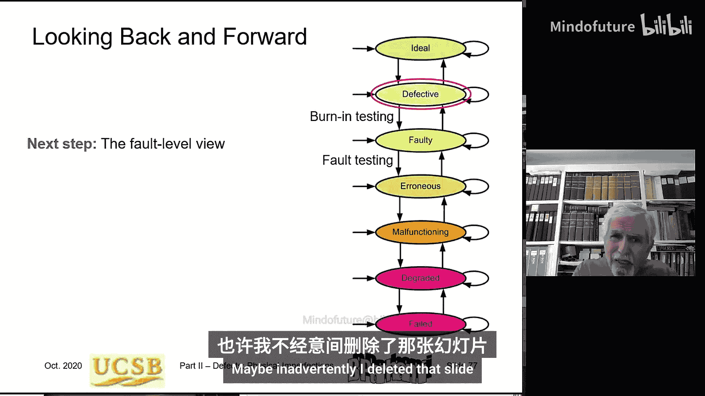

# 006：缺陷规避 🛡️

在本节课中，我们将要学习缺陷规避的基本概念、通用方法以及一些具体实例。缺陷规避的核心思想是检测缺陷，并通过移除或屏蔽的方式，来规避其不良影响。

## 缺陷规避的两种互补方法

上一节我们介绍了缺陷规避的目标，本节中我们来看看实现这一目标的两种主要方法。它们是互补的，可以在特定场景中单独或组合使用。

**缺陷规避通过移除**：
此方法要求系统具备动态冗余。它需要在晶圆或芯片层面识别出缺陷部件。识别方式可以是目视检查（针对大缺陷）或测试与关联分析。关联分析类似于通过症状诊断疾病，即通过观察与缺陷相关的效应来推断缺陷的存在。随后，系统通过内置的嵌入式开关来绕过缺陷或重新配置系统。

**缺陷规避通过屏蔽**：
此方法要求提供所谓的**静态冗余**。静态冗余是指冗余结构内建于系统中，并作为系统正常操作的一部分。当出现问题时，这些内置的冗余会自动生效，防止不良后果发生。

可以这样类比：缺陷移除类似于**错误检测码**，你检测到问题，但需要采取行动来纠正或移除错误的影响。而缺陷屏蔽则类似于**错误纠正码**，冗余是内置的，它能自动纠正错误，通常不涉及系统重配置。

一般来说，静态冗余需要更高程度的冗余，因此在电路成本和功耗方面更昂贵。有时我们会在检测到缺陷后对冗余结构进行调整，但这是可选的，并非必需。因为存在足够的冗余来抵消缺陷部分的影响，系统可以继续运行。

鉴于缺陷移除意味着较低的冗余度，从而带来更低的电路成本和能耗，这些方法在集成电路中更受欢迎。

## 缺陷检测方法

以下是缺陷检测的几种方式：

*   **目视或光学检查**：在晶圆制造完成后，由专家进行检查，重点关注更可能出现缺陷的区域（如晶圆边缘）。严重的大缺陷可以通过目视发现。也可以使用光学检查，通过分析光线照射晶圆后的反射情况来判断是否符合预期，这通常能更准确地捕捉到微小缺陷。
*   **测试与关联分析**：通过运行测试并观察异常效应（症状）来推断缺陷的存在。

## 适用于芯片冗余与重配置的系统

在芯片上使用冗余和重配置技术，在系统具有**规则结构**时效果最佳。

这类系统的例子包括：
*   **存储器**
*   **现场可编程门阵列**
*   **多核芯片**或**芯片多处理器**

对于不规则或随机逻辑，则需要更高程度的冗余，因为除了复制结构外没有太多选择。在复制时，需要确保复制单元在芯片上不要靠得太近，以免芯片某一区域的单个缺陷同时影响原始单元和复制版本。另一方面，如果将这些单元在芯片上放置得太远，当需要替换故障单元时，布线和开关开销会变得非常大。因此，需要在“足够远以避免单点缺陷影响多个单元”和“足够近以控制开关和布线成本”之间取得平衡。

## 磁盘存储中的坏扇区规避

避免使用磁盘存储器上的坏扇区，是“通过移除实现缺陷规避”的一个典型例子。

磁盘使用非常强大的**错误纠正码**，实际上是纠错码和检错码的组合。当我们通过这些码发现磁盘上某个特定扇区（存储信息块的一个区域）是坏的时，就不再向该扇区记录数据，因为获取错误数据的概率会很高。我们通过**重映射**将该扇区映射到磁盘的不同区域。

逻辑地址（如“扇区A”）和物理地址是分离的，因此通过重定位扇区，我们可以规避坏扇区的影响。

在此机制中，涉及两种映射表：
*   **P表（主缺陷表）**：由磁盘制造商建立。在制造和测试过程中发现某些扇区不可靠后，制造商会直接绕过这些扇区，并建立一个映射表指明这些扇区的新位置。P表不影响磁盘的标称容量和性能，因为制造商会将磁盘做得略大一些，并在重映射后仍能保证标称规格。
*   **G表（增长缺陷表）**：在磁盘出厂后，由磁盘驱动软件检测到坏扇区时建立。例如，当某个扇区读取时纠错码频繁介入，就认为该扇区可能不再可靠，从而将其重映射。随着G表增长，磁盘的实际可用容量会减少，性能也可能受影响（因为文件可能被存储在不连续的物理位置）。当G表变得过大时，可能需要更换磁盘。

## 存储器阵列的缺陷规避

多年来，针对存储器阵列开发了许多缺陷规避技术。

一种常见的方法是**为存储器阵列提供备用行**（通常还有备用列）。假设一个存储器阵列的某一行出现缺陷（整行或部分存储单元），我们没有能力替换单个存储单元，因此需要替换包含缺陷的整行。

这是通过解码机制实现的。通常，解码器根据地址选择某一行（例如第100行）。如果该行有缺陷，则必须将逻辑上的第100行映射到一个备用行。因此，解码逻辑必须具备这种映射能力，比普通解码器更复杂。

假设有 M 行主存储器和 S 个备用行，并且假设所有外围逻辑和解码器完全可靠（简化假设），那么只要 M+S 行中有任意 M 行是好的，系统就是好的。这可以建模为一个 **M out of M+S** 系统。如果考虑外围逻辑的失效率，只需将其与此系统的可靠性相乘即可。

如果同时提供备用列，则可以替换故障列。注意，如果整列失效，备用行作用有限，因为失效单元数量多。备用列对于**沿列方向聚集的缺陷**更有效，而备用行对于**沿行方向聚集的缺陷**更有效。

## 逻辑电路中的缺陷规避

在逻辑电路中规避缺陷影响有很长的历史。早在1950年代，Moore和Shannon就提出了开创性的想法，即用高度不可靠的“劣质”继电器构建任意可靠的继电器电路。

其工作原理如下：假设一个继电器在应该断开时错误闭合的概率是 P（缺陷概率）。现在，我们使用四个继电器组成一个冗余结构，而不是单个继电器。所有继电器由同一个信号 X 控制。

当 X=0（期望电路断开）时，所有四个继电器都应断开。如果其中一个继电器有缺陷而闭合，电流仍然无法从左流到右，因为其他三个继电器是断开的。然而，如果两个继电器同时有缺陷并闭合（有四种可能的组合），则电路可能错误导通。

可以计算出这个冗余继电器电路的整体错误闭合概率 H(P) 为：
`H(P) = 4p^3 - 3p^4`
（注：原文公式推导有误，此处根据上下文修正为常见可靠度计算公式，对于2-out-of-4系统，失效概率为 C(4,3)p^3(1-p) + C(4,4)p^4 = 4p^3 - 3p^4，故 H(P) 应为此值）

如果 H(P) < P，即该结构误操作的概率小于单个继电器的误操作概率，那么就可以递归地使用此方法，将可靠性提高到任意所需水平。对于这个特定结构，当 P < 0.5 时，H(P) < P 成立（原文为0.382，但根据常见计算，阈值应为0.5）。如果 P 非常小，该结构将足够可靠。

虽然继电器是旧技术，但CMOS传输晶体管这类开关在IC中很常见，因此这些方法再次变得适用，例如在**FPGA**中。

FPGA天生适合缺陷规避。如果某个逻辑块被发现有缺陷，只需声明其不可用。将设计映射到FPGA的工具通常具备避开特定逻辑块或互连线的能力。这是内建于设计工具中的功能。

FPGA中的可编程开关盒允许在水平和垂直通道之间建立灵活连接。如果某个通道有缺陷，可以通过设置开关状态来避免使用它。

## 多核芯片的缺陷规避

多核芯片也具有天然的绕过或规避能力。例如，要制造一个八核芯片，通常会构建比需求更多的核心（例如10个）。如果在测试中发现一两个核心有缺陷，只需不使用它们。如果核心通过总线连接，隔离这些故障单元即可。如果是更复杂的互连网络，则需要设计网络，使其在特定端口失效时仍能允许其他核心灵活通信。

一种组织芯片上多个处理单元的方法是构建为一维或二维阵列。

*   **一维阵列**：每个单元是独立的，有自己的I/O连接。但这可能导致芯片引脚数成为瓶颈。
*   **二维阵列**：减少了每个处理器的I/O引脚需求，但灵活性降低。如果阵列中某个处理器失效，需要提前设计互连，确保其他处理器仍能有效工作。

一种策略是构建比需求更大的阵列（包含备用行和列），并通过提供备用连接来重配置芯片，避开缺陷区域，从而“挽救”出一个功能正常的子阵列。这需要设计允许行和列“移位”的开关结构。

## 重配置方案详述

为了实现上述规避，需要使用可配置的开关。例如，四端口开关可以有两种状态：“弯曲”状态和“交叉”状态。

利用这种开关，可以构建一维阵列，并通过设置开关状态来旁路故障处理器单元。这种方案的可靠性建模为：处理器部分是一个 **4 out of 5** 系统（如果能容忍1个缺陷），与开关系统串联。开关通常比处理器简单，因此对整体可靠性影响较小。

为了减少作为系统“硬核”（必须正常工作的部分）的开关数量，可以采用**分布式重配置**方案。在每个处理器单元内部集成多路复用器，使其可以选择输入来源。这样，硬核就减少到只剩下这些多路复用器，开关缺陷的影响不再比处理器缺陷更严重。

对于二维处理器阵列，也有集中式和分布式的重配置方案。分布式方案在每个处理单元提供多路复用器，以选择其北向和西向邻居的来源，从而避免开关成为单一的故障点。

## 基于备用行/列的二维重配置

假设我们有一个需要 N x N 的处理器阵列，我们构建一个带有 R 个备用行和 C 个备用列的更大阵列。如果存在缺陷处理器，我们可以通过“移动”行和列来避开它们，利用备用行/列来填补位置，最终形成一个无缺陷的 N x N 逻辑阵列。

该方案的一个关键特性是：只要能够从备用行或备用列向每个缺陷处理器画出一条箭头（表示替换路径），并且这些箭头互不相交，那么系统就是可重配置的。最坏情况下，仅需**三个**特定位置分布的缺陷就足以使该（单备用行、单备用列）方案失效。因此，在可靠性建模中，对于 N x N 阵列，可以将其建模为 **N² - 2 out of N²** 系统（即最多容忍2个缺陷）。这是一个悲观的、保证的下界。实际中，由于缺陷分布随机，通常可以容忍更多缺陷。

可以在阵列的上下左右都放置备用行/列，以提供更大的灵活性（允许上下左右移位），从而容忍更多缺陷。

## 成品率提升

许多缺陷规避方案源于提高集成电路成品率的努力。通过在芯片上提供冗余元件，即使存在缺陷，我们仍然可以使用该芯片，从而提高成品率。

**成品率模型**通常将缺陷建模为圆形，尽管实际缺陷很少是圆形的。只要模型的预测结果与现实匹配，它就是有用的模型。

一个简单的例子：假设有一个1平方厘米的芯片，上面只有宽度和间距均为1微米的导线。平均缺陷密度为每平方厘米10个随机缺陷。进一步假设80%的缺陷是小缺陷（直径0.5微米），不会导致导线短路；20%的缺陷是大缺陷（直径1.5微米）。大缺陷只有当其中心落在特定的“关键区域”（约占芯片面积的四分之一）时才会导致短路。通过概率计算，可以估算出该芯片的成品率。这个例子展示了建模的基本思路，实际中缺陷尺寸分布更复杂，但可通过计算机化模型处理。

**冗余**是提升成品率的方法，但仅提供冗余元件并不足够，还需要考虑如何用冗余单元替换故障单元以及相关的互连问题。通常，将单元组织成行和列，并用备用行/列替换整行/整列，可以使重配置变得简单，但可能造成浪费。

在VLSI布局布线中，必须考虑缺陷的影响。**较宽的导线**对材料缺失缺陷不敏感（更难断开），但更容易因多余材料缺陷导致桥接。**较窄的导线**则相反。因此，需要在导线宽度和间距之间进行权衡，以最小化各类“致命缺陷”的概率。

## 存储器成品率提升实例

为了提高存储器成品率，我们提供备用行和列。这是一个**覆盖问题**，在一般情况下是NP完全的。

可以将问题转化为**二分图**模型：一侧节点代表行，另一侧节点代表列。如果第 i 行第 j 列有一个缺陷单元，则在代表第 i 行的节点和代表第 j 列的节点之间连一条边。选择备用行和备用列来替换，等价于在二分图中选择一组行节点和列节点，使得这些选中的节点“覆盖”了所有的边（即每条边至少与一个选中的节点相连）。

对于随机缺陷，R 个备用行和 C 个备用列**保证**可以规避最多 R x C 个缺陷（在最坏情况下，每个缺陷都在不同的行和列）。实际上，缺陷往往在行或列上**聚集**，因此通常可以规避比 R x C 更多的缺陷。

## 组合多种冗余方案

通常，我们会组合使用多种冗余方案，以发挥每种方案的优势。一个经典例子是同时使用**纠错码**和**备用行/列**。

*   **纠错码**擅长处理**孤立的、随机的**缺陷（例如，单错纠正码可以纠正一个缺陷单元的影响）。
*   **备用行/列**擅长处理**聚集的**缺陷（例如，一整行或列的失效）。

研究表明，单独使用纠错码或备用行/列时，芯片在成品率下降到不可接受水平前所能容忍的平均缺陷数量有限。而将两者结合使用，则可以容忍多得多的缺陷，从而显著提高成品率。当然，组合方案也需注意各自的缺点。

## 回顾与前瞻

我们已经完成了对“缺陷”状态及其处理方法的探讨。我们讨论了**老化测试**，它暴露潜在缺陷并将其转化为故障。虽然我们致力于使系统向更好的状态转变（向上转换），但有时我们故意让系统经历向下转换（如老化测试、故障测试），因为故障比缺陷更容易观察，错误比故障更容易观察。通过在这些条件下测试，我们可以检测到缺陷或故障的存在。

下一次课程，我们将讨论**故障**层面的内容：故障检测与测试，以及可测试性设计。故障容错是我们在本课所学的缺陷容错在故障层面的对应概念。

---

本节课中我们一起学习了缺陷规避的核心概念，包括通过移除和屏蔽两种基本方法，以及在存储器、逻辑电路、FPGA、多核芯片和磁盘等具体系统中的应用实例。我们还探讨了如何通过冗余和重配置技术来提升系统可靠性与成品率，并了解了组合多种方案的优势。理解这些基础方法，是构建更健壮、更可靠计算系统的重要一步。