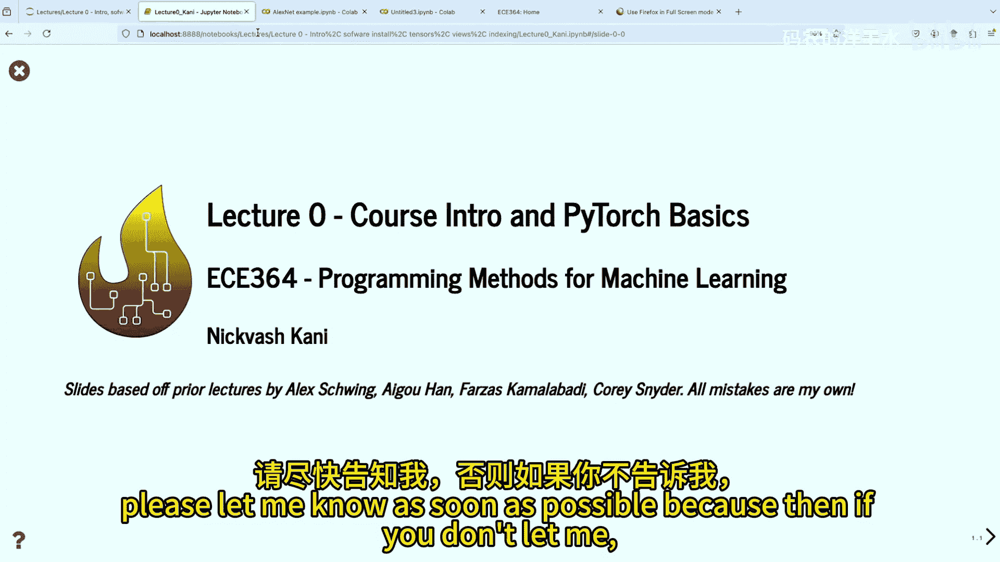

# 001：课程介绍与PyTorch基础 🎯





在本节课中，我们将学习课程的整体安排，并开始探索PyTorch的基础知识，特别是张量（Tensor）的概念和基本操作。

## 课程概述

本课程涵盖机器学习的核心主题，包括自动回归、自动梯度计算、PyTorch基础，以及深度网络和大语言模型的基本原理与应用。课程的重点是通过实际应用来学习机器学习，强调动手编程和模型构建。

## 课程结构

以下是课程的主要组成部分：

*   **讲座**：每周进行，内容以Jupyter Notebook形式呈现并会提前发布。
*   **作业**：共10次，通过PrairieLearn平台发布和自动评分，部分题目需要手动评分。作业每周五发布，下下周一截止，并有一次最低分豁免机会。
*   **考试**：共有两次期中考试，均在课堂内进行。第一次在春假前，第二次在学期末。若有冲突，可在期末考试周参加补考。
*   **项目**：占总成绩25%，涉及在特定数据集上构建和优化深度网络，并可能设置排行榜进行激励。
*   **成绩构成**：作业占25%，两次期中考试各占25%，项目占25%。
*   **办公时间**：将于周三、周四、周五举行，具体地点稍后公布。
*   **课程交流**：使用Piazza平台进行异步讨论。
*   **技术栈**：使用多种工具完成不同任务：Piazza用于讨论，PrairieLearn用于作业，考试为纸笔形式，成绩通过Gradescope和Canvas管理。

## 为什么选择PyTorch？

上一节我们介绍了课程的整体框架，本节中我们来看看本课程将使用的核心工具——PyTorch。PyTorch是一个开源的机器学习库，最初由Meta开发，现由Linux基金会维护。它因其简洁的Python集成、高效的张量运算以及强大的自动微分功能而成为当前机器学习社区的主流框架。PyTorch 2.0版本在2023年发布后，其性能优势进一步巩固了其地位。

## 张量（Tensor）基础


理解了PyTorch的重要性后，我们开始学习其核心数据结构——张量。在计算机科学和PyTorch的语境下，张量本质上是N维数组，是向量和矩阵的高维推广。

### 创建张量

创建PyTorch张量与创建NumPy数组非常相似。

```python
import torch
import numpy as np

# 从列表创建
py_list = [[1, 2, 3], [4, 5, 6]]
np_array = np.array(py_list)
torch_tensor = torch.tensor(py_list)

# 常用初始化方法
x = torch.rand(2, 3, 4)  # 随机初始化形状为(2,3,4)的张量
y = torch.ones(2, 3)      # 全1张量
z = torch.zeros(2, 3)     # 全0张量
```

### 张量属性与索引

张量具有描述其状态的属性，并可以像NumPy数组一样进行索引。

```python
a = torch.rand(3, 4)
print(a.shape)   # 输出: torch.Size([3, 4])
print(a.dtype)   # 输出: torch.float32
print(a.device)  # 输出: cpu

# 索引
print(a[:, 1])   # 获取第1列所有元素（索引从0开始）
print(a[1, 0])   # 获取第1行第0列的元素
```

### 张量运算

PyTorch支持丰富的张量运算。

```python
a = torch.tensor([[1, 2], [3, 4]])
b = torch.tensor([[5, 6], [7, 8]])

# 逐元素乘法
c = a * b
# 矩阵乘法
d = torch.matmul(a, b)  # 或使用 a @ b

# 转置
e = a.T
# 指定维度转置（适用于高维张量）
f = torch.rand(2, 3, 4)
g = f.transpose(0, 2)  # 将维度0和2交换
```

> **注意**：对于二维以上的张量，`.T` 属性的行为可能不符合直觉，建议使用 `.transpose()` 方法并明确指定维度。

### 视图（View）与复制（Copy）

为了高效利用内存，PyTorch会尽可能创建数据的“视图”而非“副本”。这意味着多个张量可能共享底层存储。

```python
a = torch.arange(16).view(4, 4)
b = a.view(2, 8)  # b是a的一个视图，共享数据

print(a.storage().data_ptr() == b.storage().data_ptr())  # 输出: True

# 显式创建副本
c = a.clone()
print(a.storage().data_ptr() == c.storage().data_ptr())  # 输出: False
```

当操作（如`view`、`transpose`、切片）不改变数据总量且内存布局允许时，PyTorch返回视图。当操作必须分配新内存时（如`clone`、跨设备传输数据），则创建副本。

### 张量的内存布局：步幅（Stride）

步幅是理解张量视图如何工作的关键。它定义了在内存中需要跳过多少元素才能将索引增加1。

```python
x = torch.tensor([[1, 2, 3],
                  [4, 5, 6]])
print(x.stride())  # 输出: (3, 1)
```
对于这个2x3的矩阵，`stride(3, 1)`意味着：
*   要移动到下一行（维度0增加1），需要在内存中前进3个元素。
*   要移动到下一列（维度1增加1），需要在内存中前进1个元素。

转置操作本质上就是交换步幅：
```python
y = x.T
print(y.stride())  # 输出: (1, 3)
```

### 其他常用操作

以下是组合和操作张量的一些其他方法：

```python
# 拼接张量
a = torch.rand(2, 3)
b = torch.cat([a, a, a], dim=0)  # 沿维度0（行）拼接，形状变为(6, 3)
c = torch.cat([a, a, a], dim=1)  # 沿维度1（列）拼接，形状变为(2, 9)

# 堆叠张量（创建新维度）
d = torch.stack([a, a, a], dim=0)  # 形状变为(3, 2, 3)

# 增加或减少维度
e = torch.unsqueeze(a, dim=0)  # 在指定维度增加一个大小为1的维度
f = torch.squeeze(e)           # 移除所有大小为1的维度

# 数据类型转换（节省内存/计算资源）
g = a.to(torch.float16)
```

## 总结


本节课中我们一起学习了课程的基本信息，并深入探讨了PyTorch张量的核心概念。我们了解了如何创建和初始化张量，如何进行索引和基本运算，更重要的是理解了**视图**与**复制**的区别以及**步幅**的概念，这些是高效使用PyTorch进行内存管理的基础。下一讲，我们将继续探讨张量的存储、数据类型以及更多相关函数。