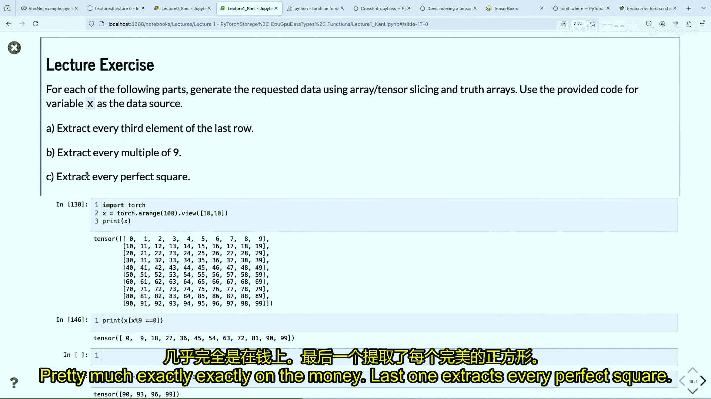
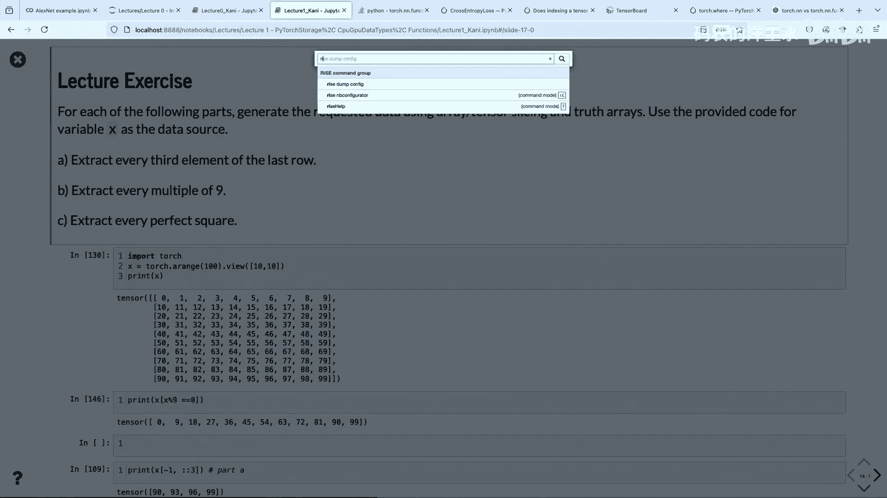

# 002：PyTorch存储、索引、CPU-GPU、数据类型与函数

在本节课中，我们将要学习PyTorch的核心基础概念，包括张量的存储机制、高级索引操作、CPU与GPU的数据处理、不同的数据类型以及常用函数。掌握这些知识是构建和优化机器学习模型的基础。

## 张量存储与内存连续性

上一节我们介绍了张量的基本概念，本节中我们来看看张量在内存中是如何存储的，以及为什么内存连续性很重要。

每个PyTorch张量都有一个底层的存储对象，它包含一个指向数据的内存指针、张量大小、元素大小以及步长（stride）信息。步长定义了在内存中沿每个维度移动到下一个元素所需的步数。

**公式**：对于一个形状为 `(d1, d2, ..., dn)` 的张量，其步长 `stride[i]` 表示在维度 `i` 上移动一个元素需要在内存中跳过的元素数量。

```python
import torch
a = torch.randn(3, 3)
print(a.is_contiguous())  # 检查张量是否连续存储
print(a.storage())        # 查看底层存储
```

当对张量进行切片或转置等操作时，可能会创建一个“视图”（view），它与原始张量共享底层数据，但具有不同的步长和形状。这避免了不必要的数据复制，但可能导致数据在内存中不再连续排列。

## 高级索引与切片

理解了存储机制后，我们来看看如何高效地访问和操作张量中的数据。PyTorch的索引语法与NumPy非常相似。

以下是几种常见的索引和切片操作：

*   **基本切片**：`tensor[行起始:行结束, 列起始:列结束]`
*   **步长切片**：`tensor[起始:结束:步长]`
*   **高级索引**：使用整数列表或布尔张量进行索引，例如 `tensor[[0, 2], [1, 3]]`
*   **条件索引**：使用比较操作生成布尔掩码，例如 `tensor[tensor > 0]`

```python
x = torch.arange(100).view(10, 10)
# 提取最后一行中每隔一个的元素
last_row_every_other = x[-1, ::2]
# 提取所有9的倍数
multiples_of_9 = x[x % 9 == 0]
```

需要注意的是，并非所有索引操作都会生成视图。例如，使用整数列表进行的“高级索引”通常会返回一个包含数据副本的新张量。

## CPU与GPU数据处理

机器学习计算通常涉及大量数据，利用GPU进行并行计算可以显著加速。PyTorch使得在CPU和GPU之间移动数据变得非常简单。

以下是管理设备（CPU/GPU）的关键操作：





*   **检查GPU可用性**：`torch.cuda.is_available()`
*   **指定设备**：使用字符串 `'cpu'` 或 `'cuda'`（对于第一个GPU）或 `'cuda:0'` 等。
*   **在设备间移动张量**：使用 `.to(device)` 方法。
*   **创建时指定设备**：在创建函数中传入 `device` 参数。

```python
device = torch.device('cuda' if torch.cuda.is_available() else 'cpu')
# 在CPU上创建张量，然后移动到GPU
cpu_tensor = torch.randn(2, 3)
gpu_tensor = cpu_tensor.to(device)
# 直接在GPU上创建张量
gpu_tensor_direct = torch.randn(2, 3, device=device)
```

## 数据类型与常用函数

PyTorch支持多种数据类型（dtype），如 `torch.float32`, `torch.int64`, `torch.bool` 等。选择合适的数据类型可以节省内存并可能提高计算速度。

PyTorch提供了丰富的数学函数和机器学习中常用的激活函数。

以下是几个核心的激活函数：

*   **ReLU (Rectified Linear Unit)**：`F.relu(x)` 或 `torch.relu(x)`。公式为 **f(x) = max(0, x)**。
*   **Sigmoid**：`torch.sigmoid(x)`。公式为 **f(x) = 1 / (1 + exp(-x))**。
*   **Softmax**：`F.softmax(x, dim=dim)`。沿指定维度对输入进行归一化，使得输出和为1。公式为 **Softmax(x_i) = exp(x_i) / Σ_j exp(x_j)**。

```python
import torch.nn.functional as F
x = torch.tensor([1.0, 2.0, 3.0])
print(F.relu(x))      # 输出: tensor([1., 2., 3.])
print(torch.sigmoid(x)) # 输出值在0到1之间
print(F.softmax(x, dim=0)) # 输出概率和为1
```

`torch.nn.functional` (通常导入为 `F`) 模块包含了许多无状态的函数式接口，而 `torch.nn` 模块中的类通常包含可学习的参数。

## 自动微分与计算图

机器学习模型训练的核心是优化，而优化依赖于梯度计算。PyTorch的自动微分（autograd）引擎使得计算梯度变得自动化。

要计算梯度，需要将张量的 `requires_grad` 属性设置为 `True`。然后，PyTorch会跟踪所有基于该张量的操作，形成一个动态的**计算图**。

```python
x = torch.tensor([1.0], requires_grad=True)
# 定义一个复合函数：y = sin(log(x^2 + 1))
g = x**2 + 1
h = torch.log(g)
y = torch.sin(h)
# 计算梯度
y.backward()
print(x.grad) # 输出 dy/dx 在 x=1 处的值
```

`y.backward()` 会从 `y` 开始，反向遍历计算图，利用链式法则计算所有 `requires_grad=True` 的张量的梯度。计算图是理解PyTorch自动微分和模型构建方式的关键抽象。


本节课中我们一起学习了PyTorch张量的内存存储原理、高效的数据索引方法、如何在CPU和GPU上管理数据、重要的数据类型与函数，以及自动微分和计算图的基本概念。这些是使用PyTorch进行机器学习编程的基石，后续我们将在此基础上学习线性代数运算并开始构建模型。