# 005：矩阵微积分与计算图 🧮

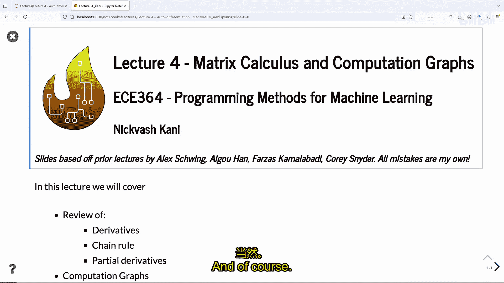

在本节课中，我们将深入学习矩阵微积分，并探讨如何将其与计算图结合使用。这是理解后续梯度下降等核心机器学习算法的关键基础。

---

## 矩阵微积分回顾 📝

上一讲我们介绍了矩阵微积分的基本概念。本节中，我们来回顾并巩固一些核心的导数计算规则。

### 标量对向量的导数

给定一个标量函数 `f` 和一个向量 `x`，其导数 `df/dx` 是一个向量，其中每个元素是 `f` 对 `x` 中对应元素的偏导数。

**公式：**
如果 `x = [x1, x2, ..., xn]`，则 `df/dx = [∂f/∂x1, ∂f/∂x2, ..., ∂f/∂xn]`。

### 向量对向量的导数（雅可比矩阵）

给定一个向量函数 `F = [f1, f2, ..., fm]` 和一个向量 `x = [x1, x2, ..., xn]`，其导数 `dF/dx` 是一个 `m x n` 的雅可比矩阵。

**公式：**
`dF/dx` 的第 `i` 行、第 `j` 列元素是 `∂fi/∂xj`。

### 矩阵乘法对向量的导数

考虑一个与 `x` 无关的矩阵 `A`（尺寸 `m x n`）和一个向量 `x`（尺寸 `n x 1`）。计算 `Ax` 对 `x` 的导数。

**核心推导：**
`Ax` 是一个 `m` 维向量。`d(Ax)/dx` 的结果是矩阵 `A` 本身。这符合标量微积分的直觉：如果 `a` 是常数，`d(ax)/dx = a`。在矩阵形式下，常数 `a` 对应单位矩阵 `I`，而矩阵 `A` 起到了类似的作用。

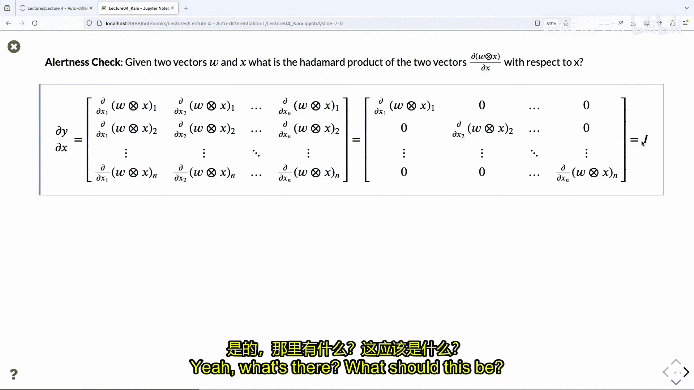

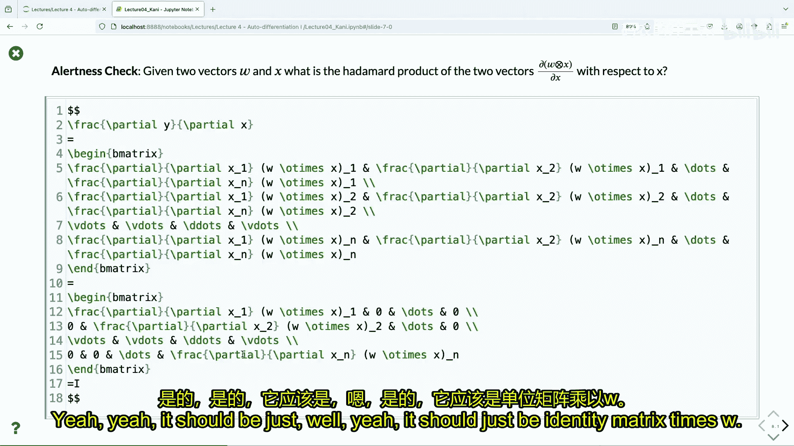

**代码描述（概念）：**
```python
# 假设 A 是常数矩阵，x 是变量向量
# d(Ax)/dx = A
```

### 向量对自身的导数

函数 `F(x) = x` 对 `x` 的导数是一个单位矩阵 `I`。因为 `∂xi/∂xj` 在 `i=j` 时为1，否则为0。

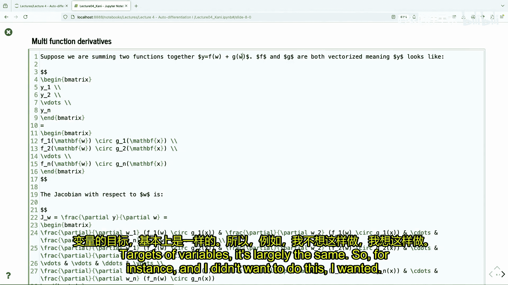

### 哈达玛积（逐元素乘）的导数

给定两个向量 `w` 和 `x`，其哈达玛积 `w ⊙ x` 对 `x` 的导数是一个对角矩阵，对角线元素是 `w` 的各个分量。

**公式：**
`d(w ⊙ x)/dx = diag(w)`，其中 `diag(w)` 表示以向量 `w` 的元素构成对角线的矩阵。

---

## 重要微积分恒等式 🔑

以下是几个在深度学习中常见且有用的导数规则：

*   **标量扩展：** `d(f * x)/dx = f` （假设 `f` 与 `x` 无关）。
*   **向量求和：** 设 `y = sum(x)`，则 `dy/dx` 是一个所有元素都为1的向量。
*   **向量加法：** `d(w + x)/dx = I` （单位矩阵）。
*   **向量减法：** `d(w - x)/dx = -I`。
*   **向量商（逐元素除）：** `d(w / x)/dx = diag(-w / x^2)`。

这些规则的本质是，将标量微积分中的直觉（如常数乘、线性加减）推广到了向量和矩阵的领域。PyTorch 等框架的内部实现就包含了所有这些基本运算及其对应的导数（反向传播）规则。

---

## 单变量链式法则复习 ⛓️

在深入计算图之前，我们先复习单变量链式法则。考虑复合函数 `f(x) = k(h(g(x)))`。

**链式法则：**
`df/dx = (dk/dh) * (dh/dg) * (dg/dx)`

我们可以将复杂函数分解为多个基本运算（如平方、对数、正弦、加法等），然后逐层应用链式法则。这为理解计算图的反向传播奠定了基础。

---

## 全导数规则与计算图 🕸️

当函数有多个输入路径时，简单的链式法则需要扩展。这就是**全导数规则**。

**核心思想：** 要计算输出 `F` 对某个变量 `x` 的导数，必须汇总 `x` 通过所有可能路径对 `F` 产生的贡献。

计算图完美地体现了这一点。在图中，变量是节点，运算是边。反向传播时，梯度从输出节点开始，沿着图的边反向流动。每当遇到一个节点有多个输入边（即“扇入”），该节点传递给上游的梯度是它对所有下游输入梯度的**总和**。

### 计算图示例

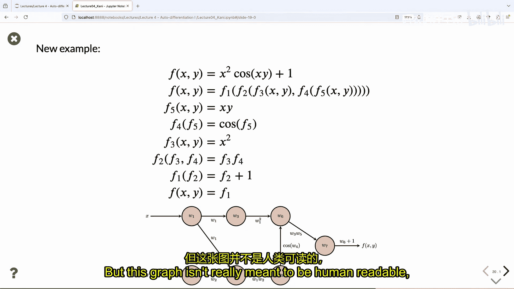

考虑一个具有两个输入 `x` 和 `y` 的计算图，包含乘法、平方、余弦、加法等操作。

**前向传播：** 从输入节点（叶子节点）开始，根据每个节点的操作（如 `W4` 是乘法，`W5` 是余弦）计算其输出值，并向前传递，直到得到最终输出 `F` 的值。这是一个线性时间的计算过程。

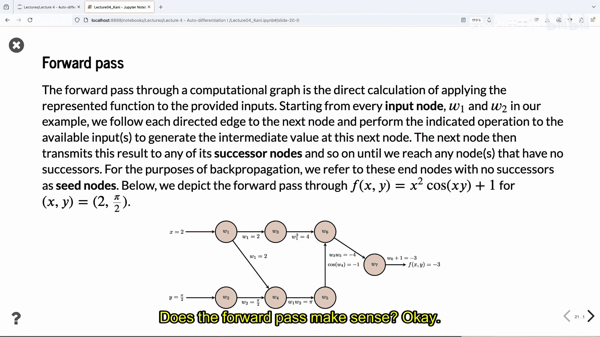

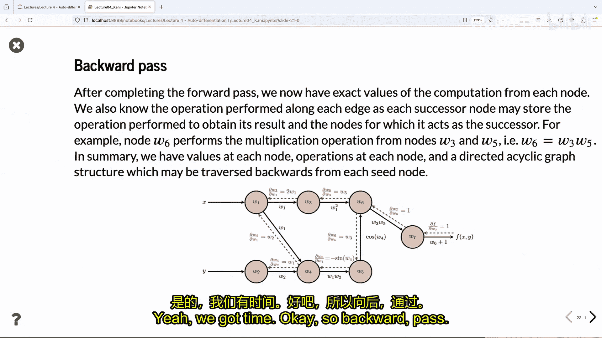

**反向传播：**
1.  从输出节点 `F` 开始，初始梯度为 `dF/dF = 1`。
2.  对于每个节点，根据其前向操作，定义其反向传播的局部梯度规则。例如：
    *   加法节点 (`W7`): 梯度直接传递（乘以1）。
    *   乘法节点 (`W6`, `W4`): 梯度乘以另一个输入的值后传递。
    *   余弦节点 (`W5`): 梯度乘以 `-sin(输入)` 后传递。
    *   平方节点 (`W3`): 梯度乘以 `2*输入` 后传递。
3.  沿着计算图的边反向应用这些规则。如果一个节点有多个上游来源（扇入），则将来自不同路径的梯度**相加**。
4.  最终，传播到输入节点 `x` 和 `y` 的梯度值，就是 `dF/dx` 和 `dF/dy` 在当前位置的数值。

通过这种方式，PyTorch 等框架可以仅凭前向计算构建的图，自动、高效地计算出所有参数的梯度，而无需用户手动推导复杂的符号导数公式。

---

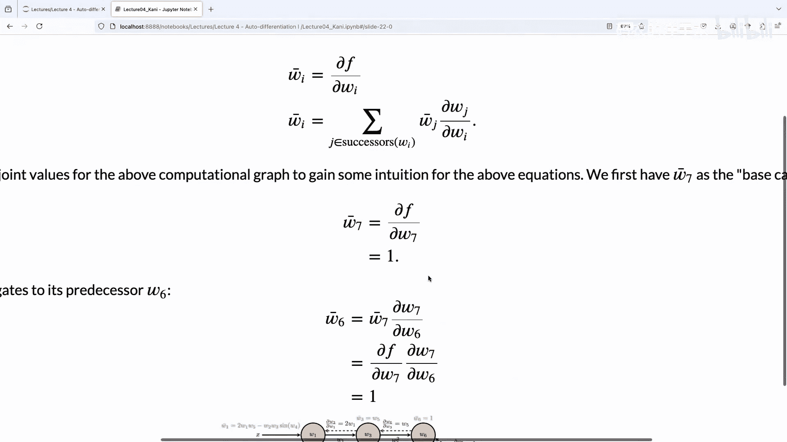

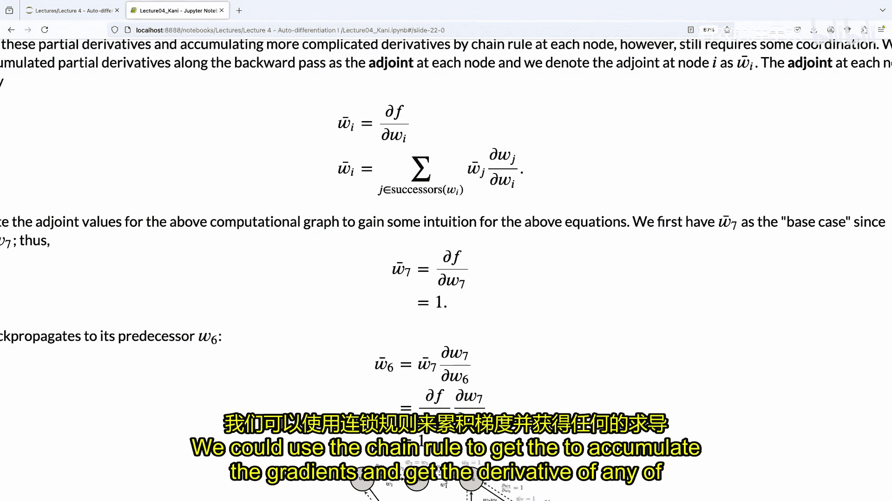

## 总结 🎯

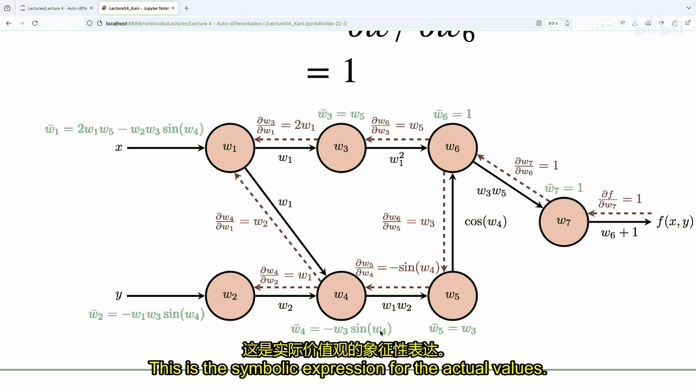

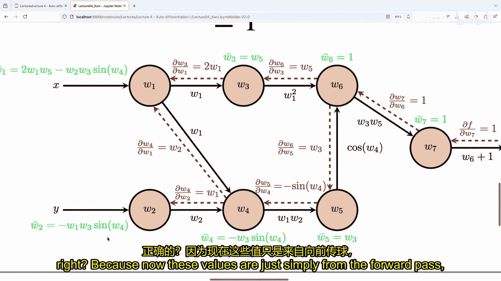

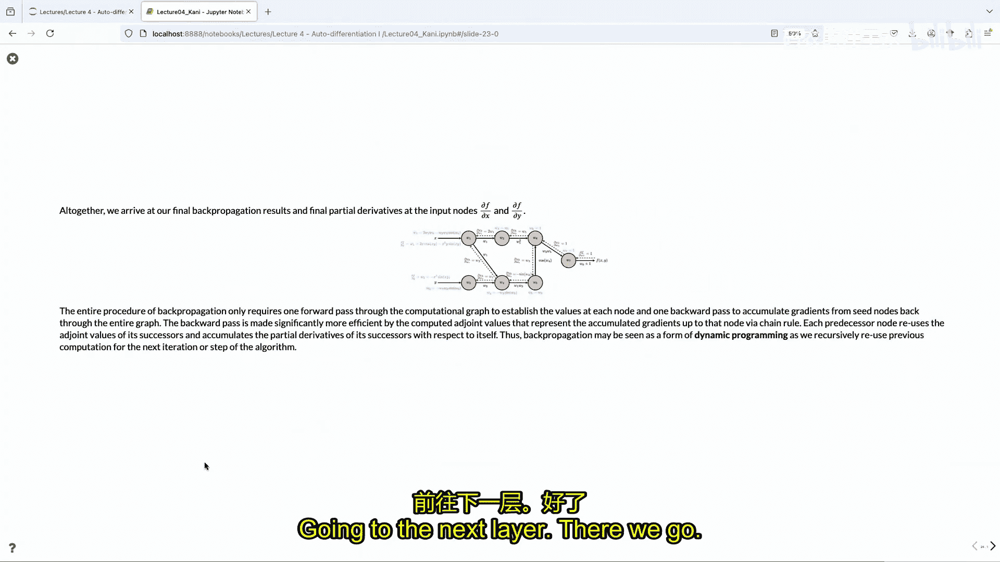

本节课中我们一起学习了：
1.  **矩阵微积分**的核心规则，包括标量对向量、向量对向量的导数，以及哈达玛积等常见运算的导数。
2.  微积分中的**全导数规则**，它要求在多路径函数中汇总所有贡献。
3.  **计算图**如何作为表示和计算复杂函数导数的强大工具。我们了解了前向传播（计算函数值）和反向传播（基于链式法则和全导数规则计算梯度）的过程。

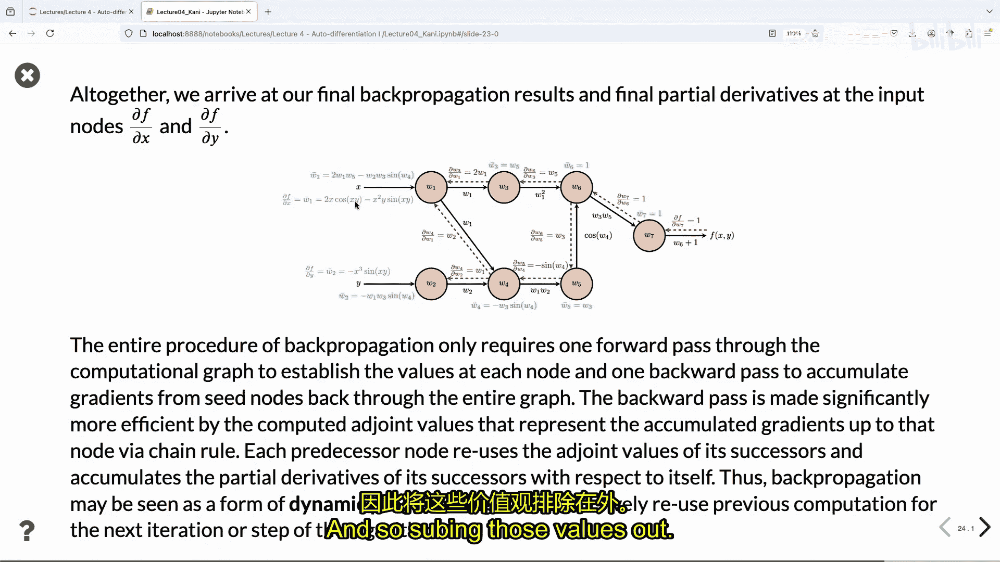

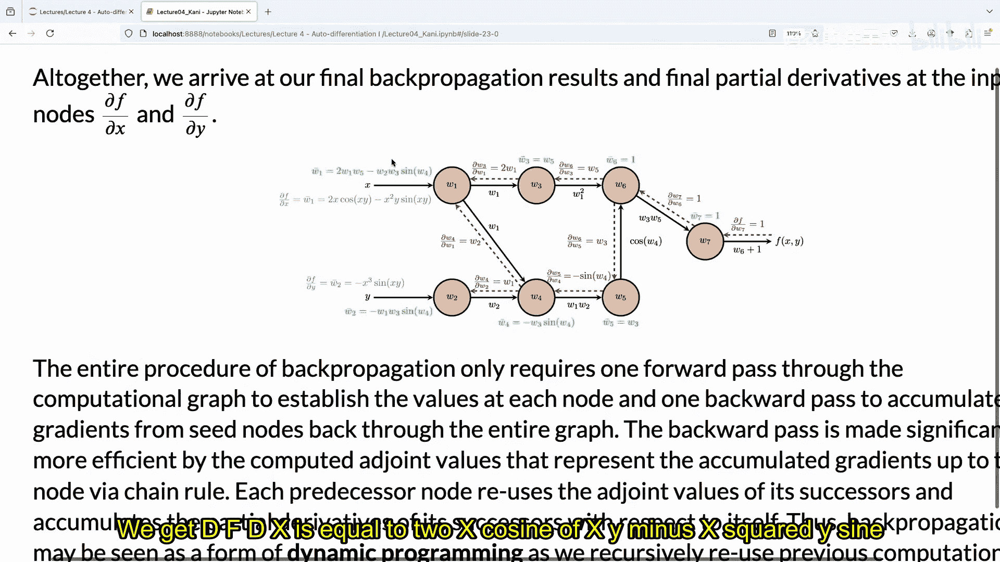

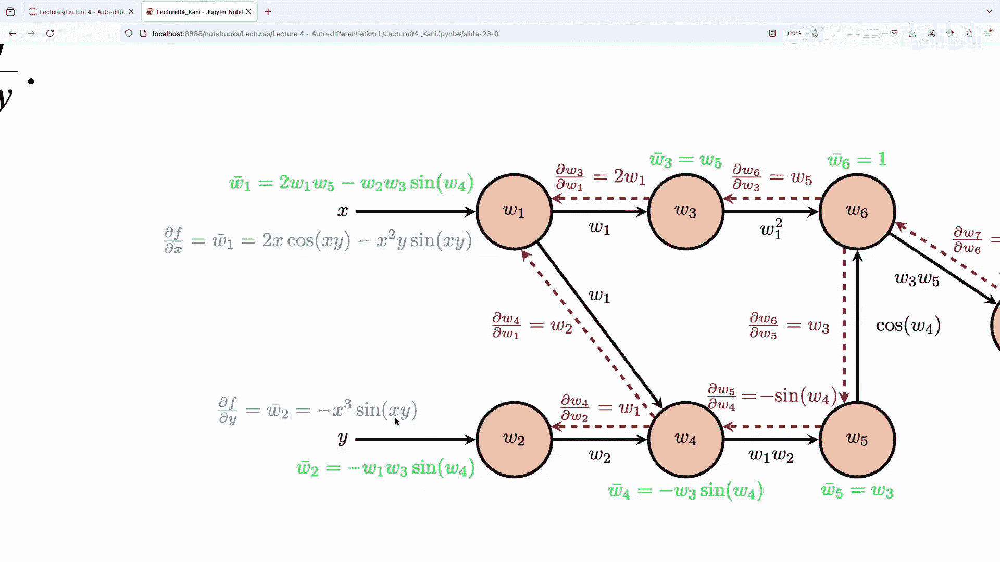

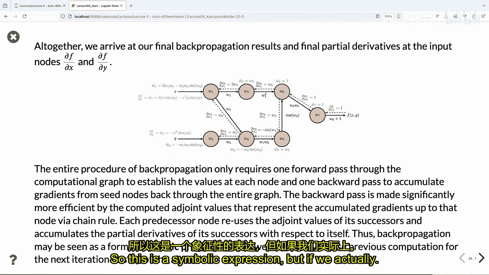

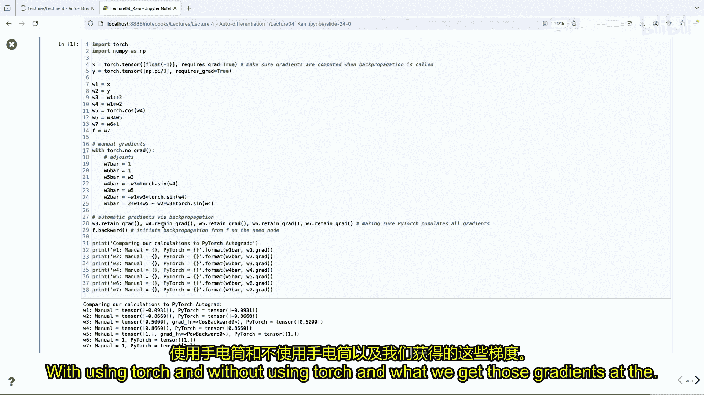

掌握矩阵微积分和计算图是理解现代机器学习算法（尤其是基于梯度的优化方法如梯度下降）工作原理的基石。下一讲，我们将利用这些知识，正式深入探讨梯度下降算法。

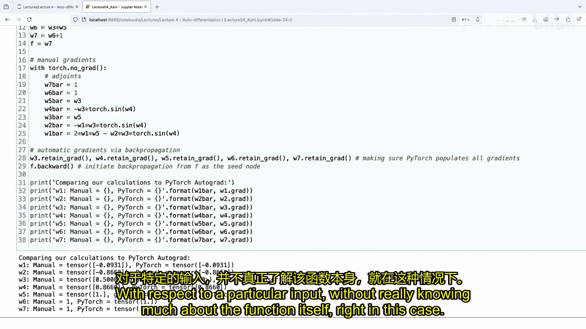


---
*注：本教程根据伊利诺伊大学“机器学习中的编程方法”课程第4讲内容整理，核心目标是清晰阐述矩阵微积分与计算图的概念及其联系。*